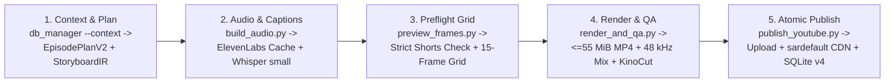

# Sutradhar (सूत्रधार)

> **Autonomous Indian Mythological, Historical & Cosmic YouTube Shorts Engine**  
> *Sutradhar Kinetic Storycraft v2 — Modular `Canvas2D + DOM` Animation via HyperFrames, ElevenLabs v4 Hindi Narration, `48 kHz` Multi-Act Audio Mastering, and Hardened YouTube Data API v3 Publishing.*

---

## 1. Project Overview

**Sutradhar** produces self-contained, story-driven `9:16` (`1080x1920 @ 30fps`) YouTube Shorts rooted in Puranic/Itihasic literature, ancient Indian epigraphy & metallurgy, and Vedic astronomical texts (*Surya Siddhanta*, *Aryabhatiya*).

### Core Architectural Pillars
- **Bilingual Platform Policy:** Pure **Hindi (`hi`)** narration and synchronized bottom-center kinetic captions (`Noto Sans Devanagari`, strictly `< Y = 1400px`) paired with pure **English (`en`)** `1080x1920` cover thumbnails (`2:3` Shorts shelf safe), YouTube titles (`#Shorts`), descriptions with scriptural citations, `10–15` tags, and English playlists.
- **Single Master Storyteller (`eleven_v4`):** Voiced exclusively by **Viraj** (`uuyFQegRan8rpIQCGu9K`) via ElevenLabs v4 (`44.1 kHz` synthesis mastered to `48,000 Hz` 24-bit stereo WAV) with scene-level SHA-256 caching.
- **Modular `Canvas2D + DOM` Runtime (`templates/runtime/`):** Deterministic `hf-seek` ES modules (`seek_runtime.js`, `scene_director.js`, `atmosphere_v1.js`, `architectural_stage.js`, `character_engine.js`, `props_library.js`, `transitions.js`, and `#captions` sub-composition) featuring `traceCapsule` anatomy, 5-finger sculpted hands, `2.5D` head turns, and `HORIZON_Y = 1142` spatial grounding.
- **`48 kHz` Broadcast Audio Pipeline:** Local `16 kHz` **`faster-whisper small`** + RMS speech-burst alignment, em-dash-safe keyword highlighting, 3-act BGM (`0` MD5 clones, `allow_synth_fallback: false`), `+33ms` peak-aligned SFX, **`6.5:1` (`ratio=6.5`)** sidechain ducking, and single 2-pass `loudnorm` (**`-14.0 ± 0.5 LUFS`**, **`<= -1.5 dBTP`**).
- **Fail-Closed QA & Bitrate Guardrails:** `hyperframes check --strict --safe-zone shorts --json`, `<= 55 MiB` (`57,671,680 B`) H.264 MP4 ceiling, dual KinoCut profiles (`ui-capture-dark >= 88.0`, `default >= 55.0`, `color_balance PASS`, `static_fraction <= 0.15`), and `thumbnail_2x3_crop.jpg` (`y=150..1770`) verification.
- **Atomic SQLite v4 & YouTube CDN Verification:** Schema v4 (`series`, `episodes`, `publishing_history`, `audio_ledger`), post-processing `thumbnails.set` gating (`processingStatus == "succeeded"`), live `sardefault.jpg` CDN parity (`MAE <= 12.0`, `dhash <= 16`), and atomic DB commit.

---

## 2. System Architecture



---

## 3. Repository Structure

```text
Sutradhar/
├── assets/
│   ├── manifest.yaml                # Schema v2.0.0 catalog (fonts, audio, characters, environments, props)
│   ├── fonts/                       # Canonical 31 SIL OFL .woff2 files + fonts.css
│   ├── characters/                  # Parametric JSON hero/deity/sage rig configs (12 presets)
│   ├── environments/                # Parametric palace, dawn, archival & cosmos presets (8 presets)
│   ├── props/                       # Declarative story prop & diagram descriptors (17 presets)
│   └── audio/
│       ├── bgm/                     # Distinct royalty-free/repo BGM stems + CREDITS.md (0 dup MD5s)
│       └── sfx/                     # Bundled Pixabay + repo acoustic SFX cues + CREDITS.md
├── templates/
│   ├── runtime/                     # Modular HyperFrames Canvas2D + DOM ES runtime
│   │   ├── index.html.jinja2        # Composition shell + #captions sub-composition
│   │   ├── styles.css               # Safe-zone calibrated stage & opt-in .ctx-pill styles
│   │   ├── core/                    # seek_runtime.js, scene_director.js
│   │   ├── backdrops/               # atmosphere_v1.js, architectural_stage.js
│   │   ├── rigs/                    # character_engine.js (traceCapsule, 2.5D head turn)
│   │   ├── props/                   # props_library.js
│   │   ├── fx/                      # transitions.js
│   │   └── captions/                # captions.html.jinja2 (<= Y=1395px, Noto Sans Devanagari)
│   └── thumbnail/
│       └── cover_template.html.jinja2 # Shared 1080x1920 English cover (2:3 crop safe)
├── scripts/
│   ├── sutradhar/
│   │   ├── config.py, db.py, models.py
│   │   ├── audio/                   # elevenlabs_tts.py, whisper_aligner.py, caption_builder.py, sound_mixer.py
│   │   ├── visual/                  # storyboard_composer.py, thumbnail_builder.py
│   │   ├── qa/                      # hyperframes_runner.py, render_optimizer.py, quality_gate.py
│   │   └── publishing/              # thumbnail_verifier.py, metadata_policy.py, youtube_client.py
│   ├── db_manager.py                # --init, --context, --create-series, --record-published, --repair
│   ├── build_audio.py               # Audio synthesis, Whisper small alignment & captions facade
│   ├── preview_frames.py            # Preflight strict Shorts check & 15-frame qa_grid.jpg facade
│   ├── render_and_qa.py             # <=55 MiB render, 48 kHz mix, KinoCut & thumbnail facade
│   ├── publish_youtube.py           # --publish, --update-playlists, --update-thumbnail, --verify-only
│   ├── thumbnail_utils.py           # Re-export facade for sutradhar.publishing.thumbnail_verifier
│   └── audition_voices.py           # Standalone voice audition utility (build/auditions/)
├── docs/                            # INSTRUCTIONS.md, SETUP_AND_OPERATIONS.md, ARCHITECTURE.md & schema.sql
├── tests/                           # Pytest unit, contract & Chromium/pipeline verification suites
├── build/                           # Ephemeral build artifacts (git-ignored)
├── config.yaml                      # Single source of truth for pacing, audio, safe zones & publishing
├── pronunciations_hi.yaml           # Authentic Devanagari phonetic overrides
├── package.json                     # HyperFrames ^0.9.70 & GSAP ^3.15.1
└── requirements.txt                 # Python 3.12+ dependencies
```

---

## 4. Quickstart & Installation

```powershell
# 1. Create Python 3.12+ virtual environment and install packages
python -m venv .venv
.\.venv\Scripts\Activate.ps1
pip install --upgrade pip
pip install -r requirements.txt

# 2. Install Node.js (22+) dependencies and HyperFrames browser
npm install
npx hyperframes browser ensure

# 3. Configure .env.local (ELEVENLABS_API_KEY, YOUTUBE_CLIENT_ID, YOUTUBE_CLIENT_SECRET, YOUTUBE_REFRESH_TOKEN)
# See docs/SETUP_AND_OPERATIONS.md for credential setup details

# 4. Initialize Schema v4 SQLite database
.\.venv\Scripts\python.exe scripts/db_manager.py --init
```

---

## 5. Daily 6-Command Production Runbook

| Step | Command | Purpose |
| --- | --- | --- |
| **1. Context** | `.\.venv\Scripts\python.exe scripts/db_manager.py --context` | Inspect pillar rotation, `language_policy`, active series & topic history. |
| **2. Series Init** | `.\.venv\Scripts\python.exe scripts/db_manager.py --create-series` | *(Optional)* Initialize a new English-titled series from `build/new_series_plan.json`. |
| **3. Audio Build** | `.\.venv\Scripts\python.exe scripts/build_audio.py` | Validate `>= 70%` Devanagari ratio, synthesize via Viraj (`SHA-256` cache), align with `faster-whisper small` + RMS & build captions. |
| **4. Preview QA** | `.\.venv\Scripts\python.exe scripts/preview_frames.py` | Compile `StoryboardIR`, run `hyperframes check --strict --safe-zone shorts`, probe DOM & stitch 15-frame `build/qa_grid.jpg`. |
| **5. Render & QA** | `.\.venv\Scripts\python.exe scripts/render_and_qa.py` | Render `<= 55 MiB` `1080x1920@30fps` MP4, master `48 kHz` audio (`-14 LUFS`), build `1080x1920` cover + `2:3` crop & run KinoCut dual gate. |
| **6. Publish** | `.\.venv\Scripts\python.exe scripts/publish_youtube.py` | Upload MP4, assign English playlist, poll processing, `thumbnails.set`, verify live `sardefault.jpg` CDN parity & commit SQLite atomically. |

Read-only verification & recovery:
- `.\.venv\Scripts\python.exe scripts/publish_youtube.py --verify-only` (read-only live audit of published episodes, playlists, CDN & DB parity)
- `.\.venv\Scripts\python.exe scripts/db_manager.py --record-published` / `--repair` (manual DB recovery & integrity repair)

---

## 6. Automated Testing

```powershell
# Run full Python test suite
.\.venv\Scripts\python.exe -m pytest -q

# Fast non-render test suite (skips full Chromium/MP4 render tests)
.\.venv\Scripts\python.exe -m pytest -q --ignore=tests/test_runtime.py --ignore=tests/test_render_qa.py

# Run HyperFrames strict Shorts safe-zone check
npm run hf:check
```

---

## 7. Documentation Index

- [INSTRUCTIONS.md](./docs/INSTRUCTIONS.md) — 16-Part Authoritative Directing & Production Spec (mandatory reading for video production runs).
- [SETUP_AND_OPERATIONS.md](./docs/SETUP_AND_OPERATIONS.md) — Prerequisites, OAuth setup, and daily 6-command runbook.
- [ARCHITECTURE.md](./docs/ARCHITECTURE.md) — System architecture, design decisions, ElevenLabs cost math, and historical benchmarks.
- [schema.sql](./docs/schema.sql) — Canonical SQLite Schema v4 (`series`, `episodes`, `publishing_history`, `audio_ledger`).
- [manifest.yaml](./assets/manifest.yaml) — Schema v2.0.0 asset catalog (`fonts`, `audio`, `characters`, `environments`, `props`, `runtime`).

---

## 8. Standard Daily Video-Creation Prompt

```text
Read and follow docs/INSTRUCTIONS.md to produce today's video.

[Optional Overrides — leave blank for autonomous operation]:
- Topic:
- Script:
- Playlist:
- Format (standalone / episodic_series):
- Special Instructions:
```
