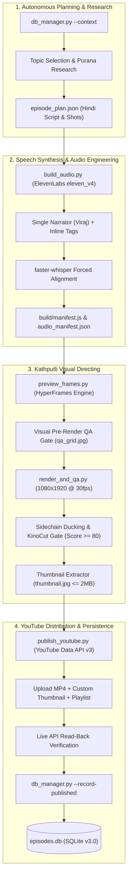

# Sutradhar (सूत्रधार)

> **Autonomous Master-Grade Indian Mythological & Historical YouTube Shorts Engine**  
> *Blending Rajasthani Kathputli Folk Theater with Neural Voice Synthesis and Automated YouTube Publishing.*

---

## 1. Project Overview

**Sutradhar** is an end-to-end autonomous content creation pipeline engineered to produce cinematic, highly engaging YouTube Shorts in pure Hindi. Drawing inspiration from classical Indian folk puppetry (*Kathputli*) and temple iconography, Sutradhar dramatizes ancient epics (*Puranas*, *Itihasas*), hidden archaeological history, and cosmic-philosophical paradoxes.

### Core Architectural Pillars

- **Pure Hindi Storytelling (`hi`):** All narration, character dialogues, titles, and descriptions are composed in culturally rich, natural Hindi (Devanagari script).
- **Single Master Storyteller Paradigm:** Voiced exclusively by **Viraj** (`uuyFQegRan8rpIQCGu9K`) via **ElevenLabs v4** (`eleven_v4`) at 44.1 kHz. Viraj performs all narrative roles, deities, and antagonists through inline emotional and cadence steering tags (`[...]`).
- **Kathputli 2.5D Theatrical Puppetry:** Modular SVG character rigs with articulated limbs connected by visible brass rivet joints, animated with organic string-suspended micro-pendulum sway via HyperFrames.
- **Clean-Canvas Aesthetic:** Zero burned-in captions, subtitles, or distracting UI badges on video frames. Rely natively on YouTube's automated closed captions to maintain pure theatrical immersion.
- **KinoCut Audio & Visual Mastering:** Automated broadcast audio engineering adhering strictly to **-14.0 LUFS ± 0.5**, **True Peak $\le -1.0$ dBFS**, dynamic sidechain BGM ducking (6:1 ratio), and quality scoring ($\ge 80/100$).
- **Autonomous Lifecycle & State Management:** Robust SQLite database (`episodes.db`) maintaining series universes, standalone stories, source research citations, thematic pillar rotation, and publishing records.
- **YouTube Data API v3 Integration:** Direct automated upload supporting public releases, scheduled publication, automated series playlist curation, custom thumbnails, and live API read-back verification.

---

## 2. System Architecture



---

## 3. Repository Structure

```
Sutradhar/
├── assets/                          # Canonical Asset Library
│   ├── bgm/                         # 6 Mood-tailored BGM tracks (MP3)
│   ├── manifest.yaml                # Unified machine-readable asset catalog
│   ├── sfx/                         # 13 Event-mapped SFX tracks (WAV)
│   └── svg/                         # Modular vector art library
│       ├── backdrops/               # 13 Theatrical folk-art backdrops
│       ├── characters/              # 10 Articulated Kathputli puppet rigs
│       ├── diagrams/                # 4 Bespoke astronomical/mythic diagrams
│       ├── infographics/            # 5 Theatrical callouts & symbol cards
│       └── vfx/                     # 5 Visual effect overlays
├── build/                           # Ephemeral build artifacts (ignored by Git)
├── docs/                            # Production documentation & specifications
│   ├── INSTRUCTIONS.md              # Authoritative AI agent production guide
│   ├── SETUP_AND_OPERATIONS.md      # Installation, credentials & operations runbook
│   └── schema.sql                   # SQLite schema definition (Version 3.0.0)
├── scripts/                         # Production pipeline CLI tools
│   ├── audition_voices.py           # ElevenLabs voice audition utility
│   ├── build_audio.py               # ElevenLabs TTS & Whisper forced alignment
│   ├── db_manager.py                # Database migrations, context & state manager
│   ├── generate_composition.py      # Multi-shot composition engine
│   ├── generate_pose_sheets.py      # Character puppet pose generator
│   ├── preview_frames.py            # Pre-render snapshot & safe-zone validator
│   ├── publish_youtube.py           # YouTube Data API v3 uploader & verifier
│   └── render_and_qa.py             # Video renderer, audio mastering & KinoCut QA
├── tests/                           # Comprehensive automated test suite (127 tests)
├── config.yaml                      # Global channel configuration & thresholds
├── engine.js                        # HyperFrames client animation runtime
├── package.json                     # Node.js dependencies & scripts
├── pronunciations_hi.yaml           # Hindi Devanagari pronunciation overrides
└── requirements.txt                 # Python dependencies
```

---

## 4. Prerequisites & Requirements

- **Operating System:** Windows 10/11, macOS, or Linux.
- **Python:** Python 3.12+ (managed in a project-local virtual environment `.venv`).
- **Node.js:** Node.js 18+ (Node 20 LTS recommended) & `npm`.
- **FFmpeg:** FFmpeg 6.0+ with `ffprobe` installed and available on system `PATH`.
- **ElevenLabs Account:** Active Starter subscription or higher with community voice access to **Viraj** (`uuyFQegRan8rpIQCGu9K`).
- **Google Cloud Console:** Project with YouTube Data API v3 enabled and OAuth2 desktop client credentials.

---

## 5. Quickstart & Installation

### Step 1: Clone Repository & Create Virtual Environment

```powershell
git clone <repository-url> Sutradhar
cd Sutradhar

# Create Python 3.12 virtual environment
python -m venv .venv
.\.venv\Scripts\Activate.ps1

# Install Python dependencies
pip install --upgrade pip
pip install -r requirements.txt
```

### Step 2: Install Node.js Dependencies

```powershell
npm install
```

### Step 3: Configure Environment Variables

Create `.env.local` in the project root:

```env
# ElevenLabs API Configuration
ELEVENLABS_API_KEY="your_elevenlabs_api_key_here"

# YouTube OAuth2 Credentials (see docs/SETUP_AND_OPERATIONS.md for generation steps)
YOUTUBE_CLIENT_ID="your_google_client_id.apps.googleusercontent.com"
YOUTUBE_CLIENT_SECRET="your_google_client_secret"
YOUTUBE_REFRESH_TOKEN="your_oauth2_refresh_token"
```

### Step 4: Initialize SQLite Database

```powershell
.\.venv\Scripts\python.exe scripts/db_manager.py --init
```

---

## 6. Daily Production Workflow (7-Command Whitelist)

In daily production, the pipeline executes 7 static commands sequentially with zero dynamic arguments:

| Step | Command | Description |
| :--- | :--- | :--- |
| **1. Context** | `.\.venv\Scripts\python.exe scripts/db_manager.py --context` | Inspects channel configuration, active series, topic history, and pillar rotation. |
| **2. Series Init** | `.\.venv\Scripts\python.exe scripts/db_manager.py --create-series` | Initializes a new series universe and YouTube playlist (when starting a new series). |
| **3. Audio Build** | `.\.venv\Scripts\python.exe scripts/build_audio.py` | Synthesizes Hindi narration via ElevenLabs Viraj and generates forced-alignment timestamps. |
| **4. Preview QA** | `.\.venv\Scripts\python.exe scripts/preview_frames.py` | Validates HyperFrames composition, safe zones, and generates pre-render QA snapshot grid. |
| **5. Render & QA** | `.\.venv\Scripts\python.exe scripts/render_and_qa.py` | Encodes 1080x1920 MP4, masters audio with sidechain ducking (-14 LUFS), extracts thumbnail. |
| **6. Publish** | `.\.venv\Scripts\python.exe scripts/publish_youtube.py` | Uploads video and custom thumbnail to YouTube, verifies live API read-back. |
| **7. Persist** | `.\.venv\Scripts\python.exe scripts/db_manager.py --record-published` | Records published video ID in `episodes.db` and updates series completion status. |

---

## 7. Quality Assurance & KinoCut Standards

Every generated episode must pass strict automated production gates before being uploaded:

- **Audio Loudness:** Integrated loudness mastered to **-14.0 LUFS ± 0.5** with True Peak $\le -1.0$ dBFS.
- **Dialogue Separation:** Background music sidechain-ducked by **6:1 ratio** (-18.0 dB ducking bed under speech).
- **Audio Tail:** Smooth exponential fade-out over **1.20s** at conclusion (zero abrupt cutoffs).
- **Visual Composition:** 1080×1920 vertical canvas adhering to YouTube Shorts safe-zone clearances (Top: 288px, Bottom: 520px, Right: 192px, Left: 48px).
- **Clean Canvas:** Zero burned-in subtitles, captions, or part labels.
- **KinoCut Gate:** Automated composite quality score $\ge 80.0 / 100$.

---

## 8. Automated Testing

Run the test suite to verify system integrity:

```powershell
# Run full Python test suite (127 unit tests)
.\.venv\Scripts\python.exe -m unittest discover tests

# Run HyperFrames animation runtime checks
npm run hf:check
```

---

## 9. Documentation Directory

- [INSTRUCTIONS.md](./docs/INSTRUCTIONS.md): Authoritative agent instruction guide for daily video production.
- [SETUP_AND_OPERATIONS.md](./docs/SETUP_AND_OPERATIONS.md): Comprehensive setup, credentials configuration, and operational runbook.
- [schema.sql](./docs/schema.sql): SQLite database schema v3.0.0.
- [manifest.yaml](./assets/manifest.yaml): Complete asset catalog of characters, backdrops, BGM, SFX, and diagrams.

---

## 10. AI Agent Operating Guidelines

To ensure optimal execution and avoid unnecessary context overhead, AI agents operating in this repository must follow these rules:

- **Mandatory for Video Creation & Production:**
  When assigned a task to create, script, animate, render, quality-check, or publish a video (or to execute the daily production pipeline), reading and strictly following [`docs/INSTRUCTIONS.md`](./docs/INSTRUCTIONS.md) is **MANDATORY**. It contains non-negotiable rules for Hindi storytelling, Viraj voice steering, Kathputli puppet directing, safe zones, KinoCut gates, and physical artifact verification.

- **Optional for General Engineering & Maintenance:**
  When assigned general engineering tasks—such as bug fixing, database migrations, unit testing, refactoring scripts, environment troubleshooting, or updating configuration files—reading `docs/INSTRUCTIONS.md` is **OPTIONAL**. Such tasks do not invoke the video production workflow and can proceed directly from code, tests, and documentation.

---

## 11. Standard Daily Video-Creation Prompt

To initiate a video production run, use the standard prompt below. It allows full autonomous execution while providing clean, optional override slots:

```text
Read and follow docs/INSTRUCTIONS.md to produce today's video.

[Optional Overrides — leave blank for 100% autonomous operation]:
- Topic: 
- Script: 
- Playlist: 
- Format (standalone / episodic_series): 
- Special Instructions:
```

