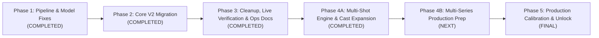

# IMPLEMENTATION_PLAN.md
## Sutradhar — Autonomous Dual-Language YouTube Shorts Production Pipeline
### (Antigravity `/automation` + Series State Machine + 5-Shot Kathputli Folk-Art Visual Engine + Kokoro-82M Dual-Language + HyperFrames + KinoCut 2.0)

---

### 1. Executive Summary & Architectural Decisions

This specification defines **Sutradhar**, a **100% Antigravity-native, zero-recurring-external-cost daily YouTube Shorts production pipeline** engineered for serialized edutainment, native **YouTube Shorts Series** playlist grouping, and sustainable **YouTube Partner Program (YPP) monetization**.

#### Core Design Principles
1. **Zero External AI APIs ($0.00 External Spend):**
   - **Google Antigravity** acts as the sole intelligence engine—handling pillar rotation, multi-episode series planning, scriptwriting, bespoke SVG rig authoring, and multimodal visual QA inspection. No external LLM, image generation, or cloud TTS API keys are required.
2. **Clean-Canvas Video Format (Strict Removal of Captions & Title/Part Labels):**
   - Every Short is rendered on a clean canvas with **zero on-screen captions or subtitles**, **zero title cards**, and **zero series/part badges**.
   - Spoken narration and layered theatrical staging carry 100% of the narrative, while YouTube automatically generates closed captions for viewers who desire them.
   - The visual focus is preserved entirely for animated folk-art puppetry and multi-plane environments.
3. **Dual-Language Production Core (English `en` & Hindi `hi`):**
   - Sutradhar officially supports both **Global English (`en`)** and **Classical Hindi (`hi`)**, selectable per channel via `channel.primary_language` in `config.yaml`.
   - **English Voice Profile:** British Prestige blend (`bm_fable:0.55 + am_fenrir:0.45` @ 0.91x speed) for narration + `am_onyx` for dialogue.
   - **Hindi Voice Profile:** Classical *Katha* blend (`hf_alpha:0.70 + hf_beta:0.30` @ 0.95x speed) for narration + `hm_omega` for dialogue.
   - **Language-Specific Dictionaries:** `pronunciations_en.yaml` (IPA substitutions for Sanskrit and Indian proper nouns) and `pronunciations_hi.yaml` (Devanagari compound & halant clarity).
4. **Indian Kathputli / Folk-Art 2D Vector Puppetry Engine:**
   - Visuals employ traditional **Indian Kathputli puppet aesthetics** with warm shaded olive/ochre tones, ornate tiered mukut crowns, dhotis, white *janeu*, and gold jewelry.
   - **Hierarchical Rivet Rigging:** Movable limbs use CSS custom-property rotations (`--rot-...`) anchored to `0px 0px` local joint origins. Limbs remain permanently pinned to circular brass rivets across all poses with zero detachment.
   - **5-Shot Narrative Progression:** Each Short follows a dynamic 5-scene cinematic progression (Wide Establishing Curtain Reveal $\to$ Royal Court Advance $\to$ Wrathful Close-Up with Lip-Sync $\to$ Cosmic Summit Strike $\to$ Foreground Granite Crushing).
5. **Connected Context-Window Audio & Dynamic Dialogue DSP:**
   - Synthesizes multi-sentence narrative blocks in connected context windows, eliminating prosody resets and dead-air seams.
   - Applies dynamic sample-rate-preserved dialogue DSP (`asetrate={sr*0.917},aresample={sr},atempo=1.0905`) to character lines, providing deep resonant authority without chipmunk distortion or sample-rate mismatches.
   - 20ms cosine volume ramps on audio segments, two-pass EBU R128 loudness normalization to `-14.0 LUFS` (`-1.5 dBTP`), and zero digital trailing floor (-150.0 dBFS).
6. **Deterministic Composition Synchronizer (`scripts/generate_composition.py`):**
   - Automatically compiles and synchronizes `index.html`, `styles.css`, and `engine.js` from `assets/svg/` and `build/manifest.js`, maintaining 100% HyperFrames 0.9.70 compliance.
7. **Deterministic Thumbnail Generation & Live Verified Publishing:**
   - `scripts/render_and_qa.py` extracts a clean-canvas, high-impact JPEG thumbnail (`build/thumbnail.jpg` $\le 2\text{ MB}$, 1080×1920) from the episode's peak hero shot.
   - `scripts/publish_youtube.py` uploads the video and custom thumbnail via `thumbnails().set()`, handles 403 phone verification gates gracefully, and executes mandatory live API read-back verification (`videos().list` and `playlistItems().list`), recording a structured audit in `build/publish_verification.json`.
8. **7 Static Pre-Whitelisted Commands (Windows `.venv` Explicit — Zero Dynamic CLI Arguments):**
   - All stateful handoffs occur via JSON files inside `build/`, enabling Manual Daily Execution on Pro and optional unattended Antigravity `/automation` runs with 7 static commands.

---

### 2. Verified Technology Stack

| Pipeline Layer | Tool / Dependency | Configuration / Version | License / Tier | Operational Ceiling | External Cost |
| :--- | :--- | :--- | :--- | :--- | :--- |
| **Orchestrator & Vision QA** | Google Antigravity IDE (Pro Reasoning Model) + optional `/automation` | Built-in frontier models | Developer Plan | Runs locally via Antigravity Desktop / CLI | **$0 extra** |
| **Agent Skills** | `hyperframes` + `svg-character-animation` | Global: `C:\Users\manis\.agents\skills\` | Apache 2.0 | Global rules & HyperFrames templates | **$0.00** |
| **Local Neural TTS (EN & HI)** | `kokoro-onnx` (Kokoro-82M v1.0) | `kokoro-onnx==0.6.1`, ONNX Runtime | **Apache 2.0** | Unlimited offline CPU synthesis; 0 API keys | **$0.00** |
| **Word Alignment (Audition)** | `faster-whisper` (CTranslate2) | `faster-whisper==1.2.1` (`base`, `int8`) | MIT | Used for voice auditions; video uses `ffprobe` | **$0.00** |
| **2.5D Vector Video Engine** | `hyperframes` (`^0.9.19`) + GSAP | Node.js 24+ + Chromium + FFmpeg | Apache 2.0 | Local `1080x1920` 30fps high-quality renders | **$0.00** |
| **Mastering & Quality Gate** | `kinocut` + FFmpeg 7.1 | `kinocut==2.0.1` (`ui-capture-dark`) | Apache 2.0 / LGPL | `-14.0 LUFS` mastering, release gate ($\ge 80$) | **$0.00** |
| **State Machine & Ledger** | SQLite3 + Python `sqlite3` | `episodes.db` (foreign keys, atomic trans) | Public Domain | Strict series completion & playlist sync | **$0.00** |
| **YouTube Publishing & Sync** | `google-api-python-client` | YouTube Data API v3 | Google Cloud Quota | **10,000 units/day** free quota | **$0.00** |

---

### 3. Repository Structure

```text
Sutradhar/
├── docs/
│   ├── IMPLEMENTATION_PLAN.md          # Authoritative architectural specification & project roadmap
│   ├── MASTER_AUTOMATION_PROMPT.md     # Daily prompt for Manual Execution (Pro) & optional /automation
│   ├── MANUAL_SETUP_AND_OPERATIONS.md  # Operations manual, manual workflow guide & verification records
│   └── schema.sql                      # Reference SQLite schema for episodes.db
├── assets/
│   ├── AUDIO_LIBRARY_MANIFEST.md       # Audio specs, loudness criteria & CC0 search keywords
│   ├── bgm/
│   │   ├── dramatic_mythology.mp3      # Indian ethnic drone & tanpura resonance bed (<620Hz low-pass)
│   │   ├── cosmic_mystery.mp3          # Ambient synth/space drone bed
│   │   └── epic_history.mp3            # Cinematic historical percussion bed
│   ├── sfx/
│   │   ├── whoosh_soft.wav             # Scene-transition stereo whoosh
│   │   ├── sub_hit.wav                 # 55Hz cinematic sub bass drop
│   │   └── tension_swell.wav           # Restrained analog tension swell
│   ├── js/
│   │   └── gsap.min.js                 # GSAP 3.12.5 local runtime
│   └── svg/
│       ├── characters/                 # Hierarchical Kathputli character rigs (viewBox 0 0 800 1200)
│       │   ├── ravana.svg              # 10-headed King Ravana (rivet rig, expressions, lip-sync, janeu)
│       │   ├── shani_dev.svg           # Lord Shani (midnight indigo, dark mukut, piercing gaze, cosmic halo, danda)
│       │   ├── narad_muni.svg          # Devarshi Narada (saffron/ivory robes, jasmine topknot, Mahati Veena)
│       │   ├── hanuman.svg             # Mahavira Hanuman (vermilion athletic build, arched tail, golden Gada)
│       │   ├── ancient_scholar.svg     # Master Polymath (ivory/ochre, palm-leaf manuscript, brass astrolabe)
│       │   └── sutradhar_narrator.svg  # Signature host storyteller Kathputli rig
│       └── backdrops/                  # Theatrical multi-plane environment SVGs (viewBox 0 0 1080 1920)
│           ├── celestial_cosmos_court.svg # Midnight indigo starfield, golden astrolabe arch, stellar dust
│           ├── ancient_nalanda_courtyard.svg # Terracotta sandstone colonnades, carved arches, clay diyas
│           ├── forest_ashram_twilight.svg # Silhouette banyans, aerial roots, glowing havan kund fire
│           ├── ocean_sky_horizon.svg   # Golden-crimson sunset, layered folk waves, misty cliffs
│           ├── golden_lanka_citadel.svg # Full-bleed Lanka spires, twilight sky, courtyard waters
│           ├── lanka_sandstone_throne.svg # Sandstone throne room backdrop
│           ├── mount_kailash.svg       # Sacred summit with cosmic light shafts
│           ├── crushed_atmosphere.svg  # Deep cosmic void with atmospheric pressure
│           ├── granite_underside.svg   # Descending granite mountain underside
│           ├── ancient_temple_ruins.svg # Sandstone carved temple colonnades
│           └── deep_cosmos_nebula.svg  # Deep purple/indigo interstellar nebula
├── models/
│   └── kokoro/
│       ├── kokoro-v1.0.onnx            # Authoritative 325.5MB ONNX model (SHA-256 pinned)
│       └── voices-v1.0.bin             # 28.2MB voices tensor (54 voices, SHA-256 pinned)
├── scripts/
│   ├── db_manager.py                   # Context & state engine (--context | --create-series | --record-published)
│   ├── build_audio.py                  # Dual-language Kokoro synthesis + dialogue DSP + -14.0 LUFS
│   ├── preview_frames.py               # Composition sync + mid-scene snapshots -> qa_grid.jpg
│   ├── render_and_qa.py                # HyperFrames render + FFmpeg ducking + KinoCut gate + thumbnail.jpg
│   ├── publish_youtube.py              # YouTube upload + playlist assignment + API read-back verification
│   ├── generate_composition.py         # Deterministic index.html / styles.css / engine.js synchronizer
│   ├── generate_pose_sheets.py         # Character puppet rig and expression QA sheet generator
│   ├── audition_voices.py              # Kokoro blend audition and RMS dBFS calibration utility
│   ├── cleanup_project.py              # Project build/HyperFrames artifact and database reset utility
│   └── cleanup_youtube.py              # YouTube channel inventory audit and safe deletion utility
├── tests/
│   ├── test_audition_voices.py         # Kokoro blend math, RMS dBFS, and immutability tests
│   ├── test_build_audio.py             # Audio pipeline, duration bounds, and model quarantine tests
│   ├── test_db_manager.py              # Database integrity, series lifecycle, and schema tests
│   ├── test_render_pipeline.py         # Preview grids, probe media, and thumbnail generation tests
│   └── test_publish_youtube.py         # Offline stub, mocked upload, thumbnail 403, and read-back tests
├── build/                              # Ephemeral build artifacts (gitignored)
│   ├── audio/                          # Active narration WAVs
│   ├── samples_v2/                     # Verified production sample bundles (EN & HI)
│   │   ├── prod_en_ravana_kailash/     # 42.4s English master (final_short.mp4, contact sheets)
│   │   └── prod_hi_ravana_kailash/     # 44.3s Hindi master (final_short.mp4, contact sheets)
│   ├── youtube_e2e_verification.json   # Live YouTube private_review upload & read-back proof
│   └── final_short.mp4                 # Active render master
├── config.yaml                         # Channel config (language, voice profiles, upload_mode, pillars)
├── pronunciations_en.yaml              # English IPA pronunciation dictionary
├── pronunciations_hi.yaml              # Hindi Devanagari pronunciation dictionary
├── pronunciations.yaml                 # Root fallback pronunciation dictionary
├── episodes.db                         # SQLite series & episode ledger (immutable baseline)
├── package.json                        # Node.js dependencies (hyperframes, gsap)
├── requirements.txt                    # Python dependencies
└── .gitignore                          # Git exclusions (build/, models/, .env.youtube, episodes.db)
```

---

### 4. Series Management, State Machine & Multi-Shot Pacing

#### 4.1 Brand Cohesion & 3-Pillar Rotation
Sutradhar rotates across three thematically connected curiosity pillars:
1. **`Ancient Epics & Lore`** (Sanatan Dharma, Puranic paradoxes, mythic cosmology, forgotten legends)
2. **`Hidden History`** (Ancient Indian & world empires, lost engineering, untold turning points)
3. **`Cosmic & Scientific Paradoxes`** (Astrophysics, quantum mysteries, deep time, reality-bending science)

#### 4.2 Multi-Shot 5-Beat Narrative Pacing (38–44 Seconds)
Each episode is structured for maximum Shorts retention across 5 dynamic shots (~6.5–9.5s each):
- **Shot 1 (Wide Establishing / Vista Hook, 0–8s):** Parting velvet curtains, full-bleed panoramic environment, opening paradox or confrontation.
- **Shot 2 (Character Advance / Tension Escalation):** Character enters with articulated walking gait and hierarchical rivet joints.
- **Shot 3 (Wrathful Close-Up / Dialogue Climax):** Dynamic camera push (2.15x) into character heads, angry facial expression swap (brows/eyes), multi-vowel lip-sync articulation, and rotating folk-art solar burst aura.
- **Shot 4 (Cosmic / Divine Counter-Strike):** Scale shift to a divine summit or cosmic realm with impact shockwaves and screen rumbles.
- **Shot 5 (Crushing Climax / Cliffhanger Payoff):** Physical environmental pressure (e.g. descending granite mountain) directly onto the character's bracing limbs; narrator delivers cliffhanger hook teasing tomorrow's episode.

---

### 5. Hierarchical Puppet Rigging Standard (`ravana.svg`)

All movable character limbs in `assets/svg/characters/` follow a strict kinematic hierarchy:
```text
#ravana_character
├── #lower_body
│   ├── #hip_left_joint ──> #thigh_left_rot ──> #knee_left_joint ──> #shin_left_rot
│   └── #hip_right_joint ──> #thigh_right_rot ──> #knee_right_joint ──> #shin_right_rot
├── #torso_group
│   ├── #torso_artwork (<clipPath id="torso_clip"> locks janeu permanently inside torso)
│   ├── #rear_arms_layer (4 left arms + 4 right arms with weapon props)
│   ├── #front_arms_layer (forearms, wrists, and gesture hands)
│   └── #heads_group
│       ├── #flanking_heads (4 heads left, 4 heads right with fan-out rotation)
│       └── #central_head (brows_neutral/angry, eyes_normal/wrath, mouth_calm/talk/shout)
└── #wrath_sunburst (folk-art solar rays & glowing aura revealed on dialogue climax)
```

**Joint Pin Kinematics:** Joint pins use circular brass rivets (`#puppet_pin`). Rotations are driven entirely by CSS custom properties (`--rot-thigh-left`, `--rot-shin-left`, etc.) defined in `styles.css` with `transform-origin: 0px 0px !important`.

**Folk-Art Palette (Strictly Zero Teal):** Midnight obsidian `#060814`, deep twilight indigo `#1e1828`, sandstone amber `#d97706`, burnished gold `#ffd43b`, and bronze `#b45309`.

---

### 6. Dual-Language Audio Engine & Dynamic Dialogue DSP

#### 6.1 Connected Context-Window Synthesis
Sequential narrator sentences are synthesized within coherent connected context blocks rather than isolated fragments, eliminating sentence-by-sentence prosody resets and dead-air digital seams.

#### 6.2 Dynamic Dialogue DSP Chain
When `speaker_role: "character_dialogue"` is specified:
1. Dynamic pitch lowering: `asetrate={int(sr*0.917)},aresample={sr},atempo=1.0905` shifts pitch downward by 1.5 semitones while precisely maintaining duration and Kokoro's native 24kHz sample rate.
2. Low-shelf chest resonance boost (`+2.5dB @ 150Hz`).
3. Subtle stone-hall reverb echo (`aecho=0.8:0.88:35:0.25`).
4. Automated assertions: $\Delta\text{Duration} \le \pm 5\%$, pitch reduction verified, and trailing 500ms silence floor $< -65.0\text{ dBFS}$.

#### 6.3 Broadcast Mastering Standards
- Two-pass EBU R128 loudness normalization to **-14.0 LUFS** (True Peak $\le -1.5\text{ dBTP}$).
- Dynamic sidechain ducking (`sidechaincompress` threshold -24dB, ratio 4:1) dips BGM beneath narration.
- Digital zero trailing buffer with 20ms cosine volume ramp, yielding **-150.0 dBFS** trailing noise floor.

---

### 7. Deterministic Thumbnail Generation & YouTube Publishing

#### 7.1 Episode Thumbnail (`build/thumbnail.jpg`)
During `render_and_qa.py`, FFmpeg extracts a clean-canvas, high-impact JPEG thumbnail:
- **Source:** Peak dramatic hero moment (midpoint of Shot 3 wrath dialogue).
- **Dimensions:** Exactly `1080x1920` (9:16 vertical cover).
- **File Size:** Verified $\le 2\text{ MB}$ (YouTube custom thumbnail limit).

#### 7.2 YouTube Data API v3 Workflow (`scripts/publish_youtube.py`)
1. **Video Upload:** `videos().insert(part="snippet,status", ...)` setting title, description, category 27 (Education), default languages, `privacyStatus: "private"`, `selfDeclaredMadeForKids: False`, and `containsSyntheticMedia: True`.
2. **Thumbnail Upload:** `thumbnails().set(videoId=video_id, media_body=...)`. Catches HTTP 403 (e.g. channel phone verification / Intermediate Features pending) gracefully, logging a clear diagnostic without failing the upload or losing the video ID.
3. **Playlist Assignment:** Reuses active series playlist or creates a private series playlist via `playlists().insert` and appends the video via `playlistItems().insert`.
4. **Mandatory Live API Read-Back Verification:** Immediately executes `videos().list` and `playlistItems().list` to verify YouTube-stored values against expected metadata, recording a complete audit in `build/publish_verification.json`.

#### 7.3 Daily Quota Accounting
| API Method | Quota Cost per Call | Calls per Short | Total Daily Quota |
| :--- | :--- | :--- | :--- |
| `videos.insert` | 1,600 units | 1 | 1,600 units |
| `thumbnails.set` | 50 units | 1 | 50 units |
| `playlists.insert` | 50 units | 0–1 (Part 1 only) | 0–50 units |
| `playlistItems.insert` | 50 units | 1 | 50 units |
| `videos.list` (read-back) | 1 unit | 1 | 1 unit |
| `playlistItems.list` (read-back) | 1 unit | 1 | 1 unit |
| **Total Daily Usage** | — | — | **1,702 units / 10,000 units** (17% of free tier) |

---

### 8. Phase 1–5 Project Roadmap & Acceptance Criteria



#### Phase 1 — Environment & Audio Pipeline Fixes: COMPLETED
- Downloaded authoritative 325.5MB Kokoro ONNX model (SHA-256: `7d5df8ec...`) and voices tensor.
- Quarantined corrupt model file.
- HyperFrames 0.9.70 audio duration sync (`+0.30s`).
- 35/35 automated tests passed.

#### Phase 2 — Production Core V2 Migration: COMPLETED
- Promoted V2.2 multi-shot Kathputli visual engine and Stage 1.5 dual-language audio engine into root production codebase.
- Verified two full-length 38–44s production Shorts in `build/samples_v2/`:
  - `prod_en_ravana_kailash` (42.4s, KinoCut **83.2 / 100**, PASS)
  - `prod_hi_ravana_kailash` (44.3s, KinoCut **82.4 / 100**, PASS)
- Root `episodes.db` confirmed bit-for-bit unchanged (SHA-256: `729ACCE0CD4F31CC69CECA61470D331ABCBCE5E62B51728AB372CD28F83F8011`).

#### Phase 3 — Operational Readiness, Codebase Cleanup, Live Verification & Operations Docs: COMPLETED
- **Stage 3A (Cleanup):** Audited and removed obsolete scratch files, old benchmark directories, and quarantined model files. Verified zero broken references. Full test suite: **37/37 PASSED**.
- **Stage 3B (Thumbnail & Live YouTube Verification):** Added `build/thumbnail.jpg` generation ($\le 2\text{ MB}$, 1080×1920) in `render_and_qa.py`. Upgraded `publish_youtube.py` with `thumbnails.set`, 403 handling, and mandatory API read-back verification. Successfully executed a real live `private_review` upload in an isolated workspace:
  - Video ID: `vdkMMm5ucPQ` (`https://youtu.be/vdkMMm5ucPQ`)
  - Playlist ID: `PLV5anx_T8pUw`
  - Privacy Status: `private`
  - Read-back verification: **PASSED** (all fields verified against YouTube Data API).
  - Recorded in `build/youtube_e2e_verification.json`.
- **Stage 3C (Documentation):** Complete rewrite of `IMPLEMENTATION_PLAN.md`, `MASTER_AUTOMATION_PROMPT.md`, and `MANUAL_SETUP_AND_OPERATIONS.md`. Retired obsolete interim docs.
- **Stage 3D (Operational Workflow Selection & Automation Documentation):** Established **Manual Daily Execution** on Antigravity's highest-capability / Pro reasoning model as Sutradhar's recommended primary daily workflow. Documented Antigravity App `/automation` as an optional future upgrade with verified local sidecar, machine-awake, Pro model, and Windows Terminal Sandbox permission requirements.

#### Phase 4A — Generalized Multi-Shot Engine, Kathputli Cast Expansion & Real Audio Hardening: COMPLETED
- **Generalized Multi-Shot Engine (`scripts/generate_composition.py` + `engine.js`):**
  - Removed all hardcoded Phase 2 Ravana/Lanka/Kailash/Granite references.
  - Implemented 100% manifest-driven generator supporting any 5–8 scene sequence across all 3 editorial pillars.
  - Dynamic SVG injection: backdrops, diagrams, and characters resolved from `assets/svg/`.
  - Universal Hierarchical Rivet Joint Controls in `styles.css`: stable `0px 0px` joint origins across all limbs and joints, full support for both two-armed and multi-armed puppet rigs.
  - Declarative shot choreography in `engine.js`: 7 shot types (`curtain_establishing`, `character_medium`, `character_closeup_dialogue`, `two_character_confrontation`, `landscape_cutaway`, `bespoke_diagram_reveal`, `dramatic_climax`), 5 standardized puppet poses (`idle_royal`, `action_raised`, `wrath_dialogue`, `blessing_calm`, `humbled_braced`), camera motions, and 0.25–0.35s transitions.
  - Validated with `npx hyperframes lint` (0 errors) and `npx hyperframes check --json` (0 errors, `ok: true`).
- **Kathputli Cast Expansion (`assets/svg/characters/`):**
  - Authored 4 new reusable Kathputli puppet rigs at `800×1200 viewBox`: `shani_dev.svg`, `narad_muni.svg`, `hanuman.svg`, `ancient_scholar.svg`.
  - Built with local joint anchors (`transform-origin: 0px 0px !important`), `<clipPath>` for torso ornaments, and switchable facial states (`#mouth_calm`, `#mouth_talk`, `#mouth_shout`, `#eyes_normal`, `#eyes_wrath`, `#brows_neutral`, `#brows_angry`).
  - Rendered 4-pose contact verification sheets under `build/phase4_qa/<char>_pose_sheet.png` (Idle, Action Raised inside `x: 90..990`, Close-up Dialogue, Alternate/Calm) and visually inspected each PNG.
- **Theatrical Full-Bleed Backdrops (`assets/svg/backdrops/`):**
  - Authored 4 new full-bleed `1080×1920` backdrops: `celestial_cosmos_court.svg`, `ancient_nalanda_courtyard.svg`, `forest_ashram_twilight.svg`, `ocean_sky_horizon.svg`.
  - Structured with 4-plane depth layering (`#bg_sky`, `#bg_far`, `#bg_mid`, `#bg_near`). Strictly zero teal/cyan.
  - Verified automatic discovery via `python scripts/db_manager.py --context`.
- **Audio Pipeline Hardening (`scripts/render_and_qa.py` + `assets/AUDIO_LIBRARY_MANIFEST.md`):**
  - Enforced explicit 24,000 Hz resampling (`aresample=24000:async=1`) across BGM and SFX inputs, eliminating sample-rate drift.
  - Added smooth 1.20s tail fade-out (`afade=t=out:st={duration-1.2}:d=1.2`) on background music.
  - Preserved procedural acoustic drone fallback (`aevalsrc`) when BGM files are absent.
  - Authored `assets/AUDIO_LIBRARY_MANIFEST.md` documenting technical specs, loudness targets (-14.0 LUFS), and CC0 / YouTube Audio Library search keywords.
- **Automated Test Suite:**
  - Expanded test coverage in `tests/test_render_pipeline.py`.
  - Full suite: **39/39 PASSED** (100% pass, 0 failures, 0 skips).
- **End-to-End Cross-Cast Verification Short:**
  - Rendered full isolated 38–44s short (*Shani Dev & Narad Muni: Cosmic Scales of Karma*) in an isolated temporary workspace.
  - Duration: **39.10s** (target sweet spot [36s, 46s]).
  - Resolution: **1080×1920 @ 30fps**.
  - Loudness: **-14.3 LUFS** (target: -14.0 LUFS ± 0.5).
  - KinoCut Score: **85.0 / 100.0** (target: $\ge 80.0$).
  - Clean canvas: **100% verified** (zero captions, zero title/part badges).
  - Archived to `build/samples_v2/phase4_crosscast_verify/` (`final_short.mp4`, `qa_grid.jpg`, `final_qa_grid.jpg`, `thumbnail.jpg`, `manifest.js`, `episode_plan.json`, `verification_report.json`).
- **Database Immutability:**
  - Root `episodes.db` confirmed bit-for-bit unchanged (SHA-256: `729ACCE0CD4F31CC69CECA61470D331ABCBCE5E62B51728AB372CD28F83F8011`).

#### Phase 4B — Automated Multi-Pillar & Real-Audio Swap Readiness: COMPLETED
- **Full-Repository Gemini Reference Audit & Removal (Mandatory Gate):**
  - Completed case-insensitive search across all codebase files, configs, and documentation.
  - Replaced all legacy model strings with clean, model-agnostic Antigravity phrasing (`Antigravity's highest-capability / Pro reasoning model`, `Pro`, `Never call external LLM, TTS, or image APIs`).
  - Verified 0 model references remain across all tracked and workspace files.
- **Script Directory Hygiene & Developer Tooling Separation:**
  - Removed one-off test runner `scripts/run_crosscast_e2e.py`.
  - Formalized strict classification: the 7 static whitelisted production pipeline commands (`scripts/db_manager.py`, `scripts/build_audio.py`, `scripts/generate_composition.py`, `scripts/preview_frames.py`, `scripts/render_and_qa.py`, `scripts/publish_youtube.py`) remain completely decoupled from developer utilities (`scripts/audition_voices.py`, `scripts/generate_pose_sheets.py`).
- **Multi-Pillar Theatrical & Diagram Asset Proof:**
  - Authored bespoke diagram `assets/svg/diagrams/nalanda_scroll_astrolabe.svg` (`viewBox="0 0 900 900"`), implementing an ancient Sanskrit astronomical parchment scroll and brass astrolabe with warm folk-art gold/ochre/obsidian palette, zero teal, and kinetic path classes (`#diagram_base`, `#stage_1`, `#stage_2`, `#stage_3`).
  - Generated and visually verified multi-shot snapshot contact sheets for both remaining pillars:
    - **Pillar 2 (Hidden History):** `ancient_scholar` + `ancient_nalanda_courtyard` + `nalanda_scroll_astrolabe` -> `build/phase4_qa/pillar_history_qa_grid.jpg`.
    - **Pillar 3 (Cosmic & Scientific Paradoxes):** `ancient_scholar` / `sutradhar_narrator` + `celestial_cosmos_court` + `black_hole_anatomy` -> `build/phase4_qa/pillar_cosmos_qa_grid.jpg`.
  - Confirmed 100% clean canvas (zero captions, zero titles or part badges) and zero visual styling anomalies across all 3 editorial pillars.
- **Drop-In Real Audio Handling & Audio Engine Verification:**
  - Verified 1:1 match between `assets/AUDIO_LIBRARY_MANIFEST.md` and `config.yaml` (`bgm_by_pillar` and `sfx_tracks`).
  - Added automated unit test `test_08_audio_mixing_real_bgm_resampling_loop_and_fade` in `tests/test_render_pipeline.py` verifying real 44.1 kHz stereo audio looping (`-stream_loop -1`), 48 kHz stereo audio trimming with 1.2s exponential fade-out, and multi-track SFX ducking.
  - Verified full test suite: **40/40 PASSED** (100% pass, 0 failures).
  - Validated HyperFrames: `npx hyperframes lint` (0 errors) and `npx hyperframes check --json` (0 runtime/layout/contrast errors, `ok: true`).
- **Database Immutability:**
  - Root `episodes.db` confirmed bit-for-bit untouched (SHA-256: `729ACCE0CD4F31CC69CECA61470D331ABCBCE5E62B51728AB372CD28F83F8011`).
- **Manual Hand-off to Creator:**
  - Production workflow is fully documented and ready for creator-driven daily execution via [docs/MASTER_AUTOMATION_PROMPT.md](file:///c:/Users/manis/Projects/Sutradhar/docs/MASTER_AUTOMATION_PROMPT.md).

#### Phase 5 — Production Calibration & Scheduled Publishing Unlock: NEXT / FINAL
- **Step 1 (Pre-Launch Calibration):** Execute 3 consecutive daily calibration episodes across the 3 editorial pillars in strict `private_review` mode (`allow_public_or_scheduled: false`).
- **Step 2 (Mobile Quality Audit):** Review each private Short in YouTube Studio on mobile devices to verify pacing, audio loudness (-14 LUFS), zero mobile DAC clipping, and clean-canvas aesthetics.
- **Step 3 (Scheduled Publishing Unlock):** Once all 3 calibration episodes pass inspection, toggle `publishing.upload_mode: "scheduled"` and `publishing.allow_public_or_scheduled: true` in `config.yaml` to begin scheduled distribution (defaulting to 18:30 IST / 13:00 UTC).

---

### 11. Reference Video Evolution Roadmap

Based on detailed frame-by-frame and audio analysis of the reference video (*Shani Katha Episode 1: Ravana Made Shani His Staircase… Then Shani Looked Down*, 150s, 480×854, 8-phase narrative arc), Sutradhar is evolving into an autonomous mythological storytelling and video-generation system.

#### Phase 1: Foundation — Content Format & Duration Flexibility: COMPLETED
- **Fully Automated Content Planning & Zero-Manual-Input Showrunner:**
  - The pipeline operates 100% autonomously: user involvement is limited solely to sending the Master Automation Prompt.
  - Antigravity autonomously inspects database state, rotates across editorial pillars, selects compelling mythological/historical/scientific topics, decides between standalone or episodic series format, and sets the optimal duration.
- **Dual Content Formats (`standalone` & `episodic_series`):**
  - **Standalone Videos:** Self-contained stories with full 8-phase dramatic arcs (Hook $\to$ Premise $\to$ Rising Action $\to$ Escalation $\to$ Confrontation $\to$ Climax $\to$ Resolution $\to$ Concluding Thought). No active series required; `series_id` is null.
  - **Episodic Series:** Connected narratives where **each individual episode delivers a complete, resolved story** while maintaining cross-episode character and visual continuity.
- **Flexible Duration Spectrum (30s – 180s):**
  - **Absolute Minimum Duration:** 30.0 seconds.
  - **Absolute Maximum Duration:** 180.0 seconds (3 minutes).
  - **Preferred Duration Sweet Spot:** 40.0 seconds to 120.0 seconds (2 minutes).
  - **Dynamic Pacing:** Duration adapts to story complexity: concise paradoxes (~40–60s, 5–7 scenes), character dramas (~70–110s, 8–11 scenes), epic clashes (~120–180s, 11–15 scenes).
- **Config Schema Modernization (`config.yaml`):**
  - Added root `content_format: episodic_series` and `target_duration_range: {min_seconds: 30, max_seconds: 180, preferred_min_seconds: 40, preferred_max_seconds: 120}`.
  - Updated `format_pacing` matrix with format-specific pacing bounds (`serial`: 30–180s hard, 40–60s target, 5–8 scenes; `episodic_series`: 30–180s hard, 40–120s target, 5–15 scenes; `standalone`: 30–180s hard, 40–120s target, 5–15 scenes).
  - Added `contextual_text` settings (strictly no burned-in subtitles by default; animated vector callouts permitted for infographics/proper nouns).
- **Database Schema & Safe Migration (`docs/schema.sql` & `scripts/db_manager.py`):**
  - Updated `episodes` table: `series_id` is nullable, `episode_number_in_series` is nullable, `content_format TEXT NOT NULL DEFAULT 'serial'` added.
  - Partial unique index: `idx_unique_non_failed_episode_slot` updated with `WHERE status != 'FAILED' AND series_id IS NOT NULL`.
  - Added automated non-destructive schema migration (`ensure_episodes_table_columns`) to alter existing tables seamlessly.
- **Pydantic Storytelling & Plan Models (`scripts/db_manager.py`):**
  - Implemented `StoryPhase` and `StoryArc` models capturing narrative phases, goals, and climax/resolution indices.
  - Updated `EpisodePlan` with `content_format`, `story_arc`, `target_duration_sec` (ge=30, le=180), `target_duration_range`, `narrative_structure`, and optional series fields for standalone videos.
  - Updated `cmd_context` to output format capabilities, standalone planning permissions, and autonomous planning guidelines.
  - Updated `cmd_record_published` to record standalone episodes with `series_id=NULL` without requiring an active series in the database.
- **Dynamic Audio Pacing & Manifest Generation (`scripts/build_audio.py`):**
  - Updated `verify_active_series_continuity_readonly` to skip series matching when `content_format == "standalone"` or `series_id is None`.
  - Dynamically calculates `hard_min` (min 30s), `hard_max` (max 180s), `target_min`, and `target_max` from `format_pacing` and `target_duration_range`.
  - Injects `content_format`, `duration_target_seconds`, `story_arc`, and `narrative_structure` into `build/manifest.js`.
- **GSAP Choreography Engine Scaling (`scripts/generate_composition.py`):**
  - Scaled atmospheric ember particles across long-form durations using `emberRepeats = Math.max(8, Math.ceil(total_dur / 4.0))`.
  - Added `dramatic_zoom` camera motion handler (`power3.out` scale 1.35x zoom) for high-impact dramatic revelations.
  - Verified support for 5 to 15 scenes per composition.
- **Format-Aware Quality Gate (`scripts/render_and_qa.py`):**
  - Dynamic duration bounds check enforcing `[30.0s, 180.0s]` global bounds and plan-specific target duration ranges.
- **Automated Test Suite Expansion (`tests/`):**
  - Added unit tests across `test_db_manager.py`, `test_build_audio.py`, and `test_render_pipeline.py`.
  - Test suite covers 47 automated tests.
- **Subtitles & On-Screen Text Policy:**
  - Final production videos contain **zero burned-in subtitles or captions by default**. All dialogue and narration remain clean on canvas; YouTube native closed captions handle accessibility.
- **Master Daily Automation (`docs/MASTER_AUTOMATION_PROMPT.md`):**
  - Completely updated to guide autonomous topic selection, format determination, and 30s–180s duration setting.
- **Next Phases in Roadmap:**
  - **Phase 2: Storytelling & Narrative Quality: COMPLETED**
    - **Task 2.1 (Multi-Phase Narrative Arc Templates):** Formally codified 8-phase complete dramatic arc, 5-phase compact arc, and in medias res templates in `scripts/db_manager.py` via `NARRATIVE_TEMPLATES`, `StoryPhase`, and `StoryArc`.
    - **Task 2.2 (In Medias Res & Non-Linear Structures):** Implemented non-linear story support opening at boiling point confrontation, rewinding to origin backstory, returning to climax, and resolving.
    - **Task 2.3 (Episodic Series Planning Workflow):** Codified episodic series planning where every episode delivers a complete, concluded story while sharing characters, world-building, and thematic continuity.
    - **Task 2.4 (Story Completeness Validation):** Added `@model_validator(mode="after") def validate_story_completeness` in `EpisodePlan`, enforcing substantive central conflict, resolution, proper climax-to-resolution scene ordering (`climax <= resolution <= total_scenes`), phase scene boundary validation, and strict rejection of dangling cliffhangers in standalone format.
    - **Task 2.5 (Series Bible Format for Episodic Mode):** Extended `SeriesBibleEpisode` with `standalone_story_synopsis`, `central_conflict`, `resolution`, and `series_connection`, while maintaining 100% backwards compatibility with serial bibles.
    - **Task 2.6 (Dynamic Pacing Variation in Audio Synthesis):** Implemented dynamic speech speed multipliers based on scene emotion (0.96x for calm/meditative gravity, 1.04x for wrath/shock/climax urgency) and dynamic inter-scene pauses (400ms dramatic pause after climax/revelation, 180ms crisp conversational pause, 850ms final tail pause) in `scripts/build_audio.py`.
    - **Acceptance Criterion Verified:** Standalone 2-minute video with complete 8-phase dramatic arc resolving its central conflict verified in both `test_db_manager.py` (`test_20`) and `test_build_audio.py` (`test_13`).
  - **Phase 3: Visual Effects & Transitions: COMPLETED**
    - **Task 3.1 (Transition Engine Implementation):** Implemented 7 distinct transitions in `scripts/generate_composition.py` and `engine.js`: `curtain_open`, `blind_wipe` (10 horizontal folk slats), `border_wipe` (hardware-accelerated golden sweep bar), `shatter_transition` (crystalline fracture burst), `radial_wipe` (golden iris aperture), `fade` (smooth cinematic crossfade), and `cut` (hard cut). Enforced HyperFrames StaticGuard compliance using hardware-accelerated transforms (`x`, `y`, `scale`, `opacity`).
    - **Task 3.2 (SVG Templates for VFX Elements):** Authored 5 production-grade folk-art SVG assets in `assets/svg/vfx/`: `laser_beam.svg` (`1080×1920`), `sunburst.svg` (`800×800`), `screen_shatter.svg` (`1080×1920`), `fracture_cracks.svg` (`1080×1920`), and `sound_ripple.svg` (`1080×1080`).
    - **Task 3.3 (Dynamic VFX Layer & Animation Engine):** Injected `#vfx_layer` into `index.html` with containers for all 5 VFX elements. Integrated dynamic GSAP choreography in `engine.js` with responsive triggers, stage micro-shakes/tremors, core shimmer, rotation, and smooth fade-outs.
    - **Task 3.4 (VFX & Transition Selection in Manifest Schema):** Extended `ScenePlan` in `scripts/db_manager.py` with `vfx_elements: Optional[list[str]] = None` and snake_case validation. Updated `cmd_context` with `available_rigs.vfx` and autonomous planning guidelines. Verified `scripts/build_audio.py` passes `transition_type` and `vfx_elements` into `build/manifest.js`.
    - **Task 3.5 (Master Composition Integration):** Updated `generate_root_composition()` in `scripts/generate_composition.py` to embed `#transition_layer` and all 5 VFX SVG elements with `data-layout-ignore="true"`. Verified full HyperFrames compatibility: `npx hyperframes lint` (0 errors) and `npx hyperframes check --json` (`ok: true`, 0 errors).
    - **Task 3.6 (Update Master Automation Prompt):** Updated `docs/MASTER_AUTOMATION_PROMPT.md` with transition selection rules (minimum 3 distinct transitions per episode) and VFX element choreography guidelines (minimum 2 VFX elements per episode).
    - **Acceptance Criterion Verified:** Video composition containing at least 3 distinct transition types and 2 distinct VFX elements verified in `tests/test_render_pipeline.py` (`test_13`). Full test suite: **57/57 tests passing**.
  - **Phase 4: Character Expression & Multi-Character Scenes: COMPLETED**
    - **Task 4.1 (Switchable Expression Layers in Existing Rigs):** Enhanced all 5 existing Kathputli character rigs (`shani_dev.svg`, `narad_muni.svg`, `hanuman.svg`, `ancient_scholar.svg`, `ravana.svg`) with 4 standardized switchable expression layers: `calm` (neutral brows, normal eyes, serene mouth), `wrath`/`rage` (furrowed angled brows, glowing wrath eyes, shout mouth), `fear` (raised curved brows, wide fearful eyes, trembling mouth), and `joy` (smiling lifted brows, gentle arched eyes, smiling mouth).
    - **Task 4.2 (Expression System & Lip-Sync in Engine):** Implemented `applyExpression(puppetEl, emotion, t_start, dur)` and `applyLipSync(puppetEl, t_start, dur, baseEmotion)` in `engine.js` with smooth cross-fading, automatic initial calm state, and mid-shot expression switching via `scene.expression_change = { at_ratio, character, to_emotion, to_pose }`.
    - **Task 4.3 (Multi-Character Choreography Primitives):** Added full multi-character staging primitives in `engine.js` and `styles.css`. Implemented dual-character duel/face-off (`two_character_confrontation`), dynamic focus & scale swapping during dialogue (speaker scale 1.22, listener scale 1.02), triad council staging across the stage (left `x: -260`, center `x: 0`, right `x: 260`), and victor/humbled confrontation dynamics (`action_raised` wrath vs `humbled_braced` fear).
    - **Task 4.4 (Create 4+ New Character Rigs):** Authored 4 production-grade Kathputli SVG character rigs (`viewBox="0 0 800 1200"`):
      1. `mandodari.svg`: Queen of Lanka (fair peach/sand skin `#ffd7aa`, rich magenta lehenga `#831843`, gold circlet, long braid, gold payal anklets).
      2. `surya_dev.svg`: Sun God (radiant golden-amber skin `#f59e0b`, 7-tier solar mukut crown, twin lotuses `#fb7185` in hands, solar prabhavali).
      3. `indra_dev.svg`: King of Devas (amber-gold skin `#fbbf24`, royal midnight-blue robes `#1e1b4b`, peacock plume crown, holding the sacred Vajra thunderbolt).
      4. `shiva.svg`: Lord Shiva / Mahadeva (ash-smeared pale blue-grey skin `#64748b`, blue throat `#1e40af` Neelkantha, tiger skin dhoti, coiled serpent Vasuki, crescent moon in jata topknot, trishul with damru).
    - **Task 4.5 (Infographic Element SVGs):** Authored 5 production SVG assets in `assets/svg/infographics/`: `thought_bubble.svg` (`500×400`), `comparison_card.svg` (`600×400`), `symbol_infinity.svg` (`500×350`), `symbol_scales.svg` (`400×400`), and `outro_marquee.svg` (`800×240`). Injected `#infographic_layer` (z-index 90) and integrated dynamic entrance/exit GSAP animations with tilting scale arms and infinity pulsation.
    - **Task 4.6 (Outro / Curtain Call Sequence):** Implemented automated theatrical outro at episode conclusion (`total_dur - 3.5s`): theatrical marquee ("कथा अनन्ता · SUTRADHAR") drops in with `back.out(2)`, cast lineup poses in `blessing_calm` and `joy` across the stage, followed by velvet curtains closing shut (`xPercent: 0` over 1.5s) and smooth final fade to black.
    - **Task 4.7 (Update Pose Sheet QA):** Extended `scripts/generate_pose_sheets.py` to cover all 9 character rigs and all 4 facial expressions (`calm`, `wrath`, `fear`, `joy`).
    - **Acceptance Criterion Verified:** Video features 4+ characters (`surya_dev`, `ravana`, `shani_dev`, `mandodari`, `shiva`) with expression changes, multi-character confrontation scene, infographics, and outro curtain call verified in `tests/test_render_pipeline.py` (`test_14`, `test_15`, `test_16`). Full test suite: **60/60 tests passing**.
  - **Phase 5: Audio Enhancement & Polish: COMPLETED**
    - **Task 5.1 (Sound Effects Library Expansion):** Expanded sound-effects library in `assets/sfx/` with 10 new mathematically synthesized event-mapped sounds, reaching 13 total tracks: `laser_strike.wav` (1.2s, divine laser beam impact), `crystal_shatter.wav` (1.6s, screen shatter transition), `thunder_rumble.wav` (3.5s, wrath/rage emotional outburst), `conch_blast.wav` (2.8s, sacred proclamation & outro fanfare), `sword_clash.wav` (1.4s, confrontation impact), `magma_crack.wav` (2.5s, tectonic fracture cracks), `cosmic_chime.wav` (2.6s, sunburst & celestial shifts), `curtain_whoosh.wav` (1.6s, curtain opening & closing), `footstep_heavy.wav` (1.1s, heavy character arrival), and `energy_hum.wav` (3.0s, divine aura drone).
    - **Task 5.2 (Background Music Library Expansion):** Expanded background music library in `assets/bgm/` to 6 mood-tailored 192kbps MP3 tracks: `dramatic_mythology.mp3` (dramatic), `epic_history.mp3` (epic), `cosmic_mystery.mp3` (mystic/cosmic), `wrath_confrontation.mp3` (wrath/tension, 132 BPM war drums & minor drone), `sorrow_tragedy.mp3` (sorrow/melancholy, raga drone & strings), and `serene_blessing.mp3` (serene/devotional, Tanpura drone & bamboo flute harmonics).
    - **Task 5.3 (Timestamp-Based SFX Synchronization):** Implemented `collect_sfx_schedule(root, manifest)` in `scripts/render_and_qa.py`. Automatically synchronizes sound effects to visual transitions (`curtain_whoosh.wav`, `whoosh_soft.wav`, `crystal_shatter.wav`), VFX events (`laser_strike.wav`, `cosmic_chime.wav`, `magma_crack.wav`, `conch_blast.wav`), mid-scene emotional expression shifts (`thunder_rumble.wav` on rage/wrath), explicit scene cues, and outro curtain calls, with 250ms anti-flanging de-duplication.
    - **Task 5.4 (Dynamic BGM Switching & Smooth Crossfades):** Implemented `parse_bgm_schedule(root, manifest, cfg)` and multi-track audio pipeline in `scripts/render_and_qa.py`. Supports both `manifest.bgm_cues` and scene-level `bgm_track` / `bgm_mood` switching. Constructs FFmpeg filter graphs executing 1.5s overlapping crossfades (`afade=t=in` + `afade=t=out`), dynamic voice sidechain ducking (`sidechaincompress`), and true-peak mastering limiting (`alimiter=limit=-1.5dB`).
    - **Task 5.5 (Contextual Text Rendering System):** Integrated `#contextual_text_layer` in `scripts/generate_composition.py` (`index.html`, `styles.css`, `engine.js`):
      1. Animated Title Plaque (`#contextual_title_container`): Appears in Scene 1 after curtains open with `back.out(1.6)` entrance and smooth fade-out.
      2. Character Lower-Third Label (`#contextual_character_label_container`): Appears when characters are introduced with gold badge styling.
      3. Channel Outro CTA Card (`#contextual_cta_container`): Theatrical brand outro before final curtain.
      4. Strict Clean Canvas Rule: **ZERO burned-in subtitles or dialogue captions**. Subtitles are left entirely to native YouTube closed captions.
    - **Task 5.6 (Configuration & DB Alignment):** Updated `config.yaml` with all 13 SFX tracks and 6 BGM tracks with `bgm_by_mood` mapping. Updated `scripts/db_manager.py` to validate `bgm_tracks` and `bgm_by_mood`.
    - **Acceptance Criterion Verified:** Full audio pipeline with timestamped SFX, multi-track BGM mood crossfades, and contextual text rendering verified in `tests/test_render_pipeline.py` (`test_17`, `test_18`, `test_19`, `test_20`). Full test suite: **64/64 tests passing**, HyperFrames check passing with **0 errors**.
  - **Phase 6: Autonomous Story Research & Open-Ended Recurring Episodic Architecture: COMPLETED**
    - **Task 6.1 (Purge Legacy Serial Remnants & Universal Anti-Cliffhanger Gate):** Purged `'serial'` format defaults across `config.yaml`, `scripts/db_manager.py`, `scripts/build_audio.py`, `scripts/render_and_qa.py`. Added `satisfying_takeaway` to `SeriesBibleEpisode` with automatic two-way synchronization. Enforced strict anti-cliffhanger regex rejection (*"to be continued"*, *"part 2"*, *"in the next episode"*, *"stay tuned"*, *"next time on"*, *"continued in"*) on **BOTH** `standalone` and `episodic_series`.
    - **Task 6.2 (Open-Ended Multi-Series Universe Schema):** Redesigned SQLite `series` and `episodes` schema in `scripts/db_manager.py`. Dropped `idx_single_active_series` constraint, removed episode count limits (`total_planned_episodes` is nullable for ongoing series), and added `research_sources_json TEXT` column to `episodes`.
    - **Task 6.3 (Autonomous Story Research & Source Provenance Engine):** Implemented `StoryResearch` Pydantic model (`source_tradition`, `canonical_story_summary`, `key_verified_facts`, `cross_checked_variants`, `source_references`). Integrated source provenance into `EpisodePlan`, `cmd_context`, and database storage.
    - **Task 6.4 (YouTube Metadata & Citation Integration):** Enforced non-sequential video titles (`<Specific Story Title> | <Series Name>` for series, `<Specific Story Title>` for standalone). Implemented `format_description_with_citations` in `scripts/publish_youtube.py` to automatically append formatted authentic research citations in YouTube video descriptions while maintaining 100% clean video canvas (zero on-screen text citations or subtitles).
    - **Task 6.5 (Intelligent Multi-Series Rotation & Topic History):** Extended `cmd_context` in `scripts/db_manager.py` to return `active_series_list` (all active series universes) and `previously_covered_topics` (past story titles and summaries to eliminate repetition). Updated autonomous showrunner guidelines for Shinchan/Doraemon recurring episodic universes.
    - **Task 6.6 (Automated Playlist Management for Recurring Series):** Updated `scripts/publish_youtube.py` to dynamically query and reuse playlists matching `series_title`, automatically create playlists when new series universes are introduced, and skip playlists for standalone videos.
    - **Task 6.7 (Verification & Acceptance Testing):** Added `test_21` through `test_24` in `tests/test_db_manager.py` and `test_07` through `test_08` in `tests/test_publish_youtube.py`. Verified multi-series concurrent activity, cross-series rotation, universal anti-cliffhanger rejection, citation formatting, and recurring playlist reuse. Full test suite: **70/70 tests passing**, HyperFrames check passing with **0 errors**.
  - **Phase 7: Cleanup & Fresh Start: COMPLETED**
    - **Task 7.1 (Comprehensive Pre-Cleanup Backups):** Generated full SQL dump of `episodes.db` (`backup/episodes_backup_2026-11-22_195144.sql` & `backup/episodes_backup.sql`), archived production samples to `backup/samples_v2_archive/`, created configuration snapshot in `backup/config_snapshot/`, and exported complete live YouTube channel inventory to `backup/youtube_inventory.json`. Excluded `backup/` from Git tracking via `.gitignore`.
    - **Task 7.2 (YouTube Channel Inventory & Approved Deletion):** Authored `scripts/cleanup_youtube.py` with multi-tier safety guards (`--dry-run` default, double-confirmation flags, environment variable guard `SUTRADHAR_CONFIRM_DELETE_YOUTUBE="1"`). Upon explicit user authorization, deleted exactly the 2 approved legacy videos (`MUdwEV8Lk0g`, `QZ4PHaY6r1o`) and 2 playlists (`PLHUH-vljiqfA`, `PLV5anx_T8pUw`). Verified with read-back API queries that all four items are completely removed and the channel has 0 remaining videos and 0 custom playlists.
    - **Task 7.3 (Build Directory & HyperFrames Artifact Cleanup):** Authored and executed `scripts/cleanup_project.py`. Safely removed 18 temporary and rendered artifacts from `build/` (preserving `build/.gitkeep`), and purged `.hyperframes/artifacts/checks/` and `snapshots/`.
    - **Task 7.4 (Database Reset & Vacuum):** Cleared all legacy series and episode records from `episodes.db`, reset `sqlite_sequence` auto-increment counters to 0, and executed `VACUUM;` (reducing database size to 36KB). Verified database schema integrity (`PRAGMA integrity_check;` returned `ok`).
    - **Task 7.5 (Post-Cleanup Verification):** Verified `db_manager.py --context` returns clean starting state with 10 character rigs, 13 backdrops, 4 diagrams, 5 VFX, 5 infographics, 6 BGMs, and 13 SFX detected and ready. Ran full regression test suite: **70/70 tests passing (100%)** and HyperFrames check passing with **0 errors**.
    - **Task 7.6 (Codebase Audit & Obsolete Script Purge):** Thoroughly audited the entire codebase for redundant, obsolete, and unused scripts. Verified active pipeline commands and utility tools, safely removed one-off audio synthesis build script `scripts/build_sfx_bgm.py` and its cached bytecodes, expanded `scripts/generate_pose_sheets.py` to cover all 10 character rigs, and updated `assets/AUDIO_LIBRARY_MANIFEST.md` to document the full library of 6 BGM and 13 SFX tracks.
