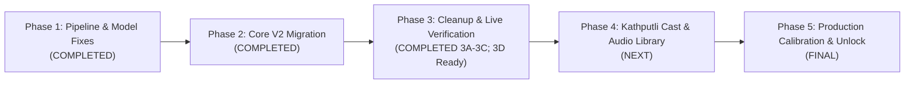

# IMPLEMENTATION_PLAN.md
## Sutradhar — Autonomous Dual-Language YouTube Shorts Production Pipeline
### (Antigravity `/automation` + Series State Machine + 5-Shot Kathputli Folk-Art Visual Engine + Kokoro-82M Dual-Language + HyperFrames + KinoCut 2.0)

---

### 1. Executive Summary & Architectural Decisions

This specification defines **Sutradhar**, a **100% Antigravity-native, zero-recurring-external-cost daily YouTube Shorts production pipeline** engineered for serialized edutainment, native **YouTube Shorts Series** playlist grouping, and sustainable **YouTube Partner Program (YPP) monetization**.

#### Core Design Principles
1. **Zero External AI APIs ($0.00 External Spend):**
   - **Google Antigravity** acts as the sole intelligence engine—handling pillar rotation, multi-episode series planning, scriptwriting, bespoke SVG rig authoring, and multimodal visual QA inspection. No external LLM, image generation, or cloud TTS API keys are required.
2. **Clean-Canvas Video Format (Strict Removal of Captions & Title/Part Labels):**
   - Every Short is rendered on a clean canvas with **zero on-screen captions or subtitles**, **zero title cards**, and **zero series/part badges**.
   - Spoken narration and layered theatrical staging carry 100% of the narrative, while YouTube automatically generates closed captions for viewers who desire them.
   - The visual focus is preserved entirely for animated folk-art puppetry and multi-plane environments.
3. **Dual-Language Production Core (English `en` & Hindi `hi`):**
   - Sutradhar officially supports both **Global English (`en`)** and **Classical Hindi (`hi`)**, selectable per channel via `channel.primary_language` in `config.yaml`.
   - **English Voice Profile:** British Prestige blend (`bm_fable:0.55 + am_fenrir:0.45` @ 0.91x speed) for narration + `am_onyx` for dialogue.
   - **Hindi Voice Profile:** Classical *Katha* blend (`hf_alpha:0.70 + hf_beta:0.30` @ 0.95x speed) for narration + `hm_omega` for dialogue.
   - **Language-Specific Dictionaries:** `pronunciations_en.yaml` (IPA substitutions for Sanskrit and Indian proper nouns) and `pronunciations_hi.yaml` (Devanagari compound & halant clarity).
4. **Indian Kathputli / Folk-Art 2D Vector Puppetry Engine:**
   - Visuals employ traditional **Indian Kathputli puppet aesthetics** with warm shaded olive/ochre tones, ornate tiered mukut crowns, dhotis, white *janeu*, and gold jewelry.
   - **Hierarchical Rivet Rigging:** Movable limbs use CSS custom-property rotations (`--rot-...`) anchored to `0px 0px` local joint origins. Limbs remain permanently pinned to circular brass rivets across all poses with zero detachment.
   - **5-Shot Narrative Progression:** Each Short follows a dynamic 5-scene cinematic progression (Wide Establishing Curtain Reveal $\to$ Royal Court Advance $\to$ Wrathful Close-Up with Lip-Sync $\to$ Cosmic Summit Strike $\to$ Foreground Granite Crushing).
5. **Connected Context-Window Audio & Dynamic Dialogue DSP:**
   - Synthesizes multi-sentence narrative blocks in connected context windows, eliminating prosody resets and dead-air seams.
   - Applies dynamic sample-rate-preserved dialogue DSP (`asetrate={sr*0.917},aresample={sr},atempo=1.0905`) to character lines, providing deep resonant authority without chipmunk distortion or sample-rate mismatches.
   - 20ms cosine volume ramps on audio segments, two-pass EBU R128 loudness normalization to `-14.0 LUFS` (`-1.5 dBTP`), and zero digital trailing floor (-150.0 dBFS).
6. **Deterministic Composition Synchronizer (`scripts/generate_composition.py`):**
   - Automatically compiles and synchronizes `index.html`, `styles.css`, and `engine.js` from `assets/svg/` and `build/manifest.js`, maintaining 100% HyperFrames 0.9.70 compliance.
7. **Deterministic Thumbnail Generation & Live Verified Publishing:**
   - `scripts/render_and_qa.py` extracts a clean-canvas, high-impact JPEG thumbnail (`build/thumbnail.jpg` $\le 2\text{ MB}$, 1080×1920) from the episode's peak hero shot.
   - `scripts/publish_youtube.py` uploads the video and custom thumbnail via `thumbnails().set()`, handles 403 phone verification gates gracefully, and executes mandatory live API read-back verification (`videos().list` and `playlistItems().list`), recording a structured audit in `build/publish_verification.json`.
8. **7 Static Pre-Whitelisted Commands (Zero Dynamic CLI Arguments):**
   - All stateful handoffs occur via JSON files inside `build/`, enabling unattended Antigravity `/automation` runs with 7 static commands.

---

### 2. Verified Technology Stack

| Pipeline Layer | Tool / Dependency | Configuration / Version | License / Tier | Operational Ceiling | External Cost |
| :--- | :--- | :--- | :--- | :--- | :--- |
| **Orchestrator & Vision QA** | Google Antigravity IDE + `/automation` | Built-in frontier models | Developer Plan | Runs locally via Antigravity Desktop / CLI | **$0 extra** |
| **Agent Skills** | `hyperframes` + `svg-character-animation` | Global: `C:\Users\manis\.agents\skills\` | Apache 2.0 | Global rules & HyperFrames templates | **$0.00** |
| **Local Neural TTS (EN & HI)** | `kokoro-onnx` (Kokoro-82M v1.0) | `kokoro-onnx==0.6.1`, ONNX Runtime | **Apache 2.0** | Unlimited offline CPU synthesis; 0 API keys | **$0.00** |
| **Word Alignment (Audition)** | `faster-whisper` (CTranslate2) | `faster-whisper==1.2.1` (`base`, `int8`) | MIT | Used for voice auditions; video uses `ffprobe` | **$0.00** |
| **2.5D Vector Video Engine** | `hyperframes` (`^0.9.19`) + GSAP | Node.js 24+ + Chromium + FFmpeg | Apache 2.0 | Local `1080x1920` 30fps high-quality renders | **$0.00** |
| **Mastering & Quality Gate** | `kinocut` + FFmpeg 7.1 | `kinocut==2.0.1` (`ui-capture-dark`) | Apache 2.0 / LGPL | `-14.0 LUFS` mastering, release gate ($\ge 80$) | **$0.00** |
| **State Machine & Ledger** | SQLite3 + Python `sqlite3` | `episodes.db` (foreign keys, atomic trans) | Public Domain | Strict series completion & playlist sync | **$0.00** |
| **YouTube Publishing & Sync** | `google-api-python-client` | YouTube Data API v3 | Google Cloud Quota | **10,000 units/day** free quota | **$0.00** |

---

### 3. Repository Structure

```text
Sutradhar/
├── docs/
│   ├── IMPLEMENTATION_PLAN.md          # Authoritative architectural specification & project roadmap
│   ├── MASTER_AUTOMATION_PROMPT.md     # Daily prompt executed by Antigravity /automation
│   ├── MANUAL_SETUP_AND_OPERATIONS.md  # Setup guide, verification records & Stage 3D handoff
│   └── schema.sql                      # Reference SQLite schema for episodes.db
├── assets/
│   ├── bgm/
│   │   ├── dramatic_mythology.mp3      # Indian ethnic drone & tanpura resonance bed (<620Hz low-pass)
│   │   ├── cosmic_mystery.mp3          # Ambient synth/space drone bed
│   │   └── epic_history.mp3            # Cinematic historical percussion bed
│   ├── sfx/
│   │   ├── whoosh_soft.wav             # Scene-transition stereo whoosh
│   │   ├── sub_hit.wav                 # 55Hz cinematic sub bass drop
│   │   └── riser_tension.wav           # Restrained analog tension swell
│   ├── js/
│   │   └── gsap.min.js                 # GSAP 3.12.5 local runtime
│   └── svg/
│       ├── characters/                 # Hierarchical Kathputli character rigs
│       │   ├── ravana.svg              # 10-headed King Ravana (rivet rig, expressions, lip-sync, janeu)
│       │   └── sutradhar_narrator.svg  # Signature host storyteller Kathputli rig
│       └── backdrops/                  # Theatrical multi-plane environment SVGs
│           ├── golden_lanka_citadel.svg # Full-bleed Lanka spires, twilight sky, courtyard waters
│           ├── lanka_sandstone_throne.svg # Sandstone throne room backdrop
│           ├── mount_kailash.svg       # Sacred summit with cosmic light shafts
│           ├── crushed_atmosphere.svg  # Deep cosmic void with atmospheric pressure
│           ├── granite_underside.svg   # Descending granite mountain underside
│           └── ancient_temple_ruins.svg # Sandstone carved temple colonnades
├── models/
│   └── kokoro/
│       ├── kokoro-v1.0.onnx            # Authoritative 325.5MB ONNX model (SHA-256 pinned)
│       └── voices-v1.0.bin             # 28.2MB voices tensor (54 voices, SHA-256 pinned)
├── scripts/
│   ├── db_manager.py                   # Context & state engine (--context | --create-series | --record-published)
│   ├── build_audio.py                  # Dual-language Kokoro synthesis + dialogue DSP + -14.0 LUFS
│   ├── preview_frames.py               # Composition sync + mid-scene snapshots -> qa_grid.jpg
│   ├── render_and_qa.py                # HyperFrames render + FFmpeg ducking + KinoCut gate + thumbnail.jpg
│   ├── publish_youtube.py              # Private review upload + thumbnails.set + API read-back verification
│   └── generate_composition.py         # Deterministic index.html / styles.css / engine.js synchronizer
├── tests/
│   ├── test_audition_voices.py         # Kokoro blend math, RMS dBFS, and immutability tests
│   ├── test_build_audio.py             # Audio pipeline, duration bounds, and model quarantine tests
│   ├── test_db_manager.py              # Database integrity, series lifecycle, and schema tests
│   ├── test_render_pipeline.py         # Preview grids, probe media, and thumbnail generation tests
│   └── test_publish_youtube.py         # Offline stub, mocked upload, thumbnail 403, and read-back tests
├── build/                              # Ephemeral build artifacts (gitignored)
│   ├── audio/                          # Active narration WAVs
│   ├── samples_v2/                     # Verified production sample bundles (EN & HI)
│   │   ├── prod_en_ravana_kailash/     # 42.4s English master (final_short.mp4, contact sheets)
│   │   └── prod_hi_ravana_kailash/     # 44.3s Hindi master (final_short.mp4, contact sheets)
│   ├── youtube_e2e_verification.json   # Live YouTube private_review upload & read-back proof
│   └── final_short.mp4                 # Active render master
├── config.yaml                         # Channel config (language, voice profiles, upload_mode, pillars)
├── pronunciations_en.yaml              # English IPA pronunciation dictionary
├── pronunciations_hi.yaml              # Hindi Devanagari pronunciation dictionary
├── pronunciations.yaml                 # Root fallback pronunciation dictionary
├── episodes.db                         # SQLite series & episode ledger (immutable baseline)
├── package.json                        # Node.js dependencies (hyperframes, gsap)
├── requirements.txt                    # Python dependencies
└── .gitignore                          # Git exclusions (build/, models/, .env.youtube, episodes.db)
```

---

### 4. Series Management, State Machine & Multi-Shot Pacing

#### 4.1 Brand Cohesion & 3-Pillar Rotation
Sutradhar rotates across three thematically connected curiosity pillars:
1. **`Ancient Epics & Lore`** (Sanatan Dharma, Puranic paradoxes, mythic cosmology, forgotten legends)
2. **`Hidden History`** (Ancient Indian & world empires, lost engineering, untold turning points)
3. **`Cosmic & Scientific Paradoxes`** (Astrophysics, quantum mysteries, deep time, reality-bending science)

#### 4.2 Multi-Shot 5-Beat Narrative Pacing (38–44 Seconds)
Each episode is structured for maximum Shorts retention across 5 dynamic shots (~6.5–9.5s each):
- **Shot 1 (Wide Establishing / Vista Hook, 0–8s):** Parting velvet curtains, full-bleed panoramic environment, opening paradox or confrontation.
- **Shot 2 (Character Advance / Tension Escalation):** Character enters with articulated walking gait and hierarchical rivet joints.
- **Shot 3 (Wrathful Close-Up / Dialogue Climax):** Dynamic camera push (2.15x) into character heads, angry facial expression swap (brows/eyes), multi-vowel lip-sync articulation, and rotating folk-art solar burst aura.
- **Shot 4 (Cosmic / Divine Counter-Strike):** Scale shift to a divine summit or cosmic realm with impact shockwaves and screen rumbles.
- **Shot 5 (Crushing Climax / Cliffhanger Payoff):** Physical environmental pressure (e.g. descending granite mountain) directly onto the character's bracing limbs; narrator delivers cliffhanger hook teasing tomorrow's episode.

---

### 5. Hierarchical Puppet Rigging Standard (`ravana.svg`)

All movable character limbs in `assets/svg/characters/` follow a strict kinematic hierarchy:
```text
#ravana_character
├── #lower_body
│   ├── #hip_left_joint ──> #thigh_left_rot ──> #knee_left_joint ──> #shin_left_rot
│   └── #hip_right_joint ──> #thigh_right_rot ──> #knee_right_joint ──> #shin_right_rot
├── #torso_group
│   ├── #torso_artwork (<clipPath id="torso_clip"> locks janeu permanently inside torso)
│   ├── #rear_arms_layer (4 left arms + 4 right arms with weapon props)
│   ├── #front_arms_layer (forearms, wrists, and gesture hands)
│   └── #heads_group
│       ├── #flanking_heads (4 heads left, 4 heads right with fan-out rotation)
│       └── #central_head (brows_neutral/angry, eyes_normal/wrath, mouth_calm/talk/shout)
└── #wrath_sunburst (folk-art solar rays & glowing aura revealed on dialogue climax)
```

**Joint Pin Kinematics:** Joint pins use circular brass rivets (`#puppet_pin`). Rotations are driven entirely by CSS custom properties (`--rot-thigh-left`, `--rot-shin-left`, etc.) defined in `styles.css` with `transform-origin: 0px 0px !important`.

**Folk-Art Palette (Strictly Zero Teal):** Midnight obsidian `#060814`, deep twilight indigo `#1e1828`, sandstone amber `#d97706`, burnished gold `#ffd43b`, and bronze `#b45309`.

---

### 6. Dual-Language Audio Engine & Dynamic Dialogue DSP

#### 6.1 Connected Context-Window Synthesis
Sequential narrator sentences are synthesized within coherent connected context blocks rather than isolated fragments, eliminating sentence-by-sentence prosody resets and dead-air digital seams.

#### 6.2 Dynamic Dialogue DSP Chain
When `speaker_role: "character_dialogue"` is specified:
1. Dynamic pitch lowering: `asetrate={int(sr*0.917)},aresample={sr},atempo=1.0905` shifts pitch downward by 1.5 semitones while precisely maintaining duration and Kokoro's native 24kHz sample rate.
2. Low-shelf chest resonance boost (`+2.5dB @ 150Hz`).
3. Subtle stone-hall reverb echo (`aecho=0.8:0.88:35:0.25`).
4. Automated assertions: $\Delta\text{Duration} \le \pm 5\%$, pitch reduction verified, and trailing 500ms silence floor $< -65.0\text{ dBFS}$.

#### 6.3 Broadcast Mastering Standards
- Two-pass EBU R128 loudness normalization to **-14.0 LUFS** (True Peak $\le -1.5\text{ dBTP}$).
- Dynamic sidechain ducking (`sidechaincompress` threshold -24dB, ratio 4:1) dips BGM beneath narration.
- Digital zero trailing buffer with 20ms cosine volume ramp, yielding **-150.0 dBFS** trailing noise floor.

---

### 7. Deterministic Thumbnail Generation & YouTube Publishing

#### 7.1 Episode Thumbnail (`build/thumbnail.jpg`)
During `render_and_qa.py`, FFmpeg extracts a clean-canvas, high-impact JPEG thumbnail:
- **Source:** Peak dramatic hero moment (midpoint of Shot 3 wrath dialogue).
- **Dimensions:** Exactly `1080x1920` (9:16 vertical cover).
- **File Size:** Verified $\le 2\text{ MB}$ (YouTube custom thumbnail limit).

#### 7.2 YouTube Data API v3 Workflow (`scripts/publish_youtube.py`)
1. **Video Upload:** `videos().insert(part="snippet,status", ...)` setting title, description, category 27 (Education), default languages, `privacyStatus: "private"`, `selfDeclaredMadeForKids: False`, and `containsSyntheticMedia: True`.
2. **Thumbnail Upload:** `thumbnails().set(videoId=video_id, media_body=...)`. Catches HTTP 403 (e.g. channel phone verification / Intermediate Features pending) gracefully, logging a clear diagnostic without failing the upload or losing the video ID.
3. **Playlist Assignment:** Reuses active series playlist or creates a private series playlist via `playlists().insert` and appends the video via `playlistItems().insert`.
4. **Mandatory Live API Read-Back Verification:** Immediately executes `videos().list` and `playlistItems().list` to verify YouTube-stored values against expected metadata, recording a complete audit in `build/publish_verification.json`.

#### 7.3 Daily Quota Accounting
| API Method | Quota Cost per Call | Calls per Short | Total Daily Quota |
| :--- | :--- | :--- | :--- |
| `videos.insert` | 1,600 units | 1 | 1,600 units |
| `thumbnails.set` | 50 units | 1 | 50 units |
| `playlists.insert` | 50 units | 0–1 (Part 1 only) | 0–50 units |
| `playlistItems.insert` | 50 units | 1 | 50 units |
| `videos.list` (read-back) | 1 unit | 1 | 1 unit |
| `playlistItems.list` (read-back) | 1 unit | 1 | 1 unit |
| **Total Daily Usage** | — | — | **1,702 units / 10,000 units** (17% of free tier) |

---

### 8. Phase 1–5 Project Roadmap & Acceptance Criteria



#### Phase 1 — Environment & Audio Pipeline Fixes: COMPLETED
- Downloaded authoritative 325.5MB Kokoro ONNX model (SHA-256: `7d5df8ec...`) and voices tensor.
- Quarantined corrupt model file.
- HyperFrames 0.9.70 audio duration sync (`+0.30s`).
- 35/35 automated tests passed.

#### Phase 2 — Production Core V2 Migration: COMPLETED
- Promoted V2.2 multi-shot Kathputli visual engine and Stage 1.5 dual-language audio engine into root production codebase.
- Verified two full-length 38–44s production Shorts in `build/samples_v2/`:
  - `prod_en_ravana_kailash` (42.4s, KinoCut **83.2 / 100**, PASS)
  - `prod_hi_ravana_kailash` (44.3s, KinoCut **82.4 / 100**, PASS)
- Root `episodes.db` confirmed bit-for-bit unchanged (SHA-256: `729ACCE0CD4F31CC69CECA61470D331ABCBCE5E62B51728AB372CD28F83F8011`).

#### Phase 3 — Operational Readiness, Codebase Cleanup & Live Verification: COMPLETED (3A–3C)
- **Stage 3A (Cleanup):** Audited and removed obsolete scratch files, old benchmark directories, and quarantined model files. Verified zero broken references. Full test suite: **37/37 PASSED**.
- **Stage 3B (Thumbnail & Live YouTube Verification):** Added `build/thumbnail.jpg` generation ($\le 2\text{ MB}$, 1080×1920) in `render_and_qa.py`. Upgraded `publish_youtube.py` with `thumbnails.set`, 403 handling, and mandatory API read-back verification. Successfully executed a real live `private_review` upload in an isolated workspace:
  - Video ID: `vdkMMm5ucPQ` (`https://youtu.be/vdkMMm5ucPQ`)
  - Playlist ID: `PLV5anx_T8pUw`
  - Privacy Status: `private`
  - Read-back verification: **PASSED** (all fields verified against YouTube Data API).
  - Recorded in `build/youtube_e2e_verification.json`.
- **Stage 3C (Documentation):** Complete rewrite of `IMPLEMENTATION_PLAN.md`, `MASTER_AUTOMATION_PROMPT.md`, and `MANUAL_SETUP_AND_OPERATIONS.md`. Retired obsolete interim docs.
- **Stage 3D (Antigravity `/automation` Setup):** Ready for user UI configuration.

#### Phase 4 — Kathputli Cast Expansion & Real Audio Library: NEXT
- Expand Kathputli character roster in `assets/svg/characters/` (Lord Shiva, Narad Muni, Shani Dev, Ashwatthama) following the verified rivet rig standard.
- Author diverse multi-plane backdrops (Vaikuntha, Kurukshetra, Pataliputra, Harappan Citadel).
- Curate and master thematic acoustic BGM tracks (ancient Indian folk percussion, bamboo flute, sitar, veena) and transition SFX.

#### Phase 5 — Production Calibration & Scheduled Publishing Unlock: FINAL
- Run full 3-episode mini-series in `private_review` mode.
- Creator visual and narrative approval audit.
- Unlock `publishing.upload_mode: "scheduled"` and `publishing.allow_public_or_scheduled: true` for autonomous public YouTube distribution.
