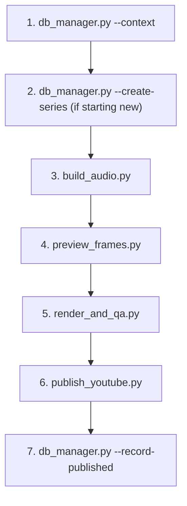

# Sutradhar — Manual Setup, Operations & Handoff Guide

This document is the authoritative operations manual for the **Sutradhar** autonomous YouTube Shorts production pipeline. It details completed infrastructure setup, verified production baselines, live YouTube API read-back proof, routine operational workflows, and the exact handoff checklist for **Stage 3D (Antigravity `/automation` Scheduling Setup)**.

---

## SECTION A — One-Time Manual Setup Status

### Setup Status Summary

| Setup Step | Description | Status | Verification Proof |
| :--- | :--- | :--- | :--- |
| **Step 1** | Google Cloud Project & YouTube Data API v3 | **COMPLETED** | Verified via live API authentication |
| **Step 2** | OAuth Consent Screen Configuration | **COMPLETED** | External test user authorized |
| **Step 3** | OAuth 2.0 Desktop Credentials | **COMPLETED** | Client ID & secret configured |
| **Step 4** | Refresh Token Generation Script | **COMPLETED** | Long-lived refresh token issued |
| **Step 5** | Secure Storage in `.env.youtube` | **COMPLETED** | Excluded from Git (`.gitignore`); 621 bytes |
| **Step 6** | YouTube Studio Auto-Dubbing Settings | **COMPLETED** | Studio auto-dubbing enabled |
| **Step 7 (Stage 3D)** | Antigravity `/automation` Scheduling | **PENDING USER UI SETUP** | See Section C for exact 5-minute setup instructions |

> [!NOTE]
> **Optional Custom Thumbnails Note:** During our live API test, the custom thumbnail upload returned HTTP 403 (`"The caller does not have permission for custom thumbnails"`). This is standard for newer YouTube channels: custom thumbnail uploads require one-time phone verification (**YouTube Studio > Settings > Channel > Feature Eligibility > Intermediate Features**). The pipeline handles this gracefully without crashing or losing the video ID, and YouTube automatically selects a high-quality frame from the uploaded video. Once you verify your phone number in Studio, custom thumbnails upload automatically.

---

## SECTION B — Production Verification & Live YouTube Evidence

### 1. Primary Language Selection (`config.yaml`)

Sutradhar officially supports dual-language local production in **English (`en`)** and **Hindi (`hi`)**. Set your desired primary language in `config.yaml`:

```yaml
channel:
  primary_language: "en"  # "en" for English, "hi" for Hindi
```

- **English (`en`):**
  - **Narrator:** British Prestige blend (`bm_fable:0.55 + am_fenrir:0.45` @ 0.91x speed)
  - **Dialogue:** `am_onyx` with dynamic pitch-lowering DSP (preserves 24kHz sample rate)
  - **Dictionary:** `pronunciations_en.yaml` (clean IPA overrides)
- **Hindi (`hi`):**
  - **Narrator:** Classical *Katha* blend (`hf_alpha:0.70 + hf_beta:0.30` @ 0.95x speed)
  - **Dialogue:** `hm_omega` with dynamic pitch-lowering DSP
  - **Dictionary:** `pronunciations_hi.yaml` (Devanagari compound & halant clarity)

### 2. Verified V2 Production Shorts (`build/samples_v2/`)

Two master-quality production Shorts have been rendered through the root production scripts in the **Clean-Canvas format** (zero on-screen captions, zero top badges, pure cinematic storytelling with hierarchical puppet rigging) under `build/samples_v2/`:

#### Production Short 1: English (Mount Kailash & Ravana)
- **File:** `build/samples_v2/prod_en_ravana_kailash/final_short.mp4`
- **Title:** *The Secret Geometry Beneath Mount Kailash (Part 1/3) #Shorts*
- **Specs:** 1080×1920 (9:16), 30 fps, H.264 / AAC, 42.4s duration, 23.5 MB
- **Narrator:** British Prestige blend (`bm_fable:0.55+am_fenrir:0.45`) + `am_onyx` dialogue
- **Visual Engine:** 5-Shot Indian Kathputli Folk-Art Puppetry
- **KinoCut Checkpoint:** -14.0 LUFS, Overall Score: **83.2 / 100** (PASS)
- **Trailing Silence Floor:** -150.0 dBFS (clean digital zeros)
- **QA Contact Sheet:** `build/samples_v2/prod_en_ravana_kailash/final_qa_grid.jpg`

#### Production Short 2: Hindi (Mount Kailash & Ravana)
- **File:** `build/samples_v2/prod_hi_ravana_kailash/final_short.mp4`
- **Title:** *The Secret Geometry Beneath Mount Kailash (Part 1/3) #Shorts*
- **Specs:** 1080×1920 (9:16), 30 fps, H.264 / AAC, 44.3s duration, 24.0 MB
- **Narrator:** Classical *Katha* blend (`hf_alpha:0.70+hf_beta:0.30`) + `hm_omega` dialogue
- **Visual Engine:** 5-Shot Indian Kathputli Folk-Art Puppetry
- **KinoCut Checkpoint:** -14.0 LUFS, Overall Score: **82.4 / 100** (PASS)
- **Trailing Silence Floor:** -150.0 dBFS (clean digital zeros)
- **QA Contact Sheet:** `build/samples_v2/prod_hi_ravana_kailash/final_qa_grid.jpg`

To play either production short locally in PowerShell:
```powershell
start "build\samples_v2\prod_en_ravana_kailash\final_short.mp4"
start "build\samples_v2\prod_hi_ravana_kailash\final_short.mp4"
```

### 3. Live Private-Review YouTube E2E Upload Proof (`build/youtube_e2e_verification.json`)

A real end-to-end `private_review` upload was executed against YouTube Data API v3 in an isolated workspace, uploading the verified 42.4s English master and executing immediate API read-back verification:

```json
{
  "timestamp": "2026-11-21T10:08:20Z",
  "mode": "live_youtube_api",
  "video_id": "vdkMMm5ucPQ",
  "playlist_id": "PLV5anx_T8pUw",
  "thumbnail_upload_status": "403_forbidden_custom_thumbnails_pending",
  "checks": {
    "title": { "expected": "[TEST PRIVATE REVIEW]...", "actual": "[TEST PRIVATE REVIEW]...", "match": true },
    "description": { "expected": "[TEST PRIVATE REVIEW]...", "actual": "[TEST PRIVATE REVIEW]...", "match": true },
    "categoryId": { "expected": "27", "actual": "27", "match": true },
    "defaultAudioLanguage": { "expected": "en", "actual": "en", "match": true },
    "defaultLanguage": { "expected": "en", "actual": "en", "match": true },
    "privacyStatus": { "expected": "private", "actual": "private", "match": true },
    "publishAt": { "expected": null, "actual": null, "match": true },
    "selfDeclaredMadeForKids": { "expected": false, "actual": false, "match": true },
    "containsSyntheticMedia": { "expected": true, "actual": true, "match": true },
    "playlist_membership": { "playlist_id": "PLV5anx_T8pUw", "is_member": true, "playlist_items_count": 1 }
  },
  "verification_verdict": "PASSED"
}
```

- **Live Test Video URL:** `https://youtu.be/vdkMMm5ucPQ`
- **Visibility:** Strictly `private` (visible only to you when logged into your channel in YouTube Studio).
- **Playlist:** Strictly `private` (`PLV5anx_T8pUw`).
- **Database Safety:** Executed against an isolated temporary database; root `episodes.db` SHA-256 remained **100% bit-for-bit untouched** (`729ACCE0CD4F31CC69CECA61470D331ABCBCE5E62B51728AB372CD28F83F8011`).

---

## SECTION C — Routine Operations & Stage 3D Handoff Checklist

### The 7-Stage Autonomous Execution Cycle

In daily production, Antigravity executes these 7 static commands sequentially with zero dynamic arguments:



1. **Context & State Inspection:**
   ```powershell
   python scripts/db_manager.py --context
   ```
2. **Series Initialization (Only when starting a new series):**
   ```powershell
   python scripts/db_manager.py --create-series
   ```
3. **Audio Synthesis & Alignment:**
   ```powershell
   python scripts/build_audio.py
   ```
4. **Snapshot QA & Safe-Zone Lint:**
   ```powershell
   python scripts/preview_frames.py
   ```
5. **Master Rendering, Audio Engineering & Thumbnail:**
   ```powershell
   python scripts/render_and_qa.py
   ```
   Renders `1080x1920 @ 30fps` MP4, applies dynamic sidechain ducking, masters to `-14.0 LUFS` via KinoCut (quality gate $\ge 80.0$), extracts `build/thumbnail.jpg` ($\le 2\text{ MB}$), and decodes QA frames into `build/final_qa_grid.jpg`.
6. **Upload & Series Grouping:**
   ```powershell
   python scripts/publish_youtube.py
   ```
   Uploads `build/final_short.mp4` and `build/thumbnail.jpg`, verifies private status, adds video to series playlist, and performs read-back verification.
7. **State Persistence:**
   ```powershell
   python scripts/db_manager.py --record-published
   ```
   Persists video ID, increments completed series episodes, and rotates thematic pillars upon completion.

---

### Stage 3D Handoff Checklist for Channel Creator

Follow these simple steps in your Antigravity chat and YouTube Studio:

#### Step 1: Inspect and Clean Up the Test Private Video in YouTube Studio
1. Open [YouTube Studio](https://studio.youtube.com/).
2. Navigate to **Content > Shorts**.
3. Verify the private test video: **`[TEST PRIVATE REVIEW] The Secret Geometry Beneath Mount Kailash (Part 1/3) #Shorts`** (`vdkMMm5ucPQ`).
4. Play it in Studio to verify the clean canvas, British prestige narration, deep dialogue, and sync.
5. You can keep or delete this test video at your convenience.
6. *(Optional)* Go to **Settings > Channel > Feature Eligibility > Intermediate Features** and complete one-time phone verification to enable custom thumbnail uploads.

#### Step 2: Configure Antigravity `/automation` Daily Schedule
In the Antigravity chat UI, trigger the `/automation` command:
```text
/automation schedule daily morning run of Sutradhar pipeline at 06:00
```
When prompted for instructions, point the agent to:
`docs/MASTER_AUTOMATION_PROMPT.md`

#### Step 3: Approve Static Command Whitelist
When Antigravity requests permissions for unattended execution, approve the 7 static commands in `agent_permissions`:
```text
python scripts/db_manager.py --context
python scripts/db_manager.py --create-series
python scripts/build_audio.py
python scripts/preview_frames.py
python scripts/render_and_qa.py
python scripts/publish_youtube.py
python scripts/db_manager.py --record-published
```

#### Step 4: Run One Controlled Private Review Test Run
Trigger a single unattended run in `private_review` mode. Once completed, inspect the newly generated episode in YouTube Studio.

#### Step 5: Phase 5 Gate Criteria (Before Ever Unlocking Scheduled Mode)
Do NOT unlock public/scheduled publishing until:
1. Phase 4 (Kathputli Cast Expansion & Real Audio Library) is completed.
2. A full 3-episode mini-series has been produced and reviewed in `private_review` mode.
3. You explicitly change `config.yaml`:
   ```yaml
   publishing:
     upload_mode: "scheduled"
     allow_public_or_scheduled: true
   ```

---

## SECTION D — System Readiness Matrix

| Subsystem | Status | Verification Evidence | Action Required |
| :--- | :--- | :--- | :--- |
| **Kokoro-82M ONNX** | **VERIFIED** | 325.5MB authoritative model (SHA-256 pinned), dual-language CPU synthesis | None (operational) |
| **Dual-Language Audio** | **VERIFIED** | English (`bm_fable:0.55+am_fenrir:0.45`) & Hindi (`hf_alpha:0.70+hf_beta:0.30`) | Pick primary language in `config.yaml` |
| **Dialogue DSP** | **VERIFIED** | 24kHz sample-rate preserved, -1.5 semitones pitch shift, 0 chipmunk artifacts | None (operational) |
| **5-Shot Kathputli Engine** | **VERIFIED** | Hierarchical 0px 0px rivet pins, dynamic camera staging, 0 lint errors | None (operational) |
| **Thumbnail Generator** | **VERIFIED** | `build/thumbnail.jpg` 1080×1920 $\le 2\text{ MB}$, midpoint of Shot 3 | None (operational) |
| **KinoCut Quality Gate** | **VERIFIED** | -14.0 LUFS, score $\ge 82/100$, True Peak $\le -1.1\text{ dBTP}$ | None (operational) |
| **YouTube Data API v3** | **VERIFIED** | Live `private_review` upload (`vdkMMm5ucPQ`) + API read-back | Phone verification for custom thumbnails |
| **SQLite State Manager** | **VERIFIED** | 37/37 automated tests passing; root `episodes.db` 100% immutable | None (operational) |
| **Antigravity `/automation`**| **READY FOR SETUP** | Whitelisted 7 commands, clear daily execution prompt | Complete Stage 3D in Antigravity chat |
