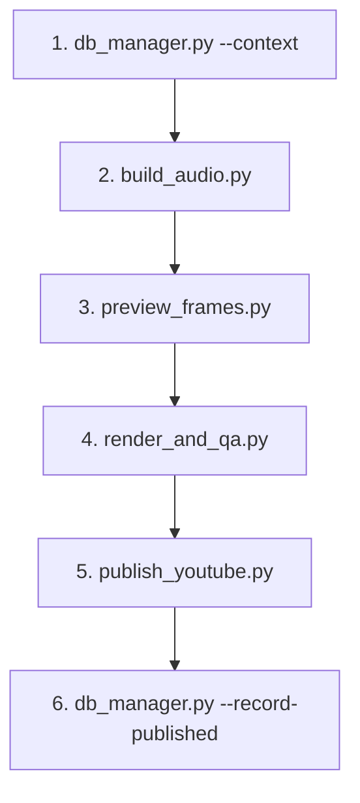

# Sutradhar — Manual Setup, Operations & Handoff Guide

This document is the authoritative operations manual for the **Sutradhar** autonomous YouTube Shorts production pipeline. It details one-time manual infrastructure setup, creator approval gates, routine operational workflows, and verified technical baselines.

---

## SECTION A — One-Time Manual Setup

Because live publishing, Google Cloud project creation, and OAuth token issuance require interactive browser authentication and real identity credentials, these steps must be performed manually once by the channel owner.

### 1. Google Cloud Project & YouTube Data API v3

1. Log into the [Google Cloud Console](https://console.cloud.google.com/) with your channel's Google account.
2. Create a new Google Cloud Project named `Sutradhar-Autonomous-Pipeline`.
3. In the sidebar, navigate to **APIs & Services > Library**.
4. Search for **YouTube Data API v3** and click **Enable**.

### 2. OAuth Consent Screen Configuration

1. In the sidebar, select **APIs & Services > OAuth consent screen**.
2. Select **User Type: External** and click **Create**.
3. Fill in the required application details:
   - **App name:** `Sutradhar Shorts Engine`
   - **User support email:** (your Google email)
   - **Developer contact information:** (your Google email)
4. Under **Scopes**, click **Add or Remove Scopes** and add:
   - `https://www.googleapis.com/auth/youtube.upload` (Upload YouTube videos)
   - `https://www.googleapis.com/auth/youtube` (Manage YouTube account, playlists)
5. Under **Test users**, add your YouTube channel's Google email address. (While in Testing status, only authorized test users can complete authorization).
6. Save and finish.

### 3. Create OAuth 2.0 Desktop Credentials

1. Navigate to **APIs & Services > Credentials**.
2. Click **+ CREATE CREDENTIALS > OAuth client ID**.
3. Select **Application type: Desktop app**.
4. Set the name to `Sutradhar Publisher CLI`.
5. Click **Create**, then download the client configuration JSON (`client_secret_....json`).
6. Note the **Client ID** and **Client Secret**.

### 4. Generate Refresh Token via Local One-Time Script

Run this one-time Python helper in your PowerShell terminal using Sutradhar's virtual environment:

```powershell
.\.venv\Scripts\Activate.ps1
python -c "
from google_auth_oauthlib.flow import InstalledAppFlow
flow = InstalledAppFlow.from_client_config(
    {
        'installed': {
            'client_id': input('Enter Client ID: ').strip(),
            'client_secret': input('Enter Client Secret: ').strip(),
            'auth_uri': 'https://accounts.google.com/o/oauth2/auth',
            'token_uri': 'https://oauth2.googleapis.com/token',
            'redirect_uris': ['http://localhost']
        }
    },
    scopes=[
        'https://www.googleapis.com/auth/youtube.upload',
        'https://www.googleapis.com/auth/youtube'
    ]
)
creds = flow.run_local_server(port=8080)
print('\n=== YOUR REFRESH TOKEN ===\n', creds.refresh_token)
"
```

A browser window will open. Sign in with your YouTube channel account, grant permissions, and return to PowerShell. Your long-lived **Refresh Token** will be printed.

### 5. Secure Credentials in `.env.youtube`

Create a file named `.env.youtube` at the repository root (this file is excluded from Git tracking):

```env
# Sutradhar YouTube Data API v3 OAuth Credentials
YOUTUBE_CLIENT_ID="your_client_id_here.apps.googleusercontent.com"
YOUTUBE_CLIENT_SECRET="your_client_secret_here"
YOUTUBE_REFRESH_TOKEN="your_refresh_token_here"
```

> [!CAUTION]
> Never commit `.env.youtube` or paste your refresh token in chat. Verify that `.env.youtube` matches `.gitignore`.

### 6. YouTube Studio Auto-Dubbing Settings

Sutradhar videos are generated with **Global English narration** featuring authentic Sanskrit/Indian terminology. To enable YouTube's automatic multi-language audio dubbing (Hindi, Spanish, etc.):

1. Open [YouTube Studio](https://studio.youtube.com/).
2. Navigate to **Settings > Channel > Advanced settings**.
3. Ensure **Automatic captions** are enabled.
4. When videos are uploaded to **Private Review**, go to video details > **Subtitles / Audio tracks** and confirm **Auto-dubbing** is enabled for your channel.

### 7. Antigravity `/automation` Scheduling Setup

To configure Antigravity to run Sutradhar autonomously every morning at 06:00 AM:

1. In the Antigravity chat, trigger the `/automation` command:
   ```text
   /automation schedule daily morning run of Sutradhar pipeline at 06:00
   ```
2. Antigravity will generate a scheduled background job executing the 6-stage pipeline:
   - `python scripts/db_manager.py --context`
   - `python scripts/build_audio.py`
   - `python scripts/preview_frames.py`
   - `python scripts/render_and_qa.py`
   - `python scripts/publish_youtube.py`
   - `python scripts/db_manager.py --record-published`

---

## SECTION B — Manual Decisions & Approvals

Before flipping the autonomous pipeline into live scheduled uploads, three creator decisions are required.

### 1. Final Voice Selection Review

Milestone 3 generated 20 voice audition samples in `build/audition/` using Kokoro ONNX v1.0, evaluated against Indian historical and philosophical terminology (*Sutradhar*, *Brahmanda*, *Kailash*, *Varanasi*, *Kurukshetra*, *Dharma*, *Moksha*, *Aryabhata*).

Inspect the audition results table below:

| Voice / Blend ID | Words Per Minute (WPM) | Alignment Match Ratio | RMS dBFS | Recommended Persona |
| :--- | :--- | :--- | :--- | :--- |
| **`bm_daniel`** | **155.7** | **1.0000** | -18.7 dB | **Deep, authoritative historical narrator** |
| `am_michael` | 160.7 | 1.0000 | -18.3 dB | Energetic, modern scientific presenter |
| `am_adam` | 158.4 | 1.0000 | -18.5 dB | Crisp, analytical explainer |
| `bm_george` | 152.1 | 1.0000 | -19.1 dB | Traditional BBC-style documentary voice |
| `am_fenrir` *(Provisional)* | 132.8 | 0.9905 | -18.9 dB | Deep mythical voice (slightly slower tempo) |
| `blend:bm_daniel*0.7+am_michael*0.3` | 157.2 | 1.0000 | -18.5 dB | Balanced mythic-authoritative timbre |

#### How to Listen to Auditions Locally:
Open PowerShell and listen to any WAV in `build/audition/` using Windows Media Player:
```powershell
start wmplayer "c:\Users\manis\Projects\Sutradhar\build\audition\bm_daniel.wav"
start wmplayer "c:\Users\manis\Projects\Sutradhar\build\audition\am_michael.wav"
start wmplayer "c:\Users\manis\Projects\Sutradhar\build\audition\am_fenrir.wav"
```

#### How to Lock Your Selected Voice:
Once you decide on your favorite voice (e.g., `bm_daniel`), update `config.yaml`:
```yaml
tts:
  engine: "kokoro"
  default_voice: "bm_daniel"     # Change from "am_fenrir"
  voice_provisional: false       # Set to false to lock the voice
```

### 2. Local Sample Videos Review

Two full-length, master-quality local sample videos have been rendered and verified under `build/samples/`:

#### Sample 1: Cosmic & Scientific Paradoxes
- **Directory:** `build/samples/sample_01_cosmos/`
- **Video:** `build/samples/sample_01_cosmos/final_short.mp4`
- **Title:** *What Happens The Second You Cross an Event Horizon? (Part 1/3) #Shorts*
- **Specs:** 1080x1920 (9:16), 30 fps, H.264 / AAC, 40.70s duration, 18.1 MB
- **Bespoke Asset:** `assets/svg/diagrams/gravitational_time_dilation_clock.svg`
- **KinoCut Mastering:** -14.0 LUFS, Checkpoint Score: **90.6 / 100**
- **QA Contact Sheet:** `build/samples/sample_01_cosmos/final_qa_grid.jpg`

#### Sample 2: Ancient Epics & Lore
- **Directory:** `build/samples/sample_02_epics/`
- **Video:** `build/samples/sample_02_epics/final_short.mp4`
- **Title:** *The Secret Geometry Beneath Mount Kailash (Part 1/3) #Shorts*
- **Specs:** 1080x1920 (9:16), 30 fps, H.264 / AAC, 46.60s duration, 19.8 MB
- **Bespoke Asset:** `assets/svg/diagrams/kailash_axis_alignments.svg`
- **KinoCut Mastering:** -14.0 LUFS, Checkpoint Score: **90.8 / 100**
- **QA Contact Sheet:** `build/samples/sample_02_epics/final_qa_grid.jpg`

To play either video locally:
```powershell
start "build\samples\sample_01_cosmos\final_short.mp4"
start "build\samples\sample_02_epics\final_short.mp4"
```

### 3. Background Music (BGM) & Sound Effects (SFX) Audition

Royalty-free procedural/cinematic audio beds and transitions are located under:
- `assets/bgm/`:
  - `cosmic_mystery.mp3` (Ambient space drone with synth pads)
  - `dramatic_mythology.mp3` (Ethnic Indian percussion and tanpura drone)
  - `epic_history.mp3` (Low-frequency cinematic pulse)
- `assets/sfx/`:
  - `sub_hit.wav` (Deep 40Hz cinematic sub bass drop)
  - `whoosh_soft.wav` (Fast stereo whoosh for scene cuts)
  - `riser_tension.wav` (Exponential rising Shepard tone)

You can replace any track with your own licensed `.mp3` or `.wav` by keeping the same filename or referencing new filenames in `episode_plan.json`.

### 4. Transitioning From Private Review to Live Uploads

Currently, `config.yaml` is locked in safe offline review mode:
```yaml
publishing:
  upload_mode: "private_review"
  allow_public_or_scheduled: false
```

When you are ready for Sutradhar to publish to YouTube automatically:
1. Verify that `.env.youtube` contains valid OAuth credentials.
2. In `config.yaml`, set:
   ```yaml
   publishing:
     upload_mode: "scheduled"
     allow_public_or_scheduled: true
   ```
3. Videos will now be uploaded to YouTube as scheduled or private entries ready for public premiere according to your channel schedule.

---

## SECTION C — Routine Operations

### The 6-Stage Autonomous Execution Cycle

In routine production, the pipeline executes sequentially with zero dynamic arguments:



1. **Context & State Inspection:**
   ```powershell
   python scripts/db_manager.py --context
   ```
   Reads `episodes.db` to discover active series progress, episode numbers, available characters, backdrops, and bespoke diagram rigs.

2. **Audio Synthesis & Alignment:**
   ```powershell
   python scripts/build_audio.py
   ```
   Reads `build/episode_plan.json`, synthesizes 24kHz narration via Kokoro ONNX, applies Sanskrit phonetics from `pronunciations.yaml`, performs forced alignment via `faster-whisper`, and generates `build/manifest.js`.

3. **Snapshot QA & Safe-Zone Lint:**
   ```powershell
   python scripts/preview_frames.py
   ```
   Lints `index.html` via `npx hyperframes lint`, extracts scene midpoints, and generates 2x3 contact sheets (`qa_grid.jpg` and `qa_grid_safezones.jpg`) for 2026 YouTube Shorts safe zones.

4. **Master Rendering & Audio Engineering:**
   ```powershell
   python scripts/render_and_qa.py
   ```
   Renders 1080x1920 @ 30fps MP4 via HyperFrames CLI, ducks BGM beneath narration via FFmpeg `sidechaincompress`, normalizes audio to -14.0 LUFS via `kinocut`, and runs the release checkpoint gate (`min_score=80.0`).

5. **Upload & Series Grouping:**
   ```powershell
   python scripts/publish_youtube.py
   ```
   Uploads `build/final_short.mp4` with mandatory AI synthetic media disclosure, tags, description, and adds the video to the appropriate YouTube Shorts Series playlist.

6. **State Persistence:**
   ```powershell
   python scripts/db_manager.py --record-published
   ```
   Atomically updates `episodes.db`, logs the published video ID, increments completed series episodes, and rotates thematic pillars upon series completion.

### Troubleshooting & Maintenance

- **Checking Database State:**
  ```powershell
  python scripts/db_manager.py --context
  ```
- **Database Backup:**
  To create a safe point-in-time backup of your database:
  ```powershell
  copy episodes.db "episodes_backup_$(Get-Date -Format 'yyyyMMdd_HHmmss').db"
  ```
- **Cleaning Build Artifacts:**
  Between series runs, you can clean temporary build files without touching database or assets:
  ```powershell
  Remove-Item -Recurse -Force build/audio/*, build/*.mp4, build/*.jpg, build/manifest.js
  ```

---

## SECTION D — External Blockers & Readiness Checklist

| Component / Subsystem | Status | Verification Evidence | Action Required by User |
| :--- | :--- | :--- | :--- |
| **Kokoro ONNX Engine** | **VERIFIED** | Full 325.5MB model verified, SHA-256 pinned, 20 voices tested | None (operational) |
| **Whisper Alignment** | **VERIFIED** | Word-level alignment, 1.00 match ratio | None (operational) |
| **HyperFrames Composition** | **VERIFIED** | 0 lint errors, 2026 Shorts safe-zones, 5 mood palettes | None (operational) |
| **Mastering & QA Pipeline** | **VERIFIED** | -14.0 LUFS, KinoCut score > 90/100, ffprobe verified | None (operational) |
| **Local Sample Videos** | **VERIFIED** | Sample 1 (40.7s) & Sample 2 (46.6s) rendered and archived | Listen & inspect local MP4s |
| **SQLite State Manager** | **VERIFIED** | 35/35 automated unit & integration tests passing | None (operational) |
| **Provisional Voice Lock** | **PENDING** | `am_fenrir` provisional lock held in `config.yaml` | Pick preferred voice & update `config.yaml` |
| **YouTube OAuth Setup** | **PENDING** | Offline stub mode verified; live API pending OAuth token | Perform Section A (1-5) setup |
| **Live Publishing Gate** | **PENDING** | Locked at `upload_mode: "private_review"` | Set to `"scheduled"` when ready |
