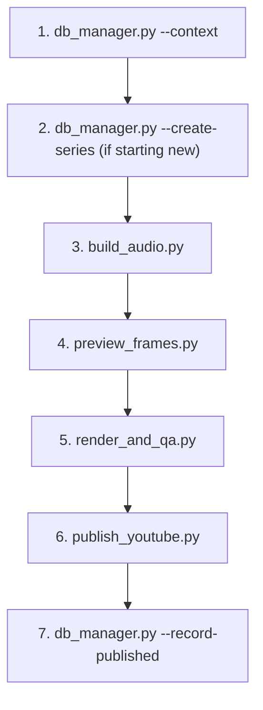

# Sutradhar — Manual Setup, Operations & Handoff Guide

This document is the authoritative operations manual for the **Sutradhar** autonomous YouTube Shorts production pipeline. It details completed infrastructure setup, verified production baselines, live YouTube API read-back proof, the primary **Manual Daily Execution** workflow, and operational guidance for optional **Antigravity App `/automation`** scheduling.

---

## SECTION A — One-Time Manual Setup Status

### Setup Status Summary

| Setup Step | Description | Status | Verification Proof |
| :--- | :--- | :--- | :--- |
| **Step 1** | Google Cloud Project & YouTube Data API v3 | **COMPLETED** | Verified via live API authentication |
| **Step 2** | OAuth Consent Screen Configuration | **COMPLETED** | External test user authorized |
| **Step 3** | OAuth 2.0 Desktop Credentials | **COMPLETED** | Client ID & secret configured |
| **Step 4** | Refresh Token Generation Script | **COMPLETED** | Long-lived refresh token issued |
| **Step 5** | Secure Storage in `.env.youtube` | **COMPLETED** | Excluded from Git (`.gitignore`); 621 bytes |
| **Step 6** | YouTube Studio Auto-Dubbing Settings | **COMPLETED** | Studio auto-dubbing enabled |
| **Step 7 (Phase 3D)** | Operational Workflow & Automation Guide | **COMPLETED** | Manual Daily Execution on Pro established as primary; `/automation` documented as optional upgrade |

> [!NOTE]
> **Optional Custom Thumbnails Note:** During our live API test, the custom thumbnail upload returned HTTP 403 (`"The caller does not have permission for custom thumbnails"`). This is standard for newer YouTube channels: custom thumbnail uploads require one-time phone verification (**YouTube Studio > Settings > Channel > Feature Eligibility > Intermediate Features**). The pipeline handles this gracefully without crashing or losing the video ID, and YouTube automatically selects a high-quality frame from the uploaded video. Once you verify your phone number in Studio, custom thumbnails upload automatically.

---

## SECTION B — Production Verification & Live YouTube Evidence

### 1. Primary Language Selection (`config.yaml`)

Sutradhar officially supports dual-language local production in **English (`en`)** and **Hindi (`hi`)**. Set your desired primary language in `config.yaml`:

```yaml
channel:
  primary_language: "en"  # "en" for English, "hi" for Hindi
```

- **English (`en`):**
  - **Narrator:** British Prestige blend (`bm_fable:0.55 + am_fenrir:0.45` @ 0.91x speed)
  - **Dialogue:** `am_onyx` with dynamic pitch-lowering DSP (preserves 24kHz sample rate)
  - **Dictionary:** `pronunciations_en.yaml` (clean IPA overrides)
- **Hindi (`hi`):**
  - **Narrator:** Classical *Katha* blend (`hf_alpha:0.70 + hf_beta:0.30` @ 0.95x speed)
  - **Dialogue:** `hm_omega` with dynamic pitch-lowering DSP
  - **Dictionary:** `pronunciations_hi.yaml` (Devanagari compound & halant clarity)

### 2. Verified V2 Production Shorts (`build/samples_v2/`)

Two master-quality production Shorts have been rendered through the root production scripts in the **Clean-Canvas format** (zero on-screen captions, zero top badges, pure cinematic storytelling with hierarchical puppet rigging) under `build/samples_v2/`:

#### Production Short 1: English (Mount Kailash & Ravana)
- **File:** `build/samples_v2/prod_en_ravana_kailash/final_short.mp4`
- **Title:** *The Secret Geometry Beneath Mount Kailash (Part 1/3) #Shorts*
- **Specs:** 1080×1920 (9:16), 30 fps, H.264 / AAC, 42.4s duration, 23.5 MB
- **Narrator:** British Prestige blend (`bm_fable:0.55+am_fenrir:0.45`) + `am_onyx` dialogue
- **Visual Engine:** 5-Shot Indian Kathputli Folk-Art Puppetry
- **KinoCut Checkpoint:** -14.0 LUFS, Overall Score: **83.2 / 100** (PASS)
- **Trailing Silence Floor:** -150.0 dBFS (clean digital zeros)
- **QA Contact Sheet:** `build/samples_v2/prod_en_ravana_kailash/final_qa_grid.jpg`

#### Production Short 2: Hindi (Mount Kailash & Ravana)
- **File:** `build/samples_v2/prod_hi_ravana_kailash/final_short.mp4`
- **Title:** *The Secret Geometry Beneath Mount Kailash (Part 1/3) #Shorts*
- **Specs:** 1080×1920 (9:16), 30 fps, H.264 / AAC, 44.3s duration, 24.0 MB
- **Narrator:** Classical *Katha* blend (`hf_alpha:0.70+hf_beta:0.30`) + `hm_omega` dialogue
- **Visual Engine:** 5-Shot Indian Kathputli Folk-Art Puppetry
- **KinoCut Checkpoint:** -14.0 LUFS, Overall Score: **82.4 / 100** (PASS)
- **Trailing Silence Floor:** -150.0 dBFS (clean digital zeros)
- **QA Contact Sheet:** `build/samples_v2/prod_hi_ravana_kailash/final_qa_grid.jpg`

To play either production short locally in PowerShell:
```powershell
start "build\samples_v2\prod_en_ravana_kailash\final_short.mp4"
start "build\samples_v2\prod_hi_ravana_kailash\final_short.mp4"
```

### 3. Live Private-Review YouTube E2E Upload Proof (`build/youtube_e2e_verification.json`)

A real end-to-end `private_review` upload was executed against YouTube Data API v3 in an isolated workspace, uploading the verified 42.4s English master and executing immediate API read-back verification:

```json
{
  "timestamp": "2026-11-21T10:08:20Z",
  "mode": "live_youtube_api",
  "video_id": "vdkMMm5ucPQ",
  "playlist_id": "PLV5anx_T8pUw",
  "thumbnail_upload_status": "403_forbidden_custom_thumbnails_pending",
  "checks": {
    "title": { "expected": "[TEST PRIVATE REVIEW]...", "actual": "[TEST PRIVATE REVIEW]...", "match": true },
    "description": { "expected": "[TEST PRIVATE REVIEW]...", "actual": "[TEST PRIVATE REVIEW]...", "match": true },
    "categoryId": { "expected": "27", "actual": "27", "match": true },
    "defaultAudioLanguage": { "expected": "en", "actual": "en", "match": true },
    "defaultLanguage": { "expected": "en", "actual": "en", "match": true },
    "privacyStatus": { "expected": "private", "actual": "private", "match": true },
    "publishAt": { "expected": null, "actual": null, "match": true },
    "selfDeclaredMadeForKids": { "expected": false, "actual": false, "match": true },
    "containsSyntheticMedia": { "expected": true, "actual": true, "match": true },
    "playlist_membership": { "playlist_id": "PLV5anx_T8pUw", "is_member": true, "playlist_items_count": 1 }
  },
  "verification_verdict": "PASSED"
}
```

- **Live Test Video URL:** `https://youtu.be/vdkMMm5ucPQ`
- **Visibility:** Strictly `private` (visible only to you when logged into your channel in YouTube Studio).
- **Playlist:** Strictly `private` (`PLV5anx_T8pUw`).
- **Database Safety:** Executed against an isolated temporary database; root `episodes.db` SHA-256 remained **100% bit-for-bit untouched** (`729ACCE0CD4F31CC69CECA61470D331ABCBCE5E62B51728AB372CD28F83F8011`).

---

## SECTION C — Daily Operations & Operational Workflows

### The 7-Stage Autonomous Execution Cycle

In daily production, Antigravity executes these 7 static commands sequentially with zero dynamic arguments using the explicit Windows virtual environment Python executable:



1. **Context & State Inspection:**
   ```powershell
   .\.venv\Scripts\python.exe scripts/db_manager.py --context
   ```
2. **Series Initialization (Only when starting a new series):**
   ```powershell
   .\.venv\Scripts\python.exe scripts/db_manager.py --create-series
   ```
3. **Audio Synthesis & Alignment:**
   ```powershell
   .\.venv\Scripts\python.exe scripts/build_audio.py
   ```
4. **Snapshot QA & Safe-Zone Lint:**
   ```powershell
   .\.venv\Scripts\python.exe scripts/preview_frames.py
   ```
5. **Master Rendering, Audio Engineering & Thumbnail:**
   ```powershell
   .\.venv\Scripts\python.exe scripts/render_and_qa.py
   ```
   Renders `1080x1920 @ 30fps` MP4, applies dynamic sidechain ducking, masters to `-14.0 LUFS` via KinoCut (quality gate $\ge 80.0$), extracts `build/thumbnail.jpg` ($\le 2\text{ MB}$), and decodes QA frames into `build/final_qa_grid.jpg`.
6. **Upload & Series Grouping:**
   ```powershell
   .\.venv\Scripts\python.exe scripts/publish_youtube.py
   ```
   Uploads `build/final_short.mp4` and `build/thumbnail.jpg`, verifies private status, adds video to series playlist, and performs live read-back verification (`build/publish_verification.json`).
7. **State Persistence:**
   ```powershell
   .\.venv\Scripts\python.exe scripts/db_manager.py --record-published
   ```
   Persists video ID, increments completed series episodes, and rotates thematic pillars upon completion.

---

### Operational Workflows

#### 1. Recommended Primary Daily Workflow: Manual Daily Execution

**Manual Daily Execution** is Sutradhar's authoritative production workflow. 

**Why Manual Daily Execution is Primary:**
- **Model Tier:** Sutradhar's theatrical Kathputli hierarchical SVG directing, narrative pacing, and visual error detection require **Gemini 2.5 Pro**. Antigravity `/automation` defaults to Flash, which is insufficient for multi-shot puppet anatomy and visual QA reasoning.
- **Multimodal Visual Oversight:** Directing in chat gives the creator instant visual inspection of `build/qa_grid.jpg`, `build/final_qa_grid.jpg`, and `build/thumbnail.jpg`, ensuring zero detached limbs or styling drift before any upload occurs.
- **Local Sandbox Reliability:** Antigravity App `/automation` runs as a local sidecar and by default enforces strict unattended auto-denial for network calls and `.env` file reading. Manual execution eliminates sandbox permission timeouts and guarantees smooth YouTube API connectivity.
- **Host Availability:** The creator initiates production when the workstation is active, avoiding machine-sleep failures.

**Daily 3-Step Execution Procedure:**
1. **Open Antigravity IDE:** Ensure the workspace is set to `C:\Users\manis\Projects\Sutradhar` and model selection is set to **Gemini 2.5 Pro**.
2. **Trigger Master Prompt:** Copy and send the contents of [docs/MASTER_AUTOMATION_PROMPT.md](file:///c:/Users/manis/Projects/Sutradhar/docs/MASTER_AUTOMATION_PROMPT.md) in the chat.
3. **Review End-of-Run Report:**
   - Confirm all 7 steps executed with exit code `0`.
   - Inspect the generated `build/final_qa_grid.jpg` and `build/thumbnail.jpg` images displayed by the agent.
   - Confirm `build/publish_verification.json` reflects `upload_status: "PRIVATE_REVIEW"` and `publishAt: null`.
   - Inspect the private Short in [YouTube Studio > Content > Shorts](https://studio.youtube.com/).

---

#### 2. Optional Upgrade: Antigravity App `/automation` (Scheduled)

Antigravity App `/automation` is supported as an optional future upgrade for scheduled unattended runs, provided the following verified requirements and constraints are met:

- **Surface Limitation:** `/automation` runs strictly within the **Antigravity Desktop App** (via local background sidecar processes). It cannot run as a cloud cron or in browser-only / standalone CLI environments.
- **Machine-Awake Requirement:** The host Windows PC must remain powered on, awake, and unlocked at the scheduled time (`CRON_TZ=Asia/Kolkata`). If the machine is sleeping or off, scheduled events fail or stall.
- **Model Configuration:** You must explicitly switch the automation model configuration from default `Flash` to **`Gemini 2.5 Pro`**.
- **Interactive Permissions Record:** Because the Windows Terminal Sandbox restricts `.env` file reads and outbound network access by default, an interactive first run is **mandatory** to record and persist `agent_permissions` for:
  - All 7 whitelisted `.\.venv\Scripts\python.exe` commands.
  - Outbound HTTPS network access to `www.googleapis.com` and `oauth2.googleapis.com`.
  - Read access to `.env.youtube`.
- **Strict Private Review Lock:** The channel must remain strictly locked to `upload_mode: "private_review"` (`allow_public_or_scheduled: false`) in `config.yaml` until at least 3 calibration episodes pass mobile review in YouTube Studio.

To schedule `/automation` in the Antigravity App chat:
```text
/automation schedule daily morning run of Sutradhar pipeline at 06:00
```
Point the automation prompt to: `docs/MASTER_AUTOMATION_PROMPT.md`.

---

### Phase Gate & Milestone Transition

- **Phase 1 (Environment & Audio Pipeline Fixes):** **COMPLETED**
- **Phase 2 (Production Core V2 Migration):** **COMPLETED**
- **Phase 3 (Operational Readiness, Cleanup, Live Verification & Docs):** **COMPLETED**
  - Steps 1–6 (One-Time YouTube Setup) verified and operational.
  - Live E2E `private_review` upload verified (`vdkMMm5ucPQ`).
  - Master daily prompt hardened with `.venv` whitelist and duplicate guards.
  - Primary manual workflow and optional `/automation` upgrade established.
- **Phase 4 (Kathputli Cast Expansion & Real Audio Library):** **NEXT**
  - Expand character SVGs (Lord Shiva, Narad Muni, Shani Dev, Ashwatthama) with verified hierarchical rivet rigging.
  - Curate authentic royalty-free Indian acoustic instruments and transition SFX.
- **Phase 5 (3-Episode Calibration & Scheduled Unlock):** **FINAL**
  - Run full 3-episode mini-series in `private_review` mode.
  - Creator mobile review and quality audit.
  - Once verified, toggle `upload_mode: "scheduled"` and `allow_public_or_scheduled: true` in `config.yaml`.

---

## SECTION D — System Readiness Matrix

| Subsystem | Status | Verification Evidence | Action Required |
| :--- | :--- | :--- | :--- |
| **Kokoro-82M ONNX** | **VERIFIED** | 325.5MB authoritative model (SHA-256 pinned), dual-language CPU synthesis | None (operational) |
| **Dual-Language Audio** | **VERIFIED** | English (`bm_fable:0.55+am_fenrir:0.45`) & Hindi (`hf_alpha:0.70+hf_beta:0.30`) | Pick primary language in `config.yaml` |
| **Dialogue DSP** | **VERIFIED** | 24kHz sample-rate preserved, -1.5 semitones pitch shift, 0 chipmunk artifacts | None (operational) |
| **5-Shot Kathputli Engine** | **VERIFIED** | Hierarchical 0px 0px rivet pins, dynamic camera staging, 0 lint errors | None (operational) |
| **Thumbnail Generator** | **VERIFIED** | `build/thumbnail.jpg` 1080×1920 $\le 2\text{ MB}$, midpoint of Shot 3 | None (operational) |
| **KinoCut Quality Gate** | **VERIFIED** | -14.0 LUFS, score $\ge 82/100$, True Peak $\le -1.1\text{ dBTP}$ | None (operational) |
| **YouTube Data API v3** | **VERIFIED** | Live `private_review` upload (`vdkMMm5ucPQ`) + API read-back | Phone verification for custom thumbnails |
| **SQLite State Manager** | **VERIFIED** | 37/37 automated tests passing; root `episodes.db` 100% immutable | None (operational) |
| **Master Production Prompt**| **VERIFIED** | Self-contained, `.venv` explicit, duplicate guard, clean canvas | Trigger daily via Antigravity on Pro |
| **Operational Workflow** | **VERIFIED** | Manual Daily Execution primary; `/automation` documented as optional upgrade | Ready for Phase 4 or first real episode |
