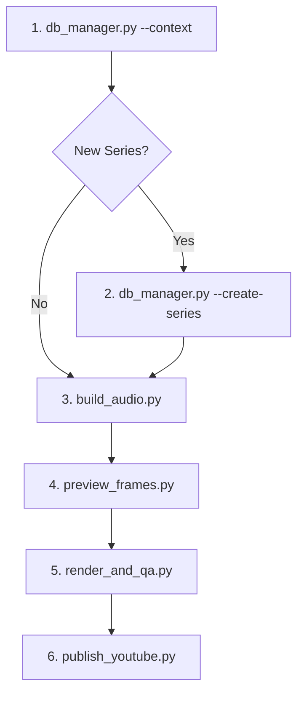

# Sutradhar — Setup, Configuration & Operations Guide

> **Authoritative Operations Manual:** Complete guide to installing dependencies, configuring ElevenLabs & YouTube OAuth credentials, running the **6-command daily CLI pipeline**, and verifying system health.

---

## 1. Prerequisites & Environment Setup

### 1.1 System Dependencies
- **Python 3.12+** (with `pip` and `venv`)
- **Node.js 22+** (`package.json` `engines.node >= 22.0.0`) & `npm`
- **FFmpeg 6.0+** (7.x recommended) with `ffprobe` on system `PATH`

### 1.2 Local Workspace Installation
Run from the repository root in PowerShell:

```powershell
# 1. Create and activate Python virtual environment
python -m venv .venv
.\.venv\Scripts\Activate.ps1

# 2. Install Python dependencies
pip install --upgrade pip
pip install -r requirements.txt

# 3. Install Node.js dependencies (HyperFrames ^0.9.70 + GSAP ^3.15.1)
npm install
npx hyperframes browser ensure

# 4. Initialize or migrate episodes.db to Schema v4
.\.venv\Scripts\python.exe scripts/db_manager.py --init
```

---

## 2. API Credentials & Configuration

Store all secrets in `.env.local` in the repository root (git-ignored; never commit or log).

### 2.1 ElevenLabs Setup (Hindi Neural Voice)
Sutradhar uses **ElevenLabs v4 (`eleven_v4`)** with **Viraj** (`uuyFQegRan8rpIQCGu9K`), synthesized at `44.1 kHz` (`mp3_44100_128`) and mastered to `48,000 Hz` 24-bit stereo WAV.

1. Log in to [ElevenLabs](https://elevenlabs.io/), open **Profile + API key**, and create an API key with Text-to-Speech permissions.
2. Add **Viraj** (`uuyFQegRan8rpIQCGu9K`) to your Voice Library.
3. Add the key to `.env.local`:
   ```env
   ELEVENLABS_API_KEY="your_elevenlabs_api_key_here"
   ```

> [!NOTE]
> **ElevenLabs Starter Quota Math (`30 Shorts / Month`):**  
> ElevenLabs Starter includes **`30,000` credits/month** (`1` credit = `1` billed character, including inline `[tags]`).  
> Sutradhar enforces a **`760–840` billed-char target** (`850` soft warning, **`900` hard pre-TTS cap**). At `~815` avg billed chars per Short, **`30` Shorts/month** consume **`~24,450 / 30,000` credits**, leaving an **`~18.5%` buffer** (`~5,550` credits). Scene-level SHA-256 WAV caching in `build/cache/audio/` + SQLite `audio_ledger` ensures visual edits cost `0` credits and single-scene rewrites re-bill only that scene.

### 2.2 Google Cloud & YouTube Data API v3 OAuth Setup
1. Open [Google Cloud Console](https://console.cloud.google.com/), create a project, and enable **YouTube Data API v3**.
2. Configure the **OAuth Consent Screen** (`External`, add your YouTube account as a **Test User**) with scopes:
   - `https://www.googleapis.com/auth/youtube.upload`
   - `https://www.googleapis.com/auth/youtube`
3. Create an **OAuth 2.0 Client ID** (**Desktop App**) and note the **Client ID** and **Client Secret** (store any downloaded `client_secret*.json` inside git-ignored `.secrets/`).
4. Obtain a long-lived **Refresh Token** for that Desktop OAuth client (for example via [Google OAuth 2.0 Playground](https://developers.google.com/oauthplayground/) configured with your own Client ID/Secret in *Settings -> Use your own OAuth credentials*, or a one-time Desktop authorization exchange against `https://oauth2.googleapis.com/token`).
5. Populate `.env.local`:
   ```env
   YOUTUBE_CLIENT_ID="your_client_id.apps.googleusercontent.com"
   YOUTUBE_CLIENT_SECRET="your_client_secret"
   YOUTUBE_REFRESH_TOKEN="your_refresh_token"
   ```

### 2.3 YouTube Studio Custom Thumbnails Verification
Verify your channel under **YouTube Studio -> Settings -> Channel -> Feature Eligibility -> Intermediate Features (Phone verification)**. Without this, `thumbnails.set` returns HTTP `403` (handled gracefully without failing the upload, while custom thumbnails remain pending until verified).

---

## 3. Daily 6-Command Operations Runbook

Once `build/episode_plan.json` (`EpisodePlanV2` + `StoryboardIR` + `ThumbnailSpec`) is authored and validated **before** TTS synthesis, execute the **6 static CLI steps**:



### Step 1: Inspect Pipeline Context & Budget
```powershell
.\.venv\Scripts\python.exe scripts/db_manager.py --context
```
- Returns Schema `v4` context: `language_policy` (`hi` audio/captions, `en` metadata/thumbnails), `next_pillar`, `monthly_tts_budget` (from `audio_ledger`), `active_series_list`, `previously_covered_topics`, and `previous_bespoke_assets`.

### Step 2: Create Series *(Only When Starting a New Series Universe)*
```powershell
.\.venv\Scripts\python.exe scripts/db_manager.py --create-series
```
- Validates `build/new_series_plan.json` (English `series_title`, optional `series_title_hi`, pillar rotation check, unique planned bespoke assets) and inserts an `ACTIVE` series into `episodes.db`.

### Step 3: Synthesize Hindi Audio & Build Captions
```powershell
.\.venv\Scripts\python.exe scripts/build_audio.py
```
- Enforces `<= 900` billed-char pre-TTS cap and `>= 70%` Devanagari ratio.
- Applies `pronunciations_hi.yaml` via `apply_pronunciations_preserving_tags` (keeping `[pause]`/`[sighs]` intact), caches per-scene WAVs in `build/cache/audio/`, records `audio_ledger`, resamples to `16 kHz` PCM, runs locally cached **`faster-whisper small`** (`local_files_only=True`) + RMS speech-burst snapping, and generates em-dash-safe `captions_data.js` + `build/audio/audio_manifest.json`.

### Step 4: Preview Storyboard & Safe Zones
```powershell
.\.venv\Scripts\python.exe scripts/preview_frames.py
```
- Compiles `StoryboardIR` into `build/composition/`, runs `hyperframes lint` + **`hyperframes check --strict --safe-zone shorts --json`** (`0` errors, `0` warnings), probes live Chromium DOM (`hf-seek`, caption `rect.bottom <= 1395px`, contextual pill bounds), and writes 15-frame `build/qa_grid.jpg` + `build/qa_grid_safezones.jpg`.
- Visually inspect `build/qa_grid.jpg` before full video rendering.

### Step 5: Render Video, Master Audio & Build Thumbnail
```powershell
.\.venv\Scripts\python.exe scripts/render_and_qa.py
```
- Renders `1080x1920 @ 30fps` H.264 MP4 (`<= 55 MiB` / `57,671,680 B` guardrail) via `render_optimizer.py`.
- Mixes multi-act BGM (`ratio=6.5` sidechain ducking) + `+33ms` peak-aligned SFX + single 2-pass `loudnorm` (`-14.0 ± 0.5 LUFS`, `-2.2 dBTP` WAV headroom -> `<= -1.5 dBTP` MP4, `48 kHz` stereo).
- Renders English `1080x1920` JPEG `build/thumbnail.jpg` (`<= 2.0 MiB`) + `build/thumbnail_2x3_crop.jpg` (`y=150..1770`).
- Runs fail-closed `quality_gate.py` (`ui-capture-dark >= 88.0`, `default >= 55.0`, `color_balance PASS`, `static_fraction <= 0.15`, `ebur128`, Whisper alignment telemetry, `build/final_qa_grid.jpg`).

### Step 6: Atomic YouTube Publish, CDN Parity & SQLite Sync
```powershell
.\.venv\Scripts\python.exe scripts/publish_youtube.py
```
- Validates `EpisodePlanV2`, `qa_report.json`, English metadata (`#Shorts`, 10–15 tags, citations), and `1080x1920` JPEG + `2:3` crop.
- Uploads `build/final_short.mp4` (`containsSyntheticMedia=True`, `defaultLanguage="en"`, `defaultAudioLanguage="hi"`), assigns series playlist (fail-closed for `episodic_series`), waits for **`uploadStatus == "processed"` & `processingStatus == "succeeded"`**, uploads `build/thumbnail.jpg`, verifies live `sardefault.jpg` CDN parity (`MAE <= 12.0`, `dhash <= 16`), writes `build/publish_result.json` & `build/publish_verification.json`, and **atomically commits `episodes` + `publishing_history` + `series` counters** in `episodes.db`.

#### Additional `publish_youtube.py` & `db_manager.py` Maintenance Commands
```powershell
# Strictly read-only live audit (Ep 1-4, Series 1-3 playlists, sardefault.jpg CDN & DB parity)
.\.venv\Scripts\python.exe scripts/publish_youtube.py --verify-only

# Sync English playlist titles/privacy on YouTube
.\.venv\Scripts\python.exe scripts/publish_youtube.py --update-playlists

# Upload & CDN-verify custom thumbnail only (without re-uploading video)
.\.venv\Scripts\python.exe scripts/publish_youtube.py --update-thumbnail --video-id <ID>

# Manual SQLite recovery / repair if a publish was interrupted after upload
.\.venv\Scripts\python.exe scripts/db_manager.py --record-published
.\.venv\Scripts\python.exe scripts/db_manager.py --repair
```

---

## 4. Maintenance & Automated Verification

### 4.1 ElevenLabs Quota Check
```powershell
curl -X GET "https://api.elevenlabs.io/v1/user/subscription" -H "xi-api-key: $env:ELEVENLABS_API_KEY"
```

### 4.2 Database Health & Schema v4
Schema v4 is defined in [docs/schema.sql](./schema.sql) (`series`, `episodes`, `publishing_history`, `audio_ledger`). Verify or repair integrity via:
```powershell
.\.venv\Scripts\python.exe scripts/db_manager.py --repair
```

### 4.3 Automated Verification Suites
```powershell
# Full Python test suite (isolated temp dirs; zero live ElevenLabs/YouTube mutations)
.\.venv\Scripts\python.exe -m pytest -q

# Fast non-render unit & contract suite
.\.venv\Scripts\python.exe -m pytest -q --ignore=tests/test_sutradhar_phase2_runtime.py --ignore=tests/test_sutradhar_phase4_pipeline.py

# HyperFrames strict Shorts safe-zone check (on a compiled composition)
npm run hf:check
```
