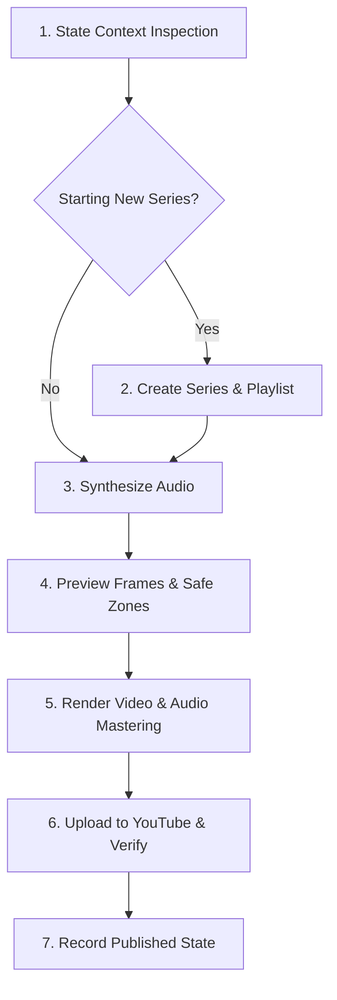

# Sutradhar — Setup, Configuration & Operations Guide

> **Authoritative Operations Manual:** This guide provides the complete, minimal set of instructions to configure credentials, operate the pipeline, and maintain the **Sutradhar** autonomous YouTube Shorts production engine.

---

## 1. Prerequisites & Environment Setup

### 1.1 System Dependencies
Ensure the host machine has the following tools installed:
- **Python 3.12+** (with `pip` and `venv`)
- **Node.js 18+** (Node 20 LTS recommended) & `npm`
- **FFmpeg 6.0+** with `ffprobe` added to system `PATH`

### 1.2 Local Workspace Installation
Run the following in PowerShell from the project root:

```powershell
# 1. Create and activate Python virtual environment
python -m venv .venv
.\.venv\Scripts\Activate.ps1

# 2. Install Python dependencies
pip install --upgrade pip
pip install -r requirements.txt

# 3. Install Node.js dependencies
npm install

# 4. Initialize the SQLite database (creates or migrates episodes.db to v3.0.0)
.\.venv\Scripts\python.exe scripts/db_manager.py --init
```

---

## 2. API Credentials & Configuration

Sutradhar requires credentials for two external services: **ElevenLabs** (speech synthesis) and **Google Cloud / YouTube** (publishing). Store these securely in `.env.local` in the project root.

### 2.1 ElevenLabs Setup (Hindi Neural Voice)

Sutradhar uses **ElevenLabs v4 (`eleven_v4`)** with the canonical narrator voice **Viraj** (`uuyFQegRan8rpIQCGu9K`).

1. Log in to [ElevenLabs](https://elevenlabs.io/).
2. Navigate to **Profile + API key** $\rightarrow$ Click **Create API Key**.
3. Grant standard Text-to-Speech access permissions and copy the API key.
4. Add the **Viraj** voice to your ElevenLabs Voice Library:
   - Go to [ElevenLabs Voice Library](https://elevenlabs.io/app/voice-library).
   - Search for **Viraj** (Voice ID: `uuyFQegRan8rpIQCGu9K`).
   - Click **Add to Voice Lab** / **Add to Library**.
5. Add the key to `.env.local`:
   ```env
   ELEVENLABS_API_KEY="your_elevenlabs_api_key_here"
   ```

> [!NOTE]
> **Credit Economics:** An ElevenLabs Starter plan provides ~37,000 characters per month. A typical 40–120s Short uses ~550 Devanagari characters, allowing up to **65+ full Shorts per month** on the Starter plan.

### 2.2 Google Cloud & YouTube Data API v3 Setup

1. Open [Google Cloud Console](https://console.cloud.google.com/) and create a project (e.g. `Sutradhar-Production`).
2. Navigate to **APIs & Services > Library**, search for **YouTube Data API v3**, and click **Enable**.
3. Configure the **OAuth Consent Screen**:
   - User Type: **External**.
   - App Name: `Sutradhar Pipeline`.
   - Developer contact email: your email.
   - Scopes: Add `https://www.googleapis.com/auth/youtube.upload` and `https://www.googleapis.com/auth/youtube`.
   - Test Users: Add the Google account associated with your YouTube channel.
4. Create **OAuth 2.0 Client Credentials**:
   - Navigate to **APIs & Services > Credentials > Create Credentials > OAuth client ID**.
   - Application Type: **Desktop App**.
   - Name: `Sutradhar Desktop Client`.
   - Download the JSON client secret file or copy the **Client ID** and **Client Secret**.
5. Generate a **Refresh Token**:
   - Run the OAuth authorization flow once to obtain a long-lived refresh token:
   ```powershell
   .\.venv\Scripts\python.exe scripts/publish_youtube.py --auth-only
   ```
   - Follow the browser prompt to log into your YouTube account and grant channel permissions.
6. Populate `.env.local`:
   ```env
   # YouTube OAuth2 Credentials
   YOUTUBE_CLIENT_ID="your_client_id.apps.googleusercontent.com"
   YOUTUBE_CLIENT_SECRET="your_client_secret"
   YOUTUBE_REFRESH_TOKEN="your_refresh_token"
   ```

### 2.3 YouTube Studio Custom Thumbnails Phone Verification

Custom thumbnail uploads require one-time phone verification on your YouTube channel:
1. Go to [YouTube Studio](https://studio.youtube.com/) $\rightarrow$ **Settings** $\rightarrow$ **Channel** $\rightarrow$ **Feature Eligibility**.
2. Under **Intermediate Features**, complete **Phone verification**.
3. *Note:* If phone verification is pending, video uploads still succeed; YouTube will select a video frame as the thumbnail until verified.

---

## 3. Daily Operations Runbook

To produce an episode, execute the 7 static CLI commands in sequence using the project virtual environment.



### Stage 1: Inspect Pipeline Context
```powershell
.\.venv\Scripts\python.exe scripts/db_manager.py --context
```
- Outputs active series, completed history, thematic pillars, and past covered topics.

### Stage 2: Create Series (Only When Launching a New Universe)
```powershell
.\.venv\Scripts\python.exe scripts/db_manager.py --create-series
```
- Provisions a new series record in `episodes.db` and creates a matching YouTube playlist.

### Stage 3: Synthesize Hindi Audio & Align Timestamps
```powershell
.\.venv\Scripts\python.exe scripts/build_audio.py
```
- Synthesizes narration and dialogue through ElevenLabs Viraj with inline tags.
- Uses local `faster-whisper` for word-level timestamp alignment into `build/manifest.js`.

### Stage 4: Preview Frames & Check Safe Zones
```powershell
.\.venv\Scripts\python.exe scripts/preview_frames.py
```
- Renders pre-flight snapshot grid (`build/qa_grid.jpg`) and validates YouTube Shorts safe zones.

### Stage 5: Render Video, Master Audio & Generate Thumbnail
```powershell
.\.venv\Scripts\python.exe scripts/render_and_qa.py
```
- Renders 1080×1920 MP4 at 30 fps via HyperFrames.
- Applies sidechain ducking (6:1 ratio) to BGM, masters to **-14.0 LUFS**, checks KinoCut gate ($\ge 80.0$).
- Generates `build/thumbnail.jpg` (`1080×1920` RGB JPEG $\le 2\text{ MB}$, validated via `scripts/thumbnail_utils.py` with `2:3` Shorts grid center-crop safe margins) and `build/final_qa_grid.jpg`.

### Stage 6: Upload to YouTube & Read-Back Verification
```powershell
.\.venv\Scripts\python.exe scripts/publish_youtube.py
```
- Pre-validates `build/thumbnail.jpg` locally before consuming upload quota.
- Uploads `build/final_short.mp4`, attaches video to series playlist, **waits for `processingDetails.processingStatus == "succeeded"` before invoking `thumbnails.set`** (preventing YouTube from silently dropping `shortsAspectRatio` / `sardefault.jpg` and reverting Shorts surfaces to auto-extracted `oar2.jpg` frames), and retrieves `sardefault.jpg` directly from `i.ytimg.com` for dimension and pixel similarity verification. Note: legacy `16:9`/`4:3` containers (`maxresdefault.jpg`, `hqdefault.jpg`) are automatically blurred/pillarboxed by YouTube when serving a `9:16` Shorts custom thumbnail.

### Stage 7: Persist State in SQLite
```powershell
.\.venv\Scripts\python.exe scripts/db_manager.py --record-published
```
- Updates `episodes.db` with the video ID, increments series episode counters, and rotates pillars.

---

## 4. Maintenance & Troubleshooting

### 4.1 ElevenLabs Quota Monitoring
Check remaining character quota via cURL or browser:
```powershell
curl -X GET "https://api.elevenlabs.io/v1/user/subscription" -H "xi-api-key: $env:ELEVENLABS_API_KEY"
```

### 4.2 Database Health & Migrations
The database schema is defined in [docs/schema.sql](./docs/schema.sql) (Version 3.0.0). To verify database integrity or run automated migrations on an existing database:
```powershell
.\.venv\Scripts\python.exe scripts/db_manager.py --init
```

### 4.3 Automated Verification
Run automated tests before and after making codebase changes:
```powershell
# Python test suite
.\.venv\Scripts\python.exe -m pytest -q

# HyperFrames animation engine check
npm run hf:check
```
