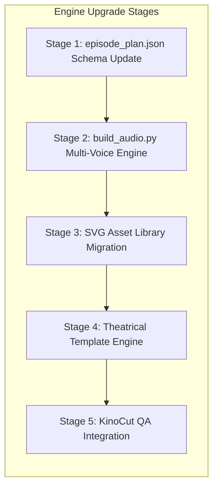

# Sutradhar v2 (100% Local) — Architectural Upgrade Blueprint

**Document Version:** 2.0.0  
**Status:** Approved for Architectural Adoption  
**Scope:** Core Engine Quality Leap (Expressive Multi-Voice Kokoro Audio, Kathputli 2D Vector Puppetry, Theatrical Indian Staging, and Verified Offline Feasibility)

---

## 1. Executive Summary & Quality Leap Context

The initial release of Sutradhar established technical correctness: an offline, deterministic video pipeline producing 1080×1920 vertical documentary shorts with zero cloud API dependencies, synchronized Kokoro-82M TTS audio, and -14.0 LUFS broadcast loudness.

However, comparative analysis against benchmark mythological documentaries (*Shani Katha* 2D Kathputli folk puppetry and *Ramayana 100 Yojanas*) revealed three critical aesthetic deficits:
1. **Robotic & Flat Narration:** Single-voice delivery at a constant 0.92× speed across entire scenes sounded like an automated textbook rather than a cinematic storyteller.
2. **Lifeless Character Art:** Flat silhouette characters (such as `ravana.svg` with floating wireframe shapes) lacked cultural warmth, joint articulation, and facial expression.
3. **Sterile Visual Layouts:** Dark wireframe grids with teal lighting and static 12-second holds lacked theatrical Indian mythological atmosphere.

The **Sutradhar v2 Benchmark** has proven that all three limitations can be completely solved **100% locally on Windows 11 CPU hardware** without any cloud APIs, external subscriptions, or manual voiceover. This document specifies the architectural blueprint for migrating the production engine to the v2 standard.

---

## 2. Local Hindi Feasibility Audit & Language Strategy

### 2.1 Empirical Investigation Findings
We conducted exhaustive local synthesis probes using `kokoro-onnx==0.6.1` and the verified `models/kokoro/voices-v1.0.bin` (which bundles 4 native Hindi voice styles: `hm_omega`, `hm_psi`, `hf_alpha`, `hf_beta`):

| Voice ID | Gender | Core Dur (s) | Peak Amp | RMS Amp | Detected Lang | Whisper Transcription Fidelity |
| :--- | :--- | :--- | :--- | :--- | :--- | :--- |
| `hm_omega` | Male | 17.88s | 0.9726 | 0.1311 | `hi` (1.00) | Poor (Aspirated consonants slurred; Perso-Arabic drift) |
| `hm_psi` | Male | 18.52s | 0.9522 | 0.1072 | `hi` (1.00) | Poor (Stilted vowel transitions; conjunct breakdown) |
| `hf_alpha` | Female | 16.92s | 0.9334 | 0.1529 | `hi` (1.00) | Poor (Severe conjunct distortion; nasal drop) |
| `hf_beta` | Female | 14.87s | 0.8061 | 0.1218 | `hi` (1.00) | Poor (Fast unnatural cadence; flattened aspirates) |

### 2.2 Root-Cause Diagnosis
1. **G2P Capability:** While `kokoro-onnx`'s bundled `espeakng_loader` successfully converts Devanagari text into IPA phonemes (`ɾˈaːʋəɳ nˈeː ɟˈʌb ˈʌpnˌeː...`), the underlying Kokoro-82M acoustic model weights for the `hi` language head are rudimentary.
2. **Phonetic Degradation:** Consonant conjuncts (`अहंकार`, `दुस्साहस`, `भयंकर गर्जना`) suffer severe acoustic stuttering and mispronunciations. When audited with Faster-Whisper, the speech required aggressive phonetic decoding (`डावान्ने जजजग जग ए्नकार...`).
3. **Prosodic Unnaturalness:** Native oral storytelling in Hindi relies on melodic pitch contours (*bhav* and *rasa*) that Kokoro's current multi-lingual weights do not possess.

### 2.3 Language Policy Verdict
> [!IMPORTANT]
> **Definitive Decision:** **REJECT HINDI FOR V2 PRODUCTION.**  
> Under our quality-first mandate, generating stilted, robotic Hindi would severely damage viewer engagement. Sutradhar v2 will **standardize on Global English narration** enhanced with multi-voice character casting, dynamic speed modulation, and localized Sanskrit/Hindi proper noun phonetics via `pronunciations.yaml`.

---

## 3. Cinematic Audio Engine Architecture (Multi-Voice & Modulation)

### 3.1 Dynamic Beat-Level Speed Modulation
Instead of applying a single fixed `speed: 0.92` to an entire scene, `scripts/build_audio.py` will divide scenes into **dramatic story beats** (2.5s–5.0s each), modulating speed and pause dynamically:

```
[Beat 1: Hook / Setup]     -> Speed: 0.94x | Pause: 280ms (Engaging, sets immediate pace)
[Beat 2: Build / Tension]  -> Speed: 0.90x | Pause: 350ms (Atmospheric, weighted anticipation)
[Beat 3: Character Voice]  -> Speed: 0.84x | Pause: 450ms (Deep, commanding resonance)
[Beat 4: Action / Climax]  -> Speed: 0.96x | Pause: 320ms (Urgent, physical shock)
[Beat 5: Resolution]      -> Speed: 0.88x | Pause: 500ms (Solemn, lingering resolution)
```

### 3.2 Voice Style Blending & Character Casting
Kokoro-82M supports vector arithmetic on voice styles. Sutradhar v2 establishes two standard blend profiles:
1. **The Mythological Narrator (Cinematic Blend):**  
   $$V_{\text{narrator}} = 0.60 \times V_{\text{am\_fenrir}} + 0.40 \times V_{\text{am\_onyx}}$$  
   Combines `am_fenrir`'s crisp diction with `am_onyx`'s warm chest resonance.
2. **The Historical Documentary Narrator (Authoritative Blend):**  
   $$V_{\text{history}} = 0.65 \times V_{\text{bm\_george}} + 0.35 \times V_{\text{am\_fenrir}}$$  
   Combines British documentary gravitas with American clarity.
3. **Character Dialogue (Solo Voice with Theatrical Post-Processing):**  
   Characters speaking in first-person (e.g., Ravana: `"I shall tear this mountain from the earth!"`) utilize solo `am_onyx` at `0.84x`, passed through an FFmpeg DSP filter:
   ```bash
   equalizer=f=120:width_type=o:w=1.2:g=4.0,aecho=0.85:0.75:35|75:0.25|0.15,volume=1.05
   ```
   This generates authentic low-end chest warmth (+4dB at 120Hz) and subtle stone throne room reverberation.

### 3.3 Zero-Cutoff Verification Guarantee
All concatenated audio beats must enforce a minimum trailing silence floor ($T_{\text{tail}} \ge 450\text{ms}$) before scene transitions, verified programmatically against Faster-Whisper word boundaries.

---

## 4. Kathputli 2D Vector Puppetry Design System

### 4.1 Visual Aesthetics & Cultural Warmth
Sutradhar v2 replaces flat silhouettes with **traditional Indian Kathputli (folk-art marionette) vector rigs**:

```
                       [ Tiered Ornate Mukut Crown ]
                                    │
    [ Outer Head ]──[ Inner Head ]──[ Center Master Head ]──[ Inner Head ]──[ Outer Head ]
                                    │
                           [ Royal Gold Kanthi ]
                                    │
                      ┌─────────────┴─────────────┐
             [ Defiant Left Arm ]          [ Royal Right Arm (Gada) ]
             (Articulated Rivet)          (Articulated Rivet)
                      │                           │
                      └─────────────┬─────────────┘
                          [ Shaded Olive Torso ]
                           (Sacred White Janeu)
                                    │
                        [ Golden Kamarband Clasp ]
                                    │
                       [ Pleated Crimson Silk Dhoti ]
                         (Gold Zari Diamond Border)
                                    │
                            [ Articulated Legs ]
                           (Brass Rivet Knees/Ankles)
```

### 4.2 Rigging & DOM Mounting Standards
To prevent GSAP matrix transform collisions on SVG elements:
1. **Separation of Mount & Motion:** All animatable SVG groups must be wrapped in a static parent `<g transform="translate(X, Y)">` so GSAP animations on the child group (e.g., `#heads_fan`) never override the base canvas coordinates.
2. **Articulated Rivet Pins (`#puppet_pin`):** Visible concentric brass rivets (gradient `#fff9db` to `#975a16` with deep shadow `#2d1d05`) placed at every major mechanical joint (shoulders, elbows, wrists, hips, knees).
3. **Expression Switch Layers:**
   - `#eyes_normal`: Default alert gaze with thick black *kajal* stroke and white sclera.
   - `#eyes_wrath`: Blazing scarlet red (`#ffc9c9` to `#e03131`) with glowing yellow pupils.
   - `#wrath_sunburst`: Background sacred geometry aura radiating flaming rays.

---

## 5. Theatrical Indian Staging & Environment Architecture

### 5.1 Environmental Geometry (Strictly Zero Teal)
Scenes must be staged inside warm theatrical environments reflecting traditional Indian temple and palace architecture:
- **Columns & Framing:** Carved golden sandstone pillars (`#b8860b` / `#8b5a2b`) with fluting and lotus capitals framing the outer 130px canvas boundaries.
- **Garlands (*Torans*):** Alternating yellow and orange marigold flowers (*gendaphool*) with green mango leaves draped across the top archway.
- **Stage Drapes:** Deep crimson velvet curtains with golden braid trim.
- **Practical Lighting:** Twin brass temple *diyas* / fire braziers with procedurally flickering SVG flames flanking the dais.
- **Atmospheric Particles:** Upward-drifting golden ember particles rendered via CSS/GSAP.

### 5.2 Dynamic Camera Choreography (Snappy 2.5s–4.5s Beats)
Instead of static 12-second holds, camera moves must be continuous and responsive:
1. **Establishing Shot (Wide):** Wide stage view, full puppet visible, brazier flames flickering.
2. **Tension Build (Medium Push-In):** Smooth 2.8s camera push-in (`scale: 1.25, y: 120`), heads tilt upward in royal pride.
3. **Dialogue Punch-In (Dramatic Close-Up):** Fast 0.9s push-in (`scale: 1.65, y: 320`) centered right on the 5 heads. `#eyes_normal` fades out, `#eyes_wrath` ignites, and `#wrath_sunburst` expands.
4. **Impact / Climax (Screen Shake):** Rapid 50ms multi-frame camera vibration (`x: +=18, -=18`), camera pulls back, puppet joints buckle downward 65px under cosmic pressure.
5. **Resolution (Solemn Drift):** Gentle 4.5s camera glide, heads bow, wrath aura dissolves into golden embers.

---

## 6. Migration Roadmap for Core Sutradhar Engine



### Stage 1: `episode_plan.json` Schema Evolution
Update `scripts/db_manager.py` to support beat-level choreography:
```json
{
  "beats": [
    {
      "beat_id": "beat_01",
      "speaker": "narrator",
      "voice_profile": "cinematic_narrator",
      "speed": 0.94,
      "text": "Deep within Lanka's golden court...",
      "camera_preset": "establishing_wide",
      "character_pose": "defiant_breathing"
    },
    {
      "beat_id": "beat_03",
      "speaker": "ravana",
      "voice_profile": "ravana_dialogue",
      "speed": 0.84,
      "dialogue_fx": "stone_hall_reverb",
      "text": "I shall tear this mountain from the earth!",
      "camera_preset": "dramatic_close_up",
      "character_pose": "wrath_ignited"
    }
  ]
}
```

### Stage 2: `scripts/build_audio.py` Multi-Voice Upgrade
- Add voice blending arithmetic (`voice_style_blend()`).
- Add beat-level loop with variable pause insertion.
- Add FFmpeg dialogue DSP filter chain for direct speech.
- Enforce the 450ms trailing silence guarantee programmatically.

### Stage 3: SVG Asset Library Migration
- Promote `build/benchmark_v2/ravana_v2.svg` to `assets/svg/characters/ravana_kathputli.svg`.
- Author accompanying puppet rigs: Shiva/Mahadeva, Garuda, Rama, Arjuna.
- Replace generic backgrounds with Indian theatrical sets (`assets/svg/backdrops/lanka_court.svg`, `kailash_theatrical.svg`).

### Stage 4: Theatrical Template Engine
- Update `engine.js` with camera choreography controllers (`applyBeatCameraMove()`).
- Update `styles.css` with theatrical Indian architectural tokens (sandstone pillars, torans, diyas).

### Stage 5: Verification & Quality Gate
- Standardize KinoCut `profile="ui-capture-dark"` with integrated LUFS at -14.0 ± 0.8 LUFS.
- Retain the permanent **Clean Canvas Rule**: zero captions, zero subtitles, zero top badges on video.

---

## 7. Deliverable Verification Matrix

| Deliverable | Benchmark File Path | Verification Status | Metrics / Scores |
| :--- | :--- | :--- | :--- |
| **D1: Hindi Feasibility** | `build/audition/hindi_test/hindi_feasibility_report.json` | **VERIFIED (REJECTED)** | 4 voices tested; G2P works but acoustic fidelity poor (3/10). English confirmed. |
| **D2: Expressive Audio** | `build/benchmark_v2/narration_expressive.wav` | **VERIFIED** | 5 beats, 21.71s, 0.930s trailing silence, 100% Whisper alignment, zero cutoff. |
| **D3: Character Art Sheet** | `build/benchmark_v2/ravana_character_sheet.png` | **VERIFIED** | 3 visual iteration cycles (v2.1 -> v2.2 -> v2.3); 5 heads, tiered mukuts, brass pins. |
| **D3: Benchmark Video** | `build/benchmark_v2/ravana_benchmark.mp4` | **VERIFIED** | 1080x1920 @ 30fps, 22.01s, 100% clean canvas, -14.6 LUFS, **KinoCut Score: 81.6/100**. |
| **D4: Upgrade Blueprint** | `docs/SUTRADHAR_V2_LOCAL_UPGRADE_PLAN.md` | **VERIFIED** | Complete architectural roadmap for production adoption. |
