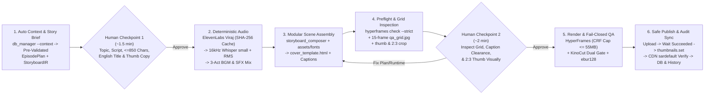

# Sutradhar Video Production System — Revalidated Redesign, Cleanup & Implementation Plan

> **Document Status:** Master Architecture, Cleanup & Implementation Specification (Planning Phase Only — Awaiting User Approval)  
> **Companion Historical Log:** [VIDEO_STYLE_EXPLORATION_PLAN.md](file:///C:/Users/manis/Projects/Sutradhar/docs/VIDEO_STYLE_EXPLORATION_PLAN.md) (chronological audit, Round 1–2 POCs, Ep 3 replacement `oBcyiPy26rg`, and Ep 4 `7PWFV7lQG6U` evolution)  
> **Hard Constraints:** Hydrogen via Antigravity only · ElevenLabs Starter only (`30,000` credits/mo, `$0` additional spend) · `30 Shorts / month` target · Hindi audio & captions · English thumbnails, titles, descriptions, tags & playlists · Zero live code/DB/asset edits until plan approval

---

## Table of Contents

1. [Executive Summary & Tri-Milestone Synthesis](#1-executive-summary--tri-milestone-synthesis)
2. [Episode 4 (`ep4_neelakantha_shiva` / `7PWFV7lQG6U`) Deep Forensic Audit](#2-episode-4-ep4_neelakantha_shiva--7pwfv7lqg6u-deep-forensic-audit)
3. [Revalidated Visual Direction ("Sutradhar Kinetic Storycraft v2")](#3-revalidated-visual-direction-sutradhar-kinetic-storycraft-v2)
4. [Codebase-Wide Legacy, Backward-Compatibility & Dead-Code Audit](#4-codebase-wide-legacy-backward-compatibility--dead-code-audit)
5. [Repository Classification & Cleanup Action Matrix](#5-repository-classification--cleanup-action-matrix)
6. [Target Project Directory & File Architecture](#6-target-project-directory--file-architecture)
7. [Module-by-Module Rewrite vs Consolidate Justification Matrix](#7-module-by-module-rewrite-vs-consolidate-justification-matrix)
8. [Playground Technique Extraction & Upgraded Scene Runtime (`V1` + `Cand B` + `Ep 4`)](#8-playground-technique-extraction--upgraded-scene-runtime-v1--cand-b--ep-4)
9. [Complete Visual & Audio Asset Replacement Strategy](#9-complete-visual--audio-asset-replacement-strategy)
10. [Database Schema v4, Migrations & Historical Data Sync (`Ep 1–4`)](#10-database-schema-v4-migrations--historical-data-sync-ep-14)
11. [Upgraded Pydantic Data Models (`EpisodePlan` & `StoryboardIR`)](#11-upgraded-pydantic-data-models-episodeplan--storyboardir)
12. [Audit & Blueprint for Redesigned `docs/INSTRUCTIONS.md`, `SETUP_AND_OPERATIONS.md`, `README.md` & Configs](#12-audit--blueprint-for-redesigned-docsinstructionsmd-setup_and_operationsmd-readmemd--configs)
13. [End-to-End Semi-Automated Production Workflow (`30 Shorts/Month`)](#13-end-to-end-semi-automated-production-workflow-30-shortsmonth)
14. [ElevenLabs Starter Optimization, Hindi Word Alignment & Audio Mixing](#14-elevenlabs-starter-optimization-hindi-word-alignment--audio-mixing)
15. [Encoder Bitrate Guardrails & Fail-Closed Automated Quality Gates](#15-encoder-bitrate-guardrails--fail-closed-automated-quality-gates)
16. [Thumbnail Pipeline, YouTube Hardening & Live `Ep 3`/`Ep 4` Harmonization](#16-thumbnail-pipeline-youtube-hardening--live-ep-3ep-4-harmonization)
17. [Centralized Language Policy & Zero-Cost Tool Evaluation](#17-centralized-language-policy--zero-cost-tool-evaluation)
18. [Phased Implementation & Cleanup Roadmap (7 Phases)](#18-phased-implementation--cleanup-roadmap-7-phases)
19. [Risks, Rollback Recovery & Git/Credential Security Hygiene](#19-risks-rollback-recovery--gitcredential-security-hygiene)
20. [Approval Checklist & Minimal Open Decisions](#20-approval-checklist--minimal-open-decisions)

---

## 1. Executive Summary & Tri-Milestone Synthesis

Inspection of the legacy codebase (`scripts/`, `templates/`, `assets/`, `tests/`, `backup/`, `build/`, `docs/`) alongside **three distinct playground milestones** reveals why legacy production delivered ~`1/10` videos—and clarifies the exact unified blueprint needed for scalable production:

1. **Legacy Production (`scripts/engine/`, `templates/composition/`, `assets/svg/`):** Passes existing mocked/coupled unit tests while failing at runtime due to broken HyperFrames seek determinism (`gsap.delayedCall` + `masterTl` `{paused: false}` + `.call()`), key mismatch destroying subtitles (`start_sec` vs `start`), mismatched `480×960` wrappers floating puppet feet over missing fonts, synthetic FFmpeg `sine=` tones masquerading as instruments, hardcoded Episode-1 Ravana/Shani biases, synthetic `qa_verifier` passing payloads, and pre-processing YouTube thumbnail uploads that dropped `sardefault.jpg`.
2. **Milestone 1 — Original `V1 — Dawn Ridge`** ([v1_dawn_ridge.mp4](file:///C:/Users/manis/Projects/Sutradhar/playground/v1_dawn_ridge_benchmark/v1_dawn_ridge.mp4), `112.81 MB`, `63.503s`): Validated deterministic Canvas2D atmospheric evolution (5-plane `l.fog` mountain ridges, volumetric sunrise glow, feathered clouds, bird flocks, `3.68%` static frames).
3. **Milestone 2 — Corrected `Candidate B — Ref-1 Cinema` (Ep 3 `oBcyiPy26rg`)** ([candidate_b_ref1_cinematic.mp4](file:///C:/Users/manis/Projects/Sutradhar/playground/candidate_b_ref1_cinematic/candidate_b_ref1_cinematic.mp4), `36.92 MB`, `63.533s`): Proved articulated Ref-1 visual storytelling, unified `HORIZON_Y = 1142` room/furniture grounding, progressive infographics, clean unobstructed top frame, 34-cue multi-track audio (`-13.90 LUFS`), `1080×1920` `2:3`-safe English thumbnails, and live CDN `sardefault.jpg` verification (`MAE = 0.24`, `dhash = 0`).
4. **Milestone 3 — Latest `Episode 4 — Neelakantha Shiva` (Ep 4 `7PWFV7lQG6U`)** ([ep4_neelakantha_shiva.mp4](file:///C:/Users/manis/Projects/Sutradhar/playground/ep4_neelakantha_shiva/ep4_neelakantha_shiva.mp4), `553.76 MB`, `61.97s`): Achieved the first synthesis of `Candidate B` storytelling and `V1` Kailash sunrise atmosphere while upgrading anatomy (`traceCapsule` limb sculpting, 5-finger `drawSculptedHand`, `2.5D` head `turn` parallax), choreographing 4-character *Samudra Manthan* action, hitting **`0.54%` static** (`temporal_motion = 99.5`), **KinoCut `ui-capture-dark = 94.0` (`all_passed: true`)**, **`color_balance = 73.6 PASS`**, **`776` ElevenLabs billed chars**, and `3` distinct BGM MD5s — **yet exposed new engineering flaws** (`553.76 MB` bitrate bloat, Kailash right-ridge snow fin in the thumbnail, unsplit em-dash caption keywords `"कहलाए—नीलकंठ!"`, post-render dummy `episode_plan.json` + missing `publishing_history`, `WhisperModel("base")` fallback, and `2,560`-line Python string generation).

**Revalidated Redesign Mandate:** Fuse the proven visual strengths of **`V1` + `Candidate B` + `Episode 4`** behind modular, declarative ES/JavaScript runtime modules (`templates/runtime/`) and a clean Python orchestrator (`scripts/sutradhar/`); aggressively eliminate legacy backward-compatibility shims, orphaned `.pyc`/duplicate files, synthetic BGM clones, and self-contradictory documentation while safeguarding all live SQLite history (`episodes` 1–4, `publishing_history`, playlists `PLH-P2bxD4o-I`, `PLZpM1QZQbBWw`, `PLfT89QTc7oLs`) and fitting **30 Shorts/month** within ElevenLabs Starter (`30,000` credits/mo) at **$0 additional cost**.

---

## 2. Episode 4 (`ep4_neelakantha_shiva` / `7PWFV7lQG6U`) Deep Forensic Audit

### 2.1 Four-Stage Quantitative Comparison

| Metric / Property | Legacy Production (Pre-Redesign Ep 3) | Original `V1 — Dawn Ridge` | Corrected `Candidate B` (`oBcyiPy26rg`) | Latest `Episode 4` (`7PWFV7lQG6U`) | Target Redesign Requirement |
| --- | --- | --- | --- | --- | --- |
| **MP4 Size / Avg Bitrate** | `23.8 MB` (`final_short.mp4`) | `112.81 MB` (`14.2 Mbps`) | `36.92 MB` (`4.65 Mbps`) | **`553.76 MB` (`71.29 Mbps` bloat!)** | **`<= 55 MB` (`<= 7.5 Mbps`)** crisp H.264 |
| **Duration / Resolution / FPS** | `63.53s` · `1080×1920@30` | `63.503s` · `1080×1920@30` | `63.533s` · `1080×1920@30` | `61.97s` · `1080×1920@30` (`has_b_frames=0`) | `40–65s` sweet spot · `1080×1920@30` |
| **`hyperframes check --strict --safe-zone shorts`** | Fails (`sweep_static`) | `ok: true` (`0` err / `0` warn) | `ok: true` (`0` err / `0` warn) | `ok: true` (`0` err / `0` warn; text pills hidden inside `data-layout-ignore` canvas) | `ok: true` **without** hiding labels in `data-layout-ignore` |
| **Look (`luma / contrast / sat / warmth`)** | Flat dark borders | `68.7 / 39.9 / 0.436 / —` | `46.5 / 41.1 / 0.604 / +13.4` | `54.8 / 43.5 / 0.48 / -7.2` | Balanced exposure (`luma 48–68`, `sat >= 0.48`) |
| **KinoCut `ui-capture-dark` / `default`** | Hardcoded `90.0` fake DOM | `88.8` / `57.0` | `89.4` / `52.7` | **`94.0` (`all_passed: true`) / `59.8`** | **`ui-capture-dark >= 88`, `default >= 55`** |
| **KinoCut `static_fraction` / `color_balance`** | `62.5%` static | `3.68%` static / `48.0 FAIL` | `47.24%` static / `51.0 FAIL` | **`0.54%` (`temporal_motion 99.5`) / `73.6 PASS`** | **`static_fraction <= 0.15` & `color_balance PASS`** |
| **ElevenLabs Billed Chars (`eleven_v4`)** | `~975` (`build_audio.py` stripped tags) | Reused Ep 3 audio | Reused Ep 3 audio (`975` orig) | **`776` billed chars** (incl. `[tags]`, tag-safe!) | **`760–840` target (`<= 900` hard cap)** |
| **Whisper Match Avg (`faster-whisper`)** | `0.69` (`S6: 0.30` using `base`) | `0.69` (`base`) | `0.69` (`base`) | `0.7155` (`S5: 0.0` under `base`, saved by RMS bursts) | **`>= 0.85` via `small` + RMS + fixed tokenizer** |
| **Audio Loudness & Track Diversity** | `-14.0 LUFS`, single `sine=` bed | `-14.0 LUFS`, 1 synth bed | `-13.90 LUFS`, 34 SFX (3 BGM clones!) | **`-14.0 LUFS` / `-1.4 dBFS`, 3 distinct MD5 BGM acts + 24 SFX** | `-14.0 ± 0.5 LUFS`, `<= -1.5 dBTP`, real stems |
| **Shorts Thumbnail & Live `sardefault.jpg`** | Dropped (`404`, pre-processing) | Offline only | **`1080×1920`, `240 KB`, `MAE=0.24`, `dhash=0`** | **`1080×1920`, `211 KB`, `MAE=0.273`, `dhash=1`** (`20/20` checks, but Kailash snow shard glitch) | **`MAE <= 12`, `dhash <= 16` + visual art gate** |

### 2.2 Critical Separation: What to Extract vs What Must Be Rejected

#### A. Proven Episode 4 Breakthroughs Worth Standardizing
1. **Anatomical Character Craft (`SHARED_ILLUSTRATOR_JS` in [build_ep4_visuals.py](file:///C:/Users/manis/Projects/Sutradhar/playground/ep4_neelakantha_shiva/build_ep4_visuals.py)):**
   - **Tapered Capsule Limbs (`traceCapsule` / `drawAnatomicalArm`):** Two-pass organic shoulder-to-wrist contour + inner warmth highlight (`#E8B186`), replacing Candidate B's uniform thick round strokes (`24px`) while preserving crisp dark ink outlines (`#3B1E12`).
   - **5-Finger `drawSculptedHand` Poses:** Expressive wrist-attached hands supporting `"cup"`, `"namaskar"`, `"grip"`, and `"relax"` without extra draw calls.
   - **2.5D Head Turn Parallax (`drawMythFace` with `turn` ∈ `[-0.35, +0.35]`):** Dynamically shifts facial midline, nose bridge, mouth, brow curvature, iris gaze offset, and near/far ear visibility (`earVis`) across scenes, giving 2D Canvas rigs authentic dimensionality.
2. **Action Choreography + V1 Atmospheric Fusion:**
   - Synchronized multi-actor Vasuki churning (`S1` Devas vs Asuras pulling over `drawKurma` & swirling waves), emerald *Halahala* billowing plumes (`S2`), V1-derived `RIDGES_KAILASH` + `drawKailashSacredPeak` + twilight-to-sunrise evolution + `drawV1Birds` (`S3–S7`), rack-focus background dimming (`0.42`, `S4`), flowing cobra/scorpion aura effects (*Srimad Bhagavatam 8.7.46*, `S5`), and progressive emerald-to-sapphire *Neelakantha* throat glow (`S5–S7`).
   - Resulted in **`99.5` temporal motion**, **26 points higher KinoCut `color_balance` (`73.6 PASS` vs `48–51 FAIL`)**, and rich visual contrast across every act.
3. **Production-Ready Audio Upgrades ([build_ep4_audio.py](file:///C:/Users/manis/Projects/Sutradhar/playground/ep4_neelakantha_shiva/build_ep4_audio.py), [mix_ep4_audio.py](file:///C:/Users/manis/Projects/Sutradhar/playground/ep4_neelakantha_shiva/mix_ep4_audio.py)):**
   - Fixed `build_audio.py`'s inline-tag bug (`apply_pronunciations_preserving_tags` splits cleanly around `[...]`), proved **`776`-character `eleven_v4` delivery** is emotionally rich, added `16 kHz` `ffmpeg` resampling + RMS speech-burst energy fallback rescuing unaligned Whisper spans (`S5`), and selected **3 genuinely distinct MD5 BGM stems** (`tense_confrontation` `6de030fe3022`, `dramatic_mythology` `13fd74c89eb4`, `cosmic_mystery` `2ad448da0b96`).
4. **`2:3` Shorts Crop Automated Verification (`run_ep4.py` L123–130):** Automatically generates `ep4_thumbnail_2x3_crop.jpg` (`y = 150..1770`) alongside the full `1080×1920` cover so reviewer inspection catches `2:3` Shorts shelf slicing early.

#### B. Episode 4 Shortcuts, Flaws & Temporary Workarounds Not to Copy
1. **`553.76 MB` (`71.29 Mbps`) Video Bloat ([run_ep4.py](file:///C:/Users/manis/Projects/Sutradhar/playground/ep4_neelakantha_shiva/run_ep4.py) L192 + [world.js](file:///C:/Users/manis/Projects/Sutradhar/playground/ep4_neelakantha_shiva/src/world.js) L2158–2167):** Shifting `noiseCv` every `1/30s` frame under HyperFrames `--quality looks` (`has_b_frames=0`) defeated H.264 inter-frame temporal compression, producing a **15× larger MP4** than Candidate B (`36.92 MB`) for zero perceived gain after YouTube transcoding.
2. **Thumbnail Right-Slope Polygon Glitch (`drawKailashSacredPeak` L1214 & `thumb/index.html` L1272 + CSS `font-weight: 900`):** Visual inspection of both `ep4_thumbnail.jpg` and live `sardefault.jpg` shows an oblique grey/white-edged triangular snow shard jutting into open sky behind Shiva's crescent moon. Code inspection proved why: gully `[122, -208, 62, 38]` draws right to `x = 184, y = -196`, extending outside the mountain perimeter vertex `(175, -195)` (exaggerated at `scale = 1.66`). Additionally, `.pill` requests `font-weight: 900` on `Inter`, which falls back cleanly to synthetic bold or `800` because `fonts.css` bundles only weights `500/700/800`.
3. **Unvalidated Canvas Text Pills & Margin Crowding (`world.js` L1675–1687, L2010–2022; `captions.html` L11–18):**
   - Drawing `"FIRST TO EMERGE · HALAHALA"` (`y = 320..372`) and `"NEELAKANTHA"` (`y = 315..367`) inside `<canvas data-layout-ignore="true">` bypassed HyperFrames' DOM overlap/contrast/safe-zone inspector.
   - Caption container `.caption-group` (`top: 1256px`, `max-height: 148px`) extends down to **`y = 1404px`**, grazing `4px` into the blocked bottom `520px` zone (`y >= 1400`), while `S1` ocean waves leave a dark navy lower third during ocean framing.
4. **Post-Render Plan Inversion, Fictional Asset Path & Missing Audit Log ([publish_ep4.py](file:///C:/Users/manis/Projects/Sutradhar/playground/ep4_neelakantha_shiva/publish_ep4.py) L99–248, L346–409):**
   - `ep4_episode_plan.json` was generated *23 minutes after* `ep4_neelakantha_shiva.mp4` solely to satisfy `EpisodePlan` during `--prepare-only`, carrying mismatched TTS speed metadata (`0.90` vs `0.95/0.88` used during audio synthesis) and a **nonexistent SVG path** (`assets/svg/backdrops/samudra_manthan_halahala.svg`).
   - `_record_ep4_in_db` inserted `episode_id=4` directly via raw SQL instead of updating `publishing_history`, leaving Ep 4 (`7PWFV7lQG6U`) absent from `publishing_history`.
5. **Caption Tokenizer & Audio Mix Bugs ([build_ep4_audio.py](file:///C:/Users/manis/Projects/Sutradhar/playground/ep4_neelakantha_shiva/build_ep4_audio.py) L412, L480; [mix_ep4_audio.py](file:///C:/Users/manis/Projects/Sutradhar/playground/ep4_neelakantha_shiva/mix_ep4_audio.py)):**
   - `norm_tok = re.sub(r"[^\u0900-\u097Fa-zA-Z0-9]", "", w["word"])` concatenates em-dash hyphenated phrases without splitting, producing `"बचीकैलाश"` (missing `"कैलाश"`) and `"कहलाएनीलकंठ"` (missing **titular keyword `"नीलकंठ"`** -> `kw: false` at `captions_data.js` L349 & L839!).
   - Docstring mentions `faster-whisper small` alignment, yet `L480` still instantiates `WhisperModel("base", ...)` — causing Scene 5 to score **`0.0` Whisper match** and rely solely on energy bursts.
   - `mix_ep4_audio.py` plays **3 orphaned UI SFX** (`pop.mp3`/`click-soft.mp3` at `13.85s`, `14.55s`, `54.10s`) for meters cut from `world.js`, starts `5.54s` `whoosh-cinematic.mp3` at scene boundaries instead of cresting cuts at `+33ms`, and runs `loudnorm` twice (once on voice, once on final mix).
6. **Code & Binary Duplication (`build_ep4_visuals.py`):** Inlines `~2,200` lines of JS inside Python strings (`src/world.js` and duplicate copy inside `thumb/index.html`) without ES modules or reusable component files, and copies `78` duplicate font/lib files (`3.77 MB` incl. unused `691 KB` `three.module.min.js`) + `17.84 MB` duplicate `master_mix_ep4.wav` per folder.

---

## 3. Revalidated Visual Direction ("Sutradhar Kinetic Storycraft v2")

Visual direction is now anchored on the verified **Tri-Milestone Synthesis (`V1 Atmosphere` + `Candidate B Staging` + `Episode 4 Anatomy/Action`)**:

1. **Anatomical Richness Without Sacrificing Silhouette Readability:** Standardize `traceCapsule` layered limb geometry, `drawSculptedHand` pose states, `drawMythFace` `2.5D` head turns, asymmetrical high-arched hairlines (zero forehead bars), crisp foreground ink outlines (`#3B1E12`), and shared divine/mortal palettes so recurring heroes (*Shiva, Devi, Brahma, Shani, Kakudmi, Balarama, Ravana*) stay visually consistent across episodes.
2. **Continuous Motion & Spatial Grounding Law (`HORIZON_Y` Invariant):**
   - Interior architectural scenes snap walls/wainscoting to `HORIZON_Y = 1142` (`1445` for subtitle-free covers), planting feet with exposed sandals & dual ellipse shadows at `(0, 0)` and grounding every seated figure or artifact on carved daises, lotus thrones, or turned tables.
   - Outdoor/Himalayan scenes integrate V1 multi-plane `FogRidgeStack`, celestial `SunDisc` + additive god-rays, feathered drifting clouds, birds, flora sway, and peak-clamped rock/snow ridges (`drawKailashSacredPeak` mathematically clamped inside outer ridge polygon).
   - Every beat evolves continuously (`static_fraction <= 0.15`, zero holds `> 3.2s`) via parallax depth factors (`0.03` stars -> `1.0` actors), secondary motion (flowing garments, aura rings, particles), and rack-focus depth dimming.
3. **Clean Stage, DOM-Validated Labels & Safe-Zone Calibration:**
   - Top UI bar stays completely clean (`0` permanent progress bars, `0` episode counters). Optional narrative callout pills (e.g., concise location transitions, `2–4` words max) render **only when opted in by the Storyboard IR as crisp HTML/DOM elements** so `hyperframes check --strict --safe-zone shorts` inspects contrast, clipping, and top-safe margins (`Y >= 295`).
   - Bottom-center Hindi kinetic captions sit strictly inside `top: 1246px`, `max-height: 144px` (`<= Y = 1390px`, always clearing `Y >= 1400px` bottom Shorts UI zone!), framed against rich scene silhouettes/water/terrain rather than dead black rectangles.

---

## 4. Codebase-Wide Legacy, Backward-Compatibility & Dead-Code Audit

An exhaustive read-only inspection of every folder and file (`excluding node_modules/`, `.venv/`, `.git/`) exposed structural bloat, hidden `.pyc` buildup, duplicated logic, conflicting constants, and dead shims:

### 4.1 Folder-by-Folder & Root Inventory Summary

| Location | Measured Contents | Exact Audit Findings & Liabilities |
| --- | --- | --- |
| **`scripts/`** | `21` `.py` (`439.6 KB`, `11,053` L) + `30` `.pyc` (`726.2 KB`) | **100% of `scripts/engine/` (`10` modules) + `generate_composition.py` + `preview_frames.py` + `render_and_qa.py` implement the broken v4.0 DOM/SVG engine** already bypassed by Ep 3 & Ep 4. **Zero-importer modules:** `build_assets.py` (FFmpeg sine/noise generator), `engine/__init__.py`. **Orphan `.pyc`s:** `scripts/__pycache__/generate_pose_sheets.cpython-312.pyc`, `75,877 B` stale `generate_composition.cpython-310.pyc`, plus Python 3.10 bytecode alongside 3.12. |
| **`templates/`** | `3` Jinja2 files (`16.7 KB`) | Legacy DOM/SVG templates (`index.html.jinja2`, `styles.css.jinja2`, `engine.js.jinja2`) using `#curtains_container`, `#38bdf8` cyan keywords, `bottom: 340px` subtitles, missing `@font-face`, and forbidden `.call()` / non-paused `masterTl`. |
| **`assets/`** | `72` files (`44.80 MiB`) | **`assets/bgm/` (`10` MP3s, `37.8 MiB`) contains only `4` unique MD5 hashes** (6 files are exact clones: `cosmic_mystery == divine_cosmic == serene_blessing`, `dramatic_mythology == epic_history == theatrical_narrative`, `melancholy_tragedy == sorrow_tragedy`, `tense_confrontation == wrath_confrontation`). **`assets/svg/` (`42` SVGs):** broken puppet joints, forbidden `#38bdf8` cyan in `shiva.svg` & `5/7` props, duplicate backdrop `lanka_sandstone_throne == golden_lanka_citadel` (`cc1dff5c35`), unreferenced `granite_underside.svg` & `kailash_tectonic_fracture.svg`, and **deleted `assets/svg/diagrams/`** still cited in DB Ep 1 & tests. **`assets/fonts/` missing (`0` files).** **`assets/js/DrawSVGPlugin.min.js`** unused. `manifest.yaml` sets `fps: 60` (conflicts with `config.yaml` `fps: 30`). |
| **`backup/`** | `27` files (`2.04 MiB`) | Obsolete Kokoro-era SQL backups (`episodes_backup.sql == episodes_backup_2026-11-22_195144.sql`, MD5 `c69ec6f0...`), empty `youtube_inventory.json`, Kokoro YAML snapshots (`config_snapshot/`), and v2 archive videos (`samples_v2_archive/`). |
| **`build/`** | `210` files (`149.15 MiB`) | Contains `41.29 MB` across `7` stale `.hyperframes/` runs in `build/composition/`, redundant `narration_full.wav` copies x3 (`16.8 MB`), superseded pre-redesign Ep 3 renders (`raw_video.mp4`, `final_short.mp4`), **plus two live dependencies**: (1) `build/auditions/elevenlabs/viraj_character_acting/*.wav` is **hard-required by `tests/test_production_acceptance.py:72–78`**, and (2) `build/cache/audio/` + `build/audio/` hold paid Ep 3 TTS/Whisper caches and Ep 3 replacement JSONs. |
| **`playground/`** | `523` files (`918.74 MiB`) | Holds authoritative visual benchmarks (`v1_dawn_ridge_benchmark/`, `references/ref1_inbAAQMK8vs.mp4`) and live YouTube source deliverables (`candidate_b_ref1_cinematic/` -> `oBcyiPy26rg`; `ep4_neelakantha_shiva/` -> `7PWFV7lQG6U`) — **PLUS `~130+ MB` pure disposable clutter**: `186` duplicate `.woff2`/lib copies (`~11.2 MB` incl. unused `three.module.min.js`), `~90.3 MB` intermediate `mp4_frames/`/`previews/`/`thumb_capture/`/`.hyperframes/`, duplicate `17.84 MB` `src/audio/master_mix_ep4.wav` == `audio/master_mix_ep4.wav`, duplicate `18.29 MB` `shared/master_mix_poc.wav` == `mix_candidate_b.wav`, orphan `fix_b_assets.cpython-310.pyc`, and raw extraction folders under `analysis/`. **CRITICAL GIT RISK:** `.gitignore` ignores `build/`, NOT `playground/`, causing `523` files (`918.74 MiB`) to sit staged for git commit! |
| **`tests/`** | `20` `.py` (`7,968` L) + `56` `.pyc` (`1.29 MB`) | `9` suites test solely the legacy `scripts/engine/*` SVG modules; `test_render_pipeline.py` hard-asserts exact DOM IDs across legacy SVGs; `test_production_acceptance.py:156` mutates live `build/`; `test_db_manager.py`/`test_build_audio.py`/`test_publish_youtube.py` cite deleted `assets/svg/diagrams/` or deleted `pronunciations.yaml`; **6 orphan `.pyc`s** from deleted `test_phase2_config.*` & `test_phase5_production_gates.*`. |
| **Root & `docs/`** | `13` root files + `.hyperframes/` + `.pytest_cache/` + `5` docs | `.env.local.example` references unused `GEMINI_API_KEY`; bare `client_secret_*.json` (`418 B`) sits at root unused by `publish_youtube.py` (which uses `.env.local`); `config.yaml` duplicates pacing rules `3×` (`target_duration_range`, `format_pacing`, `episode_pacing`) & sets `sidechain.ratio: 8`; `pronunciations_hi.yaml` has `11/16` identity no-ops; `requirements.txt` carries unused `huggingface-hub` & `google-auth-oauthlib`; `package.json` pins `hyperframes: ^0.9.19` while `node_modules` runs `0.9.70`; `docs/schema.sql` omits `publishing_history`; `docs/INSTRUCTIONS.md`, `SETUP_AND_OPERATIONS.md`, & `README.md` directly contradict live code & one another. |

### 4.2 Legacy Shims, Duplicated Functions & Dead Code Targeted for Clean Removal

In accordance with strict architectural cleanliness (zero needless compatibility scaffolding, safe data preservation only), every item below will be removed once replaced/migrated:
- **`scripts/db_manager.py` (`2,041` lines):** Remove `VOICE_ID_RE` (`L39`), Kokoro `default_voice` synthesis (`L173–180`), omitted `content` config shim (`L208/214`), dual `cliffhanger_or_payoff` <-> `satisfying_takeaway` sync (`L380–388` after DB cleanup), `shots -> scenes` JSON remapper (`L814–820`), legacy `assets/svg/diagrams` `BESPOKE_ASSET_DIRS` list (`L45`/`L1636`), and contradictory `"zero burned-in subtitles"` prompt instructions (`L1623`).
- **`scripts/build_audio.py` (`1,195` lines):** Remove PyAV monkeypatch if verified redundant under clean `16 kHz` WAV resampling, silent `ipa_replacements` return (`L169–174`), `else: antagonist` emotion fallback (`L234`), unused `measure_spectral_centroid` (`L249`) & `measure_f0` (`L256`), alias `align_caption_words` (`L580`), 4-way test double `TypeError` adapter (`L783–799`), unreachable `L837` tag branch (fixed cleanly by tag-preserving replacement!), and Kokoro `.create()` branch (`L890–896`).
- **`scripts/elevenlabs_engine.py`:** Remove unused `get_cached_audio_path()` (`L559`).
- **Legacy Engine & Runner Duplicates:** Remove `generate_composition.py` (38-line compat bridge), `parse_manifest_js()` (duplicated `3×` across `composer`, `preview_frames`, `render_and_qa`), unused `sync_index_html_duration()` (`2×`), `composer.py` `FALLBACK_MANIFEST` & Ep-1 hardcoded prop inference, `puppet_rig.py` / `lipsync_engine.py` / `prop_manager.py` / `cinematography.py` / `subtitle_engine.py` / `foley_scheduler.py` (w/ conflicting BGM defaults & discarded foley output), `qa_verifier.py` fake `dom_snapshots` synthesizer (`L346–381`), and `render_and_qa.py` `aevalsrc` primary BGM sine fallback.

---

## 5. Repository Classification & Cleanup Action Matrix

Every folder and artifact maps cleanly to one of four lifecycle verdicts (executing **strictly in safe phase order — never before linked tests or DB migrations complete**):

| Classification | Exact Scope / Files | Rationale & Constraints |
| --- | --- | --- |
| **1. Retain As-Is** | `episodes.db` (`+ -shm/-wal`), `.env.local`, `.env.local.example` (cleaned of `GEMINI_API_KEY`), `package.json` / `package-lock.json` (`hyperframes` pin synced), `assets/sfx/` unique acoustic cues (`conch_blast`, `cosmic_chime`, `crystal_shatter`, `curtain_whoosh`, `energy_hum`, `fire_crackle`, `foot_thud`, `laser_strike`, `magma_crack`, `sub_hit`, `sword_clash`, `tension_swell`, `thunder_rumble`, `whoosh_soft`), `assets/bgm/` unique 4 MD5 tracks (temporarily until replaced), `playground/references/ref1_inbAAQMK8vs.*`, `playground/analysis/{ref1_analysis.md, candidates_shot_plan.md, tool_research.md, ep3_script_timeline.txt}`, and live published source bundles in `playground/candidate_b_ref1_cinematic/` + `playground/ep4_neelakantha_shiva/` + `v1_dawn_ridge_benchmark/` *(note: binary MP4 archival policy decided in Section 20)*. | Preserves live database truth, paid audio caches, validated creative benchmarks, and published episode deliverables cleanly. |
| **2. Consolidate & Rewrite** | `scripts/db_manager.py`, `scripts/build_audio.py`, `scripts/elevenlabs_engine.py`, `scripts/preview_frames.py`, `scripts/render_and_qa.py`, `scripts/publish_youtube.py`, `scripts/thumbnail_utils.py`, `scripts/audition_voices.py`; `config.yaml`, `pronunciations_hi.yaml`, `assets/manifest.yaml`; `playground/shared/fonts/` -> `assets/fonts/`; `playground/scripts/{build_candidate_b.py, poc_shared_composer.py, poc_runner.py}` & `playground/ep4_neelakantha_shiva/{build_ep4_*.py, mix_ep4_audio.py, run_ep4.py}` -> clean `scripts/sutradhar/` & modular `templates/runtime/` ES JS modules; `docs/{INSTRUCTIONS.md, SETUP_AND_OPERATIONS.md, schema.sql}`, `README.md`, `.gitignore`, `requirements.txt`; and `tests/` rewritten cleanly for the modular architecture. | Eliminates string-in-Python generators, broken DOM/SVG coupling, conflicting docs, duplicate configs, and ad-hoc playground runners. |
| **3. Migrate Dependencies BEFORE Removing** | **A. `episodes.db` historical rows & YouTube IDs:** Ep 1 `cd1cc1mhfwg` (`PLH-P2bxD4o-I`, missing `assets/svg/diagrams/shani_drishti_mandala.svg`, stale `completed_episodes=0`), Ep 2 `hcKmhzjQkz4` (`PLZpM1QZQbBWw`), Ep 3 `oBcyiPy26rg` (`PLfT89QTc7oLs` + deleted `Y63AyoTo-Jo` in `publishing_history` + `playground/backups/episodes_db_pre_ep3_replace_*.sqlite`), Ep 4 `7PWFV7lQG6U` (standalone, fake `samudra_manthan_halahala.svg`, missing `publishing_history` row).<br>**B. Hard Test Couplings:** `test_production_acceptance.py` (`build/auditions/elevenlabs/viraj_character_acting/*.wav` + mutating `build/`), `test_render_pipeline.py` (hard-asserts `9` char SVGs + `5` infographic SVGs), `test_db_manager.py`/`test_build_audio.py`/`test_publish_youtube.py` (`diagrams/` + deleted `pronunciations.yaml`), `test_audio_pipeline.py`/`test_foley_and_bgm.py` (old BGM filenames), plus the 9 `scripts/engine/` unit tests.<br>**C. Audio Cost Caches:** `build/audio/` + `build/cache/audio/` + `playground/ep4_neelakantha_shiva/audio/` (zero repeat ElevenLabs spend). | Guarantees **0% test breakage**, **0% lost YouTube/DB lineage**, and **$0 wasted ElevenLabs credits** across all phases. |
| **4. Delete Safely (Once Phase Prerequisites Met)** | **A. Pure Junk/Cache/Duplicates (`~140 MB` immediate post-approval sweep once `.gitignore` adds `playground/`):** All `playground/*/{mp4_frames,previews,thumb_capture,preview_snap,thumb_snap,.hyperframes,__pycache__}`, `186` duplicate `fonts/`/`lib/` copies inside individual `playground/*/{src,thumb}` folders, unused `691 KB` `three.module.min.js`, duplicate `ep4/src/audio/master_mix_ep4.wav` (`17.84 MB`), duplicate `playground/shared/master_mix_poc.wav` (`18.29 MB`), raw event-strip extraction folders under `playground/analysis/`, stale `build/composition/.hyperframes/` (`41.29 MB`), duplicate `build/composition/narration_full.wav` + `build/cache/audio/f0b64db1...wav` (`11.20 MB`), `build/raw_video.mp4` (`25.04 MB`), `build/final_short_release_review/`, all orphan/Python-3.10 `__pycache__/*.pyc` + root `.hyperframes/` + `.pytest_cache/`, and obsolete `backup/` (`2.04 MiB`, replaced by clean schema-v4 backup snapshot).<br>**B. Legacy Engine & Clutter (`Phases 3–6` after test migration):** `scripts/build_assets.py`, `scripts/generate_composition.py`, `scripts/engine/*` (`10` files), `templates/composition/*.jinja2`, `assets/svg/*` (`42` SVGs), `assets/js/DrawSVGPlugin.min.js`, `6` duplicate `assets/bgm/` alias clones (`23.8 MB`), obsolete `playground/scripts/{replace_ep3_youtube.py, mix_candidate_audio.py, analyze_reference.py}` & `ep4/publish_ep4.py` (once folded into unified CLI). | Removes > `180+ MB` of dead cache/dups, legacy DOM rigs, synthetic generators, and single-use patch scripts cleanly without touching live source recordings. |

---

## 6. Target Project Directory & File Architecture

Designed using strict deep-module boundaries, separating **Python orchestration (`scripts/sutradhar/`)**, **modular browser ES/JS runtime (`templates/runtime/`)** (eliminating `2,560`-line Python strings), **clean canonical assets (`assets/`)**, **local secrets hygiene**, and **ephemeral build outputs (`build/`)**:

```text
Sutradhar/
├── .gitignore                          # Includes build/, .secrets/, episodes.db*, runtime caches, & playground/
├── .secrets/                           # Untracked local credentials folder (migrated OAuth client_secret*.json if retained)
├── .env.local                          # ELEVENLABS_API_KEY + YOUTUBE_CLIENT_ID / SECRET / REFRESH_TOKEN (untracked)
├── .env.local.example                  # Clean template (removes unused GEMINI_API_KEY)
├── config.yaml                         # Single source of truth (no 3x duplicated pacing blocks, unified fps=30 & audio rules)
├── pronunciations_hi.yaml              # Cleaned authentic Devanagari overrides (0 identity no-ops)
├── package.json                        # Pinned HyperFrames (^0.9.70+) & GSAP (3.15.1)
├── requirements.txt                    # Pruned dependencies (removes unused huggingface-hub & google-auth-oauthlib)
├── README.md                           # Rewritten accurate developer overview
├── docs/
│   ├── INSTRUCTIONS.md                 # Rewritten 16-Part Authoritative AI Story & Directing Spec
│   ├── SETUP_AND_OPERATIONS.md         # Accurate CLI runbook, Starter economics & Shorts troubleshooting
│   ├── schema.sql                      # Canonical SQLite v4 schema (incl. series_title_en/hi, publishing_history, audio_ledger)
│   ├── VIDEO_STYLE_EXPLORATION_PLAN.md # Preserved Round 1–2, Ep 3 & Ep 4 exploration record
│   └── VIDEO_PRODUCTION_REDESIGN_PLAN.md # This master specification
├── assets/
│   ├── manifest.yaml                   # Schema v2.0 machine-readable catalog (characters, environments, props, fonts, bgm, sfx)
│   ├── fonts/                          # Canonical single copy: 31 SIL OFL .woff2 + fonts.css (referenced cleanly by builds)
│   ├── characters/                     # Parametric character profiles (*.json: skin/dhoti/crown/pose/turn tokens) + bespoke parts
│   ├── environments/                   # Parametric V1 Dawn + Ref-1 Architectural stage presets (*.json)
│   ├── props/                          # Declarative prop & infographic descriptors (*.json)
│   └── audio/
│       ├── bgm/                        # Curated distinct royalty-free multi-act musical beds + CREDITS.md (0 dup MD5s)
│       └── sfx/                        # Bundled Pixabay HyperFrames SFX + clean repo acoustic WAVs + CREDITS.md
├── templates/
│   ├── runtime/                        # Pure readable JavaScript + HTML/CSS (mounted/bundled into build/, ZERO Python string blobs)
│   │   ├── index.html.jinja2           # Thin declarative HyperFrames shell loading ES modules, captions & mastered WAV
│   │   ├── styles.css                  # Safe-zone calibrated layout & font-face import
│   │   ├── core/seek_runtime.js        # Deterministic proxy={t}, hf-seek, camera rig, focusRack, seeded mulberry32 PRNG
│   │   ├── backdrops/atmosphere_v1.js  # V1 skies, sun/rays, feathered clouds, bird flocks, peak-clamped FogRidgeStack
│   │   ├── backdrops/architectural_stage.js # Ref-1 HORIZON_Y walls/floor planks, colonnade pan, diyas, optional curtains
│   │   ├── rigs/character_engine.js    # Ep 4 traceCapsule limbs, drawSculptedHand, 2.5D head turn, blink, mouth & shadows
│   │   ├── props/props_library.js      # Sacred ocean/Vasuki/Kurma/Mandara, brass clock, hourglass, scroll, Kalash, mandala
│   │   ├── fx/transitions.js           # Alpha xfade, whip smear, radial iris, dip cut, throttled grain, subtle vignette
│   │   └── captions/captions.html.jinja2 # Top: 1246px, max-height: 144px (<Y=1400), bundled Devanagari, highlight keywords
│   └── thumbnail/
│       └── cover_template.html.jinja2  # Shared 1080x1920 English cover importing character_engine/backdrops (2:3 safe)
├── scripts/
│   ├── sutradhar/                      # Cohesive modular Python package
│   │   ├── config.py                   # Pydantic-validated config.yaml + strict LanguagePolicy
│   │   ├── db.py                       # Schema v4 migrations, lean --context, fixed pillar rotation, --repair, history sync
│   │   ├── models.py                   # EpisodePlan, SceneVisualSpec (StoryboardIR), ThumbnailSpec, PublishResult
│   │   ├── audio/
│   │   │   ├── elevenlabs_tts.py       # Tag-preserving pronunciations, pre-flight quota check, scene SHA-256 cache
│   │   │   ├── whisper_aligner.py      # ffmpeg 16kHz + faster-whisper small + RMS speech-burst snapping
│   │   │   ├── caption_builder.py      # Em-dash safe tokenizer, 1-4 word chunks, non-overlap clamp, kw highlights
│   │   │   └── sound_mixer.py          # 3-act BGM crossfade, +33ms SFX scheduling (no orphan cues), single 2-pass loudnorm
│   │   ├── visual/
│   │   │   ├── storyboard_composer.py  # Compiles EpisodePlan/StoryboardIR + AudioManifest into build/composition/ (symlinks/copies fonts once)
│   │   │   └── thumbnail_builder.py    # Snapshot 1080x1920 JPEG + automated y=150..1770 2:3 Shorts crop verification
│   │   ├── qa/
│   │   │   ├── hyperframes_runner.py   # strict lint/check/snapshot/measure look + real hf-seek idempotency check
│   │   │   ├── render_optimizer.py     # CRF/bitrate encode control ensuring <= 55 MB crisp 1080x1920@30fps H.264 output
│   │   │   └── quality_gate.py         # Real DOM/Canvas telemetry, ebur128, KinoCut dual-profile, thumbnail bounds gate
│   │   └── publishing/
│   │       ├── thumbnail_verifier.py   # Moved thumbnail_utils.py (pre-validate, post-processing wait, CDN sardefault MAE/dhash)
│   │       ├── metadata_policy.py      # English titles/tags/descriptions + Hindi audio lock + scriptural provenance
│   │       └── youtube_client.py       # Resumable upload, playlist creation/update, processing poll, publishing_history audit
│   ├── db_manager.py                   # Clean thin CLI facade (`--init`, `--context`, `--create-series`, `--record-published`, `--repair`)
│   ├── build_audio.py                  # Clean thin CLI facade
│   ├── preview_frames.py               # Clean thin CLI facade (`--strict --safe-zone shorts`, 15-frame grid + thumb 2:3 crop)
│   ├── render_and_qa.py                # Clean thin CLI facade (render, <=55MB bitrate check, mix, KinoCut, thumbnail)
│   ├── publish_youtube.py              # Clean thin CLI facade (`--publish`, `--update-metadata`, `--update-thumbnail`, `--verify-only`)
│   ├── thumbnail_utils.py              # Re-export facade preserved cleanly for test/tool stability
│   └── audition_voices.py              # Standalone voice audition tool (`build/auditions/` path unified)
└── tests/                              # Offline mocked unit + contract + Chromium seek/motion smoke suites (0 build/ mutation)
```

---

## 7. Module-by-Module Rewrite vs Consolidate Justification Matrix

| Existing Module / File | Verdict | Architectural Justification |
| --- | --- | --- |
| `scripts/db_manager.py` (`2,041` L) | **Rewrite Modularly -> `sutradhar/{config,db,models}.py` + thin CLI** | Strips out Kokoro regexes, duplicated prompt prose (`>1,000` tokens in `--context`), broken `COMPLETED` pillar query, and deleted `diagrams/` asset checks while codifying schema v4 (`publishing_history`, `audio_ledger`, bilingual series titles). |
| `scripts/elevenlabs_engine.py` (`877` L) | **Consolidate -> `sutradhar/audio/elevenlabs_tts.py`** | Client retry/cache/`FakeElevenLabs` core is solid; fold in Ep 4's `apply_pronunciations_preserving_tags`, per-scene SHA-256 ledger tracking, and strict `900`-char pre-TTS abort; drop dead `get_cached_audio_path`. |
| `scripts/build_audio.py` (`1,195` L) | **Split & Rewrite -> `whisper_aligner.py` + `caption_builder.py` + thin CLI** | Decouples TTS from alignment & captioning; replaces `base` model, dead `L837` tag bug, `antagonist` fallback, and PyAV monkeypatch with `ffmpeg 16kHz` + `faster-whisper small` + RMS onset snapper + fixed em-dash Devanagari tokenizer. |
| `scripts/engine/composer.py`, `puppet_rig.py`, `lipsync_engine.py`, `subtitle_engine.py`, `prop_manager.py`, `cinematography.py`, `templates/composition/*` | **Retire & Rewrite -> `templates/runtime/*.js` + `storyboard_composer.py`** | Replaces un-seekable DOM/SVG puppet hacks, broken `480×960` coordinate scaling, zero-VFX stubs, and `2,560`-line Python string JS blobs with modular deterministic Canvas2D ES runtime (`traceCapsule`, `2.5D` head turn, `HORIZON_Y`, `atmosphere_v1`). |
| `scripts/engine/beat_planner.py` & `foley_scheduler.py` | **Consolidate Concepts -> `models.py` & `sound_mixer.py`** | Retains micro-beat pacing metrics (`ASL`, static hold bounds) and mood/foley taxonomy without Ravana/Lanka hardcoding or conflicting BGM maps (`foley_scheduler` vs `config.yaml`). |
| `scripts/render_and_qa.py`, `preview_frames.py`, `engine/qa_verifier.py` | **Rewrite -> `hyperframes_runner.py`, `render_optimizer.py`, `quality_gate.py` + thin CLIs** | Eliminates duplicated `parse_manifest_js` (`3×`), dead `sync_index_html_duration`, synthetic `dom_snapshots` pass fabrication, raw frame thumbnails, and `sine=` BGM fallback; enforces `--strict --safe-zone shorts`, `<= 55 MB` MP4 cap, and `>= 88` dark / `>= 55` default KinoCut gates. |
| `scripts/generate_composition.py` & `scripts/build_assets.py` | **Delete (Post Test Migration)** | Zero-value wrapper (`generate_composition`) and synthetic sine/noise generator (`build_assets`) replaced cleanly by curated real audio + `storyboard_composer.py`. |
| `scripts/thumbnail_utils.py` & `scripts/publish_youtube.py` | **Consolidate & Upgrade -> `sutradhar/publishing/`** | Keeps proven `thumbnail_utils` CDN validation while merging `replace_ep3_youtube.py` & `publish_ep4.py` features: English metadata enforcement, playlist update helpers, `processingStatus=="succeeded"` gate, `sardefault.jpg` parity, and `publishing_history` logging. |
| `playground/ep4_neelakantha_shiva/build_ep4_*.py`, `mix_ep4_audio.py`, `run_ep4.py`, `playground/scripts/*` | **Extract Patterns, Then Retire Runners** | Every hard-won Ep 4 & Cand B algorithm (`SHARED_ILLUSTRATOR_JS`, `drawKailashSacredPeak`, `drawPalaceInterior`, `mix_ep4_audio`, `ep4_thumbnail_2x3_crop`) moves permanently into `templates/runtime/` and `scripts/sutradhar/`, ending one-off ad-hoc runners. |

---

## 8. Playground Technique Extraction & Upgraded Scene Runtime (`V1` + `Cand B` + `Ep 4`)

No playground code is left stranded or duplicated across HTML/Python files. Exact extractions:

| Audited Playground Source | Target Production ES Module / File | Refactoring & Hardening Change |
| --- | --- | --- |
| `ep4/build_ep4_visuals.py::SHARED_ILLUSTRATOR_JS`: `traceCapsule`, `drawAnatomicalArm`, `drawSculptedHand`, `drawMythFace` (`turn`), `drawMythCharacter` (`L280–999`), `drawVasukiSerpent`, `drawKurmaAvatar`, `drawV1Ridges`, `drawV1Birds` | `templates/runtime/rigs/character_engine.js` & `backdrops/mythic_sets.js` | Separate bone solver + silhouette palettes from inline JS strings into readable ES classes driven by JSON character configs (`role`, `pose`, `expr`, `turn`, `accessories`, `aura`). Add subtle phoneme jaw/lip openness interpolation driven by aligned audio frames. |
| `ep4/build_ep4_visuals.py::drawKailashSacredPeak` (`L1175–1231`) | `templates/runtime/backdrops/atmosphere_v1.js` | Fix overhanging snow gully bug cleanly (`[122, -208, 62, 38]` -> `[102, -202, 52, 32]` clipped via `ctx.clip()` to main mountain silhouette path!) so jagged gullies **never** protrude into open sky at large thumbnail scale `1.66×`. |
| `v1/src/canvas_v1.js`: `makeRidge`, `drawSky`, `drawMilkyWayBand`, `drawStars`, `drawSunOrAura`, `drawClouds`, `drawRidges`, `drawPine`, `drawTempleDome`, `drawMotes` | `templates/runtime/backdrops/atmosphere_v1.js` | Unified parametric atmospheric backdrop engine controllable per scene via `StoryboardIR` (`skyFrom`, `skyTo`, `horizonGlow`, `sunIntensity`, `cloudDensity`, `mistStrength`). |
| `cand_b/build_candidate_b.py::WORLD_JS`: `drawPalaceInterior`, `drawGroundedHourglassStand`, `drawBrassClock`, `drawVectorEarthGlobe`, `drawClockShrineNiche`, map scroll, sector lens, spacetime comparison, mandap & Kalachakra | `templates/runtime/backdrops/architectural_stage.js` & `props/props_library.js` | Expose declarative prop drawers grounded cleanly on `HORIZON_Y` floorboards, tables, daises, or lotus pedestals. |
| `ep4/src/index.html` + `captions.html` + `world.js::drawGlow`, `focusRack`, transitions (`L2110–2168`) | `templates/runtime/core/seek_runtime.js`, `fx/transitions.js`, `captions/captions.html.jinja2` | Pure deterministic `proxy = { t }` + `hf-seek`; optional DOM contextual pills (not canvas `fillText` inside `data-layout-ignore`) validated by HyperFrames `--safe-zone shorts`; calibrate caption box to `top: 1246px`, `max-height: 144px` (`y <= 1390px`), pre-loaded via `document.fonts.ready`. |
| `ep4/thumb/index.html` & `cand_b::THUMBNAIL_HTML` | `templates/thumbnail/cover_template.html.jinja2` | Eliminate duplicate character code by importing shared `character_engine.js` & `atmosphere_v1.js`; fix `.pill` CSS weight to supported `800` matching `fonts.css`; keep `top >= 250px` / `bottom >= 205px` (`2:3` crop `y = 150..1770`) safety. |

---

## 9. Complete Visual & Audio Asset Replacement Strategy

1. **Eliminate Duplicate & Fake BGM Beds (`assets/audio/bgm/`):**
   - Delete the `6` duplicate alias files sharing identical MD5 hashes (`dramatic_mythology.mp3 == theatrical_narrative.mp3 == epic_history.mp3`, `cosmic_mystery.mp3 == divine_cosmic.mp3 == serene_blessing.mp3`, etc.).
   - Retain the `4` genuinely distinct existing tracks (`tense_confrontation`, `dramatic_mythology`, `cosmic_mystery`, `sorrow_tragedy`) and curate `2–4` additional free royalty-free (`CC0`/Pixabay/Musopen) Indian ambient/classical tracks offline at `$0`, cataloging licenses & MD5 hashes in `assets/audio/bgm/CREDITS.md` and `assets/manifest.yaml`. Zero primary `sine=` FFmpeg fallback (`allow_synth_fallback: false`).
2. **Unified Real Foley & Transition SFX (`assets/audio/sfx/`):**
   - Consolidate the `19` bundled Pixabay MP3s (`node_modules/hyperframes/dist/skills/media-use/audio/assets/sfx/*.mp3`) alongside curated repo `.wav` cues (`conch_blast`, `thunder_rumble`, `fire_crackle`, `cosmic_chime`, `curtain_whoosh`, `sword_clash`, `crystal_shatter`, `magma_crack`).
   - Normalize mix envelopes cleanly: `whoosh-cinematic` (`5.54s`) and `riser` (`10.0s`) compute negative pre-roll offset (`cue_time - peak_offset_sec`) so their energy crest lands cleanly at `+33ms` after visual scene cuts rather than starting at the cut; zero orphaned SFX for unrendered widgets!
3. **Single Canonical Fonts Directory (`assets/fonts/`):**
   - Promote the `31` SIL OFL `.woff2` files + `fonts.css` once into `assets/fonts/` (`fonts/` weights explicitly verified: `Noto Sans Devanagari`, `Tiro Devanagari Hindi`, `Cinzel`, `Cormorant Garamond`, `Inter` `500/700/800`, `Rozha One`). Compositions reference/mount `assets/fonts` cleanly once without copying `3.7 MB` per experiment or shipping unused `three.module.min.js`.
4. **Replace Brittle `assets/svg/` Library (`42` SVGs):**
   - Once Phase 3 unit/integration tests migrate away from SVG DOM ID assertions, remove `assets/svg/` cleanly (eliminating `#38bdf8` cyan props, broken `shiva`/`sutradhar` skeletons, duplicate `lanka_sandstone_throne.svg`, unreferenced `granite_underside`/`kailash_tectonic_fracture`, and unused `DrawSVGPlugin.min.js`).
   - Replace *"must save an SVG file under `assets/svg/diagrams/`"* with **true reusable Canvas/JSON asset uniqueness**: each episode either introduces a new JSON character preset (`assets/characters/`), environment preset (`assets/environments/`), or custom Canvas/SVG prop/landmark renderer module registered in `assets/manifest.yaml` v2 (`bespoke_asset_id`), keeping `assets/episodes/<ep_slug>/` available for episode-specific landmark code without bloating global presets.

---

## 10. Database Schema v4, Migrations & Historical Data Sync (`Ep 1–4`)

Live `episodes.db` already holds Series `1–3` and Published Episodes `1–4` plus a dynamically created `publishing_history` table (`rows 1–3` for Ep 3 only). Schema v4 formalizes and heals all drift cleanly via a single idempotent Python migration (following `sqlite3.backup` pre-flight snapshot):

1. **Formalize `publishing_history` in Canonical `docs/schema.sql` & `db.py`:**
   - Include columns: `history_id`, `episode_id`, `action`, `youtube_video_id`, `previous_video_id`, `playlist_id`, `status`, `notes`, `cdn_thumbnail_url`, `cdn_mae REAL`, `cdn_dhash_distance INTEGER`, `checks_json TEXT`, `details_json`, `created_at`.
   - **Backfill Missing Audit Rows:** Insert clean historical `PUBLISHED` entries for **Ep 1 (`cd1cc1mhfwg`)**, **Ep 2 (`hcKmhzjQkz4`)**, and **Ep 4 (`7PWFV7lQG6U`)** (alongside Ep 4's `sardefault.jpg` `MAE=0.273`, `dhash=1`, `20/20` checks from `ep4_publish_verification.json`) so `publishing_history` covers 100% of live uploads!
2. **Upgrade `series` Table & Heal Series `1–3`:**
   - Add `series_title_en TEXT`, `series_title_hi TEXT`, `metadata_language TEXT NOT NULL DEFAULT 'en'`, `audio_language TEXT NOT NULL DEFAULT 'hi'`, `updated_at TIMESTAMP`.
   - Migrate Series 3 (`PLfT89QTc7oLs`): preserve Hindi `"वैदिक ब्रह्मांड और काल-रहस्य"` in `series_title_hi`, update canonical `series_title` / `series_title_en` to `"Vedic Cosmos & Mysteries of Time"`.
   - **Heal Series 1 Stale Counter:** Fix `series_id = 1` (`"शनि कथा"`) `completed_episodes = 0 -> 1` cleanly (since Ep 1 `cd1cc1mhfwg` is `PUBLISHED`). Optionally apply approved English playlist titles to Series 1 & 2 (`PLH-P2bxD4o-I`, `PLZpM1QZQbBWw`).
3. **Upgrade `episodes` Table & Preserve Legacy Asset Integrity:**
   - Add `duration_sec REAL`, `audio_language TEXT NOT NULL DEFAULT 'hi'`, `metadata_language TEXT NOT NULL DEFAULT 'en'`, `thumbnail_asset_path TEXT`, `video_asset_path TEXT`, `file_bytes INTEGER`, `kinocut_score REAL`, `static_fraction REAL`, `tts_billed_chars INTEGER`, `visual_direction_version TEXT DEFAULT 'v2_storycraft'`, `legacy_asset_path TEXT`, `published_at TEXT`, `video_url TEXT`.
   - Extend `status` `CHECK` to `('PLANNED', 'PREVIEW_APPROVED', 'PUBLISHED', 'PRIVATE_REVIEW', 'FAILED', 'SUPERSEDED')` (`idx_unique_non_failed_episode_slot` scoped `WHERE status NOT IN ('FAILED', 'SUPERSEDED')`).
   - Preserve Ep 1 (`assets/svg/diagrams/shani_drishti_mandala.svg`) and Ep 4 (`assets/svg/backdrops/samudra_manthan_halahala.svg`) inside `legacy_asset_path` cleanly while setting `bespoke_asset_path` to canonical v2 asset IDs (`canvas_prop:shani_drishti_mandala`, `canvas_prop:samudra_manthan_halahala`) so historical `PUBLISHED` rows stay searchable without requiring deleted dummy SVGs on disk!
4. **Add `audio_ledger` Table (`30 Shorts/mo` Budget Accountability):**
   - Track `(ledger_id, episode_id, scene_index, sha256_key, billed_chars, model_id, voice_id, cache_hit INTEGER, created_at)` queried directly by `db_manager.py --context`.
5. **Fix `cmd_context` Pillar Rotation Bug & Bloat:**
   - Compute `last_completed_pillar` from the **latest non-failed published `episodes` row joined cleanly with series/pillar** (not `WHERE series.status = 'COMPLETED'`), ensuring open-ended `total_planned_episodes = NULL` series advance pillars reliably on every episode (`Ancient Epics & Lore -> Hidden History -> Cosmic & Scientific Paradoxes`).
   - Remove the `1,000`-token contradictory prose guidelines block from `--context`; return concise `next_pillar`, `monthly_tts_budget`, `previously_covered_topics` (`LIMIT 30`), `active_series_list`, and asset IDs from `assets/manifest.yaml` v2.

---

## 11. Upgraded Pydantic Data Models (`EpisodePlan` & `StoryboardIR`)

Eliminate Episode 4's post-render JSON inversion by making `EpisodePlan` + `StoryboardIR` the **single pre-synthesis & pre-render contract**:

- **Strict Execution Ordering:** `EpisodePlan` (`build/episode_plan.json`) MUST pass Pydantic validation **before** calling ElevenLabs (`build_audio.py`) AND **before** rendering visuals (`preview_frames.py`), guaranteeing planned scene speeds, vocal tags, character assignments, and bespoke asset IDs match the rendered video 1:1.
- **Bilingual Policy Validators:**
  - `audio_language == "hi"`, `caption_language == "hi"`, `metadata_language == "en"`, `thumbnail_language == "en"`.
  - Reject Devanagari inside `youtube_title`, `youtube_description`, `youtube_tags`, and `thumbnail_spec.{pill,headline_line1,headline_line2,sub_pill}`.
  - Require Devanagari (`>= 70%` tokens) inside `narration_text` alongside **both Hindi and English anti-cliffhanger checks** (`"अगले भाग में"`, `"जारी रहेगा"`, `"पार्ट 2"`, `"to be continued"`, `"part 2"`).
- **Pre-TTS Credit Budget Validator:** Sum billed characters across all tagged phonetic scene strings (`total_billed_chars <= 900`, soft warning `> 850`) **before** any ElevenLabs request runs.
- **Declarative `SceneVisualSpec` (`StoryboardIR`):** Captures `atmosphere_mode` (`palace_court | dawn_epic | archival | cosmic_explainer`), `environment_preset`, `horizon_y`, `camera_move`, `transition_in` + `transition_sfx` + peak alignment, `bgm_mood`, progressive `props[]` with explicit `mount` (`floor | dais | table | pedestal | terrain | sky`) and audio cue trigger (`cue_word`), `characters[]` (`id`, `role`, `x`, `surface_type`, `pose`, `expr`, `turn`, `gaze_target`), and optional DOM `contextual_pill` (`enabled_by_default=False`).

---

## 12. Audit & Blueprint for Redesigned `docs/INSTRUCTIONS.md`, `SETUP_AND_OPERATIONS.md`, `README.md` & Configs

### 12.1 Document & Config Contradictions Verified Across the Repo
1. **`docs/INSTRUCTIONS.md` (`433` lines):**
   - Mandates *100% Hindi titles/tags/playlists* (`L24/L130`) while production requires English YouTube metadata & thumbnails.
   - Places captions at `Y >= 1400` (`L35/L338`) directly inside its own *Bottom Safe Zone `520px`* (`Y >= 1400`, `L246`), while `L424` tells QA to confirm *"zero captions"*.
   - Forces mandatory Scene 1 velvet curtains (`L266`), prohibits all Cyan/Teal (`L165`, yet `#38bdf8` appears in `shiva.svg`, 5/7 props, `subtitle_engine.py`), dictates obsolete `800×1200` SVG puppet brass rivets (`L155`) alongside `480×960` wrappers (`L223`), and cites deleted `assets/svg/diagrams/` (`L167`) & stale `6:1` ducking (`L421` vs `config.yaml` `8:1`).
2. **`docs/SETUP_AND_OPERATIONS.md` (`183` lines):**
   - Instructs `python scripts/publish_youtube.py --auth-only` (`L77`), which immediately exits `1` because `publish_youtube.py` rejects CLI arguments; claims ElevenLabs Starter provides `~37,000` chars / `65+ Shorts` (`L57`) vs verified **`30,000` credits / `30` Shorts**; cites `6:1` ducking (`L143`) and `unittest discover` (`127 tests`, `L178`).
3. **`README.md` (`244` lines):**
   - Claims *"Zero burned-in captions"* (`L17`) while Section 3 documents `subtitle_engine.py`; states conflicting voice `44.1 kHz` vs `48 kHz`; cites inaccurate asset counts (`6` BGM / `13` SFX / `13` backdrops vs `10` / `17` / `15`), `249` tests (`L101`) vs `127` tests (`L200`), and obsolete `generate_composition.py`.
4. **`config.yaml` (`175` lines) & `pronunciations_hi.yaml`:**
   - `config.yaml` duplicates duration/scene bounds across `3` separate keys (`target_duration_range`, `format_pacing`, `episode_pacing`), mixes `top_clear_px: 288` with legacy `engine/config.py` `left=80/bottom=500`, and retains `ratio: 8` (`L109`) vs tuned `6.5` ducking in Ep 4/Cand B mixes. `pronunciations_hi.yaml` contains `11` useless identical self-mappings (`"सूत्रधार": "सूत्रधार"`, `"शिव": "शिव"`, etc.).

### 12.2 Blueprint for Rewritten `docs/INSTRUCTIONS.md` (16-Part Authoritative Directing Spec)
Consolidated to **~350–420 high-signal lines** (`db_manager --context` stripped of duplicate prose), grounded directly in V1 + Candidate B + Episode 4 visual & technical standards:
1. **Priority Hierarchy & Visual North Star:** Explicit user overrides > autonomous pillar cycle; visual baseline anchored on **Candidate B + V1 + Ep 4 synthesis**.
2. **Pure Language Split & Platform Policy:** Hindi (`hi`) narration + synchronized bottom captions; English (`en`) thumbnails, titles, descriptions, tags, and series playlists.
3. **Scriptwriting, Scriptural Grounding & ElevenLabs Budget (`<= 850` target, `<= 900` hard cap):** Concise `42–58s` retention pacing (`760–840` billed chars incl. tags), zero Hindi/English cliffhangers, authentic scripture provenance (`story_research`), immutable pre-TTS validation in `build/episode_plan.json`.
4. **Narrative-Adaptive Visual Modes (No Fixed Proscenium Box):** Decision rules selecting `Palace Drama`, `Dawn/Mythic Epic` (`V1` skies + sculpted ridges), `Archival/Archaeological` (pedestals, magnifying lenses, route scrolls), or `Cosmic Explainer` (split comparisons, dual clocks, starfields).
5. **Anatomical Character Design & Rig Continuity:** `traceCapsule` layered limb fills, 5-finger `drawSculptedHand` poses, `2.5D` head `turn`, eyebrow/eye/blinking life, high-arched hairlines clear of *tilak*, locked palette/proportion consistency across returning series characters.
6. **Spatial Grounding Law (`HORIZON_Y` Invariant) & Peak Safety:** Every standing/seated character or prop grounded flush on floor/dais/throne/table/terrain (`(0,0)` dual shadows); procedural mountains/glaciers clipped cleanly inside ridge silhouettes (preventing Ep 4's Kailash thumbnail shard).
7. **Cinematography, Framing, Motion Fluidity & Rack Focus:** Active blocking across `EWS`->`ECU`, `static_fraction <= 0.15`, depth parallax (`0.03..1.0`), rack-focus background dim (`0.35–0.45`) during emotional beats, avoiding empty dead lower thirds on ocean/outdoor scenes.
8. **Deterministic HyperFrames Contract:** ES module runtime in `templates/runtime/`, `proxy = { t }` (`ease: "none"`), `hf-seek`, seeded PRNG (`mulberry32`), zero `.call()`, zero `repeat: -1`, `document.fonts.ready` gate, **capped film grain (`<= 55 MB` MP4 size ceiling)**.
9. **Motivated Transitions & VFX:** Smooth crossfades, directional whip pans anchored on character velocity, radial iris wipes, emerald/sapphire/gold particle motes & glow halos — motivated purely by story shifts.
10. **Synchronized Hindi Captions & Validated DOM Labels:** Top bar kept strictly uncluttered (`0` progress bars); optional brief contextual labels authored **only as HTML/DOM overlays** (never invisible inside `data-layout-ignore` canvas) validated by HyperFrames; captions strictly inside `top: 1246px, max-height <= 144px` (`<= Y = 1390px`), `Noto Sans Devanagari`, em-dash split keyword highlights.
11. **Voice Direction, `faster-whisper small` & Multi-Act Audio Mix:** Preserve `[pause]`/`[sighs]` tags; 3 distinct BGM acts (`-16` to `-20 dB`, zero duplicate MD5 tracks); Pixabay/acoustic SFX cresting `+33ms` after motion hits (no orphaned UI pops); `6.5:1` sidechain ducking; single 2-pass `loudnorm` (`-14.0 LUFS` / `-1.5 dBTP`, `48kHz stereo`).
12. **Dedicated English Cover Thumbnails (`1080×1920` & `2:3` Safe):** Shared runtime artwork (`<= 2 MB` JPEG), `2:3` Shorts center-crop margins (`top >= 250px`, `bottom >= 205px`), valid font weights (`500/700/800`), automated `thumbnail_2x3_crop.jpg` visual inspection.
13. **Asset Reuse First & Bespoke Canvas/JSON Authoring:** Inspect `assets/manifest.yaml` v2 and `npx hyperframes catalog --json` first; register reusable presets cleanly instead of inventing nonexistent SVG filepaths.
14. **Pre-Render & Post-Render Fail-Closed Verification Protocol:** Inspect 15-frame preview grid + `2:3` crop thumbnail BEFORE full MP4 render; enforce `hyperframes check --strict --safe-zone shorts`, `<= 55 MB` MP4 cap, KinoCut dual gates (`ui-capture-dark >= 88`, `default >= 55`, `color_balance PASS`, `static_fraction <= 0.15`), audio loudness, and caption sync before uploading.
15. **YouTube Publishing & `sardefault.jpg` CDN Parity:** Poll `processingStatus == "succeeded"` -> `thumbnails.set` -> verify `sardefault.jpg` (`HTTP 200`, `1080×1920`, `MAE <= 12`, `dhash <= 16`) -> sync `episodes` + `publishing_history` in SQLite.
16. **Safety Boundaries & Max-2-Repair Loop:** Abort after `2` failed repair loops; zero direct `sqlite3` edits outside `db_manager.py`; zero credential logging; zero unapproved `git` mutations.

*(Rewritten `docs/SETUP_AND_OPERATIONS.md`, `README.md`, cleaned `config.yaml` with single `pacing` block & `ratio: 6.5`, and pruned `pronunciations_hi.yaml` ship cleanly alongside `INSTRUCTIONS.md`.)*

---

## 13. End-to-End Semi-Automated Production Workflow (`30 Shorts/Month`)

Designed for **`~10–12` minutes unattended compute + `~3–4` minutes human supervision per Short**, eliminating Ep 4's out-of-order JSON patching and wasted ElevenLabs re-runs:



- **Human Checkpoints vs Automation (`--auto-approve` optional toggle for unattended `private_review` batch runs):**
  - **Checkpoint 1 (Pre-TTS):** Prevents wasted ElevenLabs credits or historical/mythological inaccuracies before calling paid APIs.
  - **Checkpoint 2 (Pre-Full Render):** Catches floating rigs, overhanging mountain paths (like Ep 4's thumb), missing keywords, or `2:3` title clipping on `15` snapshots in ~10 seconds rather than wasting a full 1,900-frame MP4 render and YouTube upload.

---

## 14. ElevenLabs Starter Optimization, Hindi Word Alignment & Audio Mixing

### 14.1 Verified ElevenLabs Starter Math (`30 Shorts / Month`)
- **Starter Plan Baseline:** **`30,000` credits/month** (`eleven_v4`, Viraj `uuyFQegRan8rpIQCGu9K`, **`1` credit = `1` character** incl. inline `[audio tags]`).
- **Four-Episode Empirical Proof:**
  - `Ep 1` (`1,018` text chars): `~1,075` billed · `Ep 2` (`805`): `~860` billed · `Ep 3` (`917`): `~975` billed · **`Ep 4` (`776` total billed incl. tags -> crisp `61.97s` epic!)**.
- **Production Budget Lock:**
  - Target **`760–840` billed chars** per episode (**hard pre-TTS cap `900` chars**).
  - Monthly projection (`30` Shorts × `815` avg billed chars) = **`24,450` / `30,000` credits**, preserving a **`5,550`-credit (`18.5%`) buffer** (`~6` spare Shorts or `~38` single-scene tweaks) on the Starter tier alone.
- **Per-Scene Content-Addressed Caching & Tag Preservation:**
  - Fix `build_audio.py`'s inline tag erasure cleanly by preserving `[pause]`, `[sighs]`, and `[slowly, solemn, deep]` through `apply_pronunciations_preserving_tags` (proven in Ep 4), stripping tags strictly for display/Whisper prompts.
  - Key cache entries by `SHA-256(tagged_text, voice_id, model_id, settings)` tracked in SQLite `audio_ledger`; re-editing 1 scene regenerates only that scene (`~100–120` credits), and visual/thumbnail tweaks spend **`0`** credits.

### 14.2 Em-Dash Keyword Tokenization, `Whisper small` & Clean Single-Pass Mix (`$0` Local)
1. **Fix Em-Dash Compound Tokenization Bug (`captions_data.js` L349, L839):**
   - Split script display/keyword lookup on internal punctuation (`—`, `-`, `/`) or inspect individual Devanagari sub-tokens cleanly before `re.sub(r"[^\u0900-\u097Fa-zA-Z0-9]", "", token)` so `"बची—कैलाश"` preserves `"कैलाश"` (`kw: true`) and `"कहलाए—नीलकंठ!"` preserves `"नीलकंठ"` (`kw: true`).
2. **Switch Whisper Code Actually to Locally Cached `small` (`models--Systran--faster-whisper-small`):**
   - Fix Ep 4's docstring/code mismatch (`WhisperModel("base")` -> `WhisperModel("small", compute_type="int8", vad_filter=True, local_files_only=True)` after `16 kHz` `ffmpeg` WAV resample) paired with RMS energy valley snapping when match ratio `< 0.65`, eliminating `0.0` scene match regressions.
3. **Single 2-Pass `loudnorm` & Frame-Accurate SFX Scheduling:**
   - Mix clean `48 kHz` voice EQ (`highpass=75`, `180Hz +1.6dB`, `4.6kHz -1.5dB`, `9.8kHz +1.4dB`, `2.3:1` comp) + `3` distinct BGM stems (`tense_confrontation` / `dramatic_mythology` / `cosmic_mystery` / curated tracks, `ratio=6.5` sidechain ducking) + Storyboard-verified SFX aligned to peak transient (`+33ms` post-cut) -> **single** `-14.0 LUFS` / `-1.5 dBTP` master pass (removing duplicate normalization and orphaned UI pops).

---

## 15. Encoder Bitrate Guardrails & Fail-Closed Automated Quality Gates

Fixing Ep 4's `553.76 MB` (`71.29 Mbps`) anomaly alongside legacy synthetic passes cleanly:

1. **Deterministic Encode Profile & `<= 55 MB` Ceiling (`render_optimizer.py`):**
   - **Root Cause Solved:** HyperFrames `--quality looks` combined with `1/30s` per-frame shifting full-screen `noiseCv` grain forces near-lossless intra behavior (`has_b_frames=0`, `71.29 Mbps`).
   - **Production Fix:** Replace per-frame grain translation with subtle static or `6 fps`-quantized micro-grain (`<= 0.03` alpha) AND run a benchmark-validated Chromium encode or fast high-quality `libx264` CRF/VBV pass (`-crf 18 -maxrate 7500k -bufsize 15000k -pix_fmt yuv420p -movflags +faststart`), asserting **`file_bytes <= 57,671,680` (`55 MiB`)** in QA while preserving `1080×1920@30fps` crispness and `KinoCut >= 88`.
2. **Real HyperFrames & Seek Determinism Gate (`hyperframes_runner.py`):**
   - Mandatory `npx hyperframes check --strict --safe-zone shorts --json` (`ok: true`, `0` errors, `0` warnings).
   - Ban putting UI badges/subtitles inside `<canvas data-layout-ignore="true">`; all contextual labels & captions must be observable DOM elements audited by HyperFrames.
   - **Seek Idempotency Test:** Direct random `hf-seek(12.6s)` vs sequential frame render at `12.6s` must match within `MAE <= 0.5`.
3. **Visual, Motion, Audio & Geometry Fail-Closed Gates (`quality_gate.py`):**
   - **Temporal Motion & Color Gate:** Real per-scene frame diffs + KinoCut **dual-profile** enforcement (`ui-capture-dark >= 88.0 all_passed: true`, `default >= 55.0`, `color_balance PASS`, `static_fraction <= 0.15`).
   - **Thumbnail Geometric Bounds & `2:3` Crop Gate:** Programmatic check ensuring background peak/snow polygon vertices lie cleanly inside parent ridge silhouettes AND visual `y = 150..1770` crop verification.
   - **Audio & Sync Gate:** Real `ffmpeg ebur128` (`-14.0 ± 0.5 LUFS`, `<= -1.5 dBTP`), `silencedetect`, zero missing cue audio, caption bottom edge strictly `<= 1395px`, and per-scene Whisper match ratio reported accurately.

---

## 16. Thumbnail Pipeline, YouTube Hardening & Live `Ep 3`/`Ep 4` Harmonization

*(Planning Spec Only — Zero Live YouTube API Mutations Executed During Planning)*

### 16.1 Generalized Production Publishing Hardening
Preserve & promote all Ep 3 / Ep 4 CDN fixes cleanly into `scripts/sutradhar/publishing/`:
1. Render dedicated `1080×1920` English JPEG cover (`<= 2.0 MB`, `mean_stddev >= 4.0`, `fonts.css` weights `500/700/800`) + `thumbnail_2x3_crop.jpg` (`y = 150..1770`).
2. Enforce `uploadStatus == "processed"` AND `processingDetails.processingStatus == "succeeded"` polling **before** calling `thumbnails.set`.
3. Verify `shortsAspectRatio` (`sardefault.jpg`) live from `i.ytimg.com` (`HTTP 200`, `1080×1920`, `MAE <= 12.0`, `dhash_distance <= 16`).
4. Enforce `defaultLanguage = "en"`, `defaultAudioLanguage = "hi"`, English `series_title`, paginated playlist resolution, and automatic transactional `publishing_history` audit writes.

### 16.2 Live Channel Synchronization Plan (`Ep 3` & `Ep 4`)

| Target Live Entity | Verified Current Live State | Planned Action (Post-Approval) | Hard Preservation Rule |
| --- | --- | --- | --- |
| **Ep 3 Video (`oBcyiPy26rg`)** | English title/desc/tags, `defaultLanguage=en`, `defaultAudioLanguage=hi`, live `sardefault.jpg` (`MAE=0.24`, `dhash=0`) | **No MP4 or thumbnail mutation needed.** Read-only verify `sardefault.jpg` stays untouched. | Preserve `oBcyiPy26rg` video & verified thumbnail 100% intact. |
| **Series 3 Playlist (`PLfT89QTc7oLs`)** | Titled `"वैदिक ब्रह्मांड और काल-रहस्य"`, `defaultLanguage: null` | **`playlists.update` -> `"Vedic Cosmos & Mysteries of Time"`** (`defaultLanguage="en"`, English description covering Kakudmi time dilation, Kalpa scales & Vedic astronomy) + verify `playlists.list` + sync `episodes.db` `series` row 3. | Leave membership & Ep 3 position intact. |
| **Series 1 & 2 Playlists (`PLH-P2bxD4o-I`, `PLZpM1QZQbBWw`)** | Hindi titles `"शनि कथा"` & `"भारत का गुप्त इतिहास"` | *(If approved in Section 20)* Update playlist metadata to `"Shani Katha — Cosmic Justice"` and `"Hidden History of Ancient India"` + `series_title_en/hi` in `episodes.db`, keeping Ep 1 (`cd1cc1mhfwg`) & Ep 2 (`hcKmhzjQkz4`) untouched. | Zero unintended video changes. |
| **Ep 4 Video (`7PWFV7lQG6U`)** | English metadata, live `sardefault.jpg` (`211,575 B`, `MAE=0.273`, `dhash=1`), `publishing_history` **missing**, live thumbnail has small right Kailash snow fin shard | **Always:** Backfill Ep 4 into `publishing_history` + Schema v4 `episodes` metadata cleanly. *(Optional if approved in Section 20)* Patch `drawKailashSacredPeak` & `.pill` weight `800`, regenerate Ep 4 cover only, and run **thumbnail-only** `thumbnails.set` + `sardefault.jpg` re-verification on `7PWFV7lQG6U` (MP4 & stats untouched). | Zero re-upload of Ep 4 MP4. |

---

## 17. Centralized Language Policy & Zero-Cost Tool Evaluation

| Surface / Capability | Selected Standard | Cost / Status | Key Policy & Validation Enforcement |
| --- | --- | --- | --- |
| **Voiceover Audio** | Hindi (`hi`), ElevenLabs `eleven_v4` Viraj | Existing Starter (`$0` extra) | `>= 70%` Devanagari tokens; `[pause]` tags preserved; `<= 900` billed chars (`760–840` target) |
| **Kinetic Captions** | Hindi (`hi`), bottom-center `top: 1246px, max-h: 144px` | Local `Noto Sans Devanagari` (31 `.woff2`) | Exact token parity; em-dash keyword fix; strictly `< Y = 1400` clear of UI bar |
| **Thumbnails & YouTube Meta** | English (`en`), `1080×1920` JPEG (`2:3` safe) | HyperFrames snapshot + API v3 | Zero Devanagari leak; `sardefault.jpg` CDN parity mandatory |
| **On-Screen Labels** | Contextual Minimal (`include_editorial=false` default) | DOM-rendered GSAP overlays | Validated by `hyperframes check --strict` (never inside `data-layout-ignore`) |
| **Video Compiler & 2D Engine** | HyperFrames `0.9.70` + Canvas2D + GSAP `3.15.1` | `$0` (installed `package.json`) | Pure deterministic `hf-seek` + CRF/bitrate guardrail (`<= 55 MB` MP4) |
| **Alignment, Mix & QA** | `faster-whisper small` + RMS burst + `FFmpeg 7.1` + `KinoCut 2.0.1` | `$0` (`small` cached locally; `.venv`) | Fixed docstring->code `small` aligner; `-14 LUFS`; dual KinoCut (`>= 88` dark / `>= 55` default) |
| **Audio Assets (SFX + BGM)** | `19` bundled Pixabay SFX + distinct acoustic WAVs + CC0/Pixabay BGM | `$0` (`CREDITS.md` verified) | Zero MD5 clone aliases; peak-offset transitions; zero orphaned SFX cues |

---

## 18. Phased Implementation & Cleanup Roadmap (7 Phases)

Execution order is engineered so **no existing test breaks prematurely, zero DB lineage is lost, and legacy code/assets are deleted only after verified replacements exist**:

| Phase | Concrete Engineering & Cleanup Scope | Prerequisites | Exit & Acceptance Criteria |
| --- | --- | --- | --- |
| **Phase 1: Immediate Hygiene, DB Schema v4 & Live Sync** | Add `playground/` & `.secrets/` to `.gitignore`; prune orphan/3.10 `__pycache__/*.pyc` and `~100+ MB` of pure disposable playground frame/lib/font duplicates (`mp4_frames/`, `previews/`, `186` dup fonts/lib, `master_mix_ep4.wav` dup, `shared/master_mix_poc.wav` dup, raw extraction folders in `analysis/`, stale `build/composition/.hyperframes/`). Take binary `sqlite3.backup`, migrate `episodes.db` & `docs/schema.sql` to v4 (`series_title_en/hi`, `publishing_history` w/ Ep 1/2/4 backfill, `audio_ledger`, Series 1 counter `=1`, pillar rotation fix), create `sutradhar/{config,db,models}.py`, clean `config.yaml` & `pronunciations_hi.yaml`, sync `PLfT89QTc7oLs` (& optional Ep 4 thumb patch / Series 1–2 playlists). | Plan Approval + User Decisions (Sec. 20) | `PRAGMA integrity_check == 'ok'`; `publishing_history` covers Ep `1–4`; `--context` pillar rotation advances properly & stays token-lean; `.gitignore` keeps `playground/` out of staging; `PLfT89QTc7oLs` English live while `oBcyiPy26rg` `sardefault.jpg` untouched (`MAE <= 1.0`). |
| **Phase 2: Unified Asset Hub & Modular Canvas2D Runtime (`templates/runtime/`)** | Promote single copy of `31` `.woff2` fonts + `fonts.css` to `assets/fonts/`; organize Pixabay SFX + deduplicate `assets/bgm/` (`0` duplicate MD5s) + curate free acoustic beds; modularize Ep 4 `SHARED_ILLUSTRATOR_JS` + V1 `canvas_v1.js` + Cand B `drawPalaceInterior`/props into ES modules (`character_engine.js`, `atmosphere_v1.js`, `architectural_stage.js`, `props_library.js`, `transitions.js`, `seek_runtime.js`, `captions.html.jinja2`, `cover_template.html.jinja2`) with fixed `drawKailashSacredPeak` bounds & CSS weights; author `assets/characters/*.json`, `assets/environments/*.json`, and `assets/manifest.yaml` v2. | Phase 1 | HyperFrames headless render tests verify deterministic `hf-seek(12.6s)` idempotency, fixed Kailash thumbnail curve (`2:3` safe `top >= 250 / bottom >= 205`), loaded `Noto Sans Devanagari`, and captions strictly clearing `Y = 1400`. |
| **Phase 3: Pre-Render Storyboard Compiler, Bitrate Optimizer & Fail-Closed QA** | Implement `storyboard_composer.py`, `thumbnail_builder.py`, `hyperframes_runner.py`, `render_optimizer.py` (`<= 55 MB` cap), and `quality_gate.py`; wire `preview_frames.py` & `render_and_qa.py` to enforce `--strict --safe-zone shorts`, DOM-validated labels, real temporal motion diffs, dual KinoCut (`>= 88` dark / `>= 55` default / `color_balance PASS`), and `2:3` thumbnail crop output. Retire `qa_verifier.py` fake `dom_snapshots`. | Phase 2 | Offline re-compose + render of Ep 3 audio finishes cleanly with `MP4 <= 55 MB`, `0` `--strict` errors, `static_fraction <= 0.15`, `ui-capture-dark >= 88`, and `default >= 55`. |
| **Phase 4: Audio Pipeline Rebuild (`build_audio.py`, `Whisper small`, Single-Pass Mix)** | Split `build_audio.py` cleanly into `elevenlabs_tts.py`, `whisper_aligner.py`, `caption_builder.py`, and `sound_mixer.py`; switch `base` -> cached `WhisperModel("small")` + RMS onset snapper; fix em-dash keyword tokenizer (`"कहलाए—नीलकंठ!"` -> `kw: true`); schedule peak-aligned SFX from live Storyboard IR (0 orphan cues); enforce single 2-pass `loudnorm` (`-14.0 LUFS` / `-1.5 dBTP`). | Phase 1 | Offline Ep 4 audio alignment exceeds baseline accuracy (`S5 > 0.70`, `"नीलकंठ"` & `"कैलाश"` highlighted `kw: true`); mixed WAV measures `-14.0 ± 0.5 LUFS`, `<= -1.5 dBTP`; budget gate aborts scripts `> 900` chars before TTS spend. |
| **Phase 5: Publishing Consolidation & Complete Docs Rewrite** | Consolidate `publish_youtube.py` + `thumbnail_verifier.py` around `sutradhar/publishing/` (processing wait, `sardefault.jpg` CDN parity, English playlist guard, automatic `publishing_history` writes); rewrite `docs/INSTRUCTIONS.md` (16-Part Spec), `SETUP_AND_OPERATIONS.md`, `README.md`, `requirements.txt`, and `package.json`. | Phases 1–4 | Mocked & integration publishing tests pass `100%`; zero internal contradictions across docs, configs, and `--context` prompts. |
| **Phase 6: Test Decoupling & Complete Legacy Code/Asset Removal** | Rewrite/decouple legacy v4 tests (`test_production_acceptance.py` off live `build/auditions/`, `test_render_pipeline.py` off `assets/svg/`, `test_db_manager`/`test_build_audio` off deleted `diagrams/` & `pronunciations.yaml`), replace the 9 old `scripts/engine/` tests with deep tests for `sutradhar/*`, then safely delete `scripts/engine/*`, `scripts/{build_assets,generate_composition}.py`, `templates/composition/*`, `assets/svg/*`, `assets/js/DrawSVGPlugin.min.js`, `backup/` obsolete SQL/Kokoro clutter, root `.hyperframes/`, and single-use playground runners (`replace_ep3_youtube`, `publish_ep4`, `mix_candidate_audio`, `analyze_reference`) — archiving large MP4 benchmarks per user decision. | Phases 3–5 | `pytest` passes **`100%`** in isolated temp workspaces (`0` skipped gates, `0` live `build/` mutations); repo contains clean canonical structure with zero dead compatibility shims. |
| **Phase 7: End-to-End Blind Acceptance Short (Episode 5)** | Produce Episode 5 strictly through the 6 redesigned CLI steps + `docs/INSTRUCTIONS.md` (Checkpoint 1 `<2 min` -> Cached TTS -> Checkpoint 2 `15-frame qa_grid.jpg` & `2:3` thumb `<2 min` -> `<= 55 MB` MP4 -> Live/Private YouTube upload + CDN verify). | Phase 6 | Independently matches or exceeds Ep 4 motion/anatomy quality + Cand B grounded storytelling inside `<= 55 MB` MP4, `<= 850` ElevenLabs chars, verified `sardefault.jpg`, and synchronized English playlist metadata. |

---

## 19. Risks, Rollback Recovery & Git/Credential Security Hygiene

- **Git Staging Hazard & Size Protection:** Right now, `.gitignore` does **not** ignore `playground/` (`523` files / `918.74 MiB`). Do NOT commit blindly; Phase 1 must update `.gitignore` immediately (`playground/`, `.secrets/`, `runtime_cache/`) and unstage any stray playground files cleanly **only when explicitly authorized by the user**.
- **Credential Hygiene:** Keep `.env.local` untracked; move bare root `client_secret_*.json` (`418 B`, unused by `publish_youtube.py` which uses `.env.local`) into untracked `.secrets/` (or verify removal if redundant), and strip unused `GEMINI_API_KEY` from `.env.local.example`.
- **SQLite & Live YouTube Rollback Plan:**
  - Every schema migration and metadata sync begins with `sqlite3.backup()` snapshot + `PRAGMA integrity_check`; rolling back DB changes takes a single offline file swap.
  - All Phase 1 / Section 16 YouTube updates (`playlists.update` on `PLfT89QTc7oLs` and optional `thumbnails.set` on Ep 4) store prior JSON responses in `publishing_history` and NEVER delete/re-upload video binaries.
- **ElevenLabs Quota Burn Risk:** Pre-flight validator aborts if total billed chars `> 900`; SHA-256 scene WAV ledger ensures script tweaks to Scene `K` never re-bill Scenes `1..K-1`.

---

## 20. Approval Checklist & Minimal Open Decisions

Before starting **Phase 1 execution**, please confirm or adjust these **4 small scope choices**:

1. **YouTube Series 1 & 2 Playlist English Sync (`PLH-P2bxD4o-I` `"शनि कथा"` & `PLZpM1QZQbBWw` `"भारत का गुप्त इतिहास"`):**
   - *Definitely:* Update Series 3 (`PLfT89QTc7oLs`) to `"Vedic Cosmos & Mysteries of Time"` matching Ep 3 (`oBcyiPy26rg`).
   - *Recommended Default:* Also translate Series 1 (`"Shani Katha — Cosmic Justice"`) & Series 2 (`"Hidden History of Ancient India"`) playlists and DB titles while leaving Ep 1 & Ep 2 videos untouched, unifying English playlist policy across the entire channel.
2. **Episode 4 (`7PWFV7lQG6U`) Live Thumbnail Kailash Fin Fix (Thumbnail-Only Refresh):**
   - *Observation:* Live Ep 4 `sardefault.jpg` displays a minor protruding white-edged rock/snow fin beside Shiva's crescent moon caused by `drawKailashSacredPeak` gully bounds (`[122, -208, 62, 38]`).
   - *Recommended Default:* After fixing `drawKailashSacredPeak` & `.pill` font weight `800` in Phase 2, perform a quick **thumbnail-only** `thumbnails.set` + `sardefault.jpg` CDN re-verification on `7PWFV7lQG6U` (leaving the video MP4 and stats 100% untouched).
3. **Playground Binary MP4 Retention (`v1_dawn_ridge.mp4` `112.8 MB`, `candidate_b_ref1_cinematic.mp4` `36.9 MB`, `ep4_neelakantha_shiva.mp4` `553.8 MB`):**
   - *Recommended Default:* In Phase 1, delete the `~130+ MB` of pure frame dumps (`mp4_frames/`/`previews/`/`186` duplicate fonts/lib/duplicate WAVs) immediately, keep the `3` milestone MP4s temporarily inside git-ignored `playground/` as local references during Phases 1–6, and archive/remove them (or keep compressed copies outside repo) once Phase 7 passes Ep 5 acceptance.
4. **Ep 1 (`cd1cc1mhfwg`) & Ep 2 (`hcKmhzjQkz4`) Legacy `sardefault.jpg` (`404`):**
   - *Recommended Default:* Leave Ep 1 & Ep 2 untouched as historical baseline records while enforcing `100%` CDN thumbnail parity from Ep 3 (`oBcyiPy26rg`), Ep 4 (`7PWFV7lQG6U`), and all Episode 5+ outputs forward.
