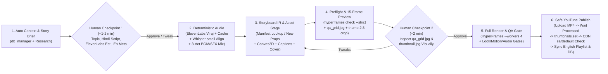

# Sutradhar Video Production System — Complete Redesign, Re-Architecture & Implementation Plan

> **Document Status:** Master Architecture & Implementation Specification (Pre-Implementation Planning Stage — Awaiting User Approval)  
> **Historical Record:** [VIDEO_STYLE_EXPLORATION_PLAN.md](file:///C:/Users/manis/Projects/Sutradhar/docs/VIDEO_STYLE_EXPLORATION_PLAN.md) (preserved intact as the chronological audit, POC exploration, Ep 3 replacement, and thumbnail fix record)  
> **Constraints:** Hydrogen via Antigravity only · ElevenLabs Starter only (`$0` additional spending) · `30 Shorts / month` target · Hindi narration & captions · English thumbnails & YouTube metadata

---

## Table of Contents

1. [Executive Summary & Transformation Objective](#1-executive-summary--transformation-objective)
2. [Current Architecture & Complete Root-Cause Analysis](#2-current-architecture--complete-root-cause-analysis)
3. [Final Visual Direction & Design System (Candidate B + V1 Sunrise Synthesis)](#3-final-visual-direction--design-system-candidate-b--v1-sunrise-synthesis)
4. [Playground Asset & Technique Extraction Plan](#4-playground-asset--technique-extraction-plan)
5. [Complete Asset Library Replacement & Migration Strategy](#5-complete-asset-library-replacement--migration-strategy)
6. [Target Codebase Architecture & Module Reorganization](#6-target-codebase-architecture--module-reorganization)
7. [Database Schema & Data-Model Redesign](#7-database-schema--data-model-redesign)
8. [Complete Audit & Redesign of `docs/INSTRUCTIONS.md`](#8-complete-audit--redesign-of-docsinstructionsmd)
9. [End-to-End Semi-Automated Production Workflow (30 Shorts/Month)](#9-end-to-end-semi-automated-production-workflow-30-shortsmonth)
10. [ElevenLabs Starter Optimization, Hindi Alignment & Audio Mastering](#10-elevenlabs-starter-optimization-hindi-alignment--audio-mastering)
11. [Thumbnail Generation & YouTube Publishing Reliability](#11-thumbnail-generation--youtube-publishing-reliability)
12. [Live Episode 3 (`oBcyiPy26rg`) & Channel Metadata Harmonization Plan](#12-live-episode-3-obcyipy26rg--channel-metadata-harmonization-plan)
13. [Centralized Language Policy Enforcement](#13-centralized-language-policy-enforcement)
14. [Technical Research & Zero-Cost Tool Evaluation](#14-technical-research--zero-cost-tool-evaluation)
15. [Automated Testing & Fail-Closed Quality Gates](#15-automated-testing--fail-closed-quality-gates)
16. [Phased Implementation Roadmap & Acceptance Criteria](#16-phased-implementation-roadmap--acceptance-criteria)
17. [Sample End-to-End Acceptance Verification Protocol](#17-sample-end-to-end-acceptance-verification-protocol)
18. [Risks, Constraints & Mitigation Matrix + Open Decisions](#18-risks-constraints--mitigation-matrix--open-decisions)

---

## 1. Executive Summary & Transformation Objective

The existing `Sutradhar` production pipeline passes `168` automated unit tests while historically producing ~`1/10` visual quality videos because its runtime violated the HyperFrames seek contract, silently discarded all subtitles on key mismatches, froze static DOM SVGs inside dark theater borders, hid missing VFX/transitions behind synthetic QA telemetry, stripped TTS `[pause]` tags, mis-aligned Devanagari words, and uploaded Shorts thumbnails before video processing finished.

Meanwhile, controlled experimentation in `playground/` proved that two complementary visual and engineering approaches succeed natively on the exact zero-additional-cost stack (**Hydrogen + HyperFrames `0.9.70` + GSAP `3.15.1` + Canvas2D/DOM + ElevenLabs Starter + FFmpeg 7.1 + local `faster-whisper`**):
- **`Candidate B — Ref-1 Inspired Cinema`** ([candidate_b_ref1_cinematic.mp4](file:///C:/Users/manis/Projects/Sutradhar/playground/candidate_b_ref1_cinematic/candidate_b_ref1_cinematic.mp4), `36,921,509 B`, `63.533s`, `1080×1920@30fps`): Proved that clean Canvas2D articulated character rigs, unified floor grounding (`HORIZON_Y = 1142`), storytelling props & progressive infographic visuals, lateral pan continuity, clean unobstructed stage margins, and crisp 34-cue multi-track SFX/BGM soundscapes can achieve HyperFrames `--strict` (`7/7` suites, `0` errors) and publish cleanly as Episode 3 (`oBcyiPy26rg`) with CDN-verified (`MAE = 0.24`, `dhash = 0`) custom thumbnail `sardefault.jpg`.
- **`V1 — Dawn Ridge`** ([v1_dawn_ridge.mp4](file:///C:/Users/manis/Projects/Sutradhar/playground/v1_dawn_ridge_benchmark/v1_dawn_ridge.mp4), `112,807,077 B`, `63.503s`): Proved a deterministic multi-plane Canvas atmospheric system with evolving dawn sky palettes, additive solar disc & breathing god-rays, soft feathered clouds, 5-plane horizon-mist mountain ridges (`l.fog`), depth-parallax motion (`0.03..1.0`), swaying flora/motes, and `5%` shifted seeded grain achieving `96.3%` temporal motion (`3.68%` static).

**Redesign Goal:** Extract the strongest modules from Candidate B and V1 into a declarative, modular, story-adaptive production architecture; eliminate broken SVG rigging, synthetic drones, and conflicting rules; rewrite `docs/INSTRUCTIONS.md` into an authoritative directing system; preserve and generalize all thumbnail/CDN safeguards; enforce clean English metadata / Hindi audio separation; and support **30 Shorts/month** within ElevenLabs Starter's `30,000` credits/month base budget with minimal, high-leverage human checkpoints.

---

## 2. Current Architecture & Complete Root-Cause Analysis

### 2.1 End-to-End Comparison: Old Production vs Playground Proven Baseline

| Subsystem | Old Production Baseline (`scripts/`, `templates/`, `assets/`) | Proven Playground & Recent Fixes (`playground/`, `thumbnail_utils.py`) | Measured Impact |
| --- | --- | --- | --- |
| **Seek Contract & Engine** | `masterTl = gsap.timeline({ paused: false })`, `repeat: 60` + `gsap.delayedCall` loops, detached `lipTl`, `.call()` DOM swaps, 4,606-line `build/composition/index.html` outside project | Pure seek-driven `proxy = { t }` (`ease: "none"`) + `hf-seek` listener calling deterministic `renderWorld(t)`, seeded Lehmer PRNG, zero `.call()` mutations | `hyperframes check`: old `sweep_static` failure (`62.5%` static) vs **7/7 strict pass** (`3.68%` static in V1) |
| **Hindi Kinetic Captions** | `subtitle_engine.py` reads `start_sec`/`end_sec`, whereas `build_audio.py` emits `start`/`end`/`global_start` -> cues collapse to `0.00..0.42s`; `bottom: 340px` in blocked zone; no bundled Devanagari `.woff2` | `captions_data.js` (`41` 1–4 word cues, `23` keywords) + `poc_shared_composer.py::_write_captions_html` at `top: 1274px` + 31 local SIL OFL `.woff2` fonts (`Noto Sans Devanagari`) | Zero vanished subtitles; readable, zero-overlap bottom-center kinetic highlights |
| **Character Grounding & Rigs** | `480×960` (1:2) DOM wrapper around `800×1200` (2:3) SVGs leaves feet `150–250px` above shadow; `composer.py` L360 skips single-char scale; `cssText` wipes `--rot-*`; `sutradhar_narrator.svg` uses `display: none` + lacks joints | Canvas2D articulated `drawRef1Character` grounded at `(0,0)` on `HORIZON_Y=1142` wall/floor seam (`Y=1226..1230`) with exposed sandals, dual floor shadows, Padmasana cushions, stepped daises | Eliminated floating stick-dolls, broken joints, and scale lock |
| **Environments, Props & VFX** | Hardcoded proscenium bars (`120px` top, `48px` sides, `520px` black void), `"vfx_elements": []`, omitted transitions, `fire_brazier` (`z=22`) behind narrator legs (`z=40`) | Full-bleed Canvas architectural interiors & V1 atmospheric dawn landscapes (`drawSunOrAura`, `drawClouds`, `drawRidges`), 9 grounded animated props/infographics, whip blurs, embers, petals | Upgraded visual telemetry and authentic spatial storytelling |
| **Audio & Alignment** | `build_audio.py` L825 strips `[tags]` before L837 check (erasing `[pause]`), hostile antagonist fallback, `base` Whisper yields Scene 6 `match=0.3` (`"देवी"` `5.08s`), `build_assets.py` synthetic `sine=` BGM/SFX | `mix_candidate_audio.py` mixes 48kHz voice EQ + Pixabay-licensed HyperFrames bundled SFX + crossfaded 3-act BGM (`ratio=6.5` ducking) to `-14.0 LUFS` / `-1.5 dBTP` | Broadcast audio balance (`-13.90 LUFS`, `-1.50 dBTP`); still needs Whisper `small` + energy-burst alignment fix |
| **QA & Verification** | `preview_frames.py` skips `hyperframes check --json` & inspects 1 midpoint frame/scene; `qa_verifier.py` generates fake `dom_snapshots`; `kinocut` dark `90.0` masks failure | `poc_runner.py` enforces `hyperframes check --strict --safe-zone shorts`, 15-frame review grid, `hyperframes measure look`, KinoCut `default` + `ui-capture-dark` | Real visual & motion checks replace synthetic passes |
| **Thumbnail & Publishing** | Raw `ffmpeg` video frame grab (`1080×1920`), `thumbnails.set` invoked while `processingStatus="processing"` (drops `shortsAspectRatio`), Hindi `defaultLanguage`, Hindi playlists | Dedicated `1080×1920` cover art (`2:3` safe margins `top: 255px`, `bottom: 208px`), waits for `processingStatus=="succeeded"`, CDN `sardefault.jpg` fetch & `MAE/dhash` check | Live `oBcyiPy26rg` `sardefault.jpg` HTTP `200`, `MAE=0.24`, `dhash=0`, `30/30` API checks |

### 2.2 Detailed Defect Catalogue (Root Cause per Code Component)

1. **`scripts/engine/composer.py` & `templates/composition/`:**
   - **Broken scale & multi-character crowding (`L263–328`, `L360–399`):** Mounts every episode character simultaneously and only runs staging on two-character scenes (`if beat.primary_character and beat.secondary_character:`), freezing solo shots at `0.75x`. Inline `p1El.style.cssText = ...` (`engine.js.jinja2` L66) erases animated `--rot-*` CSS custom properties.
   - **Scene-wrapper camera bug:** Camera moves only transform `.backdrop-wrapper`, leaving foreground characters & props unmoved (disconnected parallax).
   - **Hardcoded zero VFX & dead transitions (`L566`):** Returns `"vfx_elements": []`; `shatter_transition`, `border_wipe`, `blind_wipe`, `radial_wipe`, and `fade` have no timeline execution paths.
2. **`scripts/engine/subtitle_engine.py` (`L128–129`), `puppet_rig.py` (`L336–434`), `lipsync_engine.py` (`L252–289`):**
   - **Schema drift:** `subtitle_engine.py` expects `"start_sec"`/`"end_sec"`, receives `"start"`/`"end"` from `build_audio.py`, collapses cues to `[0, 0.3s]`. Hardcoded Ravana/Kailash keywords (`DEFAULT_KEYWORD_PATTERNS` L31–41) do not adapt to historical or cosmic scripts.
   - **Non-seekable GSAP:** Creates `lipTl` referencing scene-local `w.get("start")` rather than `global_start` (observed generating negative/backward timestamps in `build/composition/engine.js` L231–265) and launches unbounded `ContinuousLifeEngine` loops outside `masterTl`.
3. **`assets/svg/` (`42` files) & `assets/manifest.yaml`:**
   - **`sutradhar_narrator.svg`** lacks `--rot-*` vars, `#torso_group`, `#eyes_normal`, `#mouth_shout/fear/joy`, and hides `#mouth_talk` via `display: none`.
   - **Cross-rig naming fragmentation:** `shiva.svg` (`#shiva_thigh_left_rot`) and `mandodari`/`indra_dev`/`surya_dev` (`#<name>_torso_group`) mismatch `ContinuousLifeEngine`'s query (`#torso_group, #shani_torso_group`), breaking idle breathing/shifts.
   - **`assets/fonts/` missing (`0` files):** Production CSS calls `'Playfair Display'`, `'EB Garamond'`, `'Noto Sans Devanagari'` with zero bundled `.woff2` files on disk.
   - **Nonexistent Ep 1 asset reference:** `episodes` row 1 (`episode_id=1`) references `assets/svg/diagrams/shani_drishti_mandala.svg`, and `assets/svg/diagrams/` does not exist on disk (`MANIFEST_KEYS` confirms SVGs were split into `props/` and `infographics/`).
4. **`scripts/build_audio.py` & `scripts/elevenlabs_engine.py`:**
   - **Inline vocal tag deletion (`L825–847`):** Calls `strip_audio_tags` before checking for leading tags, making L837 unreachable and stripping mid-sentence `[pause]` markers (confirmed in Ep 3 scenes 4–5).
   - **Unmapped emotion fallback (`L233–234`):** Defaults unrecognized `character_dialogue` emotion combinations to `antagonist` (`[arrogant, booming, furious, shouts]`).
   - **Devanagari alignment drift (`L457–638`):** Uses `faster-whisper base` over PyAV-monkeypatched 44.1kHz WAVs (`match_ratio` `0.4211` in Scene 3, `0.3` in Scene 6 stretching `"देवी"` across `5.08s`) with pure character-length interpolation and zero audio-energy onset anchoring.
   - **Identity pronunciation file (`pronunciations_hi.yaml`):** 11 of 16 mappings map strings identically to themselves; `ipa_replacements` (`build_audio.py` L168–174) is dead code.
   - **Raw synthetic audio (`build_assets.py`):** Produces pure FFmpeg sine/noise synthesis rather than curated musical stems and realistic SFX.
5. **`scripts/preview_frames.py`, `scripts/render_and_qa.py`, `scripts/engine/qa_verifier.py`:**
   - `preview_frames.py` runs `hyperframes lint` only (ignoring `hyperframes check --strict --json` and multi-timestamp motion checks).
   - `render_and_qa.py` evaluates `collect_sfx_schedule` against raw `audio_manifest.json` before inferred props exist, queues SFX for unimplemented outro curtains, omits `dom_snapshots` when invoking `qa_verifier.py`, and relies on `kinocut` `ui-capture-dark` (`90.0`).
   - `qa_verifier.py` fabricates synthetic `dom_snapshots` (`L345–381`) when omitted so Gate 2 always passes.
6. **`scripts/db_manager.py` & `scripts/publish_youtube.py`:**
   - `--context` outputs unbounded episode summaries/assets + >1,000 tokens of contradictory prose guidelines; `cmd_create_series` queries only `status = 'COMPLETED'` so open-ended active series (`total_planned_episodes: null`) never rotate pillars; `StoryPhase` cliffhanger checks ignore Hindi phrases; Series 1 has `completed_episodes=0` despite published `cd1cc1mhfwg`.
   - `publish_youtube.py` reads `pub_cfg.get("category_id")` instead of `channel.category_id`, couples `defaultLanguage` to `hi`, creates Devanagari playlists, hardcodes 3 tags, and swallows playlist errors.

---

## 3. Final Visual Direction & Design System ("Sutradhar Kinetic Storycraft")

The production aesthetic unifies **Candidate B's illustrated Ref-1 storytelling clarity** with **V1 Dawn Ridge's dynamic sunrise and atmospheric depth** as a structured, modular design system — **not** rigid one-size-fits-all theater framing.

### 3.1 Core Aesthetic DNA
1. **Rich Flat-Vector & Atmospheric Hybrid:**
   - Clean, bold silhouettes and legible geometric proportions (`Candidate B`: `#0C1023` cosmic indigo, `#0D3B44` teal court, `#4C1623` royal crimson, `#5A3220` perspective teak floor, `#F6C453` brass/gold accents, `#E8B186` warm skin) **paired with** atmospheric depth gradients, glowing horizon mist (`V1` `l.fog`), volumetric god-rays, and subtle `5%` deterministic grain whenever environments open outdoors or into cosmic vistas.
2. **Spatial Grounding & Camera Continuity Law (`Zero Floating Objects`):**
   - **Unified Grounding Coordinates (`1080×1920` Canvas):**
     - **Architecture / Interior Stage:** Horizon wall-floor baseboard fixed cleanly via parameterized `horizonY` (default `1142` for story shots beneath `1274px` captions; `1445` for full-bleed cover thumbnails without subtitles). Standing feet anchor directly onto floorboards at `horizonY + 84..88` (`1226..1230`) with sandaled toes, golden anklets (*nupura*), and two-layer cast elliptical floor shadows centered at `(0, 0)`. Seated characters anchor cleanly on silk dais/lotus seat planes; artifacts rest flush on pedestals, tables, niches, or desks.
     - **Outdoor / Landscape Stage (V1 Synthesis):** Characters/trees/temples stand strictly along computed ridge crest points (`ridge[x] + embedOffset`) with anchored base shadows, framed inside near/far ridge depth planes (`df = 0.06..0.69`).
   - **Continuous Pan & Depth Parallax:** Adjacent spatial scenes connect via smooth colonnade/landscape camera pans (`pan_left`/`pan_right`/`push_in`/`pull_out`) applying `camX * depthFactor` per plane (`0.03` stars, `0.05` sun/god-rays, `0.12..0.40` clouds/mid-arches, `0.65` near hills/columns, `1.0` heroes/props).
3. **Unobstructed Frame Discipline & Safe Zones:**
   - **No permanent top progress bar and no noisy episode badges.** Top-center contextual callout pills remain **off by default** (`include_editorial=false`) and appear **strictly when narrative clarity demands a concise landmark, count, or entity contrast** (`title_cards` / `character_labels`, max `2–4` words, within `y = 260..390`).
   - **YouTube `9:16` + `2:3` Shorts Safe Zones:**
     - **Video Active Stage:** Primary heads/expressions reside within `y = 290..1150`, keeping the bottom-center Hindi kinetic caption lane (`top: 1274px`, `height <= 145px`) completely unobstructed above YouTube's bottom player overlay (`y >= 1430`) and clearing right-edge engagement icons (`x >= 888`).
     - **Thumbnail Safe Zone (`1080×1920` & `2:3` Center Crop `y = 150..1770`):** Top typography badge starts at `top >= 250px` (`>= 100px` inside `2:3` crop, clear of top-left `"New"` badge) and bottom signature band sits at `bottom >= 205px` (`>= 55px` above `2:3` bottom cut).

### 3.2 Narrative-Adaptive Visual Grammar Matrix (Four Modes)

AI scene planners select the visual grammar per beat rather than forcing every story into a fixed box:

| Story / Beat Situation | Primary Visual Environment | Lighting & Atmospheric Layer | Character / Camera Staging | Graphic / Prop Treatment |
| --- | --- | --- | --- | --- |
| **1. Royal Court / Palace Mythological Drama** | `architectural_stage.js` interior (`dado`, fluted plinth columns, carved balcony windows, floor planks/carpet, optional opening curtains in Beat 1 only) | Warm diya flicker halos, focus vignette rack (`background brightness 0.30` spotlighting speaker) | Medium/full grounded articulated puppets (`Y=1226`), eye contact & gesture keyframe lerp, lateral colonnade pans | Handed props (bowls, crowns, scrolls), subtle golden focus aura |
| **2. Dawn / Epic Quest / Himalayan & Outdoor Awakening** | `atmosphere_v1.js` sky + `SunDisc` + `FogRidgeStack` (5 depth planes) + `FeatheredCloudLayer` + temple domes/pine silhouettes | Evolving sky stops & crest warmth synced to timeline `p`, additive `lighter` solar rays, `ambientMotes`, `5%` shifted grain | Wide-to-medium push-in framing (`scale 1.0 -> 1.11`), bird flocks, swaying trees/grass blades, lantern glow silhouettes or foreground travelers | Floating atmospheric emblems, rising dawn transition into daytime action |
| **3. Historical / Archaeological Discovery** | Textured courtyard/pillar architecture, parchment scroll tabletops, architectural cutaways | Focused gallery spot lighting, dust motes, warm parchment vignette | Hero scholar/king alongside grounded physical artifact pedestal (`scale` cut-ins, detail zoom) | Circular magnifying inspection lens, route scroll paths (`stroke-dashoffset` trajectory), artifact callout pills |
| **4. Cosmic & Vedic Scientific Paradox** | Deep indigo nebula, `starfield` / `spiral-galaxy`, minimal grid blueprint planes (`60px` rule grid) | Slow glow halos, orbital luminescence, echo-smear radial motion trails | Split comparison frames, progressive reveal anchored directly to spoken anchor words | One-part-at-a-time growing models (2-clock race bars, spacetime curvature funnel, `27`-sector lens, Kalachakra cosmic rings) |

---

## 4. Playground Asset & Technique Extraction Plan

Every proven module in `playground/` maps directly to permanent parameterized production modules:

| Playground Source (`path` & exact symbols/lines) | Origin | Target Production Module | Extraction & Generalization Strategy |
| --- | --- | --- | --- |
| `playground/v1_dawn_ridge_benchmark/src/canvas_v1.js`: `makeRidge` (`L26–38`), `drawSky` (`L93–100`), `drawMilkyWayBand` (`L102–117`), `drawStars` (`L119–134`), `drawSunOrAura` (`L136–164`), `drawCloud`/`drawClouds` (`L166–190`), `drawRidges` (`L192–208`) | V1 | `templates/runtime/backdrops/atmosphere_v1.js` | Replace fixed arrays/globals with `AtmosphereEngine(cfg, prng)` accepting `{ skyStopsFrom/To, sunPos, sunInt, rayCount, rayAngle, ridges, cloudSpec, fogBlend, stars }` so any pillared outdoor or sunrise beat works parametrically. |
| `canvas_v1.js`: `drawPine` (`L210–226`), `drawTempleDome` (`L228–267`), `drawKalachakra` (`L269–347`), `drawMotes` (`L491–509`), `drawBirds` (`L511–529`), `noiseCv` grain/vignette (`L79–91`, `L1098–1129`), `blendCv` crossfade (`L1054–1096`) | V1 | `templates/runtime/fx/post_fx.js` & `atmosphere_v1.js` | Extract offscreen grain tile, radial vignette, offscreen scene-transition buffer (`xfade`, `dip`, `whip`), Kalachakra chakra prop, flora sway, and depth-sorted motes into shared Canvas helpers. |
| `playground/scripts/build_candidate_b.py::WORLD_JS`: `drawPalaceInterior` (`L126–273`) & thumbnail floor (`L1991–2015`) | Cand B | `templates/runtime/backdrops/architectural_stage.js` | Parameterize `horizonY`, `wallPalette`, `floorPalette`, `carpetSpec`, `columnStyle`, `windowLit`, `hasDiyas`, `curtainOpenProgress` (`0..1`) with unified perspective plank projection. |
| `WORLD_JS`: `drawRef1Character` (`L348–883`), `drawJointedArm` (`L574–622`), faces/crowns/beards/instruments | Cand B | `templates/runtime/rigs/character_engine.js` + `assets/characters/*.json` | Decouple appearance tokens (`skin`, `dhoti`, `sash`, `crown`, `hair`, `accessories`) from kinematic skeleton (`shoulder/elbow/wrist/torso/head/blink/mouth` continuous lerp interpolation) so 1 deep rig engine powers arbitrary characters without copy-pasting draw code. |
| `WORLD_JS`: `drawGroundedHourglassStand` (`L276–342`), `drawBrassClock` (`L886–940`), `drawVectorEarthGlobe` (`L942–972`), `drawClockShrineNiche` (`L992–1016`), Map Scroll (`L1149–1255`), Magnifying Lens (`L1443–1489`), Relativity/Two-Clock (`L1507–1613`), Mandap/Kalash (`L1682–1779`), Mandala (`L1798–1819`) | Cand B | `templates/runtime/props/props_library.js` | Turn every inline scene prop into a clean declarative renderer `(ctx, propState, t, progress)` grounded at `(x, y)` with animation progress `0..1`. |
| `playground/scripts/poc_shared_composer.py` (`L18–178`, `L180–459`) | Shared | `scripts/visual/stage_composer.py` + `templates/runtime/core/seek_runtime.js` + `captions_overlay.js` | Port exact `proxy = { t }` GSAP contract, `hf-seek` handler, strict non-overlapping `.caption-group` timing clamp (`endT = min(end, nextStart - 0.03)`), and optional opt-in `editorial` overlays; retire `.call()` timeline mutations completely. |
| `WORLD_JS::drawWhipBlurOverlay` + HyperFrames Registry (`cinematic-zoom`, `chromatic-radial-split`, `directional-wipe`, `transitions-radial`, `grain-overlay`, `starfield`, `sun-burst`, `camera-rig-depth-stack`, `caption-editorial-emphasis`) | Cand B + HF OSS | `templates/runtime/fx/transitions.js` + `hyperframes add` components | Use Canvas whip/iris/dip wipes cleanly between Canvas scenes and selectively install verified OSS HyperFrames blocks (`starfield`, `grain-overlay`, `caption-*`) where appropriate. |
| `playground/scripts/build_candidate_b.py::THUMBNAIL_HTML` (`L1874–2250`) | Cand B | `templates/thumbnail/cover_template.html.jinja2` | Eliminate the 300-line duplicate canvas character/clock drawing inside `THUMBNAIL_HTML` by importing `character_engine.js` & `props_library.js` directly, retaining `1080×1920` layout + `top: 255px` / `bottom: 208px` `2:3` safe margins. |
| `playground/shared/fonts/*` (31 `.woff2` + `fonts.css`) | Shared | `assets/fonts/` (moved permanently out of `playground/`) | Copy all 31 SIL OFL `.woff2` font files & unified `fonts.css` into production `assets/fonts/` so both video compositions and thumbnails work 100% offline. |
| `playground/scripts/mix_candidate_audio.py` & `HF SFX` (`node_modules/hyperframes/.../sfx/*.mp3`) | Cand B | `scripts/audio/mixer.py` + `assets/audio/sfx/` | Copy/reference the 19 Pixabay-licensed bundled HyperFrames SFX (`CREDITS.md` verified `$0` commercial OK) alongside `mix_candidate_audio.py`'s declarative 3-act BGM crossfade, voice EQ/presence chain, and sidechain ducking (`threshold=0.028, ratio=6.5`). |
| `playground/scripts/poc_runner.py` & `replace_ep3_youtube.py` | Both | `scripts/qa/` & `scripts/publishing/` | Promote `--strict --safe-zone shorts`, multi-timestamp contact sheets, `measure look`, dual KinoCut scoring, phased upload safeguards, binary SQLite backup, and `publishing_history`. |

---

## 5. Complete Asset Library Replacement & Migration Strategy

The user has explicitly authorized replacing inferior existing SVGs (`assets/svg/*`) and synthetic drones cleanly rather than preserving broken legacy structures. **No deletion happens during planning**; execution replaces assets cleanly once every reference in scripts, templates, tests, and `episodes.db` is migrated.

### 5.1 What Gets Replaced, Reused, Adapted, or Created

1. **Characters (`assets/svg/characters/` [10 files] -> Replace with Parametric Canvas/SVG Rig Profiles `assets/characters/*.json` + Hybrid SVG Accessory Partials):**
   - **Retire/Replace (`10` legacy brittle DOM SVGs):** `sutradhar_narrator.svg`, `ravana.svg`, `shiva.svg`, `hanuman.svg`, `narad_muni.svg`, `mandodari.svg`, `indra_dev.svg`, `shani_dev.svg`, `surya_dev.svg`, `ancient_scholar.svg`.
   - **Replacement Design:** Every character becomes a clean **data-driven Character Definition JSON** (`assets/characters/<id>.json`) consumed by the single deep `character_engine.js` Canvas2D renderer (grounded at `(x, footY)` with continuous FK shoulder/elbow/wrist/head/torso keyframes, high-arched hairline, animated eyes/brows/mouth phonemes, optional multi-head/multi-arm/beard/crown/weapon/garment palettes). For close-up illustrated portraits or unique mythological insignia (e.g., Ravana's 10-head crown crest, Shiva's Trishul/damaru, Balarama's Halayudha), lightweight Canvas path drawers or clean SVG vector partials are registered modularly cleanly inside `assets/custom_parts/`.
   - **Visual Consistency Across Episodes:** Shared skin tones (`warm_ivory`, `royal_wheat`, `blue_divine`, `ash_vibhuti`), shared stroke ink (`#3B1E12`), unified crown filigree geometry, and locked proportional limb ratios guarantee returning series characters (Kakudmi, Revati, Balarama, Shani, Ravana, Sutradhar) look identical across episodes.
2. **Backdrops (`assets/svg/backdrops/` [15 files] -> Replace with Environment Preset Catalog `assets/environments/*.json` + Reusable Layered Renderers):**
   - **Retire/Replace:** All 15 flat polygon/black-slab backdrop SVGs (`mount_kailash.svg`, `brahmaloka_time_chakra.svg`, `mehrauli_iron_pillar.svg`, etc.). Keep Ep 1–3 historical paths valid in `publishing_history`/`legacy_asset_note` or map them smoothly via alias resolution during DB migration.
   - **New Production Presets:** Parametrized JSON configs pairing `atmosphere_v1.js` + `architectural_stage.js`: `dawn_ridge_kailash`, `cosmic_brahmaloka_court`, `royal_palace_colonnade`, `temple_mandap_twilight`, `ancient_courtyard_archaeology`, `vedic_cosmos_observatory`, `forest_ashram_rays`, `parched_drought_horizon`, `ocean_dawn_shore`. New episode backdrops simply customize palette/column/mountain/celestial parameters or compose bespoke landmarks (`mehrauli_pillar_relief`, `nalanda_observatory`) cleanly!
3. **Props, Infographics & VFX (`assets/svg/props/` [7], `infographics/` [5], `vfx/` [5] -> Unified Declarative `assets/props/` & `templates/runtime/` Modules):**
   - **Extract & Upgrade from Candidate B:** `brass_echo_clock`, `pedestal_hourglass`, `spinning_earth_globe`, `clock_shrine_niche`, `parchment_route_scroll`, `magnifying_sector_lens`, `spacetime_two_clock_comparator`, `wedding_mandap_kalash`, `cosmic_kalachakra_lotus`.
   - **Adapt from Legacy Concepts (Better Execution):** Replace crude `vedic_kundali.svg`, `planetary_staircase.svg`, `comparison_card.svg`, `screen_shatter.svg` with genuine Ref-1/HyperFrames Canvas + SVG animated primitives (`growing_chart_node`, `orbit_diagram`, `timeline_slider`, `radial_iris_wipe`, `ember_drift`, `petal_shower`, `whip_smear`, `crack_propagation`, `sonic_ripple`).
   - **Bespoke Asset Policy Update:** Replace the brittle rule *"must save a static diagram SVG under hardcoded folder"* with *"every episode must feature at least one story-specific visual prop, landmark backdrop customization, or animated explanatory visual registered cleanly in `assets/manifest.yaml` (or scoped under `assets/episodes/<ep_id>/`) when reusable."*
4. **Fonts (`assets/fonts/` — Currently EMPTY -> Populate with 31 SIL OFL `.woff2` Files):**
   - Promote all `31` fonts + `fonts.css` from `playground/shared/fonts/` into `assets/fonts/` (`Noto Sans Devanagari`, `Tiro Devanagari Hindi`, `Rozha One`, `Cinzel`, `Cormorant Garamond`, `Inter`). Verify `font-display: block` + `await document.fonts.ready` inside headless HyperFrames.
5. **Audio Library (`assets/bgm/` [10 `.mp3`] & `assets/sfx/` [17 `.wav`] + Bundled Pixabay HyperFrames SFX):**
   - **Retire synthetic `build_assets.py` sine-wave generators** as primary audio!
   - **SFX Upgrade (`assets/sfx/`):** Import the 19 Pixabay-licensed (`CREDITS.md` verified free commercial use) HyperFrames SFX (`whoosh-cinematic`, `whoosh-short`, `impact-bass-1/2`, `click-soft`, `pop`, `sparkle`, `chime`, `ping`, `riser`, `glitch-1..3`, etc.), retain only acoustically verified distinct `.wav` cues (e.g. `conch_blast`, `thunder_rumble`, `cosmic_chime`, `curtain_whoosh`), and organize by cue category (`transition`, `reveal`, `ui_pop`, `mythic_impact`, `ambient_bed`).
   - **BGM Upgrade (`assets/bgm/`):** Replace identical copied alias `.mp3` files (`dramatic_mythology.mp3` etc. were clones of `theatrical_narrative.mp3`!) with genuinely distinct, freely licensed (`CC0` / Pixabay / Musopen / public domain) acoustic/cinematic Indian & ambient instrumental tracks curated once offline at `$0` cost — **OR** clearly gate fallback drone synthesis strictly as emergency degraded mode (`allow_synth_fallback: false` in production QA).

### 5.2 Dependency Mapping & Clean Deletion Checklist (For Execution Phase)
Before removing any file under `assets/svg/`, tests and scripts will be migrated first in Phase 2–4:
- Update `scripts/db_manager.py::cmd_context()` `available_rigs` scanner to read unified `assets/manifest.yaml` v2 (`characters`, `environments`, `props`, `fonts`, `bgm`, `sfx`) instead of hardcoded `.svg` file globs.
- Update `tests/test_render_pipeline.py` & `tests/test_db_manager.py` asset existence tests against `assets/manifest.yaml` v2 before archiving/removing legacy SVGs (`assets/svg/`).
- Preserve `episodes` rows 1–3 audit integrity by storing `legacy_asset_path` metadata safely so historical rows never fail FK/validation checks.

---

## 6. Target Codebase Architecture & Module Reorganization

Applying deep-module design (`codebase-design` principles: few deep interfaces at crisp seams, dependency injection for testability, zero duplicated helpers):

```text
Sutradhar/
├── config.yaml                         # Single source of truth (channel audio/caption/metadata split, paths, QA thresholds)
├── pronunciations_hi.yaml              # Cleaned authentic Devanagari phonetic overrides (no identity mappings)
├── docs/
│   ├── INSTRUCTIONS.md                 # Authoritative context-aware Creative & Production Spec for AI Agents
│   ├── VIDEO_STYLE_EXPLORATION_PLAN.md # Historical audit & Candidate B / V1 exploration record
│   ├── VIDEO_PRODUCTION_REDESIGN_PLAN.md # Master architecture & roadmap (this file)
│   ├── SETUP_AND_OPERATIONS.md         # Lean CLI & operational runbook
│   └── schema.sql                      # Canonical SQLite v4 schema (incl. series localization & publishing_history)
├── assets/
│   ├── manifest.yaml                   # Schema v2.0 machine-readable asset registry
│   ├── fonts/                          # 31 SIL OFL .woff2 fonts + fonts.css
│   ├── characters/                     # Parametric Ref-1/Cand-B character specs (*.json) + optional vector crests
│   ├── environments/                   # Parameterized V1 dawn + Ref-1 architectural backdrop presets (*.json)
│   ├── props/                          # Declarative animated prop & infographic definitions
│   └── audio/
│       ├── bgm/                        # Curated royalty-free multi-act musical beds
│       └── sfx/                        # Bundled Pixabay SFX + distinct foley cues + CREDITS.md
├── templates/
│   ├── runtime/                        # Clean ES/JS deterministic Canvas2D + GSAP HyperFrames modules
│   │   ├── index.html.jinja2           # Thin declarative composition shell (mounts runtime modules + captions + audio)
│   │   ├── core/seek_runtime.js        # Deterministic proxy={t} timeline, hf-seek, seeded PRNG, camera transforms
│   │   ├── backdrops/atmosphere_v1.js  # V1 Dawn Ridge sky, rising sun, god-rays, feathered clouds, fog ridges, motes
│   │   ├── backdrops/architectural_stage.js # Ref-1 perspective floor/wall seam, pillars, carpet, diyas, curtains
│   │   ├── rigs/character_engine.js    # Articulated Ref-1/Cand-B vector rig, continuous FK lerping, shadows, expressions
│   │   ├── props/props_library.js      # Grounded brass clock, hourglass, scroll map, sector lens, funnels, mandap, chakra
│   │   ├── fx/transitions.js           # Whip smear, iris circle, dip cut, focus rack, alpha crossfade, vignette, grain
│   │   └── captions/captions.html.jinja2 # Zero-overlap kinetic Hindi captions (top: 1274px, bundled fonts, fitText safe)
│   └── thumbnail/
│       └── cover_template.html.jinja2  # Shared 1080x1920 English cover composer importing runtime character/prop JS
├── scripts/                            # Thin, stable 7+1 CLI entrypoints calling modular internal packages
│   ├── sutradhar/                      # Deep cohesive Python modules behind clean CLI facades
│   │   ├── config.py                   # Validated config + strict LanguagePolicy (hi narration/captions vs en meta/thumb)
│   │   ├── db.py                       # Schema v4 migrations, lean --context, series/pillar rotation, history & repair
│   │   ├── models.py                   # Pydantic v2 EpisodePlan, SceneVisualSpec (Storyboard IR), PublishResult
│   │   ├── audio/
│   │   │   ├── elevenlabs_tts.py       # Pre-flight quota cap, inline-tag-safe chunking, SHA-256 WAV/MP3 cache
│   │   │   ├── whisper_aligner.py      # FFmpeg 16kHz PCM, faster-whisper small + RMS speech-burst onset anchoring
│   │   │   └── sound_mixer.py          # Declarative BGM 3-act splice, Pixabay SFX, voice EQ, sidechain & 2-pass loudnorm
│   │   ├── visual/
│   │   │   ├── caption_builder.py      # 1-4 word Hindi cue chunker, endT overlap guard, contextual keyword detector
│   │   │   ├── storyboard_composer.py  # Compiles Storyboard IR + AudioManifest into HyperFrames HTML + motion assertions
│   │   │   └── thumbnail_builder.py    # Renders dedicated 1080x1920 English cover with 2:3 Shorts safe-zone checks
│   │   ├── qa/
│   │   │   ├── hyperframes_runner.py   # Subprocess wrapper (`lint`, `check --strict --safe-zone shorts`, `snapshot`, `measure look`)
│   │   │   ├── audio_inspector.py      # FFmpeg `ebur128`, `silencedetect`, spectral floor + A/V hit onset validation
│   │   │   └── quality_gate.py         # Real DOM/Canvas telemetry verification + dual-profile KinoCut (zero fake snapshots)
│   │   └── publishing/
│   │       ├── thumbnail_verifier.py   # Migrated `thumbnail_utils.py` (pre-validation, post-processing wait, CDN MAE/dhash)
│   │       ├── metadata_policy.py      # English title/desc/tags builder, scriptural citations, playlist localization
│   │       └── youtube_client.py       # Resilient YouTube Data API v3 upload, playlist sync, post-upload audit
│   ├── db_manager.py                   # Preserved stable CLI facade
│   ├── build_audio.py                  # Preserved stable CLI facade
│   ├── preview_frames.py               # Upgraded preflight CLI (`check --strict`, 15-frame storyboard grid + thumb preview)
│   ├── render_and_qa.py                # Upgraded render + audio master + fail-closed QA gate CLI
│   ├── publish_youtube.py              # Upgraded YouTube publisher + CDN verification CLI
│   └── thumbnail_utils.py              # Backward-compatible re-export of `sutradhar.publishing.thumbnail_verifier`
└── tests/                              # Deterministic offline/mocked unit + contract + Chromium visual smoke tests
```

### Clean Retention vs Replacement Decisions
- **Keep CLI Interface Continuity (`scripts/db_manager.py`, `build_audio.py`, `preview_frames.py`, `render_and_qa.py`, `publish_youtube.py`)**: Keeps runbooks intuitive while replacing bloated single-file monoliths (`db_manager.py` 2,041 lines, `build_audio.py` 1,195 lines) with crisp deep sub-modules under `scripts/sutradhar/`.
- **Retire Completely:** `scripts/engine/composer.py`, `puppet_rig.py`, `lipsync_engine.py`, `subtitle_engine.py` (after migrating `beat_planner` & `foley_scheduler` concepts cleanly into `storyboard_composer.py` + `sound_mixer.py`), `scripts/build_assets.py` synthetic generators, and legacy `templates/composition/*.jinja2`.
- **Sandbox Playground Lifecycle:** Keep `playground/v1_dawn_ridge_benchmark/`, `playground/references/`, and `playground/candidate_b_ref1_cinematic/` preserved safely as visual benchmarks until the new pipeline matches or beats Candidate B on a test episode; later archive experimental builder drafts cleanly once acceptance passes.

---

## 7. Database Schema & Data-Model Redesign

### 7.1 Concrete Schema v4 Extensions (`docs/schema.sql` & `scripts/sutradhar/db.py`)
1. **Separate Display/Metadata Languages on `series`:**
   - Add `series_title_en TEXT`, `series_title_hi TEXT`, `metadata_language TEXT NOT NULL DEFAULT 'en'`, `audio_language TEXT NOT NULL DEFAULT 'hi'`, `updated_at TIMESTAMP` cleanly while retaining `series_title TEXT NOT NULL` (updated during migration to canonical English title for YouTube playlists, preserving original Hindi in `series_title_hi`!).
2. **Enrich `episodes` Without Breaking Existing Unique Slot Constraints:**
   - Preserve `idx_unique_non_failed_episode_slot` and FK guarantees.
   - Add explicit queryable fields: `duration_sec REAL`, `audio_language TEXT NOT NULL DEFAULT 'hi'`, `metadata_language TEXT NOT NULL DEFAULT 'en'`, `thumbnail_asset_path TEXT`, `video_asset_path TEXT`, `kinocut_score REAL`, `static_fraction REAL`, `tts_billed_chars INTEGER`, `visual_direction_version TEXT DEFAULT 'v2_cand_b_v1'`, `published_at TEXT`, `video_url TEXT`.
   - Extend `status` `CHECK`: allow `'PLANNED'`, `'PREVIEW_APPROVED'`, `'PUBLISHED'`, `'PRIVATE_REVIEW'`, `'FAILED'`, `'SUPERSEDED'` cleanly (adjusting unique index `WHERE status NOT IN ('FAILED', 'SUPERSEDED')`).
3. **Formalize `publishing_history` in Canonical Schema (`docs/schema.sql`):**
   - Bring the audit table already created during Candidate B replacement cleanly into `docs/schema.sql` + automated schema migration, adding `cdn_thumbnail_url TEXT`, `cdn_mae REAL`, `cdn_dhash_distance INTEGER`, and `checks_json TEXT` so every live upload & replacement verification stays permanently auditable.
4. **Add `audio_ledger` Table (`30 Shorts / Month` Quota Protection):**
   - Track `(ledger_id, episode_id, scene_index, sha256_key, billed_chars, model_id, voice_id, cache_hit INTEGER, created_at)` so monthly ElevenLabs consumption is queryable directly via `--context` (`monthly_tts_chars_used`, `monthly_budget_remaining`).
5. **Fix `cmd_context` & Pillar Rotation Bugs (`db_manager.py` Fixes):**
   - **`--context` lean payload:** Drop the 1,000-token prose duplicate guidelines (`autonomous_planning_guidelines`); return concise schema constraints, `active_series_list` (latest 3 planned/next slot rather than full historical episode essays), bounded `previously_covered_topics` (`LIMIT 30`), `monthly_tts_budget` stats, and clean asset IDs from `assets/manifest.yaml`.
   - **Pillar rotation fix:** Compute `last_completed_pillar` from the **most recent non-failed published `episodes` row joined with `series`/pillar** rather than `WHERE series.status = 'COMPLETED'`, so pillar rotation (`Ancient Epics & Lore -> Hidden History -> Cosmic & Scientific Paradoxes`) advances reliably on every episode even with ongoing `total_planned_episodes: null` series!
   - **Add `--repair` / `--update-series` administrative subcommands:** Safe transactional repair tool to fix Series 1's stale `completed_episodes=0` -> `1` and update Ep 1–3 metadata localization without ad-hoc SQLite hacks.

### 7.2 Upgraded Pydantic Models (`EpisodePlan` & `StoryboardIR`)
- Decouple story script from rendering mechanics cleanly:
  - **Language split enforced by Pydantic validators:**
    - `narration_language == "hi"`, `caption_language == "hi"`, `metadata_language == "en"`, `thumbnail_language == "en"`.
    - `youtube_title`, `youtube_description`, `youtube_tags` (8–15 English tags), `thumbnail_spec` (`pill`, `headline_line1`, `headline_line2`, `sub_pill`, `scene_motif`) MUST pass English/ASCII-ratio & formatting validators (no accidental Devanagari leak into YouTube metadata!).
    - `narration_text` MUST contain Devanagari text AND pass **both** English & Hindi anti-cliffhanger validators (`अधिक जानने के लिए पार्ट 2`, `अगले भाग में`, `जारी रहेगा`, `to be continued`, `part 2`, `wait for next part`).
    - Pre-TTS character budget validator: total `sum(len(tagged_scene_text)) <= config.tts.max_billed_chars_per_episode` (`900` hard cap, `<= 850` target).
  - **Context-Aware `SceneVisualSpec` Schema:**
    - `environment_preset`, `atmosphere_mode` (`dawn_progression`, `royal_court`, `cosmos_observatory`, `archival_chamber`), `camera_move` (`push_in`, `pan_left`, `pan_right`, `whip_pan`, `rack_focus`, `split_reveal`), `transition_in`, `characters` (`[{ id, role, x, surface_type ('floor'|'dais'|'throne'|'terrain'), pose, expression, gaze_target }]`), `props` (`[{ id, anchor_x, anchor_y_offset, mount ('floor'|'table'|'pedestal'|'sky'), cue_word, motion }]`), `infographic_spec`, `sfx_cues`, `bgm_mood`.

---

## 8. Complete Audit & Redesign of `docs/INSTRUCTIONS.md`

### 8.1 Precise Problems Identified in Existing `docs/INSTRUCTIONS.md`
Inspecting `docs/INSTRUCTIONS.md` (`L1–433`) proves the user's suspicion: it actively pushed AI agents toward rigid ~`1/10` videos:
1. **Conflicting Language Rules (`L24`, `L130` vs actual requirements):** Mandates `"100% Hindi titles, descriptions, tags, playlists (e.g. 'शनि कथा')"`, directly conflicting with our English thumbnail & English YouTube metadata strategy.
2. **Self-Contradictory Caption Mandates (`L35` vs `L38` vs `L424`):** Demands kinetic Hindi serif subtitles at `Y >= 1400` inside `L35`, then tells final QA (`L424`) to confirm `"zero captions"`, while placing captions directly inside the `520px` YouTube bottom UI dead zone (`L246`).
3. **Harmful Visual Prohibitions & Mandatory Proscenium (`L165`, `L223`, `L266`):** `L165` states *"Strictly Zero Cyan/Teal"* (ruling out deep emerald/teal night palaces cleanly demonstrated in Candidate B!); `L266` forces *"Velvet curtains parting mandatory for Scene 1"* on every single video even when a Vedic dawn sunrise or cosmic opening fits far better; `L37–38` locks aesthetics exclusively into `"Rajasthani Kathputli proscenium theater"`.
4. **Shallow Template Checklists Over Visual Directing (`L155–279`):** Instructs `"create a 800x1200 SVG with #puppet_pin brass rivets"` without explaining how Canvas/vector proportions relate, how floor planes meet rear walls (`HORIZON_Y`), why props need physical pedestals/tables, how sunrise sky stops and fog gradients blend depth, or how diagrams should reveal beat-by-beat rather than appearing as static SVG flashcards.
5. **No Cinematographic Rhythm or Genre Adaptation:** Forces identical beats/transitions (`L265`, `L273`) mechanically ("insert >=3 transitions, >=2 VFX") without teaching **motivated cause** (e.g., clock smear morphing into iris, horizontal colonnade walk continuity, spotlight rack focus).
6. **Zero Guidance on Thumbnails, `sardefault.jpg`, or Visual Inspection Criteria:** Mentions `build/thumbnail.jpg` in 2 lines (`L368`, `L425`) as `"1080x1920 <= 2MB"` with zero layout/English-title rules, zero `2:3` Shorts grid awareness, and zero visual rejection triggers (hovering limbs, dead black areas, cut-off Devanagari fonts, static `sweep_static` failures).

### 8.2 Blueprint for the Redesigned `docs/INSTRUCTIONS.md`

When Phase 5 executes, `docs/INSTRUCTIONS.md` will be cleanly rewritten as a crisp, non-contradictory **15-Part AI Directing & Production Specification** (around 350–450 high-signal lines, eliminating duplicate prose from `db_manager.py --context`):

1. **Artistic Standard & Visual Grammar ("Candidate B + V1 Dawn Synthesis"):** Clear visual bar (`Candidate B` + `V1` minimum threshold), rich jewel + dawn atmospheric palettes cleanly documented (no arbitrary "zero teal" bans), clean canvas framing free of top overlays/dead bottom slabs.
2. **Story Analysis & Self-Contained Scriptwriting (`15–60s` Sweet Spot, `<= 850` Billed Chars):** Pre-TTS ElevenLabs credit cap enforcement, genuine Sanskrit/scriptural provenance, hard anti-cliffhanger policy in Hindi + English, tight conversational pacing (`2.2` words/sec Hindi).
3. **Narrative-Adaptive Visual Mode Selection (Decision Matrix):** Explicit creative rules distinguishing Palace Drama vs Outdoor Dawn/Nature vs Historical/Archaeological vs Scientific/Cosmic Explainer scenes — instructing *when* to deploy V1 Sunrise atmospheres, *when* to use Ref-1 palace colonnades, and *when* to use split infographic builds.
4. **Character Design, Consistency & Articulation Rules:** Articulated Canvas2D rig hierarchy, grounded feet + dual floor shadows (`y=0`), continuous micro-breathing/blinking/eyeline gaze convergence, asymmetric gesture variation (never robotic mirror twins), high-arched hairlines clear of forehead *tilak*.
5. **Environments, Lighting & Spatial Grounding Law (`HORIZON_Y` Invariant):** Explicit wall-to-floor seam math, pedestal/dais/table/cushion grounding for every prop/seated character, depth parallax factors (`0.03` stars -> `1.0` heroes), horizon-fog blending (`V1 l.fog`), focus spotlights cleanly dimming background actors.
6. **Asset Discovery, Reuse & Bespoke Creation Workflow:** Query `assets/manifest.yaml` & `npx hyperframes catalog --json` first; only author new character presets, landmark environment JSONs, or animated prop drawers when existing assets cannot depict the beat authentically.
7. **Deterministic Animation & HyperFrames Seek Contract:** `proxy = { t }`, `hf-seek`, seeded PRNG (`mulberry32`), zero `Math.random()`, `Date.now()`, `repeat: -1`, `.call()` DOM swaps, or `display: none` animatable groups; `document.fonts.ready` gate; motion craft (long ease-out arrivals `expo.out`/`power4.out`, `30–50%` overlap, micro camera drift on held moments).
8. **Cinematography, Motivated Transitions & Light/Atmospheric FX:** Matching camera velocity into horizontal colonnade whip pans, iris apertures, dip cuts, Gaussian rack focus, volumetric glow pools, sunrise `p`-evolution, dust motes/embers/petals, and `5%` shifted grain.
9. **Hindi Narration, Vocal Tags & Synchronized Kinetic Captions:** ElevenLabs v4 viraj voice steering tags preserving mid-sentence `[pause]`; `faster-whisper small` + RMS onset snapping; 1–4 word non-overlapping Devanagari pills (`top: 1274px`, `42px` bold `Noto Sans Devanagari`) with keyword gold/amber accenting.
10. **Context-Appropriate On-Screen Labels (Minimalism Rule):** Clean canvas by default (`include_editorial=false`); zero top progress bars; permit brief location/entity pills (`King Kakudmi`, `Dwaraka -> Brahmaloka`) or progressive infographic numbers **only** when directly clarifying unseen spatial leaps or quantitative scales.
11. **Sound Design (`sound.md` Discipline), BGM & Mix Targets:** 3-act BGM progression matched cleanly across narrative phases (`-16` to `-20 dB`), Pixabay/acoustic SFX peaking `+1 frame` after visual motion hits (`3–6 dB` over bed, rotate takes), sidechain ducking, strict `-14.0 LUFS` / `-1.5 dBTP` / `48kHz 24-bit stereo`.
12. **Dedicated English Thumbnail Composition (`1080×1920` & `2:3` Safe Zone):** Hero text hook (`3–6` punchy English words + pill badge), `top >= 250px` / `bottom >= 205px` safe zone for `2:3` YouTube Shorts grid visibility, grounded illustrated focal figure/prop (`Y=1445/1525`), strict prohibition of raw frame grabs.
13. **Multi-Point Visual QA & Rejection Criteria:** Mandatory `hyperframes check --strict --safe-zone shorts`, multi-timestamp contact sheet (`15` frames covering transitions + ends), `hyperframes snapshot --at 0.05` thumbnail inspection, `measure look` + KinoCut telemetry, audio inspection; **explicit rejection list** (floating characters/props, empty lower-third black slabs, colliding caption text, missing Devanagari glyphs, static scene holds `> 3.5s`, mismatched caption-voice cues).
14. **Centralized Language & YouTube Metadata Policy:** Hindi voice + Hindi kinetic captions + English cover thumbnail + English YouTube title/description/tags/playlists (`defaultLanguage="en"`, `defaultAudioLanguage="hi"`).
15. **Publishing Safeguards, Quota Conservation & Error Recovery:** Never exceed 2 repair loops without stopping; immutable TTS WAV caching; wait for `processingStatus == "succeeded"` before `thumbnails.set`; retrieve and verify `sardefault.jpg` (`MAE <= 12`, `dhash <= 16`); zero manual SQLite edits; zero unapproved `git` operations.

---

## 9. End-to-End Semi-Automated Production Workflow (30 Shorts/Month)

Designed for **~10–12 minutes total runtime + ~4 minutes human supervision per episode**, making `30 Shorts / month` comfortably realistic with near-zero manual art fixes:



### Automation vs Human Supervision Split

| Workflow Stage | Steps Included (1–19 Mapping) | Automation Mode | Purpose / Time Budget |
| --- | --- | --- | --- |
| **Phase I — Editorial & Script** | Topic selection, scriptural grounding, Hindi narration + vocal tags, beat/emotion map, English metadata draft (`#1–3, #17`) | AI Automated + **Checkpoint 1** (`optional fast-track for pre-approved series`) | Prevents weak stories, hallucinations, or wasting ElevenLabs credits (`<2 min` human read). |
| **Phase II — Voice & Soundscape** | Script budget check, ElevenLabs Viraj synthesis + SHA-256 scene cache, 16kHz Whisper `small` + energy-snap alignment, kinetic caption cues, 3-act BGM + SFX mix (`#8–10, #12`) | **100% Deterministic Automated Script** | Zero manual editing; preserves inline tags and reuses cached scene WAVs cleanly on retries. |
| **Phase III — Staging, Assets & Preview** | Scene IR authoring, asset lookup/authoring (`#4–6`), Canvas/Caption/Thumbnail composition (`#11, #13`), `hyperframes check --strict`, 15-frame storyboard preview & thumbnail export (`#7, #14`) | AI + Deterministic Script + **Checkpoint 2** | **Single highest-leverage visual checkpoint** (`qa_grid.jpg` + `thumbnail.jpg` `2:3` check catches 95% of creative bugs before expensive full 1,900-frame MP4 renders!). |
| **Phase IV — Render, QA & Publish** | Full `1080×1920@30fps` MP4 render (`#16`), automated pixel-delta/Look/KinoCut/audio QA (`#15`), YouTube upload -> processing poll -> `thumbnails.set` -> `sardefault.jpg` CDN parity verify (`#18`), SQLite + `publishing_history` sync (`#19`) | **100% Automated Fail-Closed Execution** | Guarantees zero broken renders, zero dropped thumbnails, and accurate DB state. |

*(Optional `--auto-approve` / unattended execution mode still enforces all deterministic QA & CDN verification gates while allowing single-batch operation when desired.)*

---

## 10. ElevenLabs Starter Optimization, Hindi Alignment & Audio Mastering

### 10.1 Verified ElevenLabs Starter Math (`30 Shorts / Month`)
- **Account & Plan Parameters (Locally Verified):** ElevenLabs Starter provides **`30,000` credits/month** base allowance (unused rollover capped at `3×`), using flagship **`eleven_v4`** (`uuyFQegRan8rpIQCGu9K`, Viraj) billing **`1` credit per input character** including inline `[audio tags]`.
- **Empirical Baseline Observed in Repo (`episodes.db` Ep 1–3):**
  - Ep 1: `1,018` scene chars (`1,024` spaced) -> ~`1,075` billed chars with tags.
  - Ep 2: `805` scene chars (`810` spaced) -> ~`860` billed chars with tags.
  - Ep 3: `917` scene chars (`923` spaced) -> ~`975` billed chars with tags (`63.503s` audio).
- **Target Optimization Strategy (Fitting Safely Under `30,000` Base Monthly Quota):**
  1. **Tight Target Script Budget (`760–840` billed chars incl. tags; hard pre-TTS gate `900` chars):** At `~13.5–15` chars/sec speaking pace (`~145` WPM), `780–840` chars renders **punchy `48–56s` Ref-1-paced Shorts** (removing repetitive filler!).
  2. **Monthly Consumption Projection at 30 Shorts:**
     - `30 × 820 chars = 24,600 credits/month` -> leaves **`5,400 credits` (`18%` buffer, ~`6` full-episode or `35` single-scene regenerations)** under the `30,000` renewal limit without buying Creator or downgrading from `eleven_v4`.
  3. **Scene-Level Content-Addressed Caching (Zero Wasted Regenerations):** Preserve `build/cache/audio/` across episodes keyed by `SHA-256(tagged_text, voice_id, model_id, settings)` plus a dedicated **per-scene cache index** (`scene_hashes`). Revising one line in Scene 4 regenerates **only Scene 4 (~`110` credits)** instead of all 7 scenes (`~820` credits)! Zero TTS calls are permitted during visual, subtitle, or camera iteration (`preview_frames.py` / `render_and_qa.py`).
  4. **Inline Vocal Tag Preservation Fix:** Fix `build_audio.py` L825 so inline tags (`[pause]`, `[sighs]`, `[softly]`) are preserved inside phonetic text sent to ElevenLabs (stripped only from canonical word arrays for caption display + Whisper `initial_prompt`). Remove the hostile `antagonist` fallback for unmapped character dialogue emotions.
  5. **Cleaned Phonetic Dictionary (`pronunciations_hi.yaml`):** Remove the 11 useless no-op identity entries and maintain verified Sanskrit/Devanagari conjunct tweaks (anusvara / visarga / halant spacing) only where Viraj pronunciation visibly benefits.

### 10.2 Upgraded Hindi Word Alignment & Audio Mastering (`$0` Local)
- **Root Fix for Devanagari Alignment Drift (`build_audio.py` Scene 6 `0.3` ratio):**
  1. Resample every synthesized MP3 to **`16,000 Hz` mono WAV** via `ffmpeg` cleanly before feeding `faster-whisper` (eliminates PyAV stream decode instability).
  2. Switch from `faster-whisper base` to **`faster-whisper small` (`device="cpu"`, `compute_type="int8"`, `vad_filter=True`)** — **verified already cached locally in HuggingFace Hub (`models--Systran--faster-whisper-small`)** at zero download/cost!
  3. **Phonetic/ASCII Transliteration + Fuzzy Character-Window Anchor + Acoustic Envelope Refinement:** Pair `SequenceMatcher` with normalized Devanagari character equivalence (`ं`/`न्`/`म्`, nukta normalization) AND refine unmatched internal spans (`match_ratio < 0.65`) using local `numpy` **RMS speech-envelope valley/onset snapping** on the scene WAV — preventing single words from ever swallowing `5s` silences or collapsing 13 words into `0.38s`!
- *(External Note: Research shows `WhisperX` or `stable-ts` can provide even tighter Indic phoneme-level DTW boundaries if needed later, though both require `torch` + model downloads and are **not installed** in `.venv`; our `faster-whisper small` + RMS onset snapper works 100% locally with currently installed dependencies at zero overhead.)*
- **Non-Synthetic Soundscape Mixing (`sound_mixer.py`):** Retire `build_assets.py` raw `sine=` generators as primary tracks; wire `mix_candidate_audio.py`'s 3-act BGM crossfade + 19 bundled Pixabay SFX (`CREDITS.md` commercial-OK) + voice warmth EQ (`highpass=75`, `180Hz +1.6dB`, `4.6kHz -1.5dB`, `9.8kHz +1.4dB`, `2.3:1` compression) + `6.5:1` sidechain ducking + two-pass `loudnorm` (`-14.0 LUFS`, `-1.5 dBTP`, `48 kHz 24-bit stereo`). Schedule SFX from **actual compiled Storyboard IR + transition timings** (`+1 frame` / `+33ms` after visual hit per `sound.md`) rather than un-inferred raw manifests.

---

## 11. Thumbnail Generation & YouTube Publishing Reliability

Preserving and generalizing all fixes validated cleanly in [thumbnail_utils.py](file:///C:/Users/manis/Projects/Sutradhar/scripts/thumbnail_utils.py):

1. **Dedicated Cover Artifact (`templates/thumbnail/cover_template.html.jinja2`):**
   - Never capture a raw video frame via `ffmpeg`! Render frame `0.05s` via headless HyperFrames snapshot from a dedicated `1080×1920` (`9:16`) composition sharing `character_engine.js` & `props_library.js`, displaying English hook typography (`top >= 250px`), crisp subject/prop on deep vignette contrast, and brand signature (`bottom >= 205px`) — strictly clear of YouTube's `2:3` Shorts grid top/bottom cuts (`y = 150..1770`).
2. **Pre-Upload Validation Gate:** Before calling `youtube.videos().insert(...)`, run `validate_local_thumbnail` verifying `JPEG`/`PNG` readability, exact `1080×1920` size, `<= 2 MiB`, `mean_stddev >= 4.0`, and matching episode `build/` directory provenance. Fail fast before burning API upload quota.
3. **Strict Processing-Complete Sequence (`Never Pre-Process thumbnails.set`):**
   - Upload video -> assign playlist -> poll `wait_for_video_processing` until `uploadStatus == "processed"` AND `processingDetails.processingStatus == "succeeded"` -> invoke `youtube.thumbnails().set(...)`!
4. **Post-Upload `sardefault.jpg` CDN & Perceptual Verification:**
   - Verify `shortsAspectRatio` exists in `thumbnails` (both `thumbnails.set` response and `videos.list` read-back).
   - Fetch `sardefault.jpg` (`Cache-Control: no-cache`), verify `HTTP 200`, `1080×1920` dimensions, and perceptual match against local `build/thumbnail.jpg` (`MAE <= 12.0` AND `16×16` `dhash_distance <= 16`).
   - Treat non-`403` failures, absent `shortsAspectRatio`, CDN `404`s, wrong dimensions, or image mismatches (`oar2.jpg` auto-frame fallback) as hard publishing failures (`upload_status="FAILED"`, exit `1`, full diagnostics in `publish_verification.json` & `publishing_history`).
   - Document platform constraint clearly in `SETUP_AND_OPERATIONS.md` & `publish_verification.json`: `9:16` Shorts uploads produce blurred pillarboxes on legacy `16:9`/`4:3` containers (`maxresdefault.jpg` / `hqdefault.jpg`) due to YouTube's single-upload `thumbnails.set` limitation; authoritative Shorts verification targets `shortsAspectRatio` (`sardefault.jpg`).
5. **Metadata & Playlist Accuracy:** Separate `defaultLanguage="en"` from `defaultAudioLanguage="hi"`, fix `config["channel"]["category_id"]` lookup, include 10–15 curated English tags, paginate `playlists.list` matching English `series_title`, and fail loudly on playlist creation/assignment failures when `episodic_series` is active.

---

## 12. Live Episode 3 (`oBcyiPy26rg`) & Channel Metadata Harmonization Plan

*(Planning Specification Only — Zero Live API Mutations Executed During Planning Phase)*

### 12.1 Observed Current State (`2026-11-26` Audit)
- **Live Video `oBcyiPy26rg` (`LIVE_OBCYI_META`):** Title (`How 1 Song in Brahmaloka Cost 27 Eras on Earth! | King Kakudmi & Vedic Time Dilation #Shorts`), 15 English tags, English description referencing `Series: Vedic Cosmos & Mysteries of Time`, `defaultLanguage: "en"`, `defaultAudioLanguage: "hi"`, custom thumbnail `sardefault.jpg` (`HTTP 200`, `MAE=0.24`, `dhash=0`) — **all verified healthy and MUST be preserved untouched.**
- **Gap 1 — YouTube Playlist `PLfT89QTc7oLs`:** Still titled `"वैदिक ब्रह्मांड और काल-रहस्य"` (`description: "Sutradhar Series: वैदिक ब्रह्मांड और काल-रहस्य"`, `defaultLanguage: null`), inconsistent with our English metadata policy and `oBcyiPy26rg`'s own English description (*"Series: Vedic Cosmos & Mysteries of Time"*). *(Similarly `PLH-P2bxD4o-I` `"शनि कथा"` & `PLZpM1QZQbBWw` `"भारत का गुप्त इतिहास"` await optional user-approved channel-wide harmonization.)*
- **Gap 2 — `episodes.db` Partial Alignment:** `series` row 3 still stores Hindi `series_title = "वैदिक ब्रह्मांड और काल-रहस्य"` and Hindi `series_bible_json`; `episodes` row 3 `script_json` retains legacy Hindi `story_arc` / `series_title` / `language: "hi"`; `series` row 1 (`"शनि कथा"`) still shows `completed_episodes = 0` despite published `episode_id = 1`.
- **Gap 3 — Stale `build/` Directory:** `build/episode_plan.json` & `build/render_report.json` reflect the discarded pre-Candidate-B run.

### 12.2 Safe Execution Sequence (Post-Approval Phase)
1. Take fresh binary SQLite backup (`sqlite3.backup`) of `episodes.db`.
2. **Preserve `oBcyiPy26rg` Media & Verified `sardefault.jpg` Thumbnail:** Do NOT re-upload MP4 or modify the thumbnail unless explicit user update is requested.
3. **Update Live Playlist `PLfT89QTc7oLs` (`playlists.update`):** Update title to `"Vedic Cosmos & Mysteries of Time"`, English description summarizing the series (Kakudmi time dilation, Surya Siddhanta Kalpa scales, Rigvedic Nasadiya Sukta), and `defaultLanguage: "en"`, then read back `playlists.list` to verify. *(Optionally apply the same clean English playlist update to Series 1 `"Shani Katha — Stories of Cosmic Justice"` & Series 2 `"Hidden History of Ancient India"` if approved.)*
4. **Update `oBcyiPy26rg` Video Metadata Only If Polishing Tags/Localized Info (`videos.update`):** Inspect live snippet first, preserve exact `categoryId`, `tags`, `defaultAudioLanguage="hi"`, `defaultLanguage="en"`, verify `oBcyiPy26rg` retains `sardefault.jpg` (`MAE <= 1.0`, `dhash == 0`) afterward!
5. **Sync `episodes.db` via Schema v4 Migration:** Populate `series_title="Vedic Cosmos & Mysteries of Time"`, `series_title_hi="वैदिक ब्रह्मांड और काल-रहस्य"`, English `series_bible` summary alongside Hindi archive, update Ep 3 `video_asset_path`/`thumbnail_asset_path`/`duration_sec=63.533`/`audio_language='hi'`/`metadata_language='en'`, fix Series 1 `completed_episodes=1`, update `build/publish_result.json` & `publish_verification.json`, verify `PRAGMA integrity_check == 'ok'`.

---

## 13. Centralized Language Policy Enforcement

| Surface | Target Policy | Config / Schema Lock | Validation Gate |
| --- | --- | --- | --- |
| **Voiceover Audio** | Hindi (Devanagari script + Viraj v4 tags) | `channel.audio_language: "hi"` | Require Devanagari Unicode range (`\u0900-\u097F >= 70%` of spoken tokens) before TTS API call |
| **Burned-In Captions** | Hindi (Devanagari, bottom-center `top: 1274px`) | `captions.language: "hi"` | Require exact token parity against narration script + local `Noto Sans Devanagari` `.woff2` load verify |
| **Thumbnail Cover Art** | English hook headline + sub-pill | `thumbnail.language: "en"` | Enforce ASCII/English letters inside `thumbnail_spec` before HyperFrames snapshot |
| **On-Screen Contextual Labels** | English or Hindi strictly by story clarity (`0` default clutter) | `contextual_text.policy: "contextual_minimal"` | Block redundant headings duplicating captions or occupying top/bottom UI bars |
| **YouTube Metadata & Playlists** | English titles, descriptions, tags, series playlist names | `publishing.metadata_language: "en"` | Reject Devanagari strings in `youtube_title`, `youtube_tags`, `series_title_en` before API upload; `defaultLanguage="en"`, `defaultAudioLanguage="hi"` |

---

## 14. Technical Research & Zero-Cost Tool Evaluation

Every tool decision below adheres to **$0 additional spending** and distinguishes **locally verified** capabilities from external options:

| Capability Area | Evaluated Options | Verdict & License / Cost | Rationale for Sutradhar |
| --- | --- | --- | --- |
| **Deterministic Video Compiler** | **HyperFrames `0.9.70`** (installed) vs Remotion vs raw Playwright loop | **Retain & Deepen HyperFrames** (`$0`, installed, `hf:check --strict --safe-zone shorts`, `--workers 4`, `measure look`) | Already installed, natively enforces deterministic `hf-seek`, layout/contrast/safe-zone auditing, 448 OSS registry blocks (`starfield`, `grain-overlay`, `cinematic-zoom`, `chromatic-radial-split`), and multi-worker MP4 rendering. |
| **2D/2.5D Animation Engine** | **Canvas2D + GSAP `3.15.1` + Selective DOM Overlays** vs Pure SVG DOM vs Three.js WebGL (`V3` rejected) | **Canvas2D World + GSAP Captions DOM** (`$0`, installed `gsap 3.15.1`) | Research & V1/Cand-B telemetry confirm Canvas2D eliminates deep SVG DOM layout thrashing in headless Chromium, supports procedural multi-plane haze/god-rays/lighting seamlessly, while HTML/DOM overlays preserve crisp HarfBuzz Devanagari shaping for captions and cover typography. |
| **Hindi Voice Synthesis** | **ElevenLabs `eleven_v4` Starter** (paid sub) vs local Kokoro | **Retain ElevenLabs `eleven_v4` Viraj (`uuyFQegRan8rpIQCGu9K`)** (already subscribed, `30k/mo`) | Best expressive Hindi acting via `[tags]`. Strict `<= 850` char cap + scene SHA-256 caching fits `30` Shorts/month safely inside Starter plan (`24,600 / 30,000` credits). |
| **Hindi Word Alignment** | **`faster-whisper small` (`1.2.1` + cached HF weights) + `numpy` RMS Onset Snap** vs `WhisperX` vs `stable-ts` | **Upgrade to Local `faster-whisper small` + RMS Onset Snap** (`MIT`, `$0`, cached in `~/.cache/huggingface/hub`) | `small` model is **already cached locally** and handles Devanagari significantly better than `base`; `WhisperX`/`stable-ts` require `torch` + phoneme model downloads (deferred unless testing shows residual drift > 250ms). |
| **Sound Design (SFX + BGM)** | **Bundled HyperFrames Pixabay SFX (`19` MP3s) + Curated Royalty-Free Acoustic BGM** vs `build_assets.py` synthetic tones vs HeyGen paid tracks | **Bundled Pixabay SFX (`CREDITS.md` commercial OK) + Offline Curated CC0/Pixabay BGM** (`$0`) | Bundled `whoosh-cinematic`, `impact-bass`, `sparkle`, `pop`, `chime`, `riser` transformed Candidate B audio quality at zero cost. Avoid HeyGen paid generation (`credits`). *(Curating 6–8 distinct free royalty-free Indian/cinematic BGM stems locally is a small one-time `$0` manual/script setup step.)* |
| **FFmpeg Mastering & Media QA** | **FFmpeg `7.1`** (installed: `libx264`, `libass`, `harfbuzz`, `fribidi`, `libvmaf`, `ebur128`, `silencedetect`, `loudnorm`) + **KinoCut `2.0.1`** + **Pillow `10+`** | **Retain & Harden** (`$0`, installed) | Add real FFmpeg `ebur128`/`silencedetect` measurements & frame-diff checks alongside `hyperframes measure look` and KinoCut **dual-profile (`default` >= 55 AND `ui-capture-dark` >= 85)** rather than inflating dark renders alone. |

---

## 15. Automated Testing & Fail-Closed Quality Gates

Replace synthetic passes with layered deterministic tests and non-bypassable visual/audio runtime assertions:

1. **Runtime Contract & Determinism Tests (Chromium / HyperFrames CLI):**
   - Zero `sweep_static`, zero `motion_frozen`, zero `text_occluded`, zero `safe_zone_violation` under `npx hyperframes check --strict --safe-zone shorts --json`.
   - **Real Seek Idempotency Test:** Render frame at `t = 12.6s` twice (sequentially vs direct random seek `hf-seek`), verify byte-level PNG parity!
   - **Temporal Motion Check:** Compute actual pixel delta (`MAE` across `0.5s` step windows inside each scene) proving **zero static freezes `> 3.5s`** (eliminating Scene 3/4/5 stiffness while catching broken animations).
2. **Spatial Grounding & Safe-Zone Geometric Gate:**
   - Storyboard IR validator rejects any standing character whose `footY` diverges from floor/terrain plane by `> 6px`, any seated character without dais/cushion/throne/mount support, any prop without grounded pedestal/desk/surface unless tagged `floating_celestial`, or any character/prop bbox intersecting caption zone (`y >= 1255`).
3. **Typography & Caption Synchronization Tests:**
   - Assert bundled `.woff2` fonts present in `assets/fonts/` (`31` files), `document.fonts.ready` resolved with `Noto Sans Devanagari`, `endT <= nextStart - 0.03`, cue word count `<= 4` (or calibrated <= 6 for rapid phrases), zero subtitle gaps matching audio > `1.0s` anomaly (detecting `"देवी" 5.08s` drift automatically!).
4. **Acoustic & SFX Sanity Gate:**
   - Assert `-14.0 LUFS ± 0.8`, `true_peak <= -1.5 dBTP`, `48,000 Hz` stereo, trailing `>= 0.7s` quiet tail, zero clipping, AND validate SFX schedule references resolved asset paths inside compiled Storyboard IR.
5. **Thumbnail & Publishing Contract Tests (`tests/test_thumbnail_utils.py`, `tests/test_publish_youtube.py`):**
   - Validate pre-upload checks (`1080×1920`, `<= 2 MiB`, non-blank RGB), post-processing wait ordering (`videos.list -> processingStatus=='succeeded' -> thumbnails.set`), `shortsAspectRatio` enforcement, live CDN `sardefault.jpg` `MAE <= 12.0` + `dhash <= 16` verification, fail-closed error reporting, and English metadata / `defaultAudioLanguage="hi"` invariants.

---

## 16. Phased Implementation Roadmap & Acceptance Criteria

Execution proceeds in **6 small, independently verifiable phases** (never breaking tests between phases):

| Phase | Scope & Affected Modules | Dependencies | Acceptance Criteria |
| --- | --- | --- | --- |
| **Phase 1: Core Config, Schema v4 & Live Ep 3 DB/Playlist Sync** | Split language config (`config.yaml`), create `sutradhar/config.py`, `db.py` + `schema.sql` v4 (`series_title_en/hi`, `publishing_history`, `audio_ledger`, repaired pillar rotation), run DB backup & migrate `episodes.db` + fix Ep 1 counter + update `PLfT89QTc7oLs` English metadata on YouTube (`oBcyiPy26rg` media/thumb untouched). | Plan approval | `pytest`/`unittest` DB & schema migration pass `100%`; `PRAGMA integrity_check == 'ok'`; `db_manager.py --context` outputs concise token-lean English metadata context; `PLfT89QTc7oLs` reads English live while `oBcyiPy26rg` `sardefault.jpg` keeps `MAE <= 1.0`. |
| **Phase 2: Visual Runtime Library & Asset Extraction (`V1` + `Cand B`)** | Promote 31 `.woff2` fonts to `assets/fonts/`; extract `atmosphere_v1.js`, `architectural_stage.js`, `character_engine.js`, `props_library.js`, `transitions.js`, `seek_runtime.js`, `captions.html.jinja2`, `cover_template.html.jinja2`; create `assets/characters/*.json`, `assets/environments/*.json`, and `assets/manifest.yaml` v2; import Pixabay SFX cleanly into `assets/audio/sfx/`. | None (parallel with Phase 1) | Chromium HyperFrames render test confirms `atmosphere_v1` dawn sunrise progression, Candidate B grounded character walk/poses (`MAE`/`hf-seek` idempotency), and `cover_template` passing `2:3` Shorts safe zones (`top: 255px`, `bottom: 208px`). |
| **Phase 3: Storyboard Compiler, Preview & Visual QA Gate** | Replace `scripts/engine/{composer,puppet_rig,lipsync_engine,subtitle_engine}` with `storyboard_composer.py`, `caption_builder.py`, `hyperframes_runner.py`, `quality_gate.py`; wire `preview_frames.py` & `render_and_qa.py` to enforce `--strict --safe-zone shorts`, real DOM/Canvas checks, dual KinoCut scoring, and dedicated thumbnail generation. Retire synthetic fallback `dom_snapshots` permanently. | Phase 2 | Sample render re-targeting cached Ep 3 audio completes cleanly with `0` `hyperframes check --strict` errors, zero `sweep_static`, non-zero temporal motion delta on every scene, captions `100%` synced (`top: 1274px`), and KinoCut `ui-capture-dark >= 88.0`. |
| **Phase 4: Audio Optimization, `faster-whisper small` Alignment & Sound Mixer** | Implement `tts_client.py` (pre-TTS budget gate `<= 900` chars, `[pause]` tag fix, per-scene SHA-256 ledger), `whisper_aligner.py` (`ffmpeg 16kHz` + `faster-whisper small` + RMS speech-burst boundary snapper), `sound_mixer.py` (declarative 3-act BGM crossfade + `+1 frame` Pixabay SFX hits + `6.5:1` sidechain), clean `pronunciations_hi.yaml`, curate distinct royalty-free BGM stems (`$0`), archive synthetic `build_assets.py`. | Phase 1 | Running offline on cached Ep 3 WAV raises alignment match ratio significantly above `0.3` with zero `>1.5s` single-word hangs; mixed WAV measures `-14.0 ± 0.5 LUFS`, `<= -1.5 dBTP`, `48kHz stereo`; unit tests verify TTS budget abort & `[pause]` preservation. |
| **Phase 5: Publishing Hardening, `INSTRUCTIONS.md` Redesign & Legacy Cleanup** | Consolidate `publish_youtube.py` + `thumbnail_verifier.py` cleanly around `English` metadata + `Hindi` audio + playlist enforcement + CDN verification; rewrite `docs/INSTRUCTIONS.md` & `SETUP_AND_OPERATIONS.md` completely per Section 8; verify test suite coverage across all new modules; safely archive replaced `assets/svg/` legacy SVGs and retire experimental `playground/` builder clutter (preserving benchmarks per user instruction). | Phases 1–4 | Full test suite (`unittest`/`pytest`) passes `100%` with zero skipped gates; fresh blind end-to-end sample episode (Checkpoint 1 -> Cache TTS -> Checkpoint 2 -> Render -> Dry-Run/Private Review Publish) passes every acceptance criterion below. |
| **Phase 6: Live Production Acceptance Short** | Generate one full new Episode 4 (Series 3 Episode 2 — *Surya Siddhanta Cosmic Time / Kalpa Scale* or next pillar rotation if new series) using ONLY the redesigned pipeline + `docs/INSTRUCTIONS.md`, review Checkpoints 1 & 2 with user, render final MP4, publish cleanly to YouTube, and verify live `sardefault.jpg` + English metadata + DB sync. | Phase 5 | Independently reviewed Episode 4 renders cleanly at >= Candidate B visual standard with `V1` atmospheric richness when outdoors/cosmic, verified live on YouTube with crisp English thumbnail (`MAE <= 12`, `dhash <= 16`). |

---

## 17. Sample End-to-End Acceptance Verification Protocol

Before declaring the redesigned system production-ready in Phase 6, the new pipeline must satisfy **every** quantitative and visual gate cleanly on a real rendered Short:

1. **Zero Budget Overrun:** ElevenLabs character spend stays within `<= 900` billed chars (`<= 3%` of monthly `30,000` Starter quota).
2. **HyperFrames Determinism & Strict Layout:** `npx hyperframes check --strict --safe-zone shorts --json` returns **`ok: true`, `0` errors, `0` warnings**, including random seek idempotency (`frame(12.6s) sequential == frame(12.6s) random`).
3. **Visual Quality & Motion Telemetry:** `1080×1920 @ 30fps`, `duration 40–75s` sweet spot; KinoCut `ui-capture-dark >= 88.0`, `default >= 55.0`; `static_fraction <= 0.15` (significant motion upgrade even over Candidate B's `0.47` while maintaining crisp read holds); zero black/dead lower thirds, zero floating characters/props verified visually across a **15-frame review contact sheet**.
4. **Audio & Caption Synchronization:** `48 kHz 24-bit stereo`, `-14.0 ± 0.5 LUFS`, `<= -1.5 dBTP`; Devanagari `Noto Sans Devanagari` captions bottom-centered cleanly at `top: 1274px` matching spoken phrases (`1–4` words, zero overlaps, zero cutoff characters).
5. **Thumbnail & Live YouTube Compliance:** Dedicated `1080×1920` English cover verified visually in `9:16` AND `2:3` center crop; uploaded strictly after `processingStatus == "succeeded"`; live CDN `sardefault.jpg` returns `HTTP 200`, `1080×1920`, `MAE <= 12.0`, `dhash_distance <= 16`; YouTube video & series playlist hold English title/description/tags (`defaultLanguage="en"`, `defaultAudioLanguage="hi"`).

---

## 18. Risks, Constraints & Mitigation Matrix + Open Decisions

| Risk / Constraint | Impact | Concrete Mitigation Built into Design |
| --- | --- | --- |
| **ElevenLabs Starter `30k` credit exhaustion at `30 Shorts/mo`** | Stops monthly episode audio generation if scripts bloat or fail retries | Hard pre-TTS cap (`900` chars target `780–840`), scene-level SHA-256 WAV cache (`1` line edit = re-synth `1` scene only), mandatory pre-flight Devanagari validation before API call. |
| **HyperFrames headless Chrome memory/CPU timeouts on Canvas + blur effects** | Slow renders or intermittent Chromium worker crash on Windows | Avoid full-frame live CSS `filter: blur()` stacks per element; perform radial glows/cloud soft-feathers cleanly in Canvas2D gradients + seeded 128px grain tile + `--workers 4` tested cleanly at `36–112 MB`. |
| **BGM licensing / repetitive synthetic audio quality** | Viewer drop-off or copyright claims if third-party tracks aren't cleared | Audit 6–8 distinct `CC0` / Pixabay-licensed Indian classical & ambient cinematic `.mp3` beds once offline (`$0`), record source licenses in `assets/manifest.yaml` & `CREDITS.md` (mirroring bundled HyperFrames SFX). |
| **Shorts UI cropping vs legacy `16:9` pillarboxes** | Cropped headline or blurry preview cards | Keep dedicated `1080×1920` design safe inside central `1080×1620` (`2:3`), validate both locally pre-upload, and verify `sardefault.jpg` pixel match post-upload. |
| **AI agent falling back to rushed templates without checking frames** | Re-emergence of subtle visual defects (`hovering feet`, `clipping`) | Human Checkpoint 2 (`15-frame qa_grid.jpg` + `thumbnail.jpg`), fail-closed `hyperframes check --strict`, and rewritten `docs/INSTRUCTIONS.md` specifying concrete visual inspection checks & explicit rejection criteria. |

### Minimal Decisions Needed Before Phase 1 Execution
1. **YouTube Series 1 & 2 Playlists (`PLH-P2bxD4o-I` `"शनि कथा"` & `PLZpM1QZQbBWw` `"भारत का गुप्त इतिहास"`):** Series 3 (`PLfT89QTc7oLs`) definitely updates to English (`"Vedic Cosmos & Mysteries of Time"`) to match Episode 3 (`oBcyiPy26rg`). *Recommended default:* also translate Series 1 & 2 playlist titles/descriptions in YouTube & `episodes.db` to English (`"Shani Katha — Cosmic Justice"` & `"Hidden History of Ancient India"`) while leaving Ep 1 & Ep 2 videos untouched, so the entire channel satisfies the English playlist policy consistently.
2. **Episode 1 & Episode 2 Custom Shorts Thumbnails (`cd1cc1mhfwg`, `hcKmhzjQkz4`):** Live channel inspection showed Ep 1 & Ep 2 suffer the exact same missing `shortsAspectRatio` (`sardefault.jpg = 404`) bug from the old upload timing. *Recommended default:* leave Ep 1 & Ep 2 as-is unless you want us to also generate/apply verified `1080×1920` English thumbnails for those two earlier episodes cleanly without touching their videos.
3. **Human Checkpoints Mode:** *Recommended default:* keep the two lightweight human review stops (`Checkpoint 1`: Script/Title approval before ElevenLabs spend; `Checkpoint 2`: `qa_grid.jpg` + `thumbnail.jpg` approval before full Chromium render & public upload), with an explicit config toggle for unattended `private_review` batch runs if ever needed.
