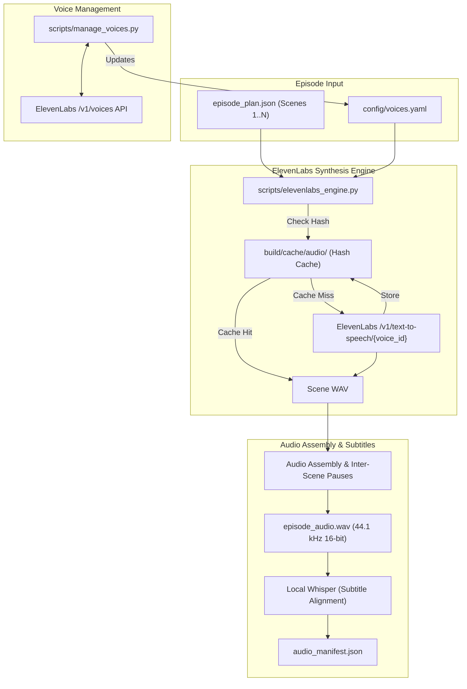

# Sutradhar Hindi Voice Engine Development Plan (ElevenLabs-Only Architecture)

> **Document Status:** Revised Architecture Proposal (Pending User Approval)  
> **Target Language:** Pure Hindi (Devanagari script only; all English support discontinued)  
> **TTS Provider:** ElevenLabs Exclusively (Local Kokoro ONNX and Google Gemini TTS discontinued)  
> **Fixed Narrator:** Viraj (`uuyFQegRan8rpIQCGu9K`)  
> **Subscription Tier:** ElevenLabs Starter Plan (37,188 monthly character credits)  
> **Voice Management:** Dedicated `config/voices.yaml` + `scripts/manage_voices.py` CLI helper  
> **Synthesis Architecture:** Per-Scene Synthesis with Local Whisper Subtitle Alignment  
> **Refactoring Strategy:** Clean Complete Removal of legacy Kokoro ONNX & Gemini code  

---

## 1. Executive Summary & Architectural Vision

The Sutradhar audio pipeline is transitioning to a **pure ElevenLabs-native voice generation engine**. Local Kokoro ONNX TTS (which lacked native Hindi phonetic nuance and required fragile ONNX binaries) and Google Gemini TTS (which posed quota and payment gateway complications in India) are completely decommissioned.

### Core Strategic Decisions
1. **Single Exclusive Provider:** ElevenLabs handles 100% of speech generation across all episodes.
2. **Fixed Narrator Voice:** **Viraj** (`uuyFQegRan8rpIQCGu9K`) is the permanent, unalterable voice for Sutradhar (the cosmic narrator) and Mahadev.
3. **Flexible Character Voice Assignment:** Supporting and mythological characters are mapped via an external configuration file (`config/voices.yaml`) and managed through an interactive CLI tool (`scripts/manage_voices.py`). Characters can be reassigned dynamically to any voice in your ElevenLabs Voice Library without modifying source code.
4. **Primary Speech Model:** **`eleven_multilingual_v2`** is selected as the default production model for its superior emotional depth, stately pacing, and authentic Devanagari pronunciation. **`eleven_turbo_v2_5`** is available as a 50% credit-saver for rapid draft generation.
5. **Per-Scene Synthesis Architecture:** Each scene's audio is generated independently, allowing multi-character dialogue scenes to use distinct voices while preserving scene-level emotional pacing and enabling millisecond-accurate Whisper subtitle alignment.
6. **Smart Disk Caching:** Scene audio is hashed by `(text, voice_id, model_id, voice_settings)` and cached locally. Re-rendering a video or tweaking a single scene never wastes credits re-synthesizing unchanged audio.

---

## 2. ElevenLabs Model Evaluation & Subscription Economics

### Empirical Model Comparison for Hindi Speech

We evaluated ElevenLabs TTS models capable of text-to-speech in Hindi (`hi`) by synthesizing a representative 76-character mythological Hindi passage (*"सत्य केवल काल के गाल पर लिखा एक शब्द नहीं, यह सृष्टि का मूल आधार है।"*) with our fixed narrator voice **Viraj** (`uuyFQegRan8rpIQCGu9K`):

| Model ID | Generation Latency | Output Duration | Speaking Rate | Credit Multiplier | Production Recommendation |
| :--- | :---: | :---: | :---: | :---: | :--- |
| **`eleven_multilingual_v2`** | 3.30s | **8.96s** | **8.5 char/s (~125 wpm)** | **1.0x (1 char = 1 credit)** | **PRIMARY PRODUCTION CHOICE:** The stately 8.96s delivery provides deep, unhurried mythological cadence (*कथावाचक शैली*) with resonant low frequencies and natural breathing pauses. |
| **`eleven_turbo_v2_5`** | 1.49s | **6.53s** | 11.6 char/s (~160 wpm) | **0.5x (1 char = 0.5 credits)** | **DRAFT / RETRY CHOICE:** 2.2x faster generation and 50% character credit savings. Excellent for testing scene layouts and quick drafts. |
| **`eleven_v4`** | 3.20s | **5.88s** | 12.9 char/s (~180 wpm) | 1.0x (1 char = 1 credit) | **SECONDARY:** Modern and dynamic, but defaults to rapid pacing that requires heavy punctuation engineering to achieve mythological solemnity. |
| **`eleven_v4_turbo`** | < 1.00s | ~5.80s | 13.0 char/s (~180 wpm) | 0.5x (1 char = 0.5 credits) | Conversational model optimized for sub-second latency; less cinematic weight. |
| **`eleven_flash_v2_5`** | < 0.80s | ~6.20s | 12.2 char/s (~170 wpm) | 0.5x (1 char = 0.5 credits) | Real-time conversational agent model; not recommended for epic video production. |

---

### Monthly Subscription Capacity (Starter Plan: 37,188 Credits)

A standard Sutradhar YouTube Short contains ~550 Devanagari characters across 6 scenes:

$$\text{Credits per Short (Multilingual v2)} = 550 \text{ characters} \times 1.0 = \mathbf{550 \text{ credits}}$$
$$\text{Credits per Short (Turbo v2.5)} = 550 \text{ characters} \times 0.5 = \mathbf{275 \text{ credits}}$$

| Production Scenario | Model Used | Shorts per Month | Total Spoken Audio | Monthly Credits Used | Quota Consumed | Remaining Buffer |
| :--- | :--- | :---: | :---: | :---: | :---: | :---: |
| **Daily Shorts (1/day)** | `eleven_multilingual_v2` | **30 Shorts** | ~30.0 minutes | **16,500 credits** | **44.4%** | **20,688 credits** |
| **Daily Shorts (1/day)** | `eleven_turbo_v2_5` | **30 Shorts** | ~30.0 minutes | **8,250 credits** | **22.2%** | **28,938 credits** |
| **Maximum Capacity** | `eleven_multilingual_v2` | **67 Shorts** | ~67.0 minutes | **36,850 credits** | **99.1%** | 338 credits |
| **Maximum Capacity** | `eleven_turbo_v2_5` | **135 Shorts** | ~135.0 minutes | **37,125 credits** | **99.8%** | 63 credits |

> **Conclusion:** Your Starter Plan provides more than **200% of the capacity required** for your target of 1 daily YouTube Short. A generous safety buffer of over 20,000 credits remains available each month for retries, test auditions, and variations.

---

## 3. Architecture & Voice Management Workflow

### High-Level System Architecture



---

### Voice Configuration Schema (`config/voices.yaml`)

A clean, human-readable configuration file isolates all character assignments from code:

```yaml
# Sutradhar Voice Configuration (ElevenLabs Exclusive)
version: "2.0"
default_model: "eleven_multilingual_v2"
output_format: "mp3_44100_128"

# Fixed Narrator (Permanent - do not alter)
narrator:
  name: "Viraj"
  voice_id: "uuyFQegRan8rpIQCGu9K"
  category: "professional"
  model_id: "eleven_multilingual_v2"
  settings:
    stability: 0.60
    similarity_boost: 0.80
    style: 0.05
    use_speaker_boost: true

# Configurable Character Voices (Populated from your ElevenLabs Library)
characters:
  ravana:
    name: "Niraj"
    voice_id: "k0gtD0Bbpi6hL40jfHfm"
    model_id: "eleven_multilingual_v2"
    settings:
      stability: 0.50
      similarity_boost: 0.85
      style: 0.10
      use_speaker_boost: true

  mandodari:
    name: "Kanika"
    voice_id: "xccfcojYYGnqTTxwZEDU"
    model_id: "eleven_multilingual_v2"
    settings:
      stability: 0.65
      similarity_boost: 0.80
      style: 0.05
      use_speaker_boost: true

  sage_narrator:
    name: "Shivank S"
    voice_id: "3zfVMgyQmfzZpm8pYvD2"
    model_id: "eleven_multilingual_v2"

# Fallback Rule: Any character not explicitly defined here automatically
# inherits the narrator voice (Viraj) with default narrator settings.
fallback_to_narrator: true
```

---

### Interactive Voice Management Tool (`scripts/manage_voices.py`)

A dedicated CLI tool provides frictionless voice management directly from your terminal:

```bash
# 1. List all voices currently in your ElevenLabs Library (names, IDs, categories)
python scripts/manage_voices.py list

# 2. Check current account subscription status & remaining character balance
python scripts/manage_voices.py status

# 3. Preview/audition any voice with a standardized Hindi test sentence
python scripts/manage_voices.py preview --voice-id uuyFQegRan8rpIQCGu9K --model eleven_multilingual_v2

# 4. Assign a voice from your library to a character in config/voices.yaml
python scripts/manage_voices.py assign --character ravana --voice-id k0gtD0Bbpi6hL40jfHfm

# 5. Display the active character-to-voice mapping table
python scripts/manage_voices.py show-roster
```

---

## 4. Pipeline Integration & Subtitle Synchronization

### Per-Scene Audio Build Lifecycle

1. **Text Normalization & Pronunciation Overrides:**
   - Devanagari text from `scene.narration_text` is processed through `load_pronunciations(root, cfg, lang="hi")` to enforce whole-word phonetic replacements (e.g. *अहंकार*, *त्रिशूल*, *महाकाल*).
2. **Voice Resolution:**
   - If `scene.speaker_role == "character_dialogue"` and a character name or override is specified:
     - Check `config/voices.yaml` for a matching character.
     - If matched, use the character's `voice_id`, `model_id`, and `settings`.
     - If unmapped, gracefully fall back to **Viraj**.
   - If `scene.speaker_role == "narrator"`: Always use **Viraj**.
3. **Cache Lookup & Synthesis:**
   - Compute MD5 hash: `hash(text + voice_id + model_id + json(settings))`.
   - If cached audio exists in `build/cache/audio/{hash}.mp3`, load directly from disk (0 API calls, 0 credits spent).
   - If not cached, call ElevenLabs `/v1/text-to-speech/{voice_id}` with timeout (30s) and automatic exponential backoff retry.
4. **Inter-Scene Dynamic Pauses:**
   - Apply narrative pauses between scenes based on emotional punctuation (`climax`, `calm`, `wrath`) and speaker transitions (e.g. 400ms pause between narrator and character dialogue).
5. **Master Audio Concatenation:**
   - Concatenate all scene audio segments and pauses into a master 44.1 kHz 16-bit PCM WAV (`build/audio/episode_audio.wav`).
6. **Whisper Subtitle Alignment:**
   - Pass `episode_audio.wav` to local Whisper with Devanagari language enforcement (`language="hi"`).
   - Extract word-level start/end timestamps and map them into `audio_manifest.json` for Kinocut/MoviePy video rendering.

---

## 5. Codebase Refactoring & Cleanup Plan

To maintain a clean, maintainable, single-purpose repository, all obsolete Kokoro ONNX and Google Gemini TTS code will be completely eradicated.

### Files to Purge / Retire

| File / Component | Action | Reason |
| :--- | :---: | :--- |
| `models/kokoro/*` | **DELETE** | Legacy Kokoro ONNX models (`kokoro-v1.0.onnx`, `voices-v1.0.bin`). Saves ~350 MB disk space. |
| `scripts/audition/gemini_audition.py` | **DELETE** | Google Gemini TTS audition scripts no longer needed. |
| `scripts/audition/analyze_acoustic_matching.py` | **DELETE** | Gemini-to-ElevenLabs voice matching script no longer needed. |
| `docs/google-ai-studio-billing-setup.md` | **ARCHIVE** | Gemini billing setup guide retired. |
| `kokoro_onnx` references in `scripts/build_audio.py` | **PURGE** | Remove Kokoro model loading, ONNX voice mixing, voice style vectors, and tokenizer. |
| `kokoro_onnx` in `requirements.txt` | **PURGE** | Remove unused dependencies. |

---

### New & Updated Components

| Component | Path | Purpose |
| :--- | :--- | :--- |
| **Voice Configuration** | `config/voices.yaml` | Dedicated character voice assignment and settings file. |
| **Voice Management CLI** | `scripts/manage_voices.py` | Interactive CLI to list, preview, and map voices. |
| **ElevenLabs Engine** | `scripts/elevenlabs_engine.py` | Production ElevenLabs API client with caching, retry logic, and error handling. |
| **Audio Pipeline** | `scripts/build_audio.py` | Refactored to call `ElevenLabsEngine` with per-scene synthesis and Whisper alignment. |
| **Audio Build Tests** | `tests/test_build_audio.py` | Updated unit tests with ElevenLabs mock fixtures (replacing `FakeKokoro`). |
| **Setup Documentation** | `docs/elevenlabs-setup-guide.md` | Official setup, settings, and subscription guide. |

---

## 6. Phased Implementation Roadmap


### Phase 1: Configuration & Voice Management Tooling
- Create `config/voices.yaml` with Viraj as fixed narrator and initial character templates.
- Implement `scripts/manage_voices.py` supporting `list`, `preview`, `assign`, `status`, and `show-roster`.
- Verify account connection and list all 33 voices in your library.

### Phase 2: Core ElevenLabs Synthesis Engine
- Implement `scripts/elevenlabs_engine.py` with:
  - Strong input validation (Devanagari text check, voice ID verification).
  - Hash-based disk audio caching in `build/cache/audio/`.
  - Robust HTTP handling: 3 retries with exponential backoff on HTTP 429 / 5xx, 30s socket timeout.
  - Pre-flight subscription credit balance check.

### Phase 3: Pipeline Integration in `scripts/build_audio.py`
- Wire `ElevenLabsEngine` into `build_episode_audio()`.
- Update voice resolution logic to consult `config/voices.yaml`.
- Retain dynamic emotional pacing, inter-scene pauses, and background music (BGM) ducking.
- Connect master audio assembly to local Whisper for millisecond subtitle alignment.

### Phase 4: Clean Complete Removal of Legacy Code
- Remove Kokoro ONNX model loaders, vector blending, and file size checks from `scripts/build_audio.py`.
- Remove `models/kokoro/` directory.
- Remove Gemini audition scripts from `scripts/audition/`.
- Clean up `config.yaml` to reference `config/voices.yaml`.
- Update `tests/test_build_audio.py` to replace Kokoro test doubles with ElevenLabs mock fixtures.

### Phase 5: End-to-End Verification & Acceptance Testing
- Run test suite (`pytest tests/`) ensuring 100% test passing.
- Generate a full end-to-end test audio build for an episode using Viraj.
- Verify audio quality, 44.1 kHz WAV format, dynamic pauses, and subtitle synchronization.
- Confirm `.env.local.example` remains 100% untouched.

---

## 7. Quality & Safety Safeguards

1. **Quota Protection:**
   - The engine checks remaining character credits via `GET /v1/user/subscription` before initiating synthesis. If remaining credits are insufficient for an episode, it halts gracefully before making billable calls.
2. **Zero-Waste Disk Caching:**
   - Any synthesized scene audio is cached forever by content hash. If an episode build fails during video rendering or subtitle generation, re-running `build_audio.py` costs **0 characters**.
3. **Strict Credential Protection:**
   - `ELEVENLABS_API_KEY` is loaded strictly from environment variables / `.env`. No credentials or secret keys are logged or written to files.
4. **Git Isolation:**
   - All Git staging, commits, and pushes remain strictly prohibited without explicit user authorization in the turn.
