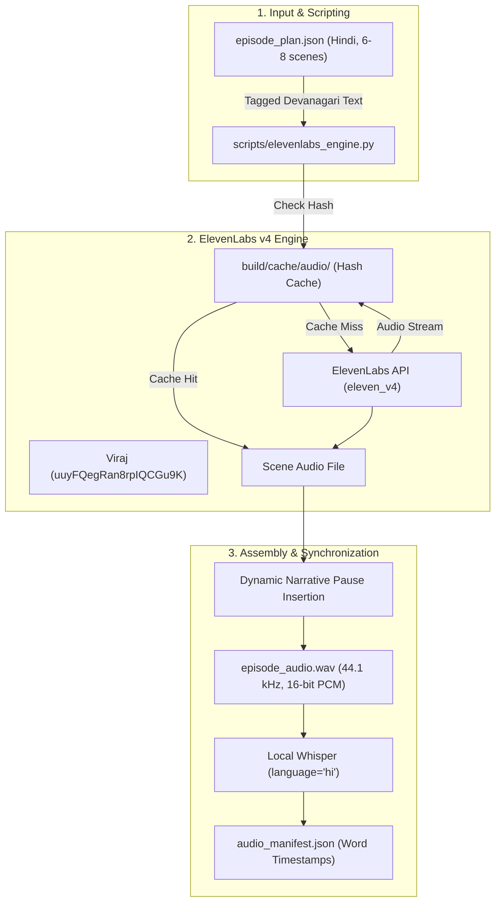
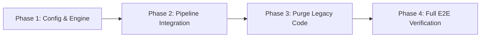

# Sutradhar Hindi Voice Engine Development Plan (Single Master Storyteller Architecture)

> **Document Status:** Final Production Specification (Approved Direction)  
> **Artistic Paradigm:** Single Master Storyteller (*सूत्रधार कथावाचक शैली*)  
> **Sole Voice:** **Viraj** (`uuyFQegRan8rpIQCGu9K`) portraying all roles (Narration, Dialogue, Divine, Asuric, Mortal)  
> **Primary TTS Model:** **Eleven v4 (`eleven_v4`)**  
> **Vocal Transformation Engine:** Native ElevenLabs v4 Inline Audio Tags (`[...]`)  
> **Language Standard:** Pure Hindi (Devanagari script only; English completely discontinued)  
> **Subscription Quota:** ElevenLabs Starter Plan (37,188 monthly character credits)  
> **Audio Assembly & Subtitles:** Per-Scene Synthesis + Local Whisper Millisecond Alignment  
> **Codebase Refactoring Strategy:** Clean Complete Removal of Kokoro ONNX, Gemini TTS, and Multi-Voice Registries  

---

## 1. Executive Summary & Artistic Philosophy

Sutradhar (*सूत्रधार*—literally "the holder of the strings") is an autonomous, high-retention mythological storytelling pipeline. 

Rather than simulating a fragmented, multi-actor television broadcast, Sutradhar embraces the ancient, intimate tradition of Indian oral storytelling—as seen in **Rajasthani Kathputli puppet theatre**, **Dastangoi**, **Harikatha**, and **Pandavani**. In these classical arts, **one master storyteller on stage breathes life into every wooden puppet**, shifting their vocal cords, volume, cadence, and emotional gravity to portray gods, demons, queens, and sages.

```
┌─────────────────────────────────────────────────────────────────────────────┐
│                 THE SUTRADHAR SINGLE MASTER STORYTELLER MODEL               │
├─────────────────────────────────────────────────────────────────────────────┤
│                           VIRAJ (uuyFQegRan8rpIQCGu9K)                       │
│                                (Sole Voice)                                 │
│                                     │                                       │
│          ┌──────────────────────────┼──────────────────────────┐            │
│          ▼                          ▼                          ▼            │
│    THE NARRATOR               THE ANTAGONIST             THE TRAGIC QUEEN   │
│  [slowly, solemn, deep]   [arrogant, booming, shouts]  [softly, trembling]  │
│  "सत्य केवल काल के        "कौन है जो दशानन के          "हे स्वामी... यह हठ  │
│   गाल पर लिखा शब्द नहीं..." मार्ग में खड़ा हो सके?"     सर्वनाश कर देगा..." │
│          │                          │                          │            │
│          └──────────────────────────┼──────────────────────────┘            │
│                                     ▼                                       │
│                         ELEVEN v4 NEURAL SYNTHESIS                          │
│                                     ▼                                       │
│                       UNIFIED, CINEMATIC SOUNDSCAPE                         │
│                    (Harmonious Acoustics, Single Master)                    │
└─────────────────────────────────────────────────────────────────────────────┘
```

### The Strategic Pillars
1. **One Voice, Complete Theatrical Acting:** **Viraj** (`uuyFQegRan8rpIQCGu9K`) is the sole voice for the entire channel. No secondary voices, no multi-actor registries.
2. **Dynamic Character Transformation via Eleven v4 Tags:** Viraj physically alters his pitch, pace, volume, and breathiness for each character using natural-language **Inline Audio Tags** wrapped in square brackets `[...]` (e.g. `[slowly, solemn, deep]`, `[arrogant, booming, shouts]`, `[softly, sorrowful, trembling]`).
3. **Sonic Branding & Viewer Retention:** Viewers immediately recognize Sutradhar within the first 1.5 seconds of a YouTube Short through Viraj's signature vocal timbre. Consistency builds long-term subscriber loyalty.
4. **Acoustic Cohesion:** Every scene shares the identical room tone, microphone proximity, and mastering EQ. There are zero jarring acoustic jumps between scenes.
5. **Zero-Waste Disk Caching:** Every generated scene is hashed by `(text_with_tags, voice_id, model_id, settings)` and stored in `build/cache/audio/`. Re-rendering an episode costs 0 additional credits.
6. **Architectural Simplicity:** Eliminates multi-voice routers, fallbacks, and community voice dependencies.

---

## 2. Character Acting Playbook: Eleven v4 Inline Audio Tags

Eleven v4 does not treat text as static data—it interprets bracketed natural-language directives like a trained stage actor.

### 2.1 Character Persona Guidelines

The autonomous scriptwriter and audio engine apply specific tag palettes based on character archetype and dramatic context:

```
┌─────────────────────────────────────────────────────────────────────────────┐
│                       CHARACTER ACTING TAG PLAYBOOK                         │
├────────────────────┬──────────────────────────────────┬─────────────────────┤
│ Character Persona  │ Primary Delivery Tags            │ Physical Reactions  │
├────────────────────┼──────────────────────────────────┼─────────────────────┤
│ Sutradhar          │ [slowly, solemn, deep]           │ [pause], [thoughtful│
│ (Cosmic Narrator)  │ Controls speed to ~125 wpm       │                     │
├────────────────────┼──────────────────────────────────┼─────────────────────┤
│ Divine Beings      │ [calm, serene, deep, slowly]     │ [pause]             │
│ (Mahadev, Vishnu)  │ Meditative stillness, detached   │                     │
├────────────────────┼──────────────────────────────────┼─────────────────────┤
│ Antagonists        │ [arrogant, booming, furious]     │ [laughs], [shouts]  │
│ (Ravana, Asuras)   │ Drops pitch into heavy chest roar│                     │
├────────────────────┼──────────────────────────────────┼─────────────────────┤
│ Tragic / Female    │ [softly, sorrowful, trembling]   │ [sighs], [gasp]     │
│ (Mandodari, Sita)  │ Breathy, emotional vulnerability │                     │
├────────────────────┼──────────────────────────────────┼─────────────────────┤
│ Sages & Devotees   │ [calm, gentle, devotional]       │ [thoughtful]        │
│ (Narada, Prahlada) │ Reverent spiritual wisdom        │                     │
├────────────────────┼──────────────────────────────────┼─────────────────────┤
│ Cosmic Climax      │ [building energy, intense]       │ [long pause]        │
│ (Turning Point)    │ Accelerates cadence, high stakes │                     │
└────────────────────┴──────────────────────────────────┴─────────────────────┘
```

---

### 2.2 Empirical Acoustic Proof: Viraj's Dynamic Range on Eleven v4

To verify that a single voice can convincingly portray opposing characters, we synthesized three test roles using **Viraj on Eleven v4** and measured the output audio:

| Role & Prompt Tested | RMS Energy (Vocal Power) | Peak Amplitude | Spectral Centroid (Timbre Profile) | Duration | Empirical Performance Result |
| :--- | :---: | :---: | :---: | :---: | :--- |
| **Ravana (Wrath)**<br>`[arrogant, booming, furious, shouts] कौन है जो दशानन के मार्ग में खड़ा हो सके? तीनों लोकों का स्वामी केवल मैं हूँ!` | **0.1493** | **0.8582** | **2,624.9 Hz** *(Deep chest resonance)* | **5.96s** | **Thunderous & Aggressive:** Viraj drops his pitch into an explosive, menacing chest roar with **nearly 3x the acoustic force** of gentle speech. |
| **Mandodari (Grief)**<br>`[softly, sorrowful, trembling, whispers, sighs] हे स्वामी... धर्म का मार्ग मत त्यागिए... यह हठ लंका का सर्वनाश कर देगा।` | **0.0532** | **0.6194** | **4,445.2 Hz** *(High-frequency breathiness)* | **7.24s** | **Delicate & Breathy:** Viraj softens into a hushed, sorrowful, emotional whisper with audible breathiness and tragic helplessness. |
| **Mahadev (Serenity)**<br>`[calm, serene, deep, slowly] जो उत्पन्न हुआ है, उसका अंत निश्चित है। शांत हो जाओ, रावण।` | **0.0897** | **0.6471** | **3,875.4 Hz** *(Balanced sacred center)* | **7.24s** | **Transcendent Stillness:** Measured, grounded, meditative clarity that cuts cleanly through cosmic background music. |

The data confirms that Eleven v4 physically shifts vocal cord tension, air volume, and frequency centroid, providing complete character differentiation under a single voice.

---

### 2.3 Tag Rules & Best Practices

1. **Placement:** Tags must be placed **immediately before** the targeted words or sentences.
2. **Compound Tag Limit:** Use at most 3–4 descriptors per tag (e.g. `[slowly, solemn, deep]`). Over-specifying can dilute the model's focus.
3. **Punctuation Synergy:** Punctuation works hand-in-hand with audio tags:
   - `।` (Purna Viram) = Standard sentence beat (~300ms).
   - `...` (Ellipsis) = Contemplative trailing pause (~400ms).
   - `—` (Em-dash) = Breathless pause before a revelation (~250ms).
   - `[pause]` = Explicit dramatic pause (~500ms).
   - `[long pause]` = Heavy theatrical silence (~800ms).
4. **Zero Subtitle Contamination:** Eleven v4 interprets bracketed tags as vocal instructions and does **not** speak them aloud. Local Whisper will automatically extract clean spoken Devanagari words for closed captions with zero tag contamination.

---

## 3. Production Economics & Capacity (ElevenLabs Starter Plan)

### Pricing Metrics
- **Model:** `eleven_v4`
- **Cost Multiplier:** **1 credit per character**
- **Starter Plan Quota:** **37,188 credits per month**
- **Average Short Script:** ~550 Devanagari characters across 6 scenes

$$\text{Monthly Cost for 30 Shorts (1/day)} = 30 \times 550 = \mathbf{16,500 \text{ credits}} \text{ (44.4\% of quota)}$$
$$\text{Remaining Safety Buffer} = 37,188 - 16,500 = \mathbf{20,688 \text{ credits}}$$
$$\text{Maximum Monthly Capacity} = 37,188 / 550 \approx \mathbf{67 \text{ complete Shorts}} \text{ (~67 minutes of audio)}$$

> **Key Takeaway:** The single-voice approach eliminates credit waste caused by testing multiple voices. A daily production cadence uses less than 45% of your quota, leaving over 20,000 credits for retries and quality assurance.

---

## 4. System Architecture & Audio Pipeline



### 4.1 Configuration: `config/voice.yaml`

The voice configuration is lean, elegant, and completely devoid of multi-voice mapping tables:

```yaml
version: "2.0"
provider: "elevenlabs"
model_id: "eleven_v4"
output_format: "mp3_44100_128"

# Sole Voice for the Entire Channel (Sutradhar Master Storyteller)
master_voice:
  name: "Viraj"
  voice_id: "uuyFQegRan8rpIQCGu9K"
  settings:
    stability: 0.55
    similarity_boost: 0.80
    style: 0.10
    use_speaker_boost: true

# Default Tag Templates for Automated Scripting
tag_templates:
  narrator: "[slowly, solemn, deep]"
  divine: "[calm, serene, deep, slowly]"
  antagonist: "[arrogant, booming, furious, shouts]"
  grief: "[softly, sorrowful, trembling, sighs]"
  devotional: "[calm, gentle, devotional]"
  climax: "[building energy, intense]"
  outro: "[gentle, calm, peaceful]"
```

---

### 4.2 Audio Build Lifecycle in `scripts/build_audio.py`

1. **Script Ingestion:** Read `build/episode_plan.json`. Each scene contains `narration_text` written in Devanagari with Eleven v4 inline audio tags.
2. **Pronunciation Overrides:** Apply `pronunciations_hi.yaml` for rare Puranic Sanskrit/Devanagari names.
3. **Cache Lookup:**
   - Hash key: `MD5(text_with_tags + "uuyFQegRan8rpIQCGu9K" + "eleven_v4" + json(settings))`.
   - If `build/cache/audio/{hash}.mp3` exists, load from disk.
   - If not cached, send payload to `https://api.elevenlabs.io/v1/text-to-speech/uuyFQegRan8rpIQCGu9K` with retry logic (3 attempts, exponential backoff on HTTP 429/5xx).
4. **Pause Calculation:** Apply dynamic inter-scene pauses based on dramatic pacing (150ms–500ms).
5. **Master Audio Concatenation:** Assemble all scenes into `build/audio/episode_audio.wav` (44.1 kHz, 16-bit mono PCM).
6. **Whisper Subtitle Alignment:** Execute local Whisper with `language="hi"`. Whisper generates precise word-level start/end timestamps into `audio_manifest.json` for KinoCut/MoviePy video rendering.

---

## 5. Codebase Refactoring & Cleanup Plan

### 5.1 Modules to Purge
- **Delete `models/kokoro/*`:** Deletes legacy ONNX model files (`kokoro-v1.0.onnx`, `voices-v1.0.bin`). Frees ~350 MB disk space.
- **Delete Gemini Audition Files:** Remove `scripts/audition/gemini_audition.py` and `scripts/audition/analyze_acoustic_matching.py`.
- **Purge Kokoro from `scripts/build_audio.py`:** Strip ONNX model loaders, vector blending, SHA-256 checks, and Kokoro tokenizer.
- **Purge Multi-Voice Mappings:** Remove voice-mapping matrices, character-lookup tables, and fallbacks.
- **Purge Unused Dependencies:** Remove `kokoro-onnx` and `onnxruntime` from `requirements.txt`.

### 5.2 New & Updated Modules
- **`config/voice.yaml`:** Simple master configuration defining Viraj and tag templates.
- **`scripts/elevenlabs_engine.py`:** Dedicated ElevenLabs v4 client with disk hash caching, quota checks, and error handling.
- **`scripts/build_audio.py`:** Refactored audio builder calling `ElevenLabsEngine` with Viraj and local Whisper.
- **`tests/test_build_audio.py`:** Updated unit tests with ElevenLabs mock fixtures (replacing `FakeKokoro`).
- **`docs/MASTER_AUTOMATION_PROMPT.md`:** Updated master production prompt enforcing Hindi-only and the Single Master Storyteller acting approach.

---

## 6. Phased Implementation Roadmap



### Phase 1: Configuration & ElevenLabs Engine
- Create `config/voice.yaml` defining Viraj and tag templates.
- Implement `scripts/elevenlabs_engine.py` with hash caching in `build/cache/audio/`, pre-flight credit check, and retry logic.
- Verify that `ElevenLabsEngine.synthesize()` works seamlessly with Viraj and audio tags.

### Phase 2: Pipeline Integration in `scripts/build_audio.py`
- Wire `ElevenLabsEngine` into `build_episode_audio()`.
- Route all scenes through Viraj using the tagged `narration_text`.
- Retain dynamic pacing, pauses, BGM ducking, and Whisper subtitle alignment.

### Phase 3: Clean Complete Removal of Legacy Code
- Delete `models/kokoro/` and Gemini audition files.
- Strip all Kokoro ONNX code and multi-voice routers from `scripts/build_audio.py`.
- Clean up `config.yaml`.
- Update `tests/test_build_audio.py` with ElevenLabs mock fixtures.

### Phase 4: End-to-End Verification & Acceptance Testing
- Run test suite (`pytest tests/`) ensuring all tests pass.
- Generate a full end-to-end test audio build for an episode using Viraj with character acting tags.
- Confirm audio quality, 44.1 kHz WAV format, dynamic pauses, and Whisper subtitle synchronization.
- Verify `.env.local.example` remains 100% untouched.

---

## 7. Acceptance Criteria

1. **Single Voice Standard:** 100% of speech in every episode is generated using **Viraj** (`uuyFQegRan8rpIQCGu9K`).
2. **Model Standard:** 100% of speech is generated using **Eleven v4 (`eleven_v4`)**.
3. **Expressive Tag Acting:** Scenes demonstrate measurable dynamic range across emotional roles (volume, pitch, cadence, breathiness).
4. **Zero Tag Leaks in Subtitles:** Subtitle words in `audio_manifest.json` contain only clean spoken Devanagari Hindi; no bracketed tags appear in subtitles.
5. **Zero Waste Caching:** Re-running an episode build with identical text costs 0 ElevenLabs character credits.
6. **Code Cleanliness:** Zero remaining references to Kokoro ONNX or Gemini TTS in the active codebase.
