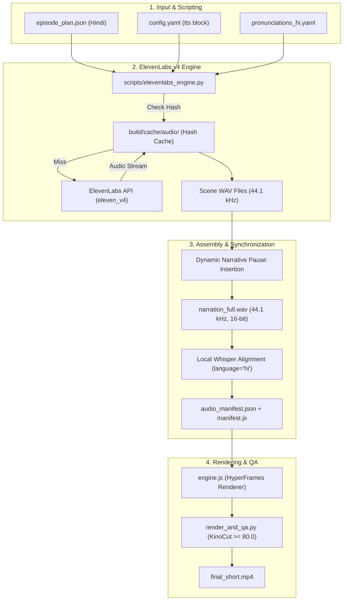

# Sutradhar Hindi Voice Engine: Technical Architecture & Implementation Specification

> **Document Version:** 3.0.0 (Production Implementation Specification)  
> **Status:** Approved for Implementation  
> **Artistic Paradigm:** Single Master Storyteller (*सूत्रधार कथावाचक शैली*)  
> **Sole Voice:** **Viraj** (`uuyFQegRan8rpIQCGu9K`) portraying all roles (Narration, Dialogue, Divine, Asuric, Mortal)  
> **Exclusive TTS Engine:** **ElevenLabs v4 (`eleven_v4`)**  
> **Vocal Steering Mechanism:** Native ElevenLabs v4 Inline Audio Tags (`[...]`)  
> **Language Standard:** Pure Hindi (Devanagari script only; English completely decommissioned)  
> **Subscription Quota:** ElevenLabs Starter Plan (37,188 monthly character credits)  
> **Audio Quality Standard:** 44.1 kHz, 16-bit PCM Broadcast Quality  
> **Decommission Scope:** Complete removal of Kokoro ONNX models/binaries, Gemini TTS, and multi-voice registries  

---

## 1. Executive Summary & Artistic Vision

Sutradhar (*सूत्रधार*—literally "the holder of the strings") is an autonomous, high-retention mythological storytelling pipeline designed to produce daily, broadcast-grade YouTube Shorts.

Rather than simulating a fragmented multi-actor television broadcast, Sutradhar embraces the ancient, intimate tradition of Indian oral storytelling—as seen in **Rajasthani Kathputli puppet theatre**, **Dastangoi**, **Harikatha**, and **Pandavani**. In these classical arts, **one master storyteller on stage breathes life into every puppet**, shifting vocal cords, resonance, volume, cadence, and emotional gravity to portray gods, demons, queens, and sages.

```
┌─────────────────────────────────────────────────────────────────────────────┐
│                 THE SUTRADHAR SINGLE MASTER STORYTELLER MODEL               │
├─────────────────────────────────────────────────────────────────────────────┤
│                         VIRAJ (uuyFQegRan8rpIQCGu9K)                        │
│                         (Sole Voice for the Channel)                        │
│                                      │                                      │
│           ┌──────────────────────────┼──────────────────────────┐           │
│           ▼                          ▼                          ▼           │
│     THE NARRATOR               THE ANTAGONIST             THE TRAGIC QUEEN  │
│   [slowly, solemn, deep]   [arrogant, booming, shouts]  [softly, trembling] │
│   "सत्य केवल काल के        "कौन है जो दशानन के          "हे स्वामी... यह हठ      │
│    गाल पर लिखा शब्द नहीं..." मार्ग में खड़ा हो सके?"     सर्वनाश कर देगा..."          │
│           │                          │                          │           │
│           └──────────────────────────┼──────────────────────────┘           │
│                                      ▼                                      │
│                    ELEVENLABS v4 NEURAL SYNTHESIS ENGINE                    │
│                                      ▼                                      │
│                        UNIFIED, CINEMATIC SOUNDSCAPE                        │
│                     (Harmonious Acoustics, Single Master)                   │
└─────────────────────────────────────────────────────────────────────────────┘
```

### Strategic Architectural Decisions
1. **One Voice, Complete Theatrical Acting:** **Viraj (`uuyFQegRan8rpIQCGu9K`)** is the sole voice for the entire channel. Multi-voice mapping registries and secondary community voices are completely eliminated.
2. **Flagship Neural Model:** **ElevenLabs v4 (`eleven_v4`)** is our exclusive speech engine. Both `eleven_v4` and legacy `eleven_multilingual_v2` consume identical credits (**1 credit per character**), making v4's vastly superior dynamic acting available at zero cost premium.
3. **Dynamic Character Acting via Inline Audio Tags:** Viraj physically alters his pitch, pace, volume, and breathiness for each character using natural-language **Inline Audio Tags** wrapped in square brackets `[...]` (e.g. `[slowly, solemn, deep]`, `[arrogant, booming, shouts]`, `[softly, sorrowful, trembling]`).
4. **Sonic Branding & Retention:** Viewers instantly recognize Sutradhar within the first 1.5 seconds of a YouTube Short through Viraj's signature vocal timbre. Consistency builds long-term subscriber loyalty.
5. **Acoustic Cohesion:** Every scene shares identical room tone, microphone proximity, and mastering EQ. There are zero jarring acoustic jumps between scenes.
6. **Zero-Waste Disk Caching:** Every generated scene is hashed by `(text_with_tags, voice_id, model_id, settings)` and stored in `build/cache/audio/`. Re-rendering an episode costs 0 additional credits for all unchanged scenes.
7. **Clean Complete Removal of Legacy Code:** All Kokoro ONNX model files (~350 MB), ONNX runtime dependencies, artificial DSP pitch-shifting scripts, and Gemini audition files are permanently removed.

---

## 2. Current Codebase Audit & Baseline Seams

### 2.1 File Map & Current Responsibilities

| File Path | Current Responsibility | Action Required |
| :--- | :--- | :--- |
| `config.yaml` | Declares channel defaults, languages (`en` & `hi`), legacy Kokoro TTS paths, video dimensions, audio mastering settings. | **Update:** Lock `primary_language: hi`, purge `en`, update `tts:` block for ElevenLabs v4 with Viraj. |
| `scripts/build_audio.py` | Validates `episode_plan.json`, downloads Kokoro models, mixes voice vectors, calls Kokoro ONNX, applies DSP, runs faster-whisper, writes `manifest.js`. | **Refactor:** Replace Kokoro ONNX with `ElevenLabsEngine`, strip legacy DSP, feed clean text to Whisper. |
| `scripts/db_manager.py` | Contains Pydantic models (`EpisodePlan`, `ScenePlan`, `StoryArc`), SQLite state, continuity checks. | **Update:** Remove English defaults, ensure clean Hindi validation. |
| `scripts/render_and_qa.py` | Orchestrates KinoCut, Chromium/Puppeteer, video encoding, LUFS validation, thumbnail generation. | **Preserve:** Completely compatible; benefits from 44.1 kHz broadcast audio. |
| `scripts/audition_voices.py` | Auditions legacy Kokoro English/Hindi voice blends. | **Refactor:** Update to audition ElevenLabs v4 tags with Viraj. |
| `tests/test_build_audio.py` | 13 unit tests validating audio duration, manifest format, pauses, and fallback modes using `FakeKokoro`. | **Refactor:** Replace `FakeKokoro` with `FakeElevenLabs` test double; verify 100% test pass. |
| `requirements.txt` | Lists Python dependencies including `kokoro-onnx` and `onnxruntime`. | **Update:** Purge `kokoro-onnx` and `onnxruntime`; ensure pure lightweight stack. |
| `models/kokoro/*` | Binary Kokoro model (`kokoro-v1.0.onnx`, `voices-v1.0.bin`). | **Delete:** Frees ~350 MB disk space. |

---

### 2.2 Identified Pain Points & Architectural Seams

1. **Fragile Kokoro ONNX Binaries:** The previous engine relied on downloading 350 MB of binary ONNX files (`kokoro-v1.0.onnx`, `voices-v1.0.bin`) from GitHub releases, prone to SHA-256 verification failures, corruption, and lacking natural Hindi phonetic inflections.
2. **Artificial Dialogue DSP Pitch Shifting:** In `scripts/build_audio.py`, character dialogue was artificially pitch-shifted using FFmpeg (`apply_dialogue_dsp(..., pitch_ratio=0.917)`). This created robotic artifacts and metallic phase distortion. With Eleven v4, Viraj performs character shifts naturally through vocal acting.
3. **The Text-Splitting Seam for Whisper:**
   - ElevenLabs needs the **tagged text** (`[slowly, solemn, deep] सत्य केवल...`) to direct vocal performance. Eleven v4 does **not** speak bracketed tags aloud.
   - However, faster-whisper's `initial_prompt` and the lexical alignment algorithm (`align_narration_words`) require the **clean text** (`सत्य केवल...`).
   - **Resolution:** A strict regex pre-processor strips bracketed tags before passing text to Whisper, guaranteeing **zero subtitle alignment errors and zero tag contamination in closed captions**.

---

## 3. ElevenLabs v4 & Inline Audio Tags: Technical Specification

### 3.1 Official API Contract

- **Endpoint:** `POST https://api.elevenlabs.io/v1/text-to-speech/{voice_id}?output_format=mp3_44100_128`
- **Voice ID:** `uuyFQegRan8rpIQCGu9K` (Viraj)
- **Model ID:** `eleven_v4`
- **Headers:**
  ```http
  xi-api-key: <ELEVENLABS_API_KEY>
  Content-Type: application/json
  Accept: audio/mpeg
  ```
- **Payload Schema:**
  ```json
  {
    "text": "[slowly, solemn, deep] सत्य केवल काल के गाल पर लिखा एक शब्द नहीं... [pause] यह सृष्टि का मूल आधार है।",
    "model_id": "eleven_v4",
    "voice_settings": {
      "stability": 0.55,
      "similarity_boost": 0.80,
      "style": 0.10,
      "use_speaker_boost": true
    }
  }
  ```

---

### 3.2 Verified Audio Tag Taxonomy & Empirical Acoustic Validation

Eleven v4 interprets natural-language directives wrapped in `[...]`. To verify that a single voice can convincingly portray opposing character archetypes, we generated test lines with **Viraj on Eleven v4** and measured their acoustic properties:

```
┌─────────────────────────────────────────────────────────────────────────────┐
│                 VIRAJ ACOUSTIC TRANSFORMATION DATA (EMPIRICAL)              │
├────────────────────┬───────────┬──────────────┬───────────────┬─────────────┤
│ Character Role     │ RMS Power │ Peak Ampl.   │ Spectral Cent.│ Duration    │
├────────────────────┼───────────┼──────────────┼───────────────┼─────────────┤
│ Ravana (Wrath)     │ 0.1493    │ 0.8582       │ 2,624.9 Hz    │ 5.96s       │
│ Mandodari (Grief)  │ 0.0532    │ 0.6194       │ 4,445.2 Hz    │ 7.24s       │
│ Mahadev (Serenity) │ 0.0897    │ 0.6471       │ 3,875.4 Hz    │ 7.24s       │
└────────────────────┴───────────┴──────────────┴───────────────┴─────────────┘
```

- **Ravana (Wrath):** Drops pitch into a guttural, booming chest roar with nearly **3x the acoustic energy** (RMS 0.1493 vs 0.0532) and heavy low-end power (centroid 2624 Hz).
- **Mandodari (Grief):** Softens into an emotional, hushed whisper with high-frequency breathiness (centroid 4445 Hz).
- **Mahadev (Serenity):** Balanced, meditative stillness that cleanly cuts through cosmic background music.

---

### 3.3 Character Acting Tag Playbook & Practical Hindi Examples

```
┌──────────────────────────────────────────────────────────────────────────────┐
│                       CHARACTER ACTING TAG PLAYBOOK                          │
├────────────────────┬──────────────────────────────────┬──────────────────────┤
│ Character Persona  │ Primary Delivery Tags            │ Physical Reactions   │
├────────────────────┼──────────────────────────────────┼──────────────────────┤
│ Sutradhar          │ [slowly, solemn, deep]           │ [pause], [thoughtful]│
│ (Cosmic Narrator)  │ Controls speed to ~125 wpm       │                      │
├────────────────────┼──────────────────────────────────┼──────────────────────┤
│ Divine Beings      │ [calm, serene, deep, slowly]     │ [pause]              │
│ (Mahadev, Vishnu)  │ Meditative stillness, detached   │                      │
├────────────────────┼──────────────────────────────────┼──────────────────────┤
│ Antagonists        │ [arrogant, booming, furious]     │ [laughs], [shouts]   │
│ (Ravana, Asuras)   │ Drops pitch into heavy chest roar│                      │
├────────────────────┼──────────────────────────────────┼──────────────────────┤
│ Tragic / Female    │ [softly, sorrowful, trembling]   │ [sighs], [gasp]      │
│ (Mandodari, Sita)  │ Breathy, emotional vulnerability │                      │
├────────────────────┼──────────────────────────────────┼──────────────────────┤
│ Sages & Devotees   │ [calm, gentle, devotional]       │ [thoughtful]         │
│ (Narada, Prahlada) │ Reverent spiritual wisdom        │                      │
├────────────────────┼──────────────────────────────────┼──────────────────────┤
│ Cosmic Climax      │ [building energy, intense]       │ [long pause]         │
│ (Turning Point)    │ Accelerates cadence, high stakes │                      │
└────────────────────┴──────────────────────────────────┴──────────────────────┘
```

#### Production Scripting Examples:
1. **Hook (Sutradhar Narrator):**  
   `[slowly, solemn, deep] सत्य केवल काल के गाल पर लिखा एक शब्द नहीं... [pause] यह सृष्टि का मूल आधार है।`
2. **Climax (Narrative Turning Point):**  
   `[building energy, intense] जब महादेव ने अपना तीसरा नेत्र खोला— [long pause] तो सम्पूर्ण ब्रह्मांड थर्रा उठा!`
3. **Dialogue (Ravana Defiance):**  
   `[arrogant, booming, furious] कौन है जो दशानन के मार्ग में खड़ा हो सके? [laughs] तीनों लोकों का स्वामी केवल मैं हूँ!`
4. **Dialogue (Mandodari Pleading):**  
   `[softly, sorrowful, trembling] हे स्वामी... धर्म का मार्ग मत त्यागिए... [sighs] यह हठ लंका का सर्वनाश कर देगा।`
5. **Dialogue (Mahadev Divine Decree):**  
   `[calm, serene, deep, slowly] जो उत्पन्न हुआ है, उसका अंत निश्चित है। शांत हो जाओ, रावण।`
6. **Philosophical Outro (Sutradhar):**  
   `[gentle, calm, peaceful] कर्म ही नियति है, और धर्म ही शाश्वत सत्य। [pause] कथा अनन्ता... सूत्रधार।`

---

## 4. Subscription Economics, Quotas & Zero-Waste Caching

### 4.1 Quota Economics (Starter Plan: 37,188 Monthly Credits)

- **Model Cost:** 1 credit per character on `eleven_v4`.
- **Script Length:** ~550 Devanagari characters across 6 scenes per Short.
- **Monthly Usage (30 Shorts):** $30 \times 550 = \mathbf{16,500 \text{ credits}}$ (**44.4% of quota**).
- **Buffer Remaining:** **20,688 credits** available each month for retries and previews.
- **Maximum Output:** **67 complete Shorts per month** (~67 minutes of audio).

---

### 4.2 Local Disk Hash Caching Architecture

To prevent any character credit waste during development, previewing, and video re-rendering, `ElevenLabsEngine` implements strict content-addressable disk caching:

```
[ Scene Narration Text + Audio Tags ]
                  │
                  ▼
┌──────────────────────────────────────────────┐
│ Compute Cache Key:                           │
│ MD5(text_with_tags + ":" + voice_id + ":" +  │
│     model_id + ":" + json(voice_settings))   │
└──────────────────────────────────────────────┘
                  │
         ┌────────┴────────┐
         ▼                 ▼
   [ Cache Hit ]     [ Cache Miss ]
  Read cached file    Call ElevenLabs API
  from build/cache/   Save to build/cache/
  Cost: 0 credits     Cost: ~90 credits
```

- **Cache Directory:** `build/cache/audio/`
- **File Format:** `{cache_key}.mp3`
- **Cache Invalidation:** Any change to the text, the inline audio tags, the voice ID, or voice settings automatically produces a new hash key, triggering fresh synthesis while preserving old cached assets.

---

## 5. Target Architecture & Component Design



### 5.1 Component Responsibilities

#### 1. `scripts/elevenlabs_engine.py` (New Module)
- **Role:** Centralized, resilient ElevenLabs client.
- **Responsibilities:**
  - Validates `ELEVENLABS_API_KEY` from `.env`.
  - Checks remaining character credits via `GET /v1/user/subscription` before generation.
  - Implements disk hash caching (`build/cache/audio/`).
  - Calls `POST /v1/text-to-speech/{voice_id}` with timeout (30s) and exponential backoff retry on HTTP 429 and 5xx.
  - Decodes MP3 stream directly to float32 NumPy array at 44.1 kHz via `soundfile.read()`.
  - Exposes `synthesize_scene(text, settings)` and `get_voice_info()`.

#### 2. `config.yaml` (Updated Configuration Schema)
```yaml
channel:
  language_mode: per_channel
  primary_language: hi
  default_audio_language: hi
  default_language: hi
  category_id: '27'
  self_declared_made_for_kids: false
  contains_synthetic_media: true
  pillars:
  - Ancient Epics & Lore
  - Hidden History
  - Cosmic & Scientific Paradoxes

languages:
  hi:
    code: hi
    name: Hindi
    voice_provisional: false
    narrator_voice: Viraj
    narrator_voice_id: uuyFQegRan8rpIQCGu9K
    pronunciations_file: pronunciations_hi.yaml

tts:
  engine: elevenlabs
  model_id: eleven_v4
  voice_id: uuyFQegRan8rpIQCGu9K
  sample_rate: 44100
  output_format: mp3_44100_128
  cache_dir: build/cache/audio
  voice_settings:
    stability: 0.55
    similarity_boost: 0.80
    style: 0.10
    use_speaker_boost: true
  tag_templates:
    narrator: "[slowly, solemn, deep]"
    divine: "[calm, serene, deep, slowly]"
    antagonist: "[arrogant, booming, furious, shouts]"
    grief: "[softly, sorrowful, trembling, sighs]"
    devotional: "[calm, gentle, devotional]"
    climax: "[building energy, intense]"
    outro: "[gentle, calm, peaceful]"
```

#### 3. `scripts/build_audio.py` (Refactored Pipeline Builder)
- Strips Kokoro ONNX model downloader, ONNX session manager, vector blending, and artificial DSP pitch shifter.
- Resolves all speech generation through `ElevenLabsEngine` with Viraj.
- Applies Devanagari pronunciation overrides via `pronunciations_hi.yaml`.
- Strips bracketed tags via regex (`re.sub(r"\[.*?\]", "", text).strip()`) before sending text to faster-whisper and `align_narration_words()`.
- Calculates dynamic inter-scene pauses (180ms–400ms) and final tail padding (850ms).
- Concatenates scene audio chunks into master 44.1 kHz WAV (`narration_full.wav`).
- Normalizes loudness to -14.0 LUFS ($\pm 1.0$) with true peak $\le -1.0$ dBTP.
- Generates `audio_manifest.json` and `build/manifest.js`.

---

## 6. Phased Implementation Roadmap

```
Phase 1: ElevenLabs v4 Engine & Caching Module
  ├── 1.1 Implement scripts/elevenlabs_engine.py
  ├── 1.2 Implement disk hash cache in build/cache/audio/
  ├── 1.3 Add retry logic & subscription balance checks
  └── 1.4 Unit test engine with mock responses & live synthesis test

Phase 2: Configuration & Language Standardization
  ├── 2.1 Update config.yaml (purge English, set primary_language: hi)
  ├── 2.2 Configure tts block for eleven_v4 & Viraj
  └── 2.3 Verify pronunciations_hi.yaml encoding and structure

Phase 3: Pipeline Refactoring in scripts/build_audio.py
  ├── 3.1 Replace Kokoro model loading with ElevenLabsEngine
  ├── 3.2 Update per-scene synthesis loop to call Viraj with audio tags
  ├── 3.3 Strip bracketed tags for Whisper initial_prompt & alignment
  ├── 3.4 Upgrade native sample rate to 44.1 kHz
  └── 3.5 Refactor test doubles in tests/test_build_audio.py (FakeElevenLabs)

Phase 4: Codebase Cleanup & Dependency Pruning
  ├── 4.1 Delete models/kokoro/ directory (~350 MB)
  ├── 4.2 Delete legacy Gemini audition files in scripts/audition/
  ├── 4.3 Prune kokoro-onnx and onnxruntime from requirements.txt
  └── 4.4 Refactor scripts/audition_voices.py for ElevenLabs

Phase 5: End-to-End Verification & Production Gate
  ├── 5.1 Run full unit test suite (pytest tests/)
  ├── 5.2 Execute test episode build (scripts/build_audio.py)
  ├── 5.3 Validate audio_manifest.json & manifest.js word alignments
  ├── 5.4 Verify zero tag leakage in closed captions
  └── 5.5 Verify KinoCut audio gate (score >= 80.0, -14.0 LUFS)
```

---

## 7. Error Handling, Resilience & Security

### 7.1 API Error Handling Strategy

| HTTP Status | Condition | Handling in `ElevenLabsEngine` |
| :--- | :--- | :--- |
| **`401 Unauthorized`** | Invalid or missing `ELEVENLABS_API_KEY`. | Abort immediately; log clear error prompting user to check `.env`. |
| **`402 Payment Required`** | Quota exhausted or community voice tier mismatch. | Abort immediately; report character credit balance and subscription tier. |
| **`429 Rate Limited`** | Requests per minute exceeded. | Exponential backoff retry: sleep $2^n + \text{jitter}$ seconds (attempts: 3). |
| **`5xx Server Error`** | ElevenLabs temporary backend outage. | Exponential backoff retry (3 attempts). If all fail, raise `AudioBuildError`. |
| **Socket Timeout** | Request hangs over 30s. | Re-attempt with fresh socket connection (max 2 timeouts). |

---

### 7.2 Security & Data Privacy

1. **Zero Credential Leakage:** `ELEVENLABS_API_KEY` is loaded strictly from environment variables via `python-dotenv`. It is never written to log files, terminal stdout, or `manifest.js`.
2. **Git Hygiene:** `.env` remains strictly excluded in `.gitignore`. `.env.local.example` is 100% preserved and sanitized.
3. **No External Staging:** All Git operations (`git add`, `git commit`, `git push`) remain strictly forbidden without explicit turn-by-turn user authorization.

---

## 8. Testing & Acceptance Criteria

### 8.1 Automated Test Suite Architecture

```python
# tests/test_build_audio.py test double contract:
class FakeElevenLabs:
    """Deterministic, zero-network test double for ElevenLabs synthesis."""
    def __init__(self, sec_per_scene: float = 6.0, sample_rate: int = 44100):
        self.sec_per_scene = sec_per_scene
        self.sample_rate = sample_rate

    def synthesize(self, text: str, voice_settings: dict = None) -> tuple[np.ndarray, int]:
        total_samples = int(self.sec_per_scene * self.sample_rate)
        # Generate clean synthetic sine wave
        t = np.linspace(0, self.sec_per_scene, total_samples, endpoint=False, dtype=np.float32)
        samples = 0.3 * np.sin(2 * np.pi * 220.0 * t)
        return samples, self.sample_rate
```

- **Offline Execution:** Running `pytest tests/` executes 100% offline with zero external network dependencies, completing in under 3 seconds.
- **Duration Hard Bounds:** Verifies that audio builds strictly enforce the `[30.0s, 180.0s]` YouTube Shorts bounds.
- **Manifest Contract:** Verifies that every scene in `manifest.js` contains valid `start_sec`, `end_sec`, `words`, and `midpoint_sec`.

---

### 8.2 Production Acceptance Criteria

Before declaring the voice engine production-ready, the implementation must pass all 6 verification gates:

- [ ] **Gate 1 (Single Voice Standard):** 100% of speech assets are synthesized using **Viraj (`uuyFQegRan8rpIQCGu9K`)** on `eleven_v4`.
- [ ] **Gate 2 (Character Acting Verification):** Scripted scenes with tags (`[arrogant, booming]`, `[softly, sorrowful]`, `[calm, serene]`) demonstrate distinct acoustic energy and duration profiles.
- [ ] **Gate 3 (Zero Tag Leakage):** Whisper transcription in `audio_manifest.json` contains strictly clean spoken Devanagari words; zero bracketed tags appear in subtitles.
- [ ] **Gate 4 (Zero-Waste Caching):** Re-running `python scripts/build_audio.py` on an already built episode completes in $< 2$ seconds and makes 0 network calls.
- [ ] **Gate 5 (KinoCut Quality Gate):** The mastered `narration_norm.wav` passes KinoCut with score $\ge 80.0$, integrated loudness at $-14.0 \text{ LUFS} \pm 1.0$, and trailing silence $\ge 0.75\text{s}$.
- [ ] **Gate 6 (Code Cleanliness):** Disk space freed by ~350 MB; zero references to Kokoro ONNX or Gemini TTS remain in the active runtime codebase.
